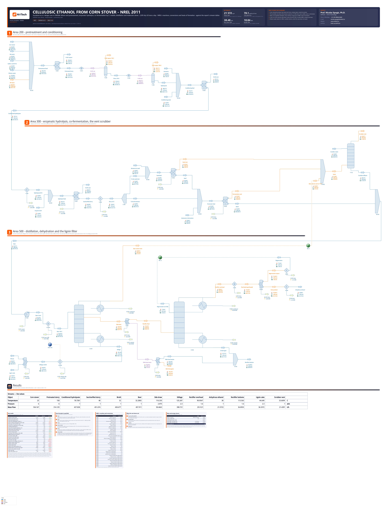

# Cellulosic ethanol from corn stover: NREL's 2011 design case - dilute-acid pretreatment, enzymatic hydrolysis, co-fermentation and distillation to anhydrous ethanol

**Category:** bioprocesses
**Status:** community
**DWSIM version:** 10.2.13
**Language:** English
**Contributor:** Prof. Nicolas Spogis, Ph.D. (@Spogis), AI4Tech · nicolas.spogis@ai4tech.ai · www.ai4tech.ai

## Summary

The National Renewable Energy Laboratory's design case for second-generation ethanol (Humbird et al., 2011): 2,000 dry tonnes a day of corn stover, pretreated with dilute sulfuric acid, hydrolysed with cellulase, co-fermented by *Zymomonas mobilis* and distilled to anhydrous ethanol. The case builds three of its areas in steady state - pretreatment and conditioning (200), enzymatic hydrolysis and fermentation (300), product recovery (500) - from NREL's stream tables, conversions and component data. It has 32 compounds, 17 of them made from NREL's formulas and heats of formation, and 38 conversion reactions. DWSIM makes 21.6 t/h of 99.4 % ethanol, 78.1 gallons per dry US ton against NREL's 79. The case also shows how to model a lignocellulosic slurry that DWSIM solves in under three minutes, and what it takes to converge an ethanol rectifier fed a vapour side draw.

## Process description

Three of NREL's areas, as the flowsheet draws them.

**Area 200 - pretreatment and conditioning.**
- The stover is mixed with hot water, 93 % sulfuric acid, dilution water and high-pressure steam (M-201). NREL's model puts all the acid into the pretreatment reactor block, and so does the case.
- R-201 hydrolyses the hemicellulose at 158 °C: 90 % of the xylan to xylose, 5 % to furfural, 2.4 % to oligomers; 9.9 % of the glucan to glucose; all the sucrose to HMF and glucose; 5 % of the lignin dissolves. NREL injects the reactor's steam "to maintain" its temperature. The case does the same: the build sizes that steam, by a secant over solves of the pretreatment alone, until R-201 leaves at 158.0 °C.
- The slurry is let down through V-201 and flashed at 2.6 atm (T-203, about 130 °C), then through V-202 at 1 atm (T-204). The vapours carry water, furfural and acetic acid to wastewater treatment.
- R-202 neutralises the sulfuric and acetic acids left with ammonia, with no excess (NREL's Appendix C: 0 % stoichiometric excess). The ammonia is measured on the slurry: the build solves the pretreatment, reads the acids, and feeds 2 mol of ammonia per mol of sulfuric acid and 1 per mol of acetic acid. Dilution water brings the slurry to about 20 % solids. 1 % of the xylose and of the minor sugars is lost to tar (Appendix C).

**Area 300 - enzymatic hydrolysis and co-fermentation.**
- The conditioned slurry is cooled to 49 °C (E-301) and gets the enzyme broth, NREL's stream 422 as a stream: area 400, which makes the cellulase, is not modelled.
- R-301 holds 48 °C: 90 % of the remaining glucan to glucose, 5.2 % to oligomers and cellobiose.
- E-302 cools the slurry to 32 °C, and S-301 sends 10 % of it to the seed train.
- R-302, the seed train, and R-303, the fermentors, run NREL's Tables 11 and 14 at 32 °C. In R-303, 3 % of every sugar is first lost to contamination as lactic acid (Table 12), then *Z. mobilis* converts 95 % of the glucose and 85 % of the xylose to ethanol. Each is given the ammonia its cells' nitrogen takes, worked out from the sugars entering it with the reactor's own arithmetic.
- The vents go to the scrubber, the broth to the beer well.

**Area 500 - product recovery.**
- The beer - the broth and the scrubber's effluent (M-501) - is pumped to 6 atm (P-501) and heated to 103 °C against the stillage in NREL's economizer, drawn as its two sides: E-501A heats the beer, SPEC-501 hands its duty to E-501B, which takes it from the stillage.
- D-501, the beer column, strips the ethanol: the CO2 and a little ethanol leave its top as vapour to the scrubber; a vapour side draw at 37 % ethanol goes to the rectifier.
- X-501 and X-502 part the side draw's traces from its ethanol and water: the gases leave on their own, the furfural and the rest join the rectifier's bottoms in X-503 - where NREL's streams 511 and 516 have them. They are modelling devices, not NREL equipment (see the notes).
- D-502, the rectifier, takes the side draw's ethanol and water and the molecular sieve's regeneration, and makes a vapour of 90.6 % ethanol. Its bottoms, water, are what NREL sends back to the pretreatment.
- The overhead is superheated to 116 °C (E-503). M-503, the molecular sieve, takes 95 % of the water and 19.8 % of the ethanol into its regeneration stream (NREL's streams 511 and 512). The product is condensed and cooled to 38 °C (E-504); the regeneration is condensed to 71 °C (E-505) and returns to D-502.
- T-512 scrubs the fermentation vents and the beer column's vent with water.
- The stillage, cooled in E-501B, is pressed in S-505: 98 % of the solids and 3.7 % of the liquid go to the lignin cake (NREL's streams 508 and 571); the filtrate goes to wastewater treatment.

Out of the case: feed handling (area 100), cellulase production (400), wastewater treatment (600), storage (700), the boiler and turbogenerator (800), utilities (900). The lines are coloured by phase: blue liquid and slurry, orange vapour, purple two-phase.

## Feed and operating conditions

| Item | Value | Unit | Notes |
|---|---|---|---|
| Corn stover | 104,167 (83,333 dry) | kg/h | Humbird et al. (2011), stream 105 and Table 4: glucan 35.05, xylan 19.53, arabinan 2.38, galactan 1.43, mannan 0.60, lignin 15.76, extractives 14.65, ash 4.93, protein 3.10, acetate 1.81, sucrose 0.77 % of the dry matter; 20 % moisture |
| Acid and water to pretreatment | 1,842 kg/h of H2SO4 (93 %), 140,850 kg/h of water at 95 °C, 36,821 kg/h at 114 °C | | streams 232, 212 and 516 - the last NREL's rectifier bottoms, fed here as fresh water |
| Steam | 3,490 kg/h to the presteamer, the reactor's sized for 158 °C | kg/h | 268 °C, 13 atm (streams 215, 216) |
| Pretreatment reactor | 158 °C, 6.0 atm | | NREL: 158 °C, 5.7 atm, "just at the bubble point" (see the notes) |
| Flashes | 2.6 atm, 1 atm | | streams 218 and 224 |
| Conditioning | ammonia, no excess; 150,310 kg/h of water at 33 °C | | Appendix C; stream 274 |
| Enzyme broth | 13,836 kg/h: 620 of cellulase, 108 of cells | kg/h | stream 422 at 29 °C |
| Hydrolysis, fermentation | 48 °C; 32 °C; 10 % of the slurry to the seed train | | Section 3.3.2 |
| Beer column D-501 | 15 stages + condenser and reboiler; feed on 2, vapour side draw on 4; molar reflux 3; 2.0 atm at the top, 2.3 at the bottom | | 32 trays at 48 %, feed on tray 4, side draw on tray 8 (Section 3.5.2); the side draw's molar flow and the vent as NREL's streams 510 and 509 |
| Rectifier D-502 | 34 stages + condenser and reboiler; side draw on 25, regeneration on 11; molar reflux 3.9; 1.6 atm; the bottoms share set for a 91.5 % overhead | | 45 trays at 76 %, trays 33 and 14; NREL's reflux is 3.5, its overhead 92.5 % (see the notes) |
| Molecular sieve M-503 | 95 % of the water, 19.8 % of the ethanol to the regeneration | | streams 511 and 512; superheated to 116 °C, product at 38 °C, regeneration back at 71 °C |
| Vent scrubber T-512 | 26,836 kg/h of water at 33 °C, 5 stages, 1 atm | | stream 524; the stages the case's |
| Lignin filter S-505 | 98 % of the solids and 3.7 % of the liquid to the cake | | streams 508 and 571 |

## Thermodynamics

- **Property package:** NRTL, on its "ExpData" enthalpies.
- **Why this package:** the columns separate ethanol from water, with acetic acid and furfural, at 1.6 to 2.3 atm: an activity model on the liquid side, an ideal gas on the vapour side. The sugars, salts, oligomers and solids do not evaporate, and they enter the liquid's activity as ideal solutes.
- **Interaction parameters:** DWSIM's NRTL databank, except ethanol / water. That pair is refit to Cornell & Montonna's (1933) 43 points at 1 atm (A12 = -68.84, A21 = 1291.74 cal/mol, alpha 0.294). DWSIM's pair puts 8 to 13 % less ethanol in the vapour over a dilute beer than the data. The pairs DWSIM has no record for are estimated with UNIFAC when it loads the package (furfural / ethanol, furfural / acetic acid and others).
- **Heats of formation:** NREL's, from Appendix D (component properties), for every compound that reacts, in the phase it reacts in: the liquid's for what reacts dissolved or suspended (ammonia included), the gas's for CO2 and oxygen. DWSIM's activity models compute enthalpy on "ExpData", the liquids' own heat capacities. On it a liquid at 25 °C sits at its ideal gas's enthalpy, so the databank's ideal-gas heat of formation becomes the liquid's: water is formed at -241.8 kJ/mol instead of -285.8. The case keeps "ExpData" and writes each liquid's own value into the datum. "Ideal" gets the 25 °C value right, but it heats liquid water at 4.75 kJ/(kg K) between 100 and 158 °C, against the steam tables' 4.28. With NREL's values, DWSIM's 38 conversion reactions take NREL's heats: +4.2 kJ/mol for cellulose hydrolysed, -84.1 for glucose fermented to ethanol and CO2.
- **Compounds DWSIM does not have** - glucan, xylan, mannan, lignin, protein, ash, cell mass, cellulase, tar, the oligomers, extractives, soluble lignin, HMF, succinic acid and the two ammonium salts - are made from NREL's formulas and heats of formation. They are non-volatile and phase-blind: one heat capacity as solid, liquid and gas, no heat of vaporisation.
  - The heat capacity is 1.3 kJ/(kg K), DWSIM's own generic biomass value; ash, as CaO, takes 0.8. DWSIM's biomass files hold it in J/(kg K) where DWSIM reads J/(kmol K), which leaves biomass with almost no heat capacity.
  - The insolubles are **pseudo-polymers of 1,000 units**, carried in the liquid: their molar mass, elements and heat of formation are a thousand monomers', their heat capacity per kilogram the monomer's, and each reaction is written per monomer with the insoluble's coefficient divided by 1,000. Their mole fraction is then a thousandth of a monomer's, and they do not dilute the liquid's activity. A column computes a solid as a liquid anyway; phase-blind, it is right there on either enthalpy model.
- **DWSIM's sugars** (glucose, xylose, mannose, sucrose, xylitol) heat as liquids at about 4.2 kJ/(kg K) on "ExpData", a water's heat capacity. The case gives them the carbohydrates' 1.3. On DWSIM's values the pretreatment reactor, which turns xylan into dissolved xylose at 150 °C, cooled 6.5 K where NREL's heats of reaction move it by a tenth of a kelvin.

## Tuning and convergence notes

- **The enthalpy model.** NRTL is created on "ExpData", where a liquid at 25 °C sits at its ideal gas's enthalpy, so a reaction among liquids takes the gas-phase heat. Cellulose hydrolysed to glucose took +182 kJ/mol in a reactor at 25 °C, where the heats of formation give +4.5. "Ideal" would fix that and heat hot water 11 % too dear. The case keeps "ExpData" and writes each liquid's measured value into the datum. The skill's `set_formation_enthalpy` reads the package's liquid function for it, since pure glucose at 25 °C flashes to a solid.
- **No forced solids.** As DWSIM forced solids the insolubles made every flash a solid-liquid-vapour one: the pretreatment area solved in 37 s instead of 4, and a 60 % glucose syrup crystallised in it. As pseudo-polymers in the liquid nothing crystallises, and the whole plant solves in under three minutes. DWSIM's template also leaves the critical compressibility at zero, which gave an empty reactor outlet a NaN enthalpy: the made compounds have it filled in.
- **The pretreatment reactor at 6.0 atm.** NREL holds it at 5.7 atm, "just at the bubble point". DWSIM puts the slurry's bubble point there at 158.1 °C. One hundredth of a kelvin past it, its flash jumped to a root at 335 °C with 231 of 314 t/h boiled off, and solved. 0.3 atm more keeps 158 °C liquid; the flashes after it are NREL's.
- **Quantities sized on the flowsheet itself, by solves of its first part before the whole is built:**
  - the reactor's steam, by a secant on 158 °C;
  - the ammonia, 2 mol per mol of sulfuric acid and 1 per mol of acetic acid left after the flashes, and what the cells take in the seed train and the fermentors;
  - D-501's bottoms, as the share of its feed that leaves NREL's side draw and vent.
- **D-501 on Wang-Henke, with the reflux and the bottoms share.** Naphtali-Sandholm ran out of iterations on every specification tried. "Feed Recovery" gives the bottoms as a share of the feed, so the vent follows the scrubber's recycle. Specified by NREL's ethanol loss instead (0.8 %), the column needed 9 % more boilup than NREL's: with the side draw fixed, that vapour left through the vent, the scrubber returned its ethanol, and the loop ran away. A heat-duty specification did not answer in 400 s.
- **D-502 at a molar reflux of 3.9, where NREL's is 3.5.** On the refit ethanol / water pair the rectifier pinches below about 3.85: between the side draw and the top its liquid goes from 28 to 82 % ethanol while its temperature moves 3.5 K, and the bubble-point method cannot follow it. At 3.5 it converged with up to 30 stages, leaving 0.4 % ethanol in the bottoms; with 32 or more no method converged - Wang-Henke, its modified form, Naphtali-Sandholm, from DWSIM's estimates or from a converged profile. At 3.9 the 34 stages converge; the reboiler pays for it (Results).
- **D-502 separates ethanol from water only.** With the side draw's furfural in it - light over water, heavy under ethanol, it gathers between the feeds - or its CO2, the column did not converge. X-501 and X-502 send them around it to where NREL's streams put them: the furfural into the bottoms (X-503), the gases out on their own. Mixed into the hot overhead, the CO2 sent DWSIM's pressure-enthalpy flash to a root at 541 °C. NREL carries those 27 kg/h of CO2 into the product; DWSIM's beer column leaves 0.5 kg/h in the side draw.
- **D-502 starts from its own profile.** DWSIM's estimates take every feed as liquid - 884 mol/s of vapour on every stage where 186 rise below the side draw - and on the case's 32 compounds the column did not converge from them in 150 s. The build first solves D-502 on ethanol and water alone, in a small flowsheet of its own (5 s), and gives the plant's column that profile (`column_profile`, `set_column_estimates`): it converges in seconds.
- **D-502's bottoms share leaves its overhead room.** NREL's share puts every mole of ethanol into an overhead at 92.5 %, which at this reflux is the edge of the column's pinch: from DWSIM's estimates it took 949 of its 1,000 iterations, and with 2 % more regeneration it converged from no start at all. The case sets the share for a 91.5 % overhead (`D502_TOP`), and the column then converged in 1 to 3 s with 3 % more regeneration or 2 % more ethanol in the side draw (the skill's example 37). Here the beer column sends it 1.2 % less ethanol than NREL's, and the overhead comes out at 90.6 %: about 5 % of room. A change that brings D-502 much more ethanol - a richer beer - may need `D502_TOP` lowered with it.
- **T-512 on Naphtali-Sandholm.** Created on Sum Rates, it failed its own mass-balance check on oxygen, which it hardly absorbs (skill F50).
- **Two recycles, and every column started from its last solution.** REC-1 tears the beer column's vent on its way to the scrubber, REC-2 the sieve's regeneration back to D-502. Their first guesses are what a converged solve gives them. The economizer as one exchanger block closed a third loop through D-501; drawn as its two sides, with the beer's outlet temperature specified, it needs none. Each column re-solves from its own last solution (`keep_warm`): the beer column took 17.7 s on its first pass and 2 s after. Six passes and 457 s became two or three passes and under three minutes, the results unchanged.
- **The rectifier's bottoms are not recycled.** NREL sends them back to dilute the acid. The case feeds the same flow as fresh water and reports the bottoms beside it: closing that loop would re-solve both columns on every pass through the pretreatment.

## Results

The case follows NREL to within a few per cent where it takes NREL's design as given. It parts from it in three places, each the model's:

- **The rectifier's energy.** At a molar reflux of 3.9, with its overhead held at 90.6 % to keep the column off its pinch, the condenser removes 14 % and the reboiler 65 % more than NREL's. The side draw brings most of the vapour, so the reboiler only makes up the rest: a little more reflux, and a little more water carried up, is a lot more boil-up. The bottoms come out with almost no ethanol where NREL leaves 0.05 %, and the product at 99.35 % where NREL's is 99.5.
- **The beer column's losses.** At NREL's reflux, side draw and duty (38.5 MW against 38.4), DWSIM's beer column leaves 2.0 % of the ethanol in the stillage against NREL's 0.8 %. That is the 1.1 % of product and of yield the case is short of. Its vent carries more CO2: the beer brings 661 kg/h of it dissolved, where NREL's stream 509 vents 522.
- **The pretreatment.** The reactor takes 9 % more steam to reach 158 °C, and its flashes give 18 % less vapour than NREL's. This was not traced. The case's reactor stays 0.3 atm above its bubble point where NREL's sits at it, and the heat capacities of the sugars and of the made compounds are the case's.

| Quantity | DWSIM | Reference | Reference source | Rel. error |
|---|---|---|---|---|
| Anhydrous ethanol, kg/h | 21 572 | 21 808 | Humbird et al. (2011), stream 515 | −1.08 % |
| Ethanol in the product, wt % | 99.35 | 99.50 | Humbird et al. (2011), stream 515 | −0.15 % |
| Ethanol yield, gal/dry US ton | 78.1 | 79.0 | Humbird et al. (2011), Table 34 | −1.11 % |
| Yield on the carbohydrates' carbon, % | 75.5 | 76.0 | Humbird et al. (2011), Section 5.1 | −0.67 % |
| Steam to hold the pretreatment at 158 C, kg/h | 26 820 | 24 534 | Humbird et al. (2011), stream 216 | +9.32 % |
| Flash vapour, 130 C and 100 C, kg/h | 27 619 | 33 648 | Humbird et al. (2011), streams 218 and 224 | −17.92 % |
| Ammonia for conditioning, no excess, kg/h | 1 018 | 1 051 | Humbird et al. (2011), stream 273 | −3.11 % |
| Conditioned hydrolysate, C | 78.7 | 78.0 | Humbird et al. (2011), stream 301 | +0.21 % |
| Glucose after enzymatic hydrolysis, wt % | 6.57 | 6.70 | Humbird et al. (2011), Section 3.3.2 | −1.89 % |
| Soluble sugars after hydrolysis, wt % | 11.46 | 11.70 | Humbird et al. (2011), Section 3.3.2 | −2.03 % |
| CO2 from the fermentors, kg/h | 20 106 | 20 205 | Humbird et al. (2011), streams 305 and 317 | −0.49 % |
| Ethanol in the beer, kg/h | 21 931 | 21 941 | Humbird et al. (2011), stream 501 | −0.05 % |
| Economizer E-501, the beer to 103 C, MW | 34.47 | 34.19 | Humbird et al. (2011), QH512 | +0.84 % |
| Stillage leaving the economizer, C | 44.6 | 47.0 | Humbird et al. (2011), stream 508 | −0.73 % |
| Beer column reboiler, MW | 38.48 | 38.40 | Humbird et al. (2011), QRD501 | +0.20 % |
| Side draw to the rectifier, kg/h | 58 466 | 58 629 | Humbird et al. (2011), stream 510 | −0.28 % |
| Ethanol in the side draw, wt % | 36.7 | 37.0 | Humbird et al. (2011), stream 510 | −0.92 % |
| Beer column vent, kg/h | 723 | 610 | Humbird et al. (2011), stream 509 | +18.59 % |
| Ethanol lost in the stillage, of the beer's, % | 2.03 | 0.84 | Humbird et al. (2011), streams 501 and 507 | +142.23 % |
| Rectifier overhead, ethanol, wt % | 90.55 | 92.50 | Humbird et al. (2011), stream 511 | −2.11 % |
| Rectifier condenser, MW | 30.84 | 26.96 | Humbird et al. (2011), QCD502 | +14.40 % |
| Rectifier reboiler, MW | 10.84 | 6.58 | Humbird et al. (2011), QRD502 | +64.88 % |
| Ethanol in the rectifier bottoms, wt % | 0.000 | 0.050 | Humbird et al. (2011), Section 3.5.2 | −99.96 % |
| Rectifier bottoms, the water reused, kg/h | 36 893 | 36 821 | Humbird et al. (2011), stream 516 | +0.20 % |
| Ethanol in the scrubber vent, kg/h | 1.1 | 4.0 | Humbird et al. (2011), stream 550 | −72.67 % |
| Lignin cake, kg/h | 36 337 | 36 538 | Humbird et al. (2011), stream 571 | −0.55 % |
| Lignin cake moisture, wt % | 36.0 | 35.0 | Humbird et al. (2011), Section 3.5.2 | +2.99 % |

## Files

- `cellulosic-ethanol-from-corn-stover.dwxmz` - the DWSIM flowsheet, with AI4Tech's title block.
- `cellulosic-ethanol-from-corn-stover.png` - the flowsheet as DWSIM draws it.

## Confidentiality

Everything in the case is public: NREL's technical report, its stream tables and its property data. No client and no plant data are in it. The contributor's contact is in the flowsheet's title block with the maintainer's agreement.

## References

- Humbird, D., Davis, R., Tao, L., Kinchin, C., Hsu, D., Aden, A., Schoen, P., Lukas, J., Olthof, B., Worley, M., Sexton, D., Dudgeon, D. (2011). *Process Design and Economics for Biochemical Conversion of Lignocellulosic Biomass to Ethanol: Dilute-Acid Pretreatment and Enzymatic Hydrolysis of Corn Stover.* NREL/TP-5100-47764, National Renewable Energy Laboratory, Golden, CO. https://www.osti.gov/biblio/1013269
- Cornell, L. W., Montonna, R. E. (1933). Studies in distillation: liquid-vapor equilibrium in the system ethanol-water. *Industrial & Engineering Chemistry* 25(12), 1331-1335 - the ethanol / water pair.
