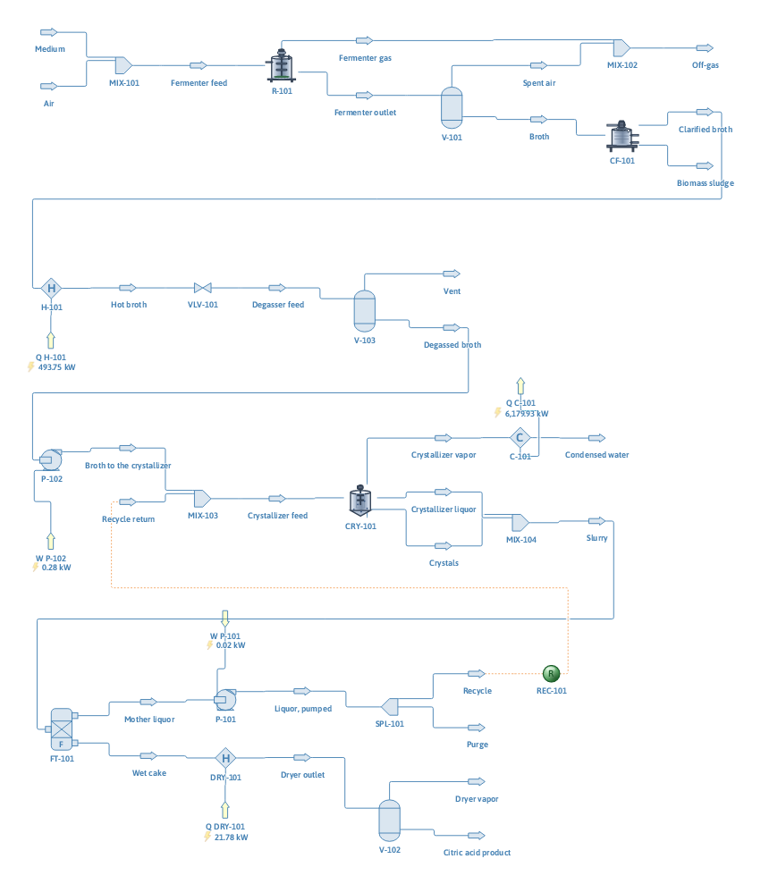
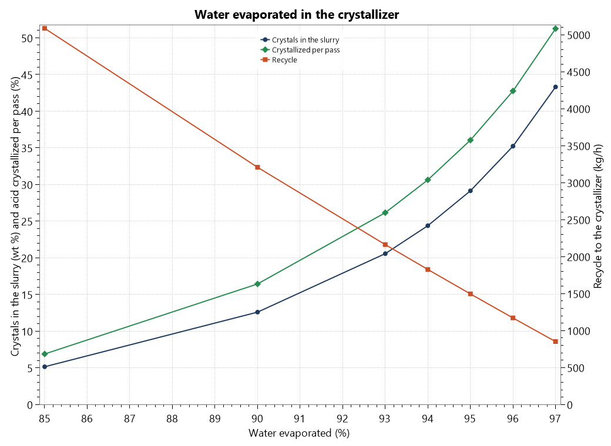
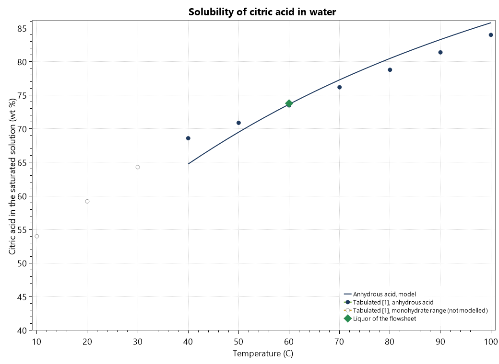

# Citric acid by fermentation of glucose, with evaporative crystallization

**Category:** bioprocesses
**Status:** community
**DWSIM version:** 10.2.17 or later
**DWSIM edition:** open source
**Language:** English
**Contributor:** Daniel Wagner Oliveira de Medeiros (@DanWBR)

> **Requirement:** The case needs DWSIM 10.2.17 or later, for the Crystallizer with the solubility from the property package, for the flash with solids in a mixture that has compounds without a vapor pressure correlation, and for the filter, the dryer and the separator with a stream without flow, which the study below needs.

## Summary

Citric acid is made by the aerobic fermentation of a sugar and recovered from the broth as crystals. This case takes 1500 kg/h of glucose through a Bio Reactor, the removal of the spent air and of the biomass, a degassing step, an evaporative crystallizer that works above the temperature where the anhydrous acid is the stable solid, a filter and a vacuum dryer, with recycle of the mother liquor. The solubility of citric acid in water comes from an NRTL pair fitted to tabulated values. The plant delivers 864 kg/h of citric acid with 99.86 wt % purity, 0.58 kg per kg of glucose fed.

## Process description

**Fermentation:** MIX-101 joins the medium and the air. R-101, a Bio Reactor of 600 m3 in continuous operation, converts the glucose to citric acid, biomass, carbon dioxide and water, and takes the oxygen and the ammonia it needs from the feed. Its second outlet carries the carbon dioxide and the oxygen left.

**Gas and biomass:** V-101 separates the nitrogen of the air from the broth, and MIX-102 joins the two gas streams into the off-gas. The disk stack centrifuge CF-101 takes 99.5 % of the biomass out as a sludge, with 2 % of the liquid.

**Degassing:** H-101 heats the clarified broth to 66 °C and VLV-101 lets it down to 0.25 bar. In V-103 a little water flashes and carries out the gases the broth held dissolved. P-102 brings the broth back to atmospheric pressure.

**Crystallization:** MIX-103 joins the broth and the recycled liquor. CRY-101 evaporates 96 % of the water at 60 °C and C-101 condenses it. MIX-104 joins the crystals and the liquor into the slurry.

**Filtration and drying:** FT-101 leaves a cake with 10 wt % of liquor. DRY-101 heats the cake to 70 °C at 0.1 bar and V-102 separates the water vapor from the product.

**Recycle:** P-101 pumps the mother liquor, SPL-101 purges 15 % of it, and the recycle block REC-101 closes the loop at MIX-103.

## Feed and operating conditions

| Item | Value | Unit | Notes |
|---|---|---|---|
| Medium | 10517 | kg/h | 30 °C; 1500 kg/h of glucose (150 g/L), 12 kg/h of ammonia, 5 kg/h of biomass as inoculum |
| Air | 6000 | kg/h | 30 °C; 1400 kg/h of oxygen |
| Bio Reactor R-101 | 600 m3, continuous, isothermal, aerobic | | Monod: maximum growth 0.10 1/h, Ks 1 g/L; 0.10 g of biomass and 0.80 g of citric acid per g of glucose |
| Centrifuge CF-101 | disk stack | | 99.5 % of the biomass and 2 % of the rest to the sludge |
| Degasser H-101 / VLV-101 / V-103 | 66 °C, 0.25 bar | | |
| Crystallizer CRY-101 | 60 °C, 96 % of the water evaporated | | evaporative mode, solubility from the property package |
| Condenser C-101 | 40 | °C | 0.20 bar |
| Filter FT-101 | 0.5 bar of pressure drop, 10 wt % of liquor in the cake | | design mode |
| Dryer DRY-101 / V-102 | 70 °C, 0.1 bar | | |
| Purge SPL-101 | 15 | % of the mother liquor | |

## Thermodynamics

- **Property package:** NRTL with solids handled by the default flash (`HandleSolidsInDefaultEqCalcMode`), for the whole flowsheet.
- **Compounds:** citric acid ("Citric acid (anhydrous)") and glucose come from the food properties database of DWSIM, and the biomass is the generic biomass compound. The three don't have a vapor pressure correlation, which is right for them: none of them goes to the vapor.
- **Solubility data:** the solubility of citric acid in water from 10 to 100 °C, in wt % of acid in the saturated solution, as the CRC Handbook values are listed in the PubChem record of citric acid [1]. The values from 40 °C up are those of the anhydrous acid and are the ones used.
- **Citric acid / water pair:** A12 = 4948.7, A21 = -1137.0 cal/mol, alpha = 0.3 (citric acid is compound 1), fitted for this case to the seven values from 40 to 100 °C. The model is 3.8 wt % low at 40 °C, within 0.2 wt % at 60 °C, where the crystallizer works, and 1.9 wt % high at 90 °C. With these energies the water activity of the saturated solution at 60 °C is 0.76.
- **Fusion data of citric acid:** 426.15 K and 26.7 kJ/mol, as in the database. With that enthalpy the model curve is steeper than the table.
- **The monohydrate isn't modelled:** below about 36 °C the stable solid is citric acid monohydrate. DWSIM takes a solid as the pure compound, so the crystallizer, the filter and the dryer stay above that temperature.
- **Other pairs:** the database doesn't have parameters for the pairs of glucose, of citric acid and of the biomass with the other compounds; they are set as ideal pairs.
- **Crystal density of citric acid:** 1665 kg/m3.

## Tuning and convergence notes

- **The fermentation parameters are assumptions:** the growth rate, the saturation constant and the two yields were chosen to give a broth with about 100 g/L of acid, in the range of an industrial fermentation. They don't come from a measured kinetics.
- **The acid forms with the growth in this model:** the Bio Reactor ties the product to the growth of the biomass. An industrial fermentation of citric acid is fed-batch and makes most of the acid after the growth has stopped, under a limitation of nutrients. The steady-state reactor here stands for the average of that cycle.
- **Continuous mode:** the fermenter is a stirred vessel with a continuous feed, at the steady state of its 600 m3. In batch mode the block takes the batch duration as the reaction time and the feed as the charge of the cycles averaged over time.
- **Where the nitrogen of the air goes:** the reactor sends the carbon dioxide and the oxygen left to its gas outlet and keeps the nitrogen with the broth, as a second phase. V-101 separates it.
- **Why the broth is degassed:** the gases dissolved in the broth come out of solution when it is heated, and the Filter block only takes a trace of vapor in its feed (under 0.1 % of the mass). Flashing a little water at 0.25 bar removes them before the crystallizer.
- **Evaporative crystallizer:** the block evaporates the fraction of the water it is given and reports the pressure of its vapor as the vapor pressure of pure water at 60 °C, 0.20 bar. The concentrated solution boils at a lower pressure than that; the rise of the boiling point isn't in the model.
- **One evaporation stage:** the 9100 kg/h of water leave in the crystallizer, at 5880 kW. A plant concentrates the broth first in a multiple-effect evaporator and uses a fraction of that heat.
- **What the purge is for:** the glucose that wasn't converted and what the centrifuge let through stay in the liquor. The purge keeps them from building up; it also takes 151 kg/h of acid.
- **Product purity:** the liquor left in the cake dries onto the crystals, so the product ends with 0.11 wt % of glucose. A plant washes the cake, which the Filter block doesn't do.
- **Smaller evaporation:** with 93 % of the water evaporated or less, the first pass of the recycle doesn't reach saturation. The crystallizer doesn't form crystals, the filter sends everything to the mother liquor and the cake, the dryer and the product stay without flow until the recycle concentrates the solution. The flowsheet goes through those passes and converges.
- **The recycle block uses Wegstein acceleration on every pass** (`AccelerationMethod`, `WegsteinParameters.AccelFreq = 1`, `MaximumIterations = 300`), set from the script that built the case, and the tear stream has a first estimate.
- **Automatic estimation of NRTL pairs is switched off** (`AutoEstimateMissingNRTLUNIQUACParameters`), and the pairs without data are declared with zero energies.
- **The filter area is illustrative:** it comes from the default cake and medium resistances of the block.
- **Mass balance:** feeds 16517.0 kg/h, products 16517.4 kg/h.

## Results

| Quantity | DWSIM | Unit |
|---|---|---|
| Citric acid made in R-101 | 1034 | kg/h, 0.69 kg per kg of glucose |
| Broth | 106 g/L of acid, 8.5 g/L of biomass, 0.3 g/L of glucose | |
| Biomass made | 78 | kg/h |
| Oxygen taken up | 714 | kg/h, 1.19 g/L/h |
| Carbon dioxide made | 634 | kg/h |
| Fermenter cooling | 2852 | kW |
| Product | 863.9 | kg/h |
| Citric acid in the product | 99.86 | wt % |
| Glucose in the product | 0.11 | wt % |
| Product per kg of glucose fed | 0.58 | kg |
| Acid recovered, of the acid made | 83.4 | % |
| Acid in the purge / in the biomass sludge | 151 / 21 | kg/h |
| Water evaporated in CRY-101 | 9103 | kg/h |
| Crystallizer duty CRY-101 / condenser C-101 | 5878 / 6180 | kW |
| Acid crystallized in CRY-101 per pass | 42.8 | % |
| Crystals in the slurry | 35.2 | wt % |
| Liquor at 60 °C | 73.8 | wt % of acid, on water and acid alone |
| Recycle to the crystallizer | 1171 | kg/h |
| Filter area FT-101 | 3.45 | m2 |
| Broth heater H-101 / dryer DRY-101 | 494 / 22 | kW |

The fraction of the water evaporated in the crystallizer, with the same purge:

| Water evaporated, % | Crystals in the slurry, wt % | Crystallized per pass, % | Product per kg of glucose, kg | Recycle, kg/h | Acid in the purge, kg/h | Crystallizer duty, kW |
|---|---|---|---|---|---|---|
| 85 | 5.2 | 6.9 | 0.24 | 5087 | 659 | 5786 |
| 90 | 12.6 | 16.4 | 0.40 | 3208 | 415 | 5830 |
| 93 | 20.6 | 26.2 | 0.49 | 2163 | 279 | 5855 |
| 94 | 24.4 | 30.6 | 0.52 | 1827 | 235 | 5863 |
| 95 | 29.2 | 36.1 | 0.55 | 1496 | 193 | 5870 |
| 96 | 35.2 | 42.8 | 0.58 | 1171 | 151 | 5878 |
| 97 | 43.3 | 51.3 | 0.60 | 851 | 109 | 5886 |

Evaporating more leaves less liquor, so less acid goes to the purge and the recycle shrinks; the slurry gets denser. At 85 % only 7 % of the acid that enters the crystallizer comes out as crystals in each pass, the recycle is four times that of the base case and the purge takes 659 kg/h of acid. The base case stays at 96 %, with 35 wt % of crystals. The duty hardly changes, because most of the water is evaporated in every case.

The solubility of citric acid in water from the model against the tabulated values [1]:

| Temperature, °C | Tabulated [1], wt % | DWSIM, wt % | Difference, wt % |
|---|---|---|---|
| 40 | 68.6 | 64.8 | -3.8 |
| 50 | 70.9 | 69.5 | -1.4 |
| 60 | 73.5 | 73.7 | +0.2 |
| 70 | 76.2 | 77.3 | +1.1 |
| 80 | 78.8 | 80.5 | +1.7 |
| 90 | 81.4 | 83.3 | +1.9 |
| 100 | 84.0 | 85.8 | +1.8 |

The values of the table at 10, 20 and 30 °C (54.0, 59.2 and 64.3 wt %) are in the range of the monohydrate and weren't used.

The case doesn't have a reference from a plant or from another simulator. The comparison of the solubility is the only one against data.

## Files

- `citric-acid-fermentation-evaporative-crystallization.dwxmz` - the DWSIM flowsheet, with the notes, the stream table and the two charts on it.
- `citric-acid-fermentation-evaporative-crystallization.png` - the flowsheet picture.
- `solubility-citric-acid-water.png`, `water-evaporated.png` - the charts above.

## Confidentiality

The flowsheet was put together for this example from the public description of the process. The flows, the fermentation parameters and the operating conditions are illustrative and don't come from any plant or third-party data set.

## References

1. PubChem, citric acid (compound 311), solubility in water from 10 to 100 °C, values of the CRC Handbook of Chemistry and Physics. https://pubchem.ncbi.nlm.nih.gov/compound/311
