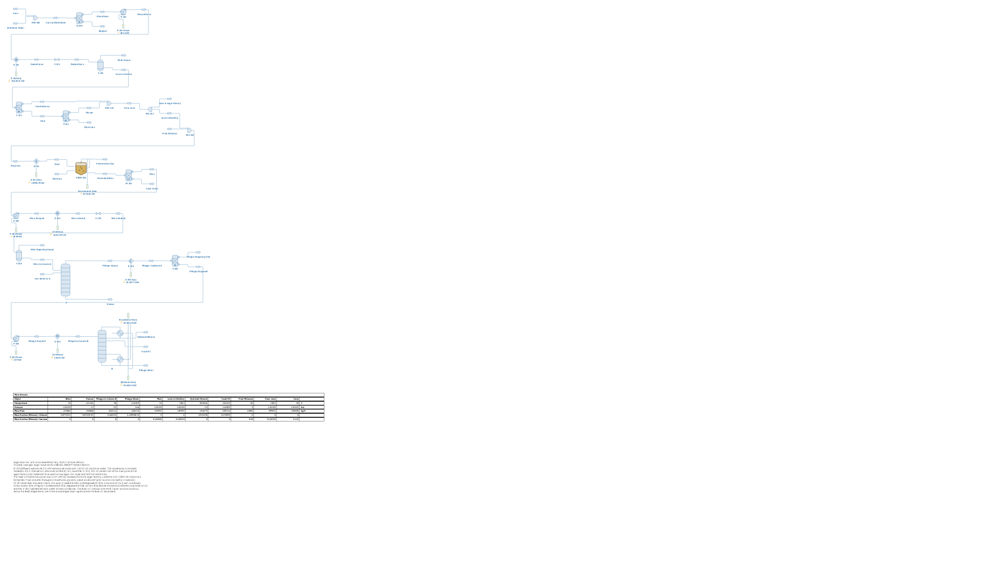

# Sugarcane mill with an annexed distillery: juice split, must with molasses, fermentation and hydrated ethanol with a fusel oil draw

**Category:** bioprocesses
**Status:** community
**DWSIM version:** 10.2.17 or later
**DWSIM edition:** Patreon Edition (Sugar Solutions property package, Alcoholic Fermenter)
**Language:** English
**Contributor:** Daniel Wagner Oliveira de Medeiros (@DanWBR)

> **Requirement:** The Sugar Solutions (S-UNIFAC) property package and the Alcoholic Fermenter belong to DWSIM Patreon. The file opens anywhere, but it only solves where they are licensed.

## Summary

A Brazilian mill crushing 500 t/h of cane, with the distillery annexed to the sugar factory. Half of the clear juice goes to the sugar factory and half to the distillery, where it makes the must together with the final molasses the sugar factory sends back. The Alcoholic Fermenter turns the sugars into a wine at 9.75 °GL, column A strips it with live steam, and column B rectifies the phlegm into 19.4 t/h of hydrated ethanol at 93.2 % m/m (24.1 m³/h at 20 °C, inside the 92.5 to 94.6 °INPM of ANP). Column B draws the fusel oil where the higher alcohols build up, and its stages below the feed are three-phase stages, on which the liquid may split into two. Of the 18.97 t/h of ethanol the yeast makes, 95.5 % ends up in the hydrated ethanol. The whole flowsheet solves in about 77 s, and in about 85 s when the saved file is solved again.

## Process description

**Extraction and juice treatment:** the diffuser D-100 (a component separator) extracts 96.5 % of the dissolved solids of the cane with 150 t/h of imbibition water at 70 °C. The mixed juice is pumped to 3.5 bar (P-101), heated to 105 °C (E-101), flashed to 1 atm (V-101, V-102) and clarified (C-101, with the mud filter F-101 returning 85 % of the juice in the mud).

**Juice split:** SPL-101 sends half of the clear juice (499.9 t/h at Bx 14.7) to the sugar factory and half to the distillery. The sugar factory is not modelled here (the raw-sugar-mill case is one); it appears as the juice it takes and the final molasses it returns.

**Must and fermentation:** the distillery juice and 10 t/h of final molasses (Bx 80, purity 55, the "Final molasses" preset of the package) make 259.9 t/h of must at Bx 17.3 and 15.9 % of total reducing sugars (ART), cooled to 32 °C in E-201. FERM-201, the Alcoholic Fermenter, inverts the sucrose and converts the reducing sugars into ethanol and carbon dioxide (90 % of the sugar consumed), glycerol, yeast, acetic and lactic acids and the higher alcohols, represented by 3-methyl-1-butanol (isoamyl alcohol, the main compound of fusel oil). Ammonia in the nutrient stream feeds the yeast growth, and the heat of fermentation leaves through an energy stream. CF-201 separates the yeast cream.

**Wine heating and degassing:** the wine is pumped (P-202), heated to 88 °C (E-202), let down to 1.6 bar (V-202) and degassed in V-203, which vents the carbon dioxide dissolved in the wine.

**Column A:** 16 stages at 155 kPa at the top, without condenser or reboiler. The wine enters on the top stage and 42 t/h of live steam at 2.5 bar under the bottom stage. The top vapour is the phlegm; the vinasse leaves the bottom.

**Phlegm:** E-203 condenses the phlegm vapour to 85 °C. V-204 vents the carbon dioxide and the ammonia it still carries (a component separator standing for the degassing of the phlegm: a total condenser cannot take them). P-203 pumps the phlegm to 2.5 bar and E-204 brings it to 90 °C, the feed of column B.

**Column B:** 60 trays with a Murphree efficiency of 0.6, a total condenser and a reboiler, 130 kPa at the top and 36 kPa of pressure drop: the rectifier and the stripping section below it (B and B1 of a Brazilian distillery) as one column, with textbook values. The phlegm enters on stage 46, with 15 trays below it. The specifications are a reflux ratio of 3 and 2e-5 (molar) of ethanol in the phlegm water. The fusel oil leaves as a liquid draw of 400 kg/h on stage 56, where the isoamyl alcohol peaks. Stages 46 to 61 are three-phase stages (Column > Three-phase stages): on them the solver tests the liquid for a split into two liquids and uses the K-values of the total liquid.

## Feed and operating conditions

| Item | Value | Unit | Notes |
|---|---|---|---|
| Cane | 500 | t/h | 30 °C |
| Cane composition | fibre 13, sucrose 13.5, glucose 0.35, fructose 0.35, ash 0.5, organic non-sugars 0.8, mud 0.5, water 71 | % | |
| Imbibition water | 150 | t/h | 70 °C, 30 % on cane |
| Juice heater | 105 | °C | at 3 bar, then flashed to 1 atm |
| Juice to the distillery | 50 | % | of the clear juice |
| Final molasses from the sugar factory | 10 | t/h | Bx 80, purity 55, 60 °C |
| Fermentation | 32 / 34 | °C | must / wine |
| Wine heating | 88 | °C | then 1.6 bar |
| Column A | 16 stages, 155 / 170 | kPa | top / bottom |
| Live steam to column A | 42 | t/h | 2.5 bar, saturated |
| Phlegm to column B | 90 | °C | 2.2 bar |
| Column B | 62 stages (condenser, 60 trays at E = 0.6, reboiler) | | feed on stage 46 |
| Column B pressures | 130 / 166 | kPa | top / bottom |
| Column B specifications | reflux ratio 3; ethanol in the phlegm water 2e-5 | molar | |
| Fusel oil draw | 400 | kg/h | stage 56, liquid |
| Three-phase stages | 46 to 61 | | |

## Thermodynamics

- **Property package:** Sugar Solutions (S-UNIFAC), DWSIM Patreon, for every stream, the fermenter and both columns.
- **Why this package:** it covers the whole mill with one model. The sugars, the ash and the organic non-sugars follow S-UNIFAC (Spiliotis and Tassios, 2000) with the terms fitted to cane juices and syrups; water, ethanol and the other compounds follow NRTL, with the pairs of the ethanol distillation (ethanol-water with temperature-dependent parameters, and the higher alcohols from DECHEMA) ahead of the DWSIM database. The package also reports the Brazilian indicators on every stream (Brix, purity, ART, °GL and °INPM).
- **Compounds:** water, the three sugars, ethanol, carbon dioxide, ammonia, glycerol, acetic and lactic acids from the DWSIM databases; sugarcane fibre, cane ash, cane organic non-sugars, cane mud solids, the yeast biomass and 3-methyl-1-butanol come with DWSIM as JSON compounds.

## Tuning and convergence notes

- **Column B starts from a converged profile:** From the default estimates, Naphtali-Sandholm doesn't reach the specifications of column B, and a warm start by the Inside-Out solver at a low reflux leaves it too far from them: on two phlegms 1.5 % apart, one converged in two minutes and the other didn't in ten. The flowsheet is built with the converged profile of this column (stage temperatures, flows and compositions) as the column's initial estimates, and Naphtali-Sandholm goes from there to the specifications in about a minute. The column keeps its last solution as estimates for the next solve.
- **Where the fusel oil goes:** The isoamyl alcohol builds up below the feed, where the liquid is nearly water. With the draw higher up (stage 51) it reaches 7 % (molar) on stages 56 to 58, the liquid splits into two on stages 54 to 60, and half of it leaves with the phlegm water. Drawn on stage 56, 99.4 % of it leaves in the fusel oil; stages 56 and 57 still hold two liquids, and the three-phase stages put both of them in the draw.
- **Phlegm condensing:** at 145 kPa the phlegm starts to boil below 95 °C. E-203 cools it to 85 °C, so the pump and E-204 take only liquid; at 2.2 bar it enters column B at 90 °C, below its bubble point.
- **Gases:** the carbon dioxide and the ammonia of the wine reach the top of column A. A total condenser on column B cannot take them, so V-204 vents them before the column.

## Results

| Quantity | DWSIM | Notes |
|---|---|---|
| Mixed juice / clear juice | 514.1 / 499.9 t/h | Bx 14.7 |
| Juice to the distillery | 249.9 t/h | |
| Must | 259.9 t/h, Bx 17.25, ART 15.9 % | 32 °C |
| Wine | 235.9 t/h, 7.73 % m/m ethanol, 9.75 °GL | ART left 0.09 % |
| Ethanol made | 18.97 t/h | |
| Fermentation heat | 4.92 | MW |
| Fermentation gas | 19.05 t/h, 1.9 % m/m ethanol | without a CO2 scrubber |
| Phlegm vapour | 42.65 t/h, 42.6 % m/m ethanol | 105.7 °C |
| Vinasse | 234.9 t/h, 0.00 % ethanol | 115.4 °C |
| Hydrated ethanol | 19.43 t/h, 93.24 % m/m, 95.6 °GL | 24.1 m³/h at 20 °C, 85.0 °C at the condenser |
| Fusel oil | 0.31 t/h, 17.1 % m/m ethanol, 46.3 kg/h of isoamyl alcohol | |
| Phlegm water | 22.82 t/h, 0.01 % ethanol | 114.4 °C |
| Ethanol in the hydrated ethanol | 95.5 % | of the ethanol made |
| Column B reboiler / condenser | 20.7 / 20.1 | MW |
| Juice heater E-101 / must cooler E-201 / wine heater E-202 | 35.6 / 18.6 / 14.3 | MW |
| Phlegm condenser E-203 / preheater E-204 | 20.1 / 0.24 | MW |
| Mass balance | closes to 1.5e-3 t/h | on 702.3 t/h in |

**Where the ethanol goes:** of the 0.86 t/h that doesn't reach the hydrated ethanol, 0.36 t/h leaves with the fermentation gas, 0.36 t/h with the yeast cream (2 % of the wine goes with the yeast), 0.06 t/h with the wine degassing vapour and 0.06 t/h with the fusel oil. A CO2 scrubber and the recovery of the fusel oil washings would bring most of it back.

**Steam:** the 42 t/h of live steam to column A and the 20.7 MW of the column B reboiler (about 34 t/h of 2.5 bar steam) make about 3.2 kg of steam per litre of hydrated ethanol, in the range of Brazilian distilleries without heat integration. The wine heater, the phlegm condenser and the column B condenser are not integrated here.

## Files

- `sugarcane-mill-annexed-distillery.dwxmz`: the DWSIM flowsheet.
- `sugarcane-mill-annexed-distillery.png`: the flowsheet.
- The flowsheet is built by `SugarEthanolMillTest.cs` in the DWSIM FluentAPI tests, which also checks the mass balance and the strength of the hydrated ethanol; `SugarEthanolMillColumnB.cs` holds the converged profile of column B.

## Confidentiality

The cane composition, the operating conditions and the column geometries are typical values for a Brazilian mill, chosen for this case. Plant data weren't used.

## References

- E. Hugot, *Handbook of Cane Sugar Engineering*, 3rd ed., Elsevier, 1986.
- P. Rein, *Cane Sugar Engineering*, Bartens, 2007.
- N. Spiliotis, D. Tassios, "A UNIFAC model for phase equilibrium calculations in aqueous and nonaqueous sugar solutions", *Fluid Phase Equilibria* 173 (2000) 39-55.
- Agência Nacional do Petróleo, Gás Natural e Biocombustíveis (ANP), Resolução nº 907/2022, specifications of ethanol fuel.
