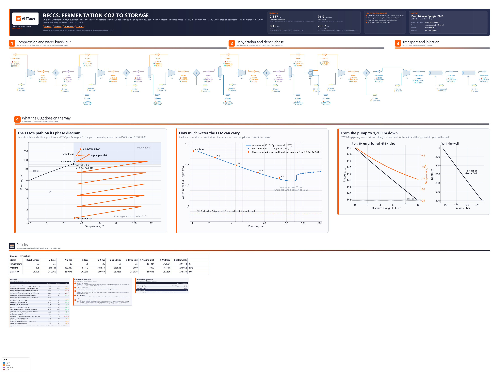

# BECCS at a sugarcane mill: fermentation CO2 compressed, dehydrated and piped in dense phase

**Category:** carbon-capture
**Status:** community
**DWSIM version:** 10.2.12
**Language:** English
**Contributor:** Prof. Nicolas Spogis, Ph.D. (@Spogis), AI4Tech · nicolas.spogis@ai4tech.ai · www.ai4tech.ai

## Summary

The fermenters of a sugarcane distillery release almost pure, biogenic CO2. Capturing it for storage - bio-energy with carbon capture and storage, BECCS - takes no separation, only compression, drying and transport.

This case takes the typical Brazilian mill of Restrepo-Valencia and Walter (2019): 4 Mt of cane a year, half of it to ethanol. It carries the mill's 26 t/h of fermentation CO2, wet from the ethanol scrubber, through:

- five intercooled compression stages to 90 bar, with the water knocked out on the way;
- dehydration to 50 ppm;
- a pump to 150 bar;
- 10 km of buried pipeline in dense phase;
- a 1,200 m injection well.

On GERG-2008 the train reproduces NIST's CO2:

| | This case | Reference |
|---|---|---|
| Compression and pumping | 2,387 kW, 91.9 kWh/t | 2,382 kW on NIST's CO2 |
| Water knocked out before drying | 487.1 kg/h | 486.3 kg/h, Spycher et al. (2003) |
| Pipeline, 10 km: pressure drop | 8.15 bar | 8.21 bar, Darcy-Weisbach on NIST |
| Well, 1,200 m: pressure at the bottom | 236.7 bar | 235.0 bar, NIST flowing down adiabatically |

Getting there took three settings a new user would not guess:

- two GERG-2008 packages for the wet CO2;
- the liquid viscosity's pressure correction switched off;
- the pump drawn as DWSIM's compressor block.

One thing DWSIM does not do: a pipe segment's energy balance has no potential energy, so the bottom of the well comes out 6 K too cold.

## Process description

After the scrubber that recovers its ethanol, the fermentation gas is CO2 saturated with water at about 32 °C and atmospheric pressure: 4.6 mol % of water. The case follows that water and the CO2's phase all the way to the bottom of the well.

- **Compression and water knock-out.** Five stages, K-1 to K-5, take the gas from 1.05 to 90 bar at a constant pressure ratio of 2.436. Each discharges at 108 to 115 °C and is cooled to 35 °C. Compressed and cooled, the gas holds less water than it carries, and the knock-out drums V-1 to V-4 drain what condenses: 487 kg/h, most of it in the first two.
- **Dehydration, at 37 bar.** The water a CO2 gas can hold falls with pressure to a minimum near 60 bar, and rises again in the dense phase (the second figure). After the fourth drum the gas holds 2,422 ppm (mol) of water. The dehydration unit DH-1 takes it to 50 ppm while the CO2 is still a gas, before it turns dense; 50 ppm is on the strict side of what CO2 pipelines specify. DH-1 is not designed here: it stands for a glycol or molecular-sieve unit.
- **The dense phase, at 90 bar rather than 74.** At 35 °C, CO2 at 74 bar is still a gas of 260 kg/m3; at 90 bar it is a dense fluid of 662 kg/m3, which a pump can take (NIST). So the fifth stage discharges at 90 bar and the aftercooler E-5 brings the CO2 to 35 °C. On the way it crosses its pseudo-critical temperature, about 40 °C at 90 bar, where its heat capacity peaks at 12.8 kJ/(kg K) (NIST): half of E-5's 1.68 MW leaves in its last 15 K.
- **Transport and injection.** The pump P-1 raises the dense CO2 to 150 bar. The pipeline PL-1 is 10 km of NPS 4 schedule 40 carbon steel buried in soil at 25 °C, with the CO2 at 1.1 to 1.2 m/s; it loses 8 bar and gives 264 kW to the soil, and the CO2 reaches the wellhead at 34.4 °C. The injection well IW-1, 1,200 m of 3-1/2 in tubing, adds the weight of the dense column: about 95 bar.

Below the train, three figures are drawn from the solved flowsheet:
- the CO2's path on its phase diagram;
- the water the CO2 can carry, against Spycher et al.'s model and King et al.'s measurements;
- the pressure and temperature along the pipeline and down the well.

## Feed and operating conditions

| Item | Value | Unit | Notes |
|---|---|---|---|
| CO2 from fermentation | 25.98 | t/h, dry | 772 t/h of cane over a 5,184 h harvest (4.0 Mt/y), half to ethanol at 86.3 L/t, 0.78 kg of CO2 per litre of ethanol (Restrepo-Valencia and Walter 2019) |
| Scrubber gas | 32 °C, 1.05 | bar | saturated with water: 4.60 mol %, set by the package's own saturation |
| Compression | 2.56 / 6.23 / 15.17 / 36.95 / 90.00 | bar | five stages, 85 % isentropic, each cooled to 35 °C |
| Knock-out drums | V-1 to V-4 | | after the first four coolers |
| Dehydration | 50 | ppm (mol) water | at 36.95 bar, after the fourth drum |
| Aftercooler | 90 bar, 35 | °C | the CO2 leaves as a dense fluid of 662 kg/m3 |
| Pump | 90 to 150 | bar | 85 % isentropic |
| Pipeline | 10 km, NPS 4 schedule 40 | | 102.3 mm inside, carbon steel (roughness 0.045 mm), buried 1.5 m to its axis in soil at 25 °C with k = 1.1 W/(m K); 50 increments |
| Injection well | 1,200 m, 3-1/2 in tubing | | 76.0 mm inside, vertical, adiabatic; 24 increments |
| Cooling | 35 | °C | every cooler, on cooling-tower water |

All pressures are absolute. The mill and its CO2 are the reference's typical mill. The rest of the design is this case's: the scrubber temperature, the stage pressures, the cooling temperature, the efficiencies, the dehydration target, the pipeline and the well.

## Thermodynamics

- **Property package:** GERG-2008 (Kunz and Wagner 2012), twice: the default, and a second one forced to look for a second liquid (VLLE) for the intercoolers E-1 to E-4 and their outlet streams.
- **Why GERG-2008:** its CO2 is NIST's (Span and Wagner 1996). Every compression stage is within 0.6 % of NIST, and the dense CO2's density within 0.02 % (Results).
  - The cubic equations of state are 3 to 15 % low on the dense phase's density. At 35 °C and 100 bar NIST gives 712.8 kg/m3; Peng-Robinson gives 632.4, SRK 613.4 and PRSV2-M 652.8 (measured on DWSIM 10.2.12).
  - The pump, the pipeline's friction and the well's weight all ride on that density.
- **Why twice:** GERG-2008's default flash misses the water condensing out of the gas at 37 bar: CO2 holding twice the water it can is returned as one vapour phase. At 2.6 bar the same flash finds the liquid.
  - Forced to VLLE it finds it at every stage. But a compressor on that package, fed the wet scrubber gas, stops with "GERG error: unable to calculate density".
  - So VLLE is used only where the water condenses.
  - Both packages are the same equation with the same enthalpy reference, so a stream that crosses from one to the other keeps its state.
- **Transport properties:** GERG-2008 has none. The viscosity is DWSIM's own liquid viscosity, with its pressure correction switched off on both packages (see the notes). It is 35 % below NIST's at the pipeline's inlet: 38 against 59 µPa s.
- **Interaction parameters:** the equation's own, for CO2 and water, unchanged.

## Tuning and convergence notes

**The water**

- **The intercoolers and their outlets are on the second package; everything else on the first.** In DWSIM's editors that is each object's property package. From a Python script, setting an object's `PropertyPackage` is not enough. pythonnet writes the base class's property, which the material stream shadows with its own, so the stream stays on the first package without a word. The build script also sets the object's `_ppid`, the id by which DWSIM finds a stream's package.
- **The knock-out drums are in the Adiabatic mode.** With one inlet, that mode keeps the phases the inlet stream brings: the water the VLLE package condensed in the cooler. In DWSIM's default mode the drum flashes the stream again on the default package, which misses the water. Fed 26 t/h of CO2 holding 4,400 ppm of water at 35 °C and 37 bar, a drum in the default mode drained nothing; in the Adiabatic mode it drained 21.2 kg/h.
- **DH-1 is a component separator.** It sends all the CO2 and 50 ppm (mol) of water to the dried gas and drains the rest. Its energy stream, 15 kW, closes its balance: the water leaves it as a liquid.

**The dense phase**

- **The liquid viscosity's pressure correction is switched off on both packages.** It is on by default, and above a compound's critical temperature it makes dense CO2 five to seven times as viscous as it is.
  - DWSIM applies Lucas' correction for compressed liquids at a reduced temperature of 1, the critical point, with the Henry constant for the vapour pressure.
  - With it on, the CO2 entering the pipeline had 292 µPa s where NIST gives 59, and the pipeline lost 8.90 bar instead of 8.15.
- **Peneloux's volume translation is switched off with it.** DWSIM 10.2.12 reads the viscosity correction back from the Peneloux setting when it opens a file, so with Peneloux on the file would open with the correction on again. Peneloux changes nothing on GERG-2008: density, enthalpy and viscosity are the same either way.
- **The pump P-1 is DWSIM's compressor block.** The pump block computes its power from the inlet's volume, v ΔP / η: 76.9 kW, 4.5 % over NIST's work, because the CO2 goes from 662 to 714 kg/m3 through it. The compressor block follows the isentrope on GERG-2008: 73.5 kW against NIST's 73.6.
  - DWSIM's log says "P-1: Liquid phase detected in compressor inlet". It calls dense CO2 a liquid, but at 35 °C and 90 bar the CO2 is above its critical point (31.0 °C, 73.8 bar).
- **The well's temperature lacks the potential energy.** DWSIM's pipe segment balances each increment as H_out = H_in + Q / W: the elevation changes the pressure, not the enthalpy.
  - Flowing 1,200 m down, the CO2 gains g Δz = 11.8 kJ/kg that the pipe leaves out. The bottom is at 39.2 °C where NIST, integrated down the well with h + g z constant, gives 45.0 °C.
  - The colder column is denser, and its bottom pressure 1.7 bar higher.
  - A heater after the well, with no pressure drop and W g Δz = 85 kW of duty, would put that energy back. This case leaves the well as DWSIM computes it.
- **The well's energy stream, IW-1 duty, reads 5.5 kW though its heat is set to zero.** The enthalpy steps down 0.76 kJ/kg in the first of its 24 increments and holds to the digit after.

**Settings changed from the defaults:**
- flash tolerances of 1e-10;
- the second package forced to VLLE;
- on both packages, the liquid viscosity's pressure correction and Peneloux's volume translation off;
- the drums in the Adiabatic mode;
- the pipeline's thermal profile: an estimated overall coefficient, through the soil at 25 °C (k = 1.1 W/(m K), 1.5 m deep), the inner and outer films and the wall, no insulation;
- the well's heat exchanged set to zero.

## Results

The references are outside DWSIM, and each is worked out in the case's `build.py`, which embeds the data it uses:

- **The water the CO2 holds** is the model of Spycher, Pruess and Ennis-King (2003): a Redlich-Kwong equation for the CO2-rich phase with fitted equilibrium constants, from the public preprint LBNL-50991. It is within 2 % of King et al.'s (1992) measurements in the dense phase. Against the measurements of Gillespie and Wilson (1982) that it compiles, it is 7 to 17 % low between 25 and 51 bar.
- **The compression and the pump** are NIST's CO2 (Span and Wagner 1996) at the case's efficiency. Each stage's isentropic outlet is interpolated on the NIST isobar, and the water vapour each stage carries is added as an ideal gas.
- **The pipeline** is Darcy-Weisbach with Colebrook's friction factor, on NIST's density and viscosity (Laesecke and Muzny 2017), along DWSIM's temperature profile: the heat lost to the soil is DWSIM's.
- **The well** is NIST's CO2 integrated down the tubing from the wellhead's state: adiabatic, so h + g z is constant, with the column's weight less Darcy-Weisbach friction.

Things to keep in mind when reading the table:

- **The water follows the saturation line**, from 0.75 % above Spycher et al.'s model at the scrubber to 15 % above it at 37 bar. That is where the model itself runs below the measurements it compiles. The water drained, which the first two drums dominate, is within 0.2 % of the reference.
- **The compression is NIST's to 0.6 % on every stage**, and 91.9 kWh per tonne of CO2 in all. Restrepo-Valencia and Walter (2019) give 2,400 kW for the same CO2, with five ideal-gas stages to 73.9 bar and a pump. At 35 °C, CO2 at 74 bar is still a gas, so this case compresses to 90 bar before pumping.
- **The viscosity is 35 % low, and the pressure drop is not.** The flow is fully turbulent in a rough pipe (Reynolds number above 10^6), where the friction factor hardly depends on the viscosity: the pipeline's drop is 0.7 % from Darcy-Weisbach on NIST. With DWSIM's default correction on, it was 8 % high.
- **The well's pressure is right to 0.7 %; its temperature is 6 K low**, for the reason in the notes.

Mass closes across the boundary to 3.1e-7 and energy to 8.3e-9, as the flowsheet's closure card shows. Relative errors are on the reference, and a temperature's on the absolute scale.

| Quantity | DWSIM | Reference | Reference source | Rel. error |
|---|---|---|---|---|
| CO2 from fermentation, dry, t/h | 25.98 | — | Restrepo-Valencia & Walter (2019)'s basis, unrounded: 0.135 Mt over a 5184 h harvest, which they give as 0.13 Mt/y | — |
| Water in the scrubber gas, saturated at 32 °C and 1.05 bar, mol % | 4.599 | 4.565 | Spycher et al. (2003) | +0.75 % |
| Water left in the gas after V-1, 35 °C and 2.56 bar, ppm (mol) | 22 693 | 22 419 | Spycher et al. (2003) | +1.22 % |
| Water left in the gas after V-2, 35 °C and 6.23 bar, ppm (mol) | 9 713 | 9 478 | Spycher et al. (2003) | +2.47 % |
| Water left in the gas after V-3, 35 °C and 15.17 bar, ppm (mol) | 4 430 | 4 191 | Spycher et al. (2003) | +5.71 % |
| Water left in the gas after V-4, 35 °C and 36.95 bar, ppm (mol) | 2 422 | 2 108 | Spycher et al. (2003) | +14.91 % |
| Water removed by the knock-out drums V-1 to V-4, kg/h | 487.1 | 486.3 | Spycher et al. (2003) | +0.16 % |
| Water removed by the dehydration unit DH-1, to 50 ppm, kg/h | 25.30 | — | — | — |
| Stage 1, 1.05 to 2.56 bar: power, kW | 501.4 | 498.4 | NIST WebBook (Span & Wagner) | +0.60 % |
| Stage 2, 2.56 to 6.23 bar: power, kW | 490.5 | 489.1 | NIST WebBook (Span & Wagner) | +0.28 % |
| Stage 3, 6.23 to 15.17 bar: power, kW | 475.4 | 475.0 | NIST WebBook (Span & Wagner) | +0.09 % |
| Stage 4, 15.17 to 36.95 bar: power, kW | 451.7 | 451.7 | NIST WebBook (Span & Wagner) | −0.01 % |
| Stage 5, 36.95 to 90.00 bar: power, kW | 394.3 | 394.3 | NIST WebBook (Span & Wagner) | 0.00 % |
| Aftercooler E-5: 90 bar, 114.6 to 35 °C, kW | 1 683.8 | 1 683.2 | NIST WebBook (Span & Wagner) | +0.03 % |
| CO2 at the pump suction, 35 °C and 90 bar: density, kg/m3 | 662.28 | 662.13 | NIST WebBook (Span & Wagner) | +0.02 % |
| Pump P-1, 90 to 150 bar, as DWSIM's compressor: power, kW | 73.5 | 73.6 | NIST WebBook (Span & Wagner) | −0.07 % |
| Compression and pumping, total, kW | 2 387 | 2 382 | NIST WebBook (Span & Wagner) | +0.20 % |
| Specific energy, kWh/t CO2 | 91.9 | 91.7 | NIST WebBook (Span & Wagner) | +0.17 % |
| Pipeline PL-1: CO2 viscosity at the inlet, 48.4 °C and 150 bar, µPa s | 38 | 59 | NIST WebBook (Laesecke & Muzny) | −35.34 % |
| Pipeline PL-1, 10 km: pressure drop, bar | 8.15 | 8.21 | Darcy-Weisbach on NIST | −0.70 % |
| Pipeline: CO2 at the wellhead, °C | 34.41 | — | the line gives 264 kW to soil at 25 °C | — |
| Injection well IW-1, 1,200 m: pressure at the bottom, bar | 236.7 | 235.0 | NIST, adiabatic flow down the well | +0.74 % |
| Injection well: CO2 at the bottom, °C | 39.2 | 45.0 | NIST, adiabatic flow down the well | −1.83 % |

## Files

- `beccs-fermentation-co2-dense-phase-pipeline.dwxmz` - the DWSIM flowsheet, with:
  - AI4Tech's title block (logo, key results, contact);
  - the three figures, drawn from the solved flowsheet;
  - a live master table of the main streams;
  - result cards.
- `beccs-fermentation-co2-dense-phase-pipeline.png` - the flowsheet as DWSIM draws it.

## Confidentiality

No plant data of the contributor or of any client is used:
- The mill is the typical Brazilian mill Restrepo-Valencia and Walter (2019) published under CC BY 4.0.
- The rest of the design is the contributor's own choice, from engineering practice.
- The references are the published literature and the NIST Chemistry WebBook.

No company, site or person is named but the contributor, whose contact details appear in the flowsheet's title block with the maintainer's agreement. The contributor ran no simulator but DWSIM, and has the right to publish all of it.

## References

- S. Restrepo-Valencia, A. Walter, "Techno-Economic Assessment of Bio-Energy with Carbon Capture and Storage Systems in a Typical Sugarcane Mill in Brazil", *Energies* 12 (2019) 1129. https://doi.org/10.3390/en12061129 (open access, CC BY 4.0)
- O. Kunz, W. Wagner, "The GERG-2008 Wide-Range Equation of State for Natural Gases and Other Mixtures: An Expansion of GERG-2004", *Journal of Chemical & Engineering Data* 57 (2012) 3032-3091. https://doi.org/10.1021/je300655b
- R. Span, W. Wagner, "A New Equation of State for Carbon Dioxide Covering the Fluid Region from the Triple-Point Temperature to 1100 K at Pressures up to 800 MPa", *Journal of Physical and Chemical Reference Data* 25 (1996) 1509-1596. https://doi.org/10.1063/1.555991
- A. Laesecke, C. D. Muzny, "Reference Correlation for the Viscosity of Carbon Dioxide", *Journal of Physical and Chemical Reference Data* 46 (2017) 013107. https://doi.org/10.1063/1.4977429
- E. W. Lemmon, M. O. McLinden, D. G. Friend, "Thermophysical Properties of Fluid Systems", in *NIST Chemistry WebBook*, NIST Standard Reference Database 69, P. J. Linstrom, W. G. Mallard (eds.), National Institute of Standards and Technology. https://doi.org/10.18434/T4D303
- N. Spycher, K. Pruess, J. Ennis-King, "CO2-H2O mixtures in the geological sequestration of CO2. I. Assessment and calculation of mutual solubilities from 12 to 100 °C and up to 600 bar", *Geochimica et Cosmochimica Acta* 67 (2003) 3015-3031. https://doi.org/10.1016/S0016-7037(03)00273-4 (preprint LBNL-50991)
- M. B. King, A. Mubarak, J. D. Kim, T. R. Bott, "The mutual solubilities of water with supercritical and liquid carbon dioxides", *The Journal of Supercritical Fluids* 5 (1992) 296-302. https://doi.org/10.1016/0896-8446(92)90021-B
- C. F. Colebrook, "Turbulent flow in pipes, with particular reference to the transition region between the smooth and rough pipe laws", *Journal of the Institution of Civil Engineers* 11 (1939) 133-156. https://doi.org/10.1680/ijoti.1939.13150
- K. Lucas, "Die Druckabhängigkeit der Viskosität von Flüssigkeiten - eine einfache Abschätzung", *Chemie Ingenieur Technik* 53 (1981) 959-960. https://doi.org/10.1002/cite.330531209
