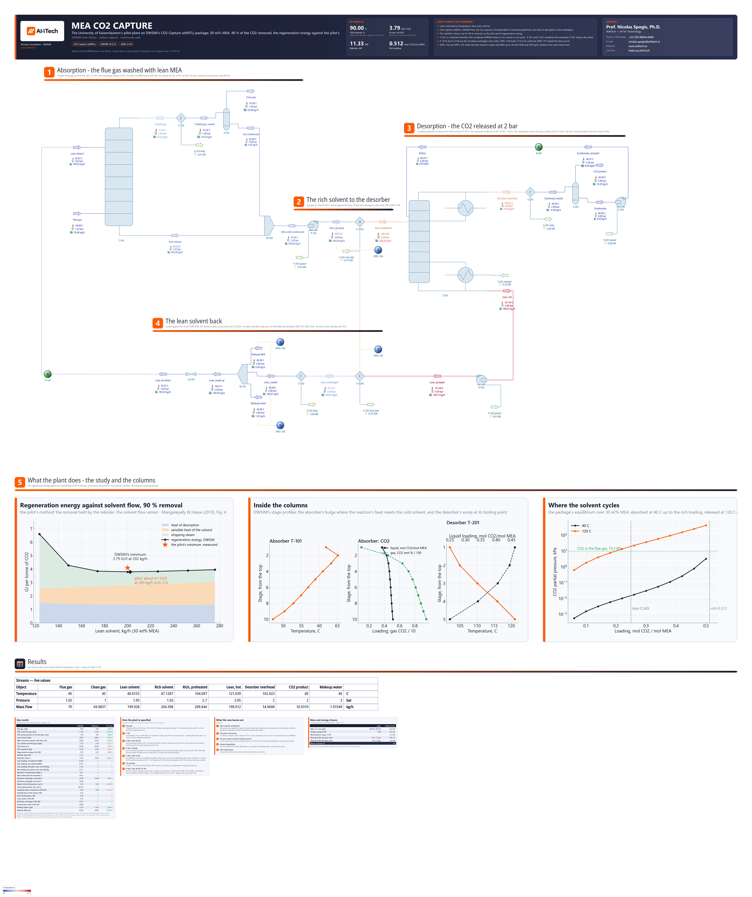

# Post-combustion CO2 capture with MEA - the Kaiserslautern pilot plant

**Category:** carbon-capture
**Status:** community
**DWSIM version:** 10.2.13
**DWSIM edition:** Patreon Edition (CO2 Capture (eNRTL) property package)
**Language:** English
**Contributor:** Prof. Nicolas Spogis, Ph.D. (@Spogis), AI4Tech · nicolas.spogis@ai4tech.ai · www.ai4tech.ai

> **Requirement.** The CO2 Capture (eNRTL) property package belongs to DWSIM Patreon. The file opens anywhere, but
> it only solves where the package is licensed.

## Summary

Absorbing the CO2 of a flue gas in 30 wt% aqueous monoethanolamine (MEA) is the reference process of
post-combustion capture, and its weak point is the steam the stripper needs. This case rebuilds the MEA baseline of
the University of Kaiserslautern's pilot plant (Mangalapally & Hasse, 2010) in DWSIM:

- the absorber;
- the rich/lean exchanger;
- the stripper, with its condenser and reflux;
- the solvent loop, closed.

It runs on DWSIM's CO2 Capture (eNRTL) package, which carries the chemistry of loaded MEA, and its heat of
absorption, in the solvent's enthalpies. The pilot removed 90 % of the CO2 by setting its regeneration energy, and
varied the solvent flow to find the least energy. The case does the same, and compares the energy with the pilot's
minimum of about 4.1 GJ per tonne of CO2, at 200 kg/h of solvent. With nothing fitted to the pilot, DWSIM finds its
least energy at the same flow - 202 kg/h - and 3.79 GJ/t, about 8 % under the pilot's.

## Process description

The flue gas of a natural-gas burner, enriched in CO2 to about 10 % and saturated with water at 40 C by the
pilot's pre-washer, enters the bottom of the absorber T-101. Lean 30 wt% MEA at 40 C flows down against it and
takes up the CO2: carbamate and bicarbonate form, and their heat warms the solvent into a bulge near the top of the
column. The treated gas leaves the top, is cooled to 45 C in E-103 and parted in V-101. The clean gas goes to the
stack. The condensate - water with the MEA the gas carried - joins the rich solvent; in the pilot, the absorber's
washing section does this.

The rich solvent is pumped (P-101) through the rich/lean exchanger E-101 to the top of the desorber T-201, at 2 bar.
Its sump is heated: the steam rising through the column strips the CO2 from the solvent. The overhead, CO2 with
steam, is cooled to 40 C in E-201. V-201 parts the CO2 product from the condensate, which P-201 returns to the top
as reflux. The reboiler's duty is set for 90 % removal - the pilot's own way of running.

The lean solvent leaves the sump at its boiling point. It is pumped (P-102), cooled against the rich solvent
(E-101) and to 40 C (E-102), made up with water and MEA (M-101), and let down to the absorber (LV-101), which closes
the loop.

## Feed and operating conditions

| Item | Value | Unit | Notes |
|---|---|---|---|
| Flue gas | 79 | kg/h | Mangalapally & Hasse (2010), Table 3 |
| Flue gas composition | CO2 10.0, H2O 7.2, O2 5.0, N2 77.8 | mol % | 102 mbar of CO2 (Table 3); saturated with water at 40 C; O2 not given, 5 % assumed |
| Flue gas | 40 C, 1.02 bar | | after the pre-washer; its temperature is not given, 40 C assumed |
| Lean solvent | 200 | kg/h | 30 wt% MEA (CO2-free basis), with its CO2; the pilot's optimum (Section 4.3), L/G 2.5 |
| Lean solvent to the absorber | 40 C | | assumed |
| CO2 removal | 90 | % | held by the reboiler's duty, as in the pilot (Section 4.2) |
| Absorber T-101 | 10 stages, 1.00 to 1.02 bar | | the pilot's 4.25 m of BX 500; the stage count assumed, not fitted |
| Treated gas after E-103 | 45 C | | sets the water balance: see the notes |
| Rich/lean exchanger E-101 | 10 | K | at its cold end, which pinches; assumed |
| Desorber T-201 | 4 stages and the sump, 2.00 to 2.05 bar | | the pilot's 2.55 m of BX 500; its pressure is not given |
| Condenser E-201, drum V-201 | 40 C, 2 bar | | the condensate back to the top as reflux |

## Thermodynamics

- **Property package:** CO2 Capture (eNRTL), DWSIM Plus.
- **Why this package:** CO2 dissolves in aqueous MEA by reaction. Loaded MEA is a solution of ions - MEAH+, the
  carbamate MEACOO-, HCO3-, CO3-- - in chemical equilibrium with the molecules. The package solves that speciation
  in every liquid the flash meets, with Chen and Song's electrolyte NRTL for the activity coefficients, Carroll,
  Slupsky and Mather's Henry constant for CO2, and Peng-Robinson for the gas. The heat of absorption comes out of
  the package's own enthalpies, so the reboiler's duty, the absorber's temperature bulge and the exchanger's duty
  are DWSIM's, not numbers given to it. A model without the chemistry - an activity model, an equation of state -
  cannot hold CO2 in an amine.
- **Parameters:** compiled into the package; DWSIM's User Guide gives their sources and fit. MEA's
  water-amine pair was fitted to MEA + water VLE, and its ion pairs to six CO2 solubility sets: the loading at the
  measured partial pressure is within about 0.01 mol/mol. The heats were fitted to Arcis et al.'s calorimetry,
  within 3 to 4 kJ/mol. Its range for MEA is 15 and 30 wt%, 313 to 393 K.
- **Measured here:** 30 wt% MEA loaded to 0.40 mol/mol has 0.169 kPa of CO2 over it at 40 C and 122 kPa at
  120 C. Its integral heat of absorption from 0 to 0.4 mol/mol at 40 C is -89.8 kJ per mol of CO2.

## Tuning and convergence notes

- **The package needs a Patron key**, also from a script: `License.ActivateWithKey`. In a Python host, add TLS 1.2
  to the process first. Without it the licence check fails as if the key were wrong.
- **The absorber on Naphtali-Sandholm.** DWSIM's default for an absorption column, Burningham-Otto (Sum Rates),
  stops at its iteration limit on this package. Naphtali-Sandholm solves the absorber in about 5 s, and in 1 to 2 s
  inside the loop.
- **The desorber is a reboiled absorber** (`ReboiledAbsorber`), its condenser outside as a cooler and a drum. A
  distillation column with a Full_Reflux condenser on a temperature reports the overhead at that temperature, but
  with the top stage's water uncondensed - 57 % of it at 40 C, where 3.7 % is possible - and returns no reflux.
- **The rich/lean exchanger is held at its cold end.** It is drawn as its two sides, E-101A and E-101B, so that no
  second loop closes round the desorber. Held at its hot end, 10 K below the sump, the lean solvent left the
  exchanger colder than the rich solvent entered it, a second-law impossibility. The rich solvent carries the
  larger heat capacity flow, so the cold end pinches. SPEC-104 sets the lean outlet 10 K above the rich inlet, and
  SPEC-101 gives the rich side that duty.
- **The water balance sets the treated gas's temperature**, as in the pilot. Cooled back to 40 C, the treated gas
  carries less water than the flue gas brought: it is at a lower pressure and without its CO2. The makeup then
  turned negative, which a mixer does not take, and the loop never closed. At 45 C the plant loses about 1 kg/h of
  water, and SPEC-102 makes it up.
- **The solvent's water and MEA are each made up to a target.** A makeup that only replaces what the plant loses
  leaves a closed loop with whatever MEA it held when the solve settled. The same flowsheet, started from two first
  guesses, settled at 30.69 and 30.22 wt% MEA (3.772 and 3.786 GJ/t). SPEC-102 and SPEC-103 make the water and the
  MEA up to 30 wt% MEA and 200 kg/h of solvent with its CO2, whatever the solve starts from, so the study's flows do
  not dilute the solvent. The loop's tear starts 1 % under the targets: a makeup cannot be negative.
- **The loops are closed outside DWSIM's Recycle.** The block only copies its inlet onto the tear, and a loop that
  sends all of its solvent back did not close in 25 passes of 9 s. The build closes both loops - the solvent and
  the reflux - by accelerated substitution: Wegstein on every compound's flow and on the temperature, about 10
  passes. It then sets the reboiler's duty for 90 % removal by a secant, and solves the file once more at the
  Recycles' tight tolerances. The file solves from its saved state.
- **Nothing is fitted to the pilot.** Each column's packing is a count of equilibrium stages, chosen once and not
  tuned: 10 in the absorber (0.43 m of packing each), 4 and the sump in the desorber (0.64 m each). The pilot's
  regeneration energy sets nothing; it is what DWSIM's is compared with. The count hardly matters: with 6, 10 and 20
  absorber stages the design point needs 3.84, 3.79 and 3.76 GJ/t. At 10 the absorber already brings the rich solvent
  close to equilibrium with the flue gas.
- **No stage efficiency.** A Murphree efficiency on the absorber's stages is the usual way to make equilibrium stages
  stand for packing, and here it moves the result the wrong way. Below 1, DWSIM's Naphtali-Sandholm solver leaves the
  bottom stage above its liquid's bubble point: the heat moves down the column, the top runs cooler, and the absorber
  captures more, not less. At 0.15 the solve fails. Reported to DWSIM as DanWBR/dwsim10#134.

## Results

Measured on the flowsheet as saved, reloaded and solved again. The pilot's numbers are from Mangalapally & Hasse
(2010), the open paper on the plant; the complete data set is Notz, Mangalapally & Hasse (2012).

| Quantity | DWSIM | Reference | Reference source | Rel. error |
|---|---|---|---|---|
| Flue gas, kg/h | 79.0 | 79.0 | Mangalapally & Hasse (2010) Table 3 | 0.00 % |
| CO2 in the flue gas, kg/h | 11.95 | 12.00 | Mangalapally & Hasse (2010) Table 3 | −0.40 % |
| CO2 partial pressure in the flue gas, mbar | 102 | 102 | Mangalapally & Hasse (2010) Table 3 | 0.00 % |
| Lean solvent, kg/h | 199.9 | 200.0 | Mangalapally & Hasse (2010) Section 4.3 | −0.04 % |
| MEA in the lean solvent, CO2-free, wt% | 30.00 | 30.00 | Mangalapally & Hasse (2010) | 0.00 % |
| L/G, solvent over flue gas, kg/kg | 2.53 | 2.50 | Mangalapally & Hasse (2010) Section 4.3 | +1.23 % |
| CO2 removal, % | 90.00 | 90.00 | Mangalapally & Hasse (2010) Section 4.2 | 0.00 % |
| CO2 captured, kg/h | 10.76 | 10.60 | Mangalapally & Hasse (2010) Table 3 | +1.48 % |
| Regeneration energy, GJ/t CO2 | 3.79 | 4.10 | Mangalapally & Hasse (2010) Section 4.3 | −7.49 % |
| Reboiler duty, kW | 11.33 | — | — | — |
| Desorber sump, C | 121.0 | 120.0 | Mangalapally & Hasse (2010) Fig. 3 | +0.26 % |
| Lean loading, mol CO2/mol MEA | 0.249 | — | — | — |
| Rich loading, mol CO2/mol MEA | 0.512 | — | — | — |
| Lean loading, the pilot's unit, mol CO2/kg | 1.162 | — | — | — |
| Rich loading, the pilot's unit, mol CO2/kg | 2.331 | — | — | — |
| Absorber's temperature bulge, C | 65.1 | — | stage 2 from the top | — |
| Rich solvent into the desorber, C | 104.1 | — | — | — |
| Rich/lean exchanger, cold end, K | 10.00 | 10.00 | the exchanger's pinch | 0.00 % |
| Rich/lean exchanger, hot end, K | 16.98 | — | above the pinch: the rich side's larger heat capacity flow | — |
| Water in the CO2 product, mol % | 3.78 | 3.69 | saturation at 40 C, IAPWS-95, by hand | +2.31 % |
| CO2 product purity, dry, mol % | 99.975 | — | — | — |
| Stripping steam: condenser E-201, kW | 2.98 | 2.99 | steam tables, by hand | −0.54 % |
| Sensible heat of the solvent, kW | 4.32 | — | 38 % of the reboiler | — |
| Heat of desorption, kW | 4.04 | — | 36 % of the reboiler; 59.5 kJ per mol of CO2 | — |
| Lean cooler E-102, kW | 3.59 | — | — | — |
| Rich/lean exchanger E-101, kW | 14.27 | — | — | — |
| Treated gas cooler E-103, kW | 4.008 | — | — | — |
| Makeup water, kg/h | 1.015 | 1.015 | water out with the clean gas and the CO2, less the flue gas's | 0.00 % |
| Makeup MEA, g/h | 0.020 | 0.020 | the clean gas's and the CO2 product's MEA | −0.18 % |

### The solvent-flow study

The pilot's method (Section 4.2), run on copies of the case's file: the removal held at 90 % by the reboiler's duty,
and the lean solvent's flow varied, its MEA held at 30 wt%. The flows are those the plant reached: the makeups hold
the solvent's water and MEA, and its CO2 follows the lean loading. The regeneration energy is split into three parts:

- the stripping steam: the heat the condenser throws away;
- the sensible heat: the rich solvent heated from the desorber's inlet to the sump temperature at 10 bar, where
  nothing boils or desorbs. It is taken from the package's enthalpies, so it includes the heat of the speciation
  shifting as the solvent warms;
- the heat of desorption: the rest.

At 300 kg/h the loops did not close - the accelerated substitution oscillated - and the point is left out.

| Lean solvent, kg/h | L/G, kg/kg | Lean loading | Rich loading | Reboiler, kW | Regeneration, GJ/t | Stripping steam, GJ/t | Sensible heat, GJ/t | Desorption, GJ/t | Sump, C |
|---|---|---|---|---|---|---|---|---|---|
| 123 | 1.56 | 0.108 | 0.520 | 19.73 | 6.60 | 4.06 | 1.05 | 1.49 | 124.1 |
| 149 | 1.88 | 0.171 | 0.518 | 12.76 | 4.27 | 1.64 | 1.21 | 1.42 | 123.2 |
| 174 | 2.20 | 0.215 | 0.515 | 11.49 | 3.85 | 1.13 | 1.34 | 1.38 | 122.2 |
| 200 | 2.53 | 0.249 | 0.512 | 11.33 | 3.79 | 1.00 | 1.45 | 1.35 | 121.0 |
| 226 | 2.86 | 0.275 | 0.508 | 11.45 | 3.83 | 0.95 | 1.54 | 1.34 | 120.0 |
| 252 | 3.19 | 0.295 | 0.505 | 11.63 | 3.89 | 0.93 | 1.62 | 1.34 | 119.0 |
| 276 | 3.49 | 0.310 | 0.503 | 11.81 | 3.95 | 0.92 | 1.69 | 1.34 | 118.1 |

The minimum, from the parabola through the three lowest points: **3.79 GJ/t at 202 kg/h** of lean solvent (L/G 2.56).

The pilot found its least energy at about 200 kg/h, near 4.1 GJ/t (Section 4.3, Fig. 4). DWSIM puts the minimum at
the same flow with nothing fitted to the pilot. The curve has the pilot's shape. Below the optimum, the lean solvent
must be stripped deeper and the stripping steam grows; above it, more solvent is heated. Its level is about 8 %
under the pilot's: see *Nothing is fitted to the pilot* in the tuning notes.

## Files

- `post-combustion-co2-capture-mea.dwxmz` - the DWSIM flowsheet, with AI4Tech's title block.
- `post-combustion-co2-capture-mea.png` - the flowsheet as DWSIM draws it, with the study's figure, the columns'
  profiles and the solvent's working window.

## Confidentiality

Everything in the case is public: the pilot plant's design and results are from an open conference paper, and the
model's other numbers are stated assumptions. No client is in it. The contributor's contact is in the flowsheet's
title block with the maintainer's agreement.

## References

- Mangalapally, H. P.; Hasse, H. (2010). *Pilot plant experiments with MEA and new solvents for post combustion
  CO2 capture by reactive absorption.* Distillation & Absorption 2010, Eindhoven, pp. 103-108.
- Notz, R.; Mangalapally, H. P.; Hasse, H. (2012). *Post combustion CO2 capture by reactive absorption: pilot plant
  description and results of systematic studies with MEA.* International Journal of Greenhouse Gas Control 6,
  84-112.
- DWSIM User Guide, *Specialized Models / Property Packages*: Carbon Capture (eNRTL) - the package's equations,
  parameters and validation.
