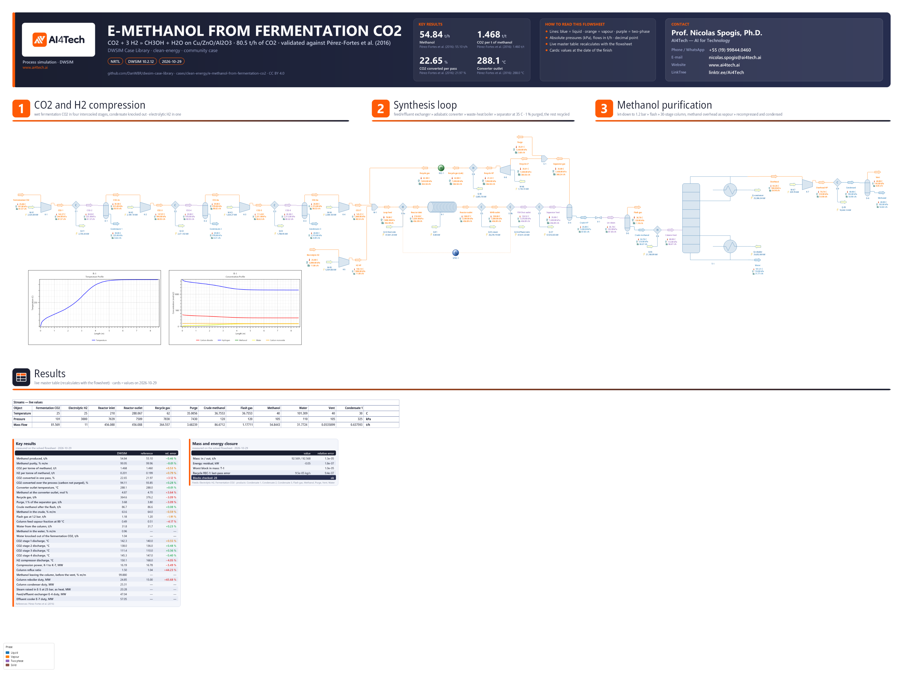

# e-Methanol from fermentation CO2 and electrolytic hydrogen: a synthesis loop on catalytic kinetics, validated against Pérez-Fortes et al. (2016)

**Category:** clean-energy
**Status:** community
**DWSIM version:** 10.2.12
**Language:** English
**Contributor:** Prof. Nicolas Spogis, Ph.D. (@Spogis), AI4Tech · nicolas.spogis@ai4tech.ai · www.ai4tech.ai

## Summary

The CO2-to-methanol plant of Pérez-Fortes et al. (2016) makes 440 kt of methanol a year from 80.5 t/h of CO2 and 11.0 t/h of electrolytic hydrogen. Here it is fed with the wet CO2 of a distillery's fermenters. It is a complete methanol loop:

- four-stage CO2 compression with knock-out drums;
- an adiabatic Cu/ZnO/Al2O3 converter on the Langmuir-Hinshelwood kinetics of Vanden Bussche and Froment (1996);
- a feed/effluent exchanger and a waste-heat boiler;
- a recycle with a 1 % purge;
- a methanol column.

Against the paper's stream table:

| | This case | Pérez-Fortes et al. (2016) |
|---|---|---|
| Methanol produced | 54.8 t/h at 99.95 % m/m | 55.1 t/h at 99.96 % m/m |
| CO2 per tonne of methanol | 1.468 t | 1.460 t |
| CO2 converted per pass | 22.65 % | 21.97 % |
| Converter outlet | 288.1 °C | 288.0 °C |

The difference that matters is the column. DWSIM 10.2.12 converges it at a reflux ratio of 1.5 but not at the paper's 1.04, so its reboiler takes 24.85 MW instead of about 15.

## Process description

The CO2 that a sugar-cane or corn distillery's fermenters release is biogenic and nearly pure. After the scrubber that recovers its ethanol it is CO2 saturated with water at about 25 °C and 1 atm, the cheapest CO2 a power-to-X plant can buy. With hydrogen from water electrolysis it becomes e-methanol by the direct hydrogenation of CO2:

- CO2 + 3 H2 ⇌ CH3OH + H2O (ΔH = −49.2 kJ/mol, exothermic)
- CO2 + H2 ⇌ CO + H2O (ΔH = +41.2 kJ/mol, the reverse water-gas shift)

This case is the CO2-to-methanol plant of Pérez-Fortes et al. (2016), at its scale of 440 kt of methanol a year, fed with fermentation CO2. It has three sections:

- **Compression.** The wet CO2 goes through four adiabatic stages to 78 bar, each one followed by a cooler and a knock-out drum that removes the water condensing there. The hydrogen comes from the electrolyser at 30 bar and needs one stage.
- **Synthesis loop.** The fresh gas joins the recycle and is heated to 210 °C against the converter's effluent. It reacts in an adiabatic bed of Cu/ZnO/Al2O3 and leaves at equilibrium near 290 °C. The effluent raises steam at 25 bar, gives its heat to the feed, and is cooled to 35 °C. A separator at 74 bar then splits it into crude methanol and unreacted gas. 1 % of the gas is purged, to keep carbon monoxide from building up, and the rest is recompressed and recycled.
- **Purification.** The crude is let down to 1.2 bar, where most of the dissolved gas flashes off. It is preheated to 80 °C and distilled on 30 stages. The methanol leaves the top as vapour, together with the last of the gas, and is recompressed to 1.2 bar and condensed at 40 °C. The gas is vented, and the water leaves the bottom.

How it is modelled in DWSIM:

- **The converter** is a plug-flow reactor on the Langmuir-Hinshelwood kinetics of Vanden Bussche and Froment (1996): two heterogeneous-catalytic reactions, with the rate per kilogram of catalyst and the driving force in partial pressures. The activation energies are those of Mignard and Pritchard (2008), as Van-Dal and Bouallou (2013) write them, which is what the reference uses. The bed holds 44 500 kg of catalyst in 42 m3. The paper gives the volume but not the shape, so the bed is drawn 2.5 m wide and 8.56 m long; an ideal plug flow does not depend on the shape. The pressure drop is the reference's 0.50 bar.
- **The feed/effluent exchanger E-4 is drawn as its two sides.** E-4a heats the feed to 210 °C. The specification block SPEC-1 hands its duty to E-4b, which takes it from the effluent. As one heat-exchanger block, E-4 would close a second loop on itself, because its hot inlet depends on its own cold outlet through the converter.
- **One recycle.** REC-1 tears the recycle gas before the mixer, and starts from the reference's stream 21.
- **The column** has a partial condenser that returns all its liquid as reflux (DWSIM's "full reflux" condenser) and sends the methanol on as vapour. Its two specifications are a reflux ratio of 1.5 and a bottoms flow that leaves 0.95 % m/m of methanol in the water, the reference's stream 44. The reference runs 57 stages at a reflux of 1.04, which DWSIM does not converge (see the notes).

## Feed and operating conditions

| Item | Value | Unit | Notes |
|---|---|---|---|
| Fermentation CO2 | 80.5 | t/h dry | 25 °C, 1.01 bar, saturated with water (3.1 mol %): 1.07 t/h of water with it |
| Electrolytic H2 | 11.0 | t/h | 25 °C, 30 bar, pure; H2 / CO2 = 2.98 mol/mol |
| CO2 compression | 3.44 / 9.94 / 23.31 / 78.00 | bar | four adiabatic stages at 75 %, intercooled to 30 / 29 / 28 °C |
| H2 compression | 30 to 78 | bar | one adiabatic stage at 75 % |
| Converter | 42 m3, 44 500 kg | | Cu/ZnO/Al2O3, adiabatic, 210 °C and 76.39 bar in, 0.50 bar of drop |
| Waste-heat boiler | 230 | °C | effluent out; the heat raises 25 bar steam |
| Separator | 35 °C, 74.30 | bar | 1 % of its gas purged |
| Recycle | 78.50 bar, 62 | °C | after its compressor and heater |
| Let-down and flash | 1.20 | bar | the crude then preheated to 80 °C |
| Column | 30 stages, feed on 20 | | 1.00 bar at the condenser, 1.10 at the reboiler; reflux ratio 1.5 (the reference: 57 stages, feed on 38, 1.04) |
| Methanol | 40 °C, 1.05 | bar | condensed after a recompression to 1.20 bar |
| Water | 0.95 | % m/m methanol | the reference's stream 44, used as a specification |

All pressures are absolute. Everything but the water in the CO2 and the column's stages and reflux is the reference's integrated process, from its stream table (Tables B.7 to B.9) and its text.

## Thermodynamics

- **Property package:** NRTL, with the enthalpy mode set to Ideal.
- **Why this package:** the two separations decide it.
  - **The separator at 74 bar and 35 °C** sets how much CO2 the crude carries away. Given the reference's stream 17, NRTL gives 87.2 t/h of crude with 1.3 % m/m of CO2, against the reference's 87.8 t/h and 1 %. Peng-Robinson with DWSIM's kij dissolves 6.6 % m/m of CO2, which would leave the plant in the flash gas.
  - **The methanol/water column** needs the pair's measured equilibrium, and NRTL carries it.
  - The vapour is ideal, which the partial-pressure rate law assumes anyway.
- **Why not the enthalpy mode NRTL is created on (ExpData):** ExpData builds every compound's enthalpy from its liquid, and CO2 and H2 are above their critical temperatures. On ExpData, the first CO2 stage discharged at 230 °C where Ideal and Peng-Robinson give 143 °C (the reference: 140 °C), and the adiabatic converter cooled from 210 to 203 °C instead of heating up to 290 °C. On Ideal, liquid water from 35 to 100 °C takes 278.7 kJ/kg, 2.3 % over the steam tables.
- **Interaction parameters / assays:** DWSIM's NRTL parameters for methanol/water, unchanged. The pairs with H2, CO and CO2 have none in DWSIM's databank, and are left ideal; how much gas the crude dissolves is compared with the reference above and in the Results table.

## Tuning and convergence notes

**The kinetics**

- **The basis is a word, and a wrong word is accepted.** A heterogeneous-catalytic reaction defined by script takes its basis as DWSIM's reaction editor names it, "Partial Pressure". The enum's own name, "PartialPress", is silently read as Fugacity. Both reactions are read back after they are defined.
- **The rate expressions see the compounds as R1, R2 and P1, P2,** the reactants and the products in the order the stoichiometry lists them: CO2 and H2; CH3OH (or CO) and H2O. Exponents are written signed (1.22E+10): the expression parser stops on 1.22E10. The methanol rate is the same numerator over the cube of the adsorption term; the shift rate has the term to the first power.
- **Where the numbers come from.** Van-Dal and Bouallou (2012, open access) name the model: Vanden Bussche and Froment's, with the parameters readjusted by Mignard and Pritchard, and Graaf's equilibrium constants. The values are those DWSIM's own sample "Methanol Synthesis by CO2 Hydrogenation" gives, citing Van-Dal and Bouallou (2013), eqs. 5-6. That sample's expressions have two slips, both corrected here: its methanol rate puts the square root of the hydrogen pressure outside the adsorption bracket, and its shift rate has 3454.38 where the methanol rate has 3453.38.
- **The converter reaches equilibrium about half-way along the bed,** as the reference's own profile shows. At the outlet the reaction quotients over the equilibrium constants are 1.000 for both reactions, so the result does not hang on the rate constants. The profile does.

**The loop**

- **One tear, not two.** As one heat-exchanger block, the feed/effluent exchanger closes a second loop on itself. With two recycle blocks, one on the recycle gas and one on the exchanger's hot inlet, the mass error stalled at 2.5 % from the 3rd pass to the 500th. Drawn as its two sides joined by SPEC-1, the loop needs one tear, and it closes to 1e-6 of its flow in about 70 passes.
- **The tear starts at the reference's stream 21.** The recycle block's tolerances are 1e-4 kg/s, 1e-3 K and 1 Pa, about a millionth of what the recycle carries.

**The column**

- **30 stages at a reflux ratio of 1.5, not the reference's 57 at 1.04.** The minimum reflux of this crude is about 0.9, by McCabe-Thiele on NRTL's own equilibrium curve. Everything below was tried on DWSIM 10.2.12 and failed by convergence error or by running to a 200 s limit:
  - Wang-Henke on 30 stages at 1.4, 1.2 and 1.04, cold, and walked down from a converged 1.5;
  - Naphtali-Sandholm and the modified Wang-Henke, even at 1.5;
  - 40 and 57 stages at every reflux tried, from 1.04 to 2.0.

  On 30 stages Wang-Henke solves 1.6 in 244 iterations and 1.5 in 665, so the column is allowed 2000. A file is solved again from the column's own estimates when it is opened, so the case runs the lowest reflux that converges that way. What it costs is the reboiler duty in the Results table.
- **The dissolved gas goes up and out.** After the let-down flash the crude still carries about 60 kg/h of CO2 and 10 g/h each of H2 and CO into the column. A total condenser has nowhere to put them: with them in the feed it ran to the time limit. The full-reflux condenser sends them on with the methanol vapour, and the drum after the recompression vents them. With H2 and CO a hundred times more concentrated, Wang-Henke stopped at once with "Failed to fulfill mass balance for Carbon dioxide", naming a compound that was not the cause.
- **The column is added once the loop has converged,** so that its first solve is on the crude it will keep seeing. Its loop tolerances are 1e-4, because its own balance check is ten times the smaller of the two.

**Settings changed from the defaults:** flash tolerances of 1e-10; the enthalpy mode; the recycle's tolerances and 500 iterations; the column's loop tolerances (1e-4) and 2000 iterations.

## Results

The reference is Pérez-Fortes et al. (2016): the stream table of its integrated process (Tables B.7 to B.9), its Table 1 (per tonne of methanol), its Table 2 (power) and its section 4.1. What it does not print as one number was taken this way:

- **CO2 and H2 per tonne:** the feed over the methanol product (stream 31), as Table 1 does.
- **The process conversion** counts as not converted the carbon that leaves in the purges - their CO2, CO and methanol, which the reference burns. Table 1 gives 93.85 %; its own stream table gives 93.8 % that way.
- **The methanol at the converter outlet** (4.7 mol %) and **the reboiler duty** (about 15 MW, with the feed on stage 38) are section 4.1's. The text gives them for the reference process, which shares the converter and the column.
- **The compression power** is Table 2's electricity for compressors, 16.78 MW. It also drives the air blower of the furnace that burns the purges, which this case does not have; this case's total includes the overhead recompressor K-7.

Things to keep in mind when reading the table:

- **The converter reaches the same equilibrium.** It leaves at 288.1 °C against 288.0. It converts 3 % more of the CO2 that enters it, and the loop circulates 3 % less gas for the same production: the same CO2, in fewer passes.
- **The H2 compressor runs cooler than the reference's.** An adiabatic 75 % stage from 30 to 78 bar heats an ideal gas with γ = 1.405 to 151 °C by hand, and DWSIM gives 150.1. The reference's 168 °C corresponds to an efficiency of about 66 %.
- **The column's reboiler takes 66 % more heat** because it runs the reflux ratio DWSIM converges (1.5), not the reference's (1.04). Its product is the same: 99.88 % m/m of methanol leaves the column, and 99.95 % after the vent drum, against 99.96.
- **The water from the fermentation CO2 leaves in the knock-out drums.** That is 1.04 t/h, and what stays in the gas, 0.07 % m/m at 78 bar, joins the water the reaction makes.

Mass closes across the boundary to 1.3e-5 and energy to 2.5e-7, as the flowsheet's closure card shows. Relative errors are on the reference, and a temperature's on the absolute scale.

| Quantity | DWSIM | Reference | Reference source | Rel. error |
|---|---|---|---|---|
| Methanol produced, t/h | 54.84 | 55.10 | Pérez-Fortes et al. (2016) | −0.46 % |
| Methanol purity, % m/m | 99.95 | 99.96 | Pérez-Fortes et al. (2016) | −0.01 % |
| CO2 per tonne of methanol, t/t | 1.468 | 1.460 | Pérez-Fortes et al. (2016) | +0.53 % |
| H2 per tonne of methanol, t/t | 0.201 | 0.199 | Pérez-Fortes et al. (2016) | +0.79 % |
| CO2 converted in one pass, % | 22.65 | 21.97 | Pérez-Fortes et al. (2016) | +3.12 % |
| CO2 converted over the process (carbon not purged), % | 94.11 | 93.85 | Pérez-Fortes et al. (2016) | +0.28 % |
| Converter outlet temperature, °C | 288.1 | 288.0 | Pérez-Fortes et al. (2016) | +0.01 % |
| Methanol at the converter outlet, mol % | 4.87 | 4.70 | Pérez-Fortes et al. (2016) | +3.64 % |
| Recycle gas, t/h | 364.6 | 376.2 | Pérez-Fortes et al. (2016) | −3.09 % |
| Purge, 1 % of the separator gas, t/h | 3.68 | 3.80 | Pérez-Fortes et al. (2016) | −3.09 % |
| Crude methanol after the flash, t/h | 86.7 | 86.6 | Pérez-Fortes et al. (2016) | +0.08 % |
| Methanol in the crude, % m/m | 63.6 | 64.0 | Pérez-Fortes et al. (2016) | −0.59 % |
| Flash gas at 1.2 bar, t/h | 1.18 | 1.20 | Pérez-Fortes et al. (2016) | −1.91 % |
| Column feed vapour fraction at 80 °C | 0.49 | 0.51 | Pérez-Fortes et al. (2016) | −4.17 % |
| Water from the column, t/h | 31.8 | 31.7 | Pérez-Fortes et al. (2016) | +0.23 % |
| Methanol in the water, % m/m | 0.96 | — | design specification: the reference's 0.95 | — |
| Water knocked out of the fermentation CO2, t/h | 1.04 | — | the reference's CO2 is dry | — |
| CO2 stage 1 discharge, °C | 142.3 | 140.0 | Pérez-Fortes et al. (2016) | +0.55 % |
| CO2 stage 2 discharge, °C | 138.0 | 136.0 | Pérez-Fortes et al. (2016) | +0.48 % |
| CO2 stage 3 discharge, °C | 111.4 | 110.0 | Pérez-Fortes et al. (2016) | +0.36 % |
| CO2 stage 4 discharge, °C | 145.3 | 147.0 | Pérez-Fortes et al. (2016) | −0.40 % |
| H2 compressor discharge, °C | 150.1 | 168.0 | Pérez-Fortes et al. (2016) | −4.05 % |
| Compression power, K-1 to K-7, MW | 16.19 | 16.78 | Pérez-Fortes et al. (2016) | −3.49 % |
| Column reflux ratio | 1.50 | 1.04 | Pérez-Fortes et al. (2016) | +44.23 % |
| Methanol leaving the column, before the vent, % m/m | 99.880 | — | — | — |
| Column reboiler duty, MW | 24.85 | 15.00 | Pérez-Fortes et al. (2016) | +65.68 % |
| Column condenser duty, MW | 25.31 | — | — | — |
| Steam raised in E-5 at 25 bar, as heat, MW | 20.28 | — | — | — |
| Feed/effluent exchanger E-4 duty, MW | 47.04 | — | — | — |
| Effluent cooler E-7 duty, MW | 57.05 | — | — | — |

## Files

- `e-methanol-from-fermentation-co2.dwxmz` - the DWSIM flowsheet, with AI4Tech's title block (logo, key results, contact), the converter's temperature and concentration profiles as live charts, and a live master table of the main streams.
- `e-methanol-from-fermentation-co2.png` - the flowsheet as DWSIM draws it.

## Confidentiality

No plant data of the contributor or of any client is used. The plant is the one Pérez-Fortes et al. (2016) published under CC BY 4.0. The kinetics come from the literature cited below. The only change, the water in the fermentation CO2, follows from the vapour pressure of water. No company, site or person is named but the contributor, whose contact details appear in the flowsheet's title block with the maintainer's agreement. The comparison is with numbers that paper published; the contributor ran no simulator but DWSIM. The contributor has the right to publish all of it.

## References

- M. Pérez-Fortes, J. C. Schöneberger, A. Boulamanti, E. Tzimas, "Methanol synthesis using captured CO2 as raw material: Techno-economic and environmental assessment", *Applied Energy* 161 (2016) 718-732. https://doi.org/10.1016/j.apenergy.2015.07.067 (open access, CC BY 4.0)
- K. M. Vanden Bussche, G. F. Froment, "A steady-state kinetic model for methanol synthesis and the water gas shift reaction on a commercial Cu/ZnO/Al2O3 catalyst", *Journal of Catalysis* 161 (1996) 1-10.
- D. Mignard, C. Pritchard, "On the use of electrolytic hydrogen from variable renewable energies for the enhanced conversion of biomass to fuels", *Chemical Engineering Research and Design* 86 (2008) 473-487.
- É. S. Van-Dal, C. Bouallou, "Design and simulation of a methanol production plant from CO2 hydrogenation", *Journal of Cleaner Production* 57 (2013) 38-45.
- É. S. Van-Dal, C. Bouallou, "CO2 abatement through a methanol production process", *Chemical Engineering Transactions* 29 (2012) 463-468.
- G. H. Graaf, P. J. J. M. Sijtsema, E. J. Stamhuis, G. E. H. Joosten, "Chemical equilibria in methanol synthesis", *Chemical Engineering Science* 41 (1986) 2883-2890.
- H. Renon, J. M. Prausnitz, "Local compositions in thermodynamic excess functions for liquid mixtures", *AIChE Journal* 14 (1968) 135-144.
