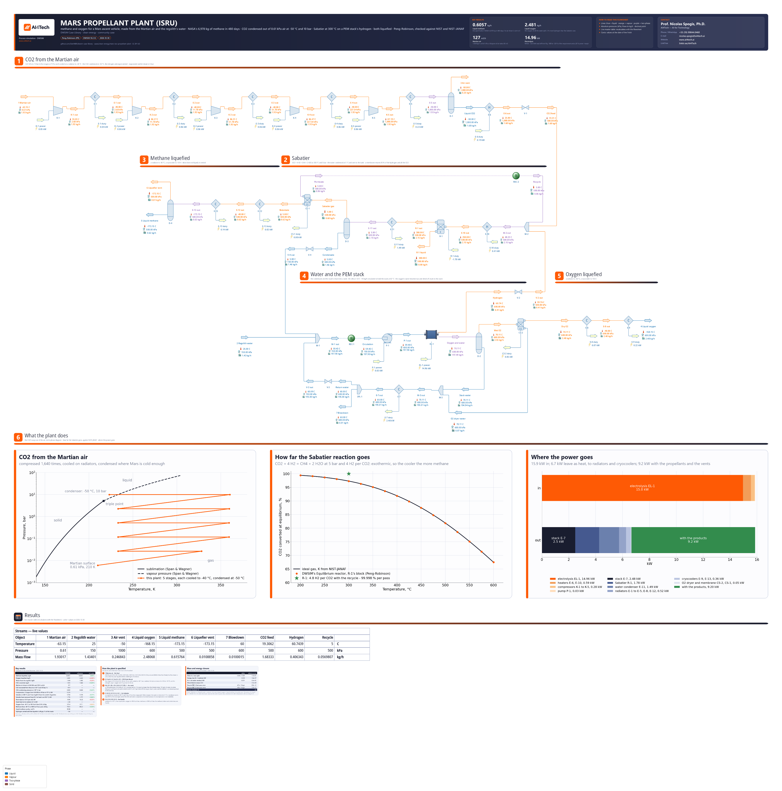

# Mars propellant plant (ISRU): methane and oxygen from the Martian atmosphere and regolith water

**Category:** clean-energy
**Status:** community
**DWSIM version:** 10.2.12
**Language:** English
**Contributor:** Prof. Nicolas Spogis, Ph.D. (@Spogis), AI4Tech · nicolas.spogis@ai4tech.ai · www.ai4tech.ai

## Summary

A crew leaving Mars needs about 7 t of liquid methane and 23 t of liquid oxygen for its ascent vehicle. Making them there, from the CO2 of the atmosphere and the water bound in the regolith, saves landing some 30 t of propellant. This is in-situ resource utilisation (ISRU). Kleinhenz and Paz (NASA, 2017) sized such a plant for NASA's Evolvable Mars Campaign: 6,978 kg of methane in 480 days of continuous operation, 0.61 kg/h, with the oxygen of all the water it splits, 2.43 kg/h.

This case is that plant, on DWSIM's own blocks:

- the CO2 compressed out of the Martian air, 0.61 kPa and 210 K, in five intercooled stages, and condensed at -50 °C;
- a Sabatier reactor, CO2 + 4 H2 = CH4 + 2 H2O, at 300 °C, fed the hydrogen of a PEM electrolyser;
- the water condensed out and returned to the electrolyser, the hydrogen left over returned to the reactor by a membrane;
- the methane and the oxygen liquefied, at 100 K and 105 K.

The air drawn is set so that the plant liquefies NASA's 0.6057 kg/h of methane: 1.93 kg/h of air, which at the surface's pressure takes up 127 m³/h. The plant then makes 2.48 kg/h of oxygen from 1.43 kg/h of regolith water, within 2.4 % and 5.2 % of NASA's figures. The electrolysis takes 15.0 kW of the 15.9 kW the plant draws.

The thermodynamics is checked against references outside DWSIM. The CO2's condensing pressure and the duties of liquefying methane and oxygen are within 0.5 % of NIST. The Sabatier reactor's heat is within 0.06 % of NIST-JANAF.

## Process description

- **CO2 from the Martian air.** The air (95.1 % CO2, 2.59 % N2, 1.94 % Ar, 0.16 % O2, 0.06 % CO by volume, NASA's Mars Fact Sheet) is drawn at 0.61 kPa and 210 K.
  - The compressors K-1 to K-5 raise it 4.4 times each, at 75 % adiabatic efficiency, to 10 bar: 0.28 kW in all. Each stage leaves at 55 to 87 °C.
  - Radiators E-1 to E-4 cool it to -40 °C between stages, 23 K above the planet's mean surface temperature, -63 °C.
  - E-5 cools the last stage's gas to -50 °C, below the CO2's condensing temperature at 10 bar. The drum D-1 vents 0.25 kg/h of gas, 70 % CO2 with the nitrogen and the argon, and keeps 1.68 kg/h of liquid CO2, 99.2 % pure: 89.9 % of the CO2 drawn.
  - The heater E-6 evaporates the liquid and warms it to 25 °C (0.19 kW), and the valve V-1 lets it down to the Sabatier's 5 bar.
- **Sabatier.** The mixer M-2 joins the CO2, the electrolyser's hydrogen and the membrane's recycle: 4.8 hydrogen per CO2.
  - The heater E-10 preheats the mix to 250 °C (0.41 kW).
  - The reactor R-1 is at 300 °C and 5 bar, at equilibrium. It converts 99.998 % of the CO2 on each pass, and 1.78 kW of heat is removed from it.
  - The cooler E-11 takes the gas to 5 °C (1.49 kW). The drum D-3 sends 1.46 kg/h of water, let down by V-4, back to the electrolyser's tank.
  - The gas, 55 % methane and 44 % hydrogen, goes to the membrane CS-1. It returns 90 % of the hydrogen and all the CO2 and water to M-2 through the Recycle block REC-2: 0.057 kg/h. The membrane is a component separator at constant pressure: its permeate's recompression is not modelled.
- **Methane liquefied.** The membrane's retentate, 92 % methane, is cooled on a radiator (E-12) to -40 °C and by a cryocooler (E-13, 0.14 kW) to 100 K at 5 bar. The drum D-4 gives 0.616 kg/h of liquid methane, 98.9 % pure, and vents 0.011 kg/h of gas, 91 % hydrogen.
- **Water and the PEM stack.** The regolith's water, 1.43 kg/h at 25 °C, the Sabatier's condensate and the stack's return water meet in the tank M-1 at 1.5 bar.
  - The pump P-1 sends 198 kg/h to the stack EL-1 at 6 bar.
  - EL-1 has 40 cells at 1.8 V and takes 15.0 kW. It splits 2.79 kg/h of water at 100 % Faraday efficiency, 2 % more hydrogen than the Sabatier takes. Its waste heat is the 0.32 V each cell carries above the thermoneutral voltage, 1.475 V: 2.70 kW.
  - The hydrogen, saturated with water, is let down by V-2 to the Sabatier.
  - The oxygen side carries the circulating water. The drum D-2 separates it, and the dryer CS-2 takes the last of the water out of the oxygen.
  - The mixer M-3 joins the stack's water and the dryer's. The radiator E-7 takes them back to 60 °C (2.48 kW), and the splitter SPL-1 returns 195 kg/h to the tank through V-3 and bleeds 0.01 kg/h off. The Recycle block REC-1 closes this loop.
- **Oxygen liquefied.** The dry oxygen, 2.48 kg/h, is cooled on a radiator (E-8) to -40 °C and by a cryocooler (E-9, 0.22 kW) to 105 K at 6 bar.

The streams are coloured by phase: liquid blue, vapour orange, two-phase purple. The coolers that condense send out purple lines: E-5 the CO2, E-11 the water, E-13 the methane.

Below the plant, three figures are drawn from the solved flowsheet:
- the CO2's way from the Martian surface to the condenser, on its phase diagram (Span and Wagner);
- how far the Sabatier reaction goes as the temperature rises: DWSIM's Equilibrium reactor, R-1's block, against the ideal-gas equilibrium on NIST-JANAF's constants;
- where the power goes: 15.9 kW in, 6.7 kW out as heat to the radiators and cryocoolers, 9.2 kW with the propellants and the vents.

## Feed and operating conditions

| Item | Value | Unit | Notes |
|---|---|---|---|
| Martian air | 0.61 kPa, 210 | K | 95.1 % CO2, 2.59 % N2, 1.94 % Ar, 0.16 % O2, 0.06 % CO by volume, normalised; NASA's Mars Fact Sheet |
| Air drawn | 1.930 | kg/h | set so that the plant liquefies 0.6057 kg/h of methane |
| Compression | 5 stages, 0.61 kPa to 10 | bar | 75 % adiabatic efficiency; each stage cooled to -40 °C |
| CO2 condenser E-5 | -50 | °C | at 10 bar, 3.2 bar above the CO2's condensing pressure |
| Sabatier R-1 | 300 °C, 5 | bar | the feed preheated to 250 °C; equilibrium on the compounds' Gibbs energies |
| Water condenser E-11 | 5 | °C | |
| Membrane CS-1 | 90 | % | of the hydrogen returned to the reactor, with all the CO2 and water |
| PEM stack EL-1 | 40 cells, 1.8 | V | 60 °C, 6 bar; power set for 2 % more hydrogen than the Sabatier takes |
| Stack circulation | 195 | kg/h | returned to the tank at 60 °C; 0.01 kg/h bled off |
| Regolith water | 1.434 | kg/h | 25 °C, into the tank at 1.5 bar; the water the plant consumes |
| Liquid methane | 100 K, 5 | bar | |
| Liquid oxygen | 105 K, 6 | bar | |
| Compressors, pump | 75 | % | |

All pressures are absolute. The production rates, the plant's subsystems and the regolith water are Kleinhenz and Paz's (2017). The temperatures, pressures, the CO2's capture by compression rather than a freezer, and the membrane's split are this case's choices. NASA mentions mechanical compressors as an alternative to the freezer.

## Thermodynamics

- **Property package:** Peng-Robinson (1976), with DWSIM's binary parameters. The databank has them for the pairs that set the phase splits: CO2 with hydrogen, methane, water and nitrogen; hydrogen with methane; methane with water. The 13 pairs it has none for are CO2-argon and pairs of traces (oxygen, CO, argon) or of water with hydrogen, oxygen and nitrogen.
- **Why not GERG-2008:** it would be the reference equation for every compound here, but on DWSIM 10.2.12 it has no density at the surface's 610 Pa: a compressor fed the Martian air stops with "GERG error: unable to calculate density". A Gibbs reactor on it did not converge in 120 s at 5 bar either. Where both run, Peng-Robinson came within 1.3 % of GERG-2008 on the CO2 condensed out of the air and within 0.4 % on the cryogenic duties.
- **Checked against NIST:**
  - the CO2's condensing pressure at -50 °C: 0.24 % above Span and Wagner;
  - the methane's and the oxygen's cooling, from -40 °C to their liquids: 0.34 % and 0.52 % below Setzmann and Wagner and Schmidt and Wagner;
  - the Sabatier's equilibrium constant and heat, against NIST-JANAF (Results).

## Tuning and convergence notes

**The reactor: DWSIM's Equilibrium reactor, not its Gibbs reactor**

- **The Gibbs reactor does not give the same answer twice** on 10.2.12. Solved once, its outlet is the equilibrium and its heat JANAF's. Solved again on the same feed, as a recycle solves it on every pass, it went wrong:
  - on some solves the heat came out as if nothing had formed, +3.9 kW where JANAF gives -1.68 kW for 0.01 mol/s of CO2;
  - from the fourth solve, the CO2 left in the outlet drifted to a millionth of the equilibrium's.
- **The Equilibrium reactor** is given the reaction, CO2 + 4 H2 = CH4 + 2 H2O in the gas on fugacities, with an empty ln K expression. DWSIM then takes K from the compounds' Gibbs energies of formation, the data a Gibbs reactor minimises over. It gives the same outlet on every solve, and its heat is within 0.06 % of JANAF's.
- **Two of its settings are changed:**
  - `UsePreviousSolution` is on. From zero extents, its default on every solve, it did not come back in 20 s on R-1's own feed with 2 % less hydrogen. Started from its last answer, it solved eleven feeds in half a second each.
  - `InternalLoopTolerance` is 1e-10. The default, 1e-3, is on the sum of the squared ln(Q/K) and let the outlet stop 3 % short of K.

**The loops**

- **Two Recycle blocks:** REC-1 on the stack's water, REC-2 on the membrane's hydrogen. DWSIM's Recycle, in its default mode, only copies its inlet onto the tear. The membrane sends 90 % of the hydrogen back, so copying closes that loop by a tenth a pass.
- **The build closes both loops from outside the solver,** by Wegstein on every compound's flow and on the temperature: 6 to 11 passes. It then scales the air drawn to the methane liquefied, and with it the electrolyser's power and the regolith water, until the methane is NASA's.
- **The Recycles' tolerances are set from the plant's flows:** 1e-7 kg/s on the water, 1e-9 kg/s on the hydrogen, 1e-4 K, 1 Pa. DWSIM's defaults, 0.01 kg/s and 0.1 K, are a hundred times this plant's flows: every loop would "converge" on its first pass. The solver then accepts the closed state: on the last solve the Recycles' last-pass errors are below 1e-12 kg/s (the closure card).

**The PEM stack**

- **The circulating water holds the stack's temperature.** DWSIM's water electrolyser puts its waste heat into its two outlets as the same rise in specific enthalpy: the heat over the mass fed. Fed only the water it splits, plus a quarter, this stack would send its oxygen out at about 1,760 °C. With 198 kg/h through it, its outlets are at 61 and 70 °C, and E-7 returns the water to 60 °C.
- **Its energy balance is open by -0.091 kW.** DWSIM's electrolyser lets its hydrogen and oxygen leave saturated with water at its inlet's temperature, and puts no energy into vaporising that water. That is 0.6 % of the stack's 15.0 kW. The flowsheet's closure card shows EL-1's residual on a line of its own. Without it, the boundary closes to 1.7e-7 on mass and energy.

**Settings changed from the defaults:**
- flash tolerances of 1e-10;
- R-1's previous solution and its tolerance;
- the Recycles' tolerances.

## Results

The references are outside DWSIM. Each is worked out in the case's `build.py`, which embeds the data it uses:

- **The plant's rates** are Kleinhenz and Paz's (2017, Fig. 2): 6,978 kg of methane, 27,912 kg of oxygen, 15,701 kg of water and 19,190 kg of CO2, over 480 days of continuous operation.
- **The electrolysis power** is read off their Fig. 10B: about 23.5 kW for case 2. Their plant produces 120 % of the requirement (three modules at 40 % each), and their power carries a 20 % growth margin, so the reference is 23.5 / 1.2 / 1.2 = 16.3 kW.
- **The CO2's condensing pressure and the cryogenic duties** are NIST's reference equations: Span and Wagner (CO2), Setzmann and Wagner (methane), Schmidt and Wagner (oxygen).
- **The Sabatier's equilibrium and heat** are NIST-JANAF's ideal gases.
  - K comes from JANAF's formation constants at 500, 600 and 700 K, through log10 K = a + b/T + c ln T.
  - The heat comes from JANAF's formation enthalpies and H - H(298.15), for the same flows in and out of R-1.

Things to keep in mind when reading the table:

- **The methane is the specification**, met by the air drawn.
- **The oxygen and the water are above NASA's:**
  - **Oxygen, 2.4 % above.** NASA's figures are the stoichiometric ones: 2 water and 2 oxygen per methane. This plant splits 2 % more water than the Sabatier needs. That hydrogen leaves with the liquefier's vent and dissolved in the liquid methane, together with 0.65 % of the methane made, and the oxygen of that water is liquefied with the rest.
  - **Water, 5.2 % above.** The same 2 %, and 0.01 kg/h bled off the stack's loop.
- **The electrolysis is 8.3 % below NASA's estimate.** At 1.8 V a cell, the stack draws 14.96 kW and puts 82 % of it into splitting the water (1.475 V of the 1.8). NASA's figure, read off a bar chart, implies about 1.96 V a cell, 75 %.
- **The Sabatier's log10 K is 0.020 below JANAF's,** which is 4.7 % on K. DWSIM's K is the one its own Gibbs energies of formation give: with the tolerance at 1e-10, the outlet's fugacities sit on it to five figures. Its heat is within 0.06 % of JANAF's.

Relative errors are on the reference.

| Quantity | DWSIM | Reference | Reference source | Rel. error |
|---|---|---|---|---|
| Methane liquefied, kg/h | 0.6057 | 0.6057 | Kleinhenz & Paz (2017), NASA | 0.00 % |
| Oxygen liquefied, kg/h | 2.481 | 2.423 | Kleinhenz & Paz (2017), NASA | +2.38 % |
| Water from the regolith, kg/h | 1.434 | 1.363 | Kleinhenz & Paz (2017), NASA | +5.21 % |
| CO2 converted, kg/h | 1.672 | 1.666 | Kleinhenz & Paz (2017), NASA | +0.40 % |
| Martian air drawn at 0.61 kPa and 210 K, m3/h | 127 | — | 1.930 kg/h: at 0.61 kPa a kilogram of air takes 66 m3 | — |
| CO2 recovered from the air at -50 °C and 10 bar, % | 89.9 | — | the rest leaves with the nitrogen and the argon vented | — |
| CO2 condensing pressure at -50 °C, bar | 6.840 | 6.824 | NIST WebBook (Span & Wagner) | +0.24 % |
| Compression, 5 stages from 0.61 kPa to 10 bar at 75 %, kW | 0.276 | — | — | — |
| Sabatier at 300 °C and 5 bar: log10 K from the outlet's fugacities | 5.558 | 5.578 | NIST-JANAF | −0.37 % |
| Sabatier heat removed from R-1, its feed in at 250 °C, kW | 1.776 | 1.777 | NIST-JANAF | −0.06 % |
| Electrolysis at 1.8 V per cell, kW | 14.96 | 16.32 | Kleinhenz & Paz (2017), NASA | −8.33 % |
| Stack heat to its radiator (E-7), kW | 2.48 | — | — | — |
| Oxygen from -40 °C to 105 K at 6 bar (E-9), kJ/kg | 315.4 | 317.1 | NIST WebBook (Schmidt & Wagner) | −0.52 % |
| Methane from -40 °C to 100 K at 5 bar, pure, kJ/kg | 799.5 | 802.3 | NIST WebBook (Setzmann & Wagner) | −0.34 % |
| Liquid methane purity, mol % | 98.88 | — | the rest: hydrogen, nitrogen and argon dissolved at 100 K | — |
| Hydrogen vented with the liquefier's off-gas, % of the made | 1.86 | — | — | — |

## Files

- `mars-isru-propellant-plant.dwxmz` - the DWSIM flowsheet, with:
  - AI4Tech's title block (logo, key results, contact);
  - the three figures, drawn from the solved flowsheet;
  - a live master table of the main streams;
  - result cards.
- `mars-isru-propellant-plant.png` - the flowsheet as DWSIM draws it.

## Confidentiality

No plant data of the contributor or of any client is used:
- The plant's rates and subsystems are those Kleinhenz and Paz (2017) published. Their paper is a work of the U.S. Government, not subject to copyright protection in the United States.
- The temperatures, pressures and splits of this flowsheet are the contributor's own choices, from engineering practice.
- The references are the published literature, NASA's Mars Fact Sheet, the NIST Chemistry WebBook and the NIST-JANAF tables.

No company, site or person is named but the contributor, whose contact details appear in the flowsheet's title block with the maintainer's agreement. The contributor ran no simulator but DWSIM, and has the right to publish all of it.

## References

- J. E. Kleinhenz, A. Paz, "An ISRU Propellant Production System to Fully Fuel a Mars Ascent Vehicle", AIAA 2017-0423, 10th Symposium on Space Resource Utilization, AIAA SciTech Forum, Grapevine, Texas, 2017. https://doi.org/10.2514/6.2017-0423 (NASA Technical Reports Server: https://ntrs.nasa.gov/citations/20170001498)
- D. R. Williams, *Mars Fact Sheet*, NASA Space Science Data Coordinated Archive. https://nssdc.gsfc.nasa.gov/planetary/factsheet/marsfact.html
- M. W. Chase Jr., *NIST-JANAF Thermochemical Tables*, 4th ed., Journal of Physical and Chemical Reference Data, Monograph 9 (1998). https://janaf.nist.gov
- R. Span, W. Wagner, "A New Equation of State for Carbon Dioxide Covering the Fluid Region from the Triple-Point Temperature to 1100 K at Pressures up to 800 MPa", *Journal of Physical and Chemical Reference Data* 25 (1996) 1509-1596. https://doi.org/10.1063/1.555991
- U. Setzmann, W. Wagner, "A New Equation of State and Tables of Thermodynamic Properties for Methane Covering the Range from the Melting Line to 625 K at Pressures up to 1000 MPa", *Journal of Physical and Chemical Reference Data* 20 (1991) 1061-1155. https://doi.org/10.1063/1.555898
- R. Schmidt, W. Wagner, "A New Form of the Equation of State for Pure Substances and its Application to Oxygen", *Fluid Phase Equilibria* 19 (1985) 175-200. https://doi.org/10.1016/0378-3812(85)85002-0
- D.-Y. Peng, D. B. Robinson, "A New Two-Constant Equation of State", *Industrial & Engineering Chemistry Fundamentals* 15 (1976) 59-64. https://doi.org/10.1021/i160057a011
- P. J. Linstrom, W. G. Mallard (eds.), *NIST Chemistry WebBook*, NIST Standard Reference Database 69, National Institute of Standards and Technology: E. W. Lemmon, M. O. McLinden, D. G. Friend, "Thermophysical Properties of Fluid Systems". https://doi.org/10.18434/T4D303
