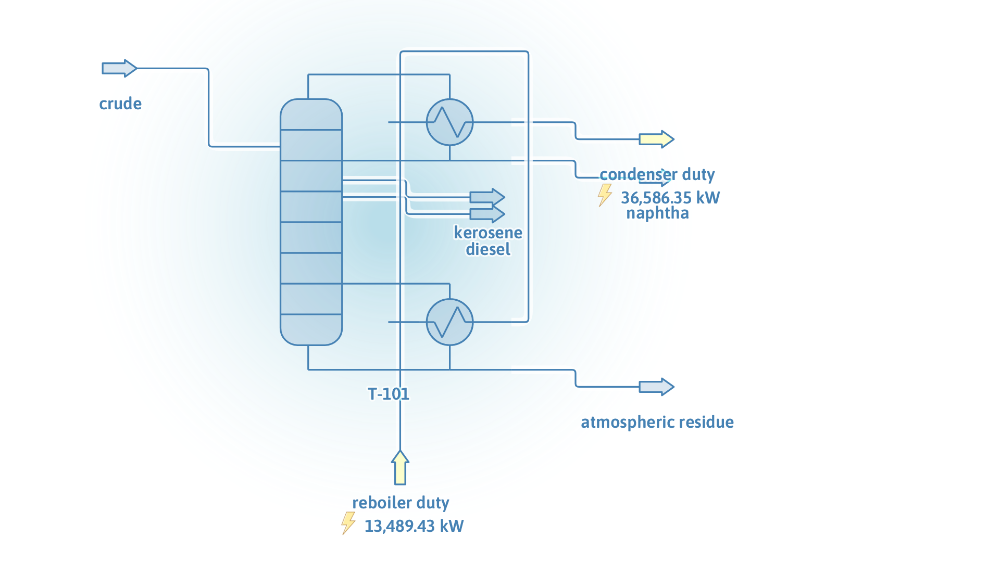

# Atmospheric crude tower: inside-out solver

**Category:** crude-distillation
**Status:** community
**DWSIM version:** 10.2.12, DWSIM Patreon level 2 or higher (Inside-Out column solver)
**Language:** English
**Contributor:** Daniel Wagner Oliveira de Medeiros (@DanWBR)

## Summary

A whole medium crude, residue included, heated to 360 C and fed to the flash zone of a 20-stage atmospheric tower with kerosene and diesel side draws, naphtha overhead and the atmospheric residue at the bottom. The feed enters 81 % vaporized. The column solves in a fraction of a second with the Inside-Out (Boston-Sullivan) solver; the bubble-point and Naphtali-Sandholm solvers do not converge it. A Distillation Curves utility on each product reports its curves and product properties.

> This flowsheet needs DWSIM Patreon level 2 or higher: the Inside-Out column solver ships with the Refining pack. In other editions, open the column, pick another solver and expect it to fail on this feed (see the notes below).

## Process description

100 kg/s of crude at 360 C and 2 bar enters stage 16 of a 20-stage column with a total condenser and a reboiler. Kerosene leaves as a liquid side draw from stage 6 and diesel from stage 11; naphtha is the distillate and the atmospheric residue the bottoms. The reboiler stands in for the stripping steam of a real tower.

## Feed and operating conditions

| Item | Value | Unit | Notes |
|---|---|---|---|
| Crude TBP (vol %, C) | 0: 36, 10: 110, 30: 210, 50: 312, 70: 420, 90: 580, 100: 760 | | medium crude, API about 33 |
| Crude feed | 100 | kg/s | 360 C, 2 bar, 81 % vaporized (molar) |
| Pseudocomponents | 12 | | cut points 36, 80, 120, ..., 360, 420, 500, 600, 760 C; each boils at the TBP of the middle of its volume |
| Specific gravity | Watson K = 11.8 | | MW by Riazi-Daubert |
| Column | 20 stages, 1.5 bar top, 0.5 bar pressure drop | | feed on stage 16 |
| Condenser | reflux ratio 3 | | total condenser |
| Reboiler | residue rate, 93.6 | mol/s | the feed's molar flow above 360 C |
| Side draws | kerosene 74.1, diesel 80.1 | mol/s | 80 % of the feed's molar flow between 175 and 245 C and between 245 and 360 C |

## Thermodynamics

- **Property package:** Peng-Robinson.
- **Pseudocomponents:** created with the fluent API from the boiling point, specific gravity and molecular weight of each cut, with critical properties by Riazi-Daubert and the acentric factor by Lee-Kesler.

## Tuning and convergence notes

- Solver: Inside-Out (Boston-Sullivan), 0.2 s and 9 outer iterations from the column's own initial estimates.
- The same column with the Wang-Henke (bubble point) solver stopped at its iteration limit after 850 s; Naphtali-Sandholm gave no result in 15 minutes. In the bubble-point method the stripping-section vapour comes out of an energy balance that subtracts large flows, and with a feed this hot it collapses.
- The side draws are set at 80 % of an ideal cut. At 100 % the column has no solution: the diesel draw takes all the liquid from stage 11 and the stages below it, down to the flash zone, run dry. The inside-out solver stops after a few iterations and names the dry stages; lower the draws or raise the reflux. A real tower draws less than the ideal cut for the same reason (the overflash).
- Each product carries a Distillation Curves utility. The tower has no side strippers or pumparounds, so the products overlap: the kerosene keeps light ends (initial TBP 45 C) and reaches into the diesel range.

## Results

| Quantity | Value | Unit |
|---|---|---|
| Condenser duty | 36,586 | kW |
| Reboiler duty | 13,489 | kW |
| Top / flash zone / bottom temperature | 110 / 357 / 454 | C |

| Product | Flow (kg/s) | D86 10 % | D86 50 % | D86 90 % | D86 95 % | Flash point | Density at 15 C | Cetane index (D4737) |
|---|---|---|---|---|---|---|---|---|
| Naphtha | 23.25 | 82.7 C | 127.6 C | 176.3 C | 223.6 C | | 757.8 kg/m3 | |
| Kerosene | 13.34 | 202.1 C | 229.3 C | 261.0 C | 302.2 C | 68.3 C | 820.1 kg/m3 | |
| Diesel | 20.06 | 270.9 C | 311.8 C | 371.9 C | 407.7 C | 115.7 C | 864.4 kg/m3 | 53.7 |
| Atmospheric residue | 43.36 | 374.1 C | 472.8 C | 643.9 C | 660.0 C | 187.0 C | 944.1 kg/m3 | |

The products close the mass balance on the feed. The heavy D86 points of the residue lie outside the range of the D86 test and come from the conversion of its TBP curve; treat them as estimates.

## Files

- `atmospheric-crude-tower-inside-out.dwxmz`: the DWSIM flowsheet, with a Distillation Curves utility on each product.
- `atmospheric-crude-tower-inside-out.png`: flowsheet screenshot.

The flowsheet was built through the fluent API, solved, saved, then reloaded and re-solved from the saved file.

## Confidentiality

The crude TBP curve and all conditions are illustrative; no plant data was used.

## References

- Russell, R. A., "A flexible and reliable method solves single-tower and crude-distillation-column problems", *Chemical Engineering*, 1983.
- Seader, J. D., Henley, E. J., *Separation Process Principles*, 2nd ed., section 10.5 (inside-out method).
- API Technical Data Book, Petroleum Refining: procedures 3A1.1 (TBP to ASTM D86) and 2B7.1 (flash point).
