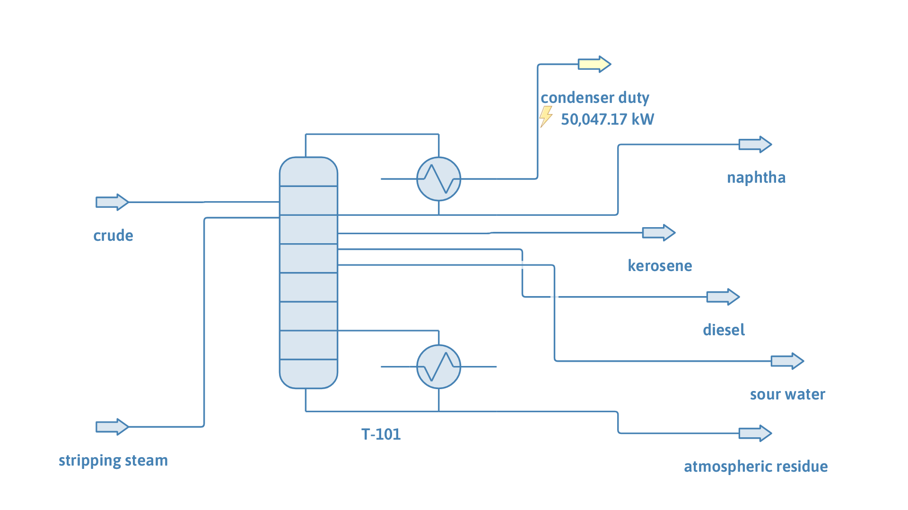

# Atmospheric crude tower with stripping steam and free water

**Category:** crude-distillation
**Status:** community
**DWSIM version:** 10.2.12, DWSIM Patreon level 2 or higher (Inside-Out column solver)
**Language:** English
**Contributor:** Daniel Wagner Oliveira de Medeiros (@DanWBR)

## Summary

The tower of `atmospheric-crude-tower-inside-out` run as a real atmospheric tower runs: no reboiler, 3 kg/s of stripping steam into the bottom stage, and the water decanted from the condenser as a free water product (sour water). The column solves in 0.3 s with the Inside-Out (Boston-Sullivan) solver. The steam strips the residue harder than the reboiler of the companion case: the residue flash point rises from 187 to 201 C.

> This flowsheet needs DWSIM Patreon level 2 or higher: the Inside-Out column solver ships with the Refining pack, and it is the solver that decants free water.

## Process description

100 kg/s of crude at 360 C and 2 bar (81 % vaporized) enters stage 16 of a 20-stage column with a total condenser; 3 kg/s of steam at 400 C and 4 bar enters stage 20. Kerosene leaves as a liquid side draw from stage 6 and diesel from stage 11; naphtha is the distillate, the atmospheric residue the bottoms, and the condensed steam leaves the condenser as free water.

## Feed and operating conditions

| Item | Value | Unit | Notes |
|---|---|---|---|
| Crude feed | 100 | kg/s | as in `atmospheric-crude-tower-inside-out`: 12 pseudocomponents, Watson K 11.8 |
| Stripping steam | 3 | kg/s | 400 C, 4 bar, to stage 20 |
| Column | 20 stages, 1.5 bar top, 0.5 bar pressure drop | | refluxed absorber: no reboiler |
| Condenser | reflux ratio 3 | | total condenser with a free water product |
| Side draws | kerosene 74.1, diesel 80.1 | mol/s | 80 % of the feed's molar flow between 175 and 245 C and between 245 and 360 C |

## Thermodynamics

- **Property package:** Peng-Robinson, with water added to the pseudocomponents.
- **Free water:** the condenser decants water as its own phase. The reflux returns without water, the water that reaches the condenser leaves as free water (the overhead vapour carries water up to saturation when there is one), and the condenser sits at the bubble point of the hydrocarbon liquid under the vapour pressure of water. Elsewhere in the column, water dissolves in the hydrocarbon liquid as the property package predicts.

## Tuning and convergence notes

- Solver: Inside-Out (Boston-Sullivan), 0.3 s from the column's own initial estimates.
- The free water product is a side product of the column marked Free Water in the side draw settings. With a solver that does not decant free water it stays empty and a warning says so.
- The stripping section below the flash zone cools from 350 C on the feed stage to 334 C at the bottom: the steam vaporizes the light ends of the residue and takes their heat of vaporization from the liquid.

## Results

| Quantity | Reboiler (companion case) | Stripping steam |
|---|---|---|
| Condenser duty | 36,586 kW | 50,047 kW |
| Condenser temperature | 110 C | 88 C |
| Free water | | 2.95 kg/s (of 3.0 kg/s of steam) |
| Naphtha | 23.25 kg/s | 24.49 kg/s |
| Kerosene flash point | 68.3 C | 73.1 C |
| Residue | 43.36 kg/s | 41.82 kg/s |
| Residue D86 10 % | 374.1 C | 394.8 C |
| Residue flash point | 187.0 C | 201.3 C |

| Product | Flow (kg/s) | D86 10 % | D86 50 % | D86 90 % | D86 95 % | Flash point | Density at 15 C | Cetane index (D4737) |
|---|---|---|---|---|---|---|---|---|
| Naphtha | 24.49 | 83.8 C | 130.6 C | 181.0 C | 228.3 C | | 759.7 kg/m3 | |
| Kerosene | 13.63 | 209.1 C | 234.7 C | 267.0 C | 307.9 C | 73.1 C | 823.7 kg/m3 | |
| Diesel | 20.11 | 278.7 C | 312.2 C | 362.1 C | 397.9 C | 121.1 C | 865.0 kg/m3 | 54.5 |
| Atmospheric residue | 41.82 | 394.8 C | 478.1 C | 645.5 C | 661.3 C | 201.3 C | 948.6 kg/m3 | |

The streams close the mass balance: 103.000 kg/s in (crude and steam) and out (products and free water). The residue keeps 0.08 % water by mass. The steam adds its own heat of condensation to the condenser duty and lowers the condenser temperature, since the hydrocarbon liquid boils there under a lower partial pressure.

## Files

- `atmospheric-crude-tower-steam-stripping.dwxmz`: the DWSIM flowsheet, with a Distillation Curves utility on each product.
- `atmospheric-crude-tower-steam-stripping.png`: flowsheet screenshot.

The flowsheet was built through the fluent API, solved, saved, then reloaded and re-solved from the saved file.

## Confidentiality

The crude TBP curve and all conditions are illustrative; no plant data was used.

## References

- Watkins, R. N., *Petroleum Refinery Distillation*, 2nd ed., Gulf Publishing, 1979 (stripping steam and the free water in crude towers).
- Seader, J. D., Henley, E. J., *Separation Process Principles*, 2nd ed., section 10.5 (inside-out method).
- API Technical Data Book, Petroleum Refining: procedures 3A1.1 (TBP to ASTM D86) and 2B7.1 (flash point).
