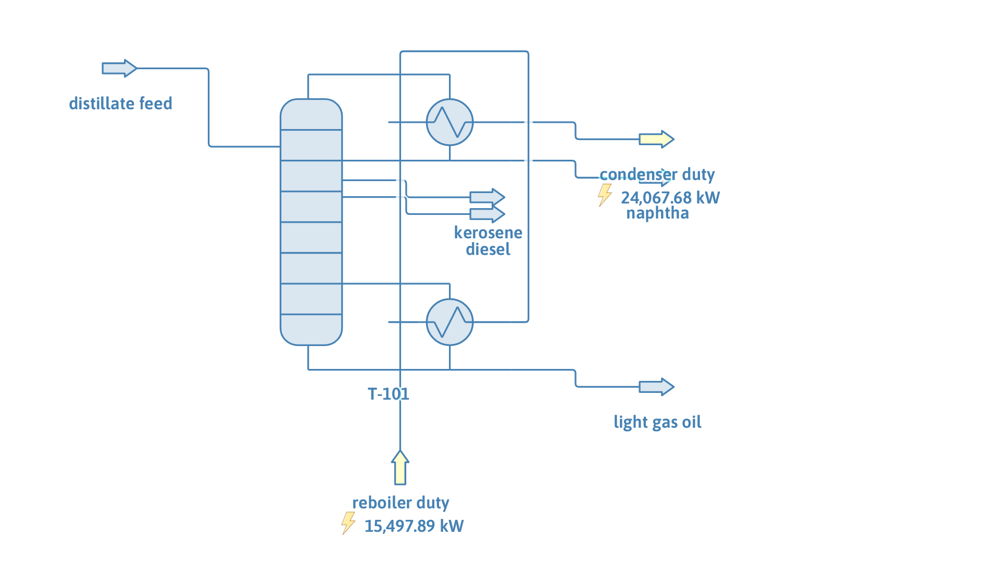
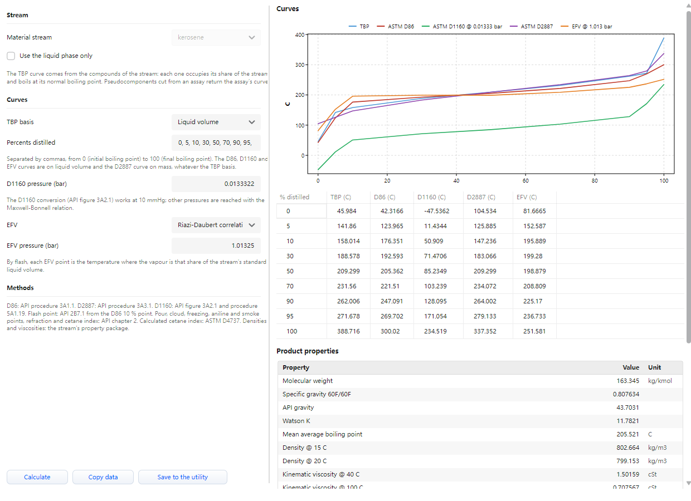

# Straight-run distillate fractionation: product distillation curves

**Category:** crude-distillation
**Status:** community
**DWSIM version:** 10.2.12
**Language:** English
**Contributor:** Daniel Wagner Oliveira de Medeiros (@DanWBR)

## Summary

The distillate part of a medium crude (everything that boils up to 420 C) is fractionated into naphtha, kerosene, diesel and a light gas oil. A Distillation Curves utility attached to each product reports its TBP, ASTM D86, D1160, D2887 and EFV curves together with the flash point, densities, viscosities and cetane index, so each cut can be checked against the pool it goes to. With this crude the kerosene meets the Jet A-1 flash point, front end, end point and density limits and misses the freezing point; the diesel is too heavy and too dense for EN 590.

## Process description

60 kg/s of straight-run distillate at 250 C and 2 bar enters stage 11 of a 20-stage column with a total condenser and a reboiler. Kerosene leaves as a liquid side draw from stage 6 and diesel from stage 11; naphtha is the distillate and a light gas oil is the bottoms.

The Distillation Curves utility of the kerosene, opened from the stream:

## Feed and operating conditions

| Item | Value | Unit | Notes |
|---|---|---|---|
| Crude TBP (vol %, C) | 0: 36, 10: 110, 30: 210, 50: 312, 70: 420, 90: 580, 100: 760 | | medium crude, API about 33 |
| Distillate feed | 60 | kg/s | the crude's cuts from 36 to 420 C, 250 C, 2 bar |
| Pseudocomponents | 9 | | cut points 36, 80, 120, ..., 360, 420 C; each boils at the TBP of the middle of its volume |
| Specific gravity | Watson K = 11.8 | | MW by Riazi-Daubert, viscosities by Abbott |
| Column | 20 stages, 1.5 bar top, 0.5 bar pressure drop | | feed on stage 11 |
| Condenser | reflux ratio 3 | | total condenser |
| Reboiler | light gas oil rate | mol/s | the feed's molar flow above 360 C |
| Side draws | kerosene 83.6, diesel 90.3 | mol/s | the feed's molar flow between 175 and 245 C and between 245 and 360 C |

## Thermodynamics

- **Property package:** Peng-Robinson.
- **Why this package:** a hydrocarbon mixture at low pressure; the cubic equation gives the vapour-liquid equilibrium and the liquid densities the product properties need.
- **Pseudocomponents:** created with the fluent API from the boiling point, specific gravity and molecular weight of each cut, with critical properties by Riazi-Daubert and the acentric factor by Lee-Kesler, as the petroleum characterization tools do.

## Tuning and convergence notes

- Solver: Wang-Henke (bubble point). The column's loop tolerances are 1e-3: at the defaults the converged column misses the post-solve mass balance check on the heaviest cut by about 0.1 %.
- The diesel is drawn from the feed stage. With the feed one or two stages below the diesel draw, or the draws moved up, the column stopped converging in the tests behind this case.
- A full atmospheric crude tower (residue included, feed at 330 to 360 C, flash zone vapour) failed to converge reliably with the current column solvers, which is why this case fractionates the distillate part of the crude. The reboiler stands in for the stripping steam of a real tower.
- The distillation curves of a product come from its compounds: each pseudocomponent occupies its share of the product's standard liquid volume and boils at its own boiling point. Traces of light and heavy cuts in a side draw therefore show up at the ends of its TBP curve; the D86 curve, converted by API procedure 3A1.1, smooths them.

## Results

| Product | Flow (kg/s) | D86 10 % | D86 50 % | D86 95 % | D86 FBP | Flash point | Density at 15 C | Cetane index (D4737) |
|---|---|---|---|---|---|---|---|---|
| Naphtha | 16.0 | 76.7 C | 113.0 C | 186.4 C | 229.7 C | | 750.8 kg/m3 | |
| Kerosene | 13.7 | 176.4 C | 205.4 C | 269.7 C | 300.0 C | 50.5 C | 802.7 kg/m3 | |
| Diesel | 21.1 | 247.8 C | 296.0 C | 378.0 C | 388.3 C | 99.8 C | 874.8 kg/m3 | 45.6 |
| Light gas oil | 9.2 | 340.3 C | 362.4 C | 394.6 C | 400.6 C | 163.6 C | 946.0 kg/m3 | |

Pool check:

| Product | Property | Value | Limit | Result |
|---|---|---|---|---|
| Kerosene | flash point (closed cup) | 50.5 C | at least 38 C (Jet A-1) | meets |
| Kerosene | D86 10 % | 176.4 C | at most 205 C | meets |
| Kerosene | D86 final boiling point | 300.0 C | at most 300 C | at the limit |
| Kerosene | density at 15 C | 802.7 kg/m3 | 775 to 840 kg/m3 | meets |
| Kerosene | freezing point (API 2B11.1) | -44.7 C | at most -47 C | misses |
| Diesel | flash point | 99.8 C | above 55 C (EN 590) | meets |
| Diesel | D86 95 % | 378.0 C | at most 360 C | misses |
| Diesel | density at 15 C | 874.8 kg/m3 | 820 to 845 kg/m3 | misses |
| Diesel | calculated cetane index | 45.6 | at least 46 | misses |

The flash point and the freezing point come from API Technical Data Book correlations (2B7.1 from the D86 10 % point, 2B11.1 from the mean average boiling point and gravity); treat them as estimates. The diesel results reflect a heavy, aromatic-leaning crude (Watson K 11.8): its straight-run diesel needs a lighter cut and hydrotreating before it meets EN 590. The companion case `straight-run-distillate-secondary-specs` converges this column on product end points.

## Files

- `straight-run-distillate-curves.dwxmz`: the DWSIM flowsheet, with a Distillation Curves utility on each product.
- `straight-run-distillate-curves.png`: flowsheet screenshot.
- `kerosene-distillation-curves.png`: the kerosene's distillation curves.

This case is generated and verified by an automated test in the DWSIM repository (`tests/DWSIM.FluentAPI.Tests/Samples/DistillateFractionationSample.cs`): built through the fluent API, solved, checked, saved, then reloaded and re-solved from the saved file.

## Confidentiality

The crude TBP curve and all conditions are illustrative; no plant data was used.

## References

- API Technical Data Book, Petroleum Refining: procedures 3A1.1, 3A2.1, 3A3.1 (distillation interconversions) and 2B7.1, 2B9.1, 2B10.1, 2B11.1, 2B13.1 (product properties).
- Riazi, M. R., *Characterization and Properties of Petroleum Fractions*, ASTM MNL50, 2005.
- ASTM D1655 (Jet A-1) and EN 590 (automotive diesel) for the limits above.
