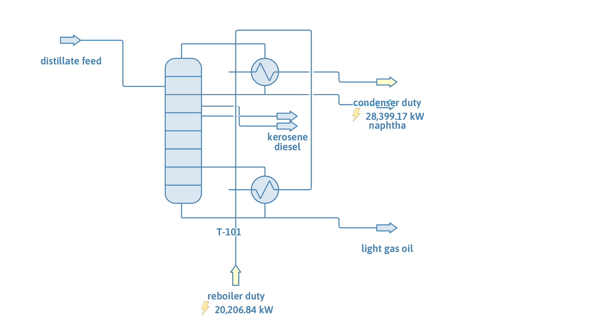

# Straight-run distillate fractionation: secondary specifications

**Category:** crude-distillation
**Status:** community
**DWSIM version:** 10.2.12
**Language:** English
**Contributor:** Daniel Wagner Oliveira de Medeiros (@DanWBR)

## Summary

The column of `straight-run-distillate-curves`, now converged on product quality: the kerosene D86 95 % point is set to 274 C and the diesel D86 95 % point to 374 C. Each target is a secondary specification that moves one side draw rate. The column meets both in two outer iterations (six column solves).

## Process description

Same feed and column as the companion case: 60 kg/s of straight-run distillate at 250 C into a 20-stage column with kerosene and diesel side draws, naphtha overhead and a light gas oil bottoms. The condenser keeps its reflux ratio of 3 and the reboiler its light gas oil rate; the two side draw rates become free variables.

## Feed and operating conditions

| Item | Value | Unit | Notes |
|---|---|---|---|
| Distillate feed | 60 | kg/s | as in `straight-run-distillate-curves` |
| Secondary specification 1 | kerosene D86 95 % = 274 C | | moves the kerosene draw rate, limits 50 to 150 % of the starting rate |
| Secondary specification 2 | diesel D86 95 % = 374 C | | moves the diesel draw rate, limits 50 to 150 % of the starting rate |
| Tolerance | 0.2 | K | on each D86 95 % point |

## Thermodynamics

- **Property package:** Peng-Robinson, with the same pseudocomponents as the companion case.

## Tuning and convergence notes

- A secondary specification is set in the column editor (Specifications, Secondary): the product, the property (any distillation curve point such as `D86 95%`, a product property such as `Flash Point (Closed Cup)`, or a stream property ID), the target and the variable it moves (the condenser or reboiler specification value, or a side draw rate). Each variable can serve one specification.
- The column solves inside an outer loop: Newton's method with a finite-difference Jacobian, updated by Broyden after each step. Here it took two iterations and six column solves in all.
- Choose a variable that drives the property. In this column the diesel is drawn from the feed stage, so its end point follows the feed's heavy end and moves little with the light gas oil rate; the diesel draw itself moves it. Pairs that act in opposite directions, or a target the column cannot reach, end with the closest solution found and a warning that names the specification.
- A column specified with both product rates and fixed side draws has no free rate left: the distillate is set by the balance. Keep a ratio or a duty on one end when a secondary specification moves a rate.

## Results

| Quantity | Free draws (companion case) | With secondary specifications |
|---|---|---|
| Kerosene draw | 83.6 mol/s | 74.2 mol/s |
| Diesel draw | 90.3 mol/s | 82.0 mol/s |
| Naphtha | 16.0 kg/s, D86 95 % 186.4 C | 18.5 kg/s, D86 95 % 198.1 C |
| Kerosene | 13.7 kg/s, D86 95 % 269.7 C | 12.7 kg/s, D86 95 % 273.9 C |
| Diesel | 21.1 kg/s, D86 95 % 378.0 C | 19.5 kg/s, D86 95 % 374.1 C |
| Light gas oil | 9.2 kg/s | 9.3 kg/s |
| Kerosene flash point | 50.5 C | 58.0 C |
| Diesel calculated cetane index | 45.6 | 46.0 |

Smaller side draws push their light ends up the column: the naphtha grows and gets heavier, the kerosene loses its front end (its flash point rises by 7.5 C) and gains on its back end, and the diesel loses part of its heavy end to the light gas oil.

## Files

- `straight-run-distillate-secondary-specs.dwxmz`: the DWSIM flowsheet, with the two secondary specifications and a Distillation Curves utility on each product.
- `straight-run-distillate-secondary-specs.png`: flowsheet screenshot.

This case is generated and verified by an automated test in the DWSIM repository (`tests/DWSIM.FluentAPI.Tests/Samples/DistillateFractionationSample.cs`): built through the fluent API, solved, checked, saved, then reloaded and re-solved from the saved file.

## Confidentiality

The crude TBP curve and all conditions are illustrative; no plant data was used.

## References

- API Technical Data Book, Petroleum Refining: procedure 3A1.1 (TBP to ASTM D86).
- Riazi, M. R., *Characterization and Properties of Petroleum Fractions*, ASTM MNL50, 2005.
