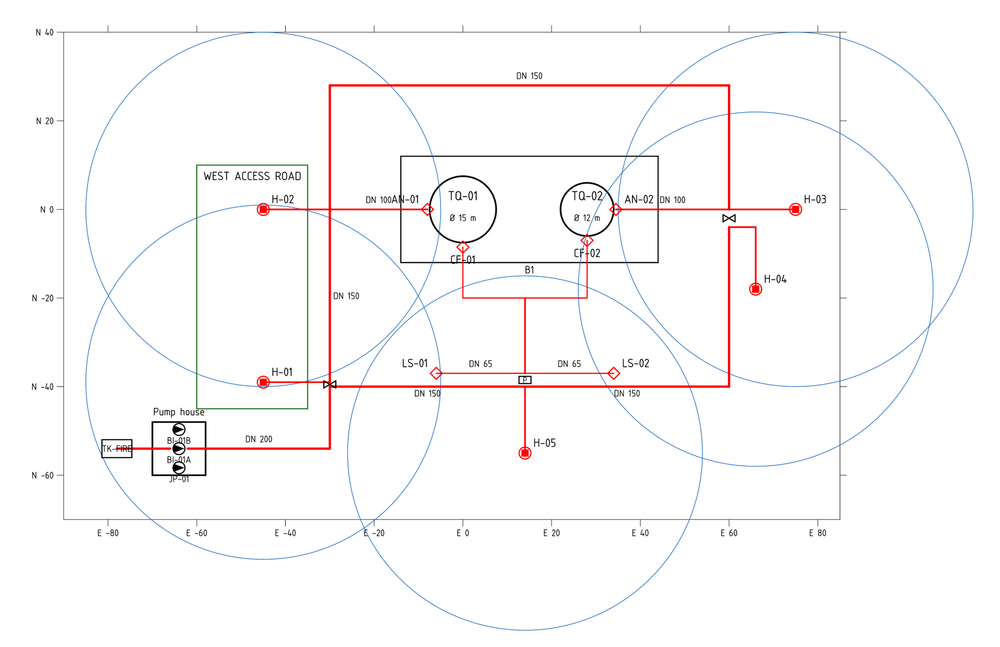
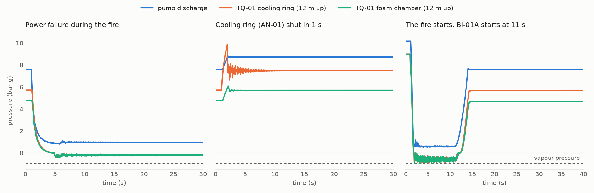

# Fire water network of a tank park: code check, drawings and water hammer

**Category:** fluid-flow-and-piping
**Status:** community
**DWSIM version:** 10.2.17 or later
**DWSIM edition:** Patreon Edition (Pipe Network with its Fire Protection tool)
**Language:** English
**Contributor:** Daniel Wagner Oliveira de Medeiros (@DanWBR)

> **Requirement.** The Pipe Network unit operation and its Fire Protection tool belong to DWSIM Patreon. The file opens anywhere, but the network only solves where the extension is licensed. The drawings of the Documents tab (P&ID, hydrant plan, isometrics, data sheets) are made by CADCraft, so it has to be installed on the same computer.

## Summary

The fire water network of a small tank park is checked against the São Paulo fire code (Instruções Técnicas 22 and 25, 2019 edition) and then put through seven water hammer cases. A 660 m³ fire reserve feeds a jockey pump, a main electric pump and a standby diesel pump. A 6 in ring main with two sectioning valves carries five hydrants, and two fixed-roof tanks are protected by cooling spray rings, foam chambers behind a 3 % proportioner and two supplementary foam lines.

The Fire Protection tool generates seven scenarios from the code and the plant, and the network meets all of them. The fire on TQ-01 governs the pumps, the reserve and the foam concentrate: it asks for 3036 L/min, which BI-01A delivers at 76 m, its rated point, and it needs 297 m³ of the 660 m³ in the reserve. The water hammer cases show that this network is not at risk of overpressure, because its velocities are low and its outlets stay open. The highest pressure of any case is 10.2 bar g, which is the jockey pump's shut-off pressure at rest, against PN 16 piping. The real transient risk is the other way round. When the power fails during the fire, or when the fire starts before the main pump does, the spray ring and the foam chamber 12 m up fall below the atmosphere, and the foam chamber touches the vapour pressure for a moment.

*The hydrant plan from the Documents tab: the ring main (DN 150) around the dike B1, the tanks TQ-01 and TQ-02, the reach circle of each hydrant (30 m of hose plus a 10 m jet), the pump house and the access road the hoses must reach.*

## The plant

The plant is an invented example. It is not the model of a real site.

| Item | Value | Notes |
|---|---|---|
| Fire reserve TK-FIRE | 660 m³ effective, 6 m of water, 0.5 m minimum level | ground level, the datum of the network |
| Jockey pump JP-01 | 18 L/min, 98 m at shut-off | holds the ring at rest |
| Main pump BI-01A | 3000 L/min at 76 m, 90 m at shut-off, electric | starts at 7 bar after 10 s |
| Standby pump BI-01B | same curve, diesel | starts at 6.3 bar after 20 s |
| Pump discharge | DN 200, 46 m | |
| Ring main | DN 150, about 310 m, two sectioning valves SV-01 and SV-02 | Hazen-Williams C = 120 |
| Hydrants H-01 to H-05 | DN 100 branches, 30 m of hose each | 200 L/min at 40 mca at the valve (IT 22, system type 3) |
| TQ-01 | 15 m diameter, 12 m high, 2100 m³, class I | spray ring AN-01 (K 640), foam chamber CF-01 (K 340) |
| TQ-02 | 12 m diameter, 10 m high, 1100 m³, class II | spray ring AN-02 (K 400), foam chamber CF-02 (K 220) |
| Foam proportioner FP-01 | 3 % concentrate, 6 m³ tank | feeds the foam chambers and the supplementary lines LS-01 and LS-02 (K 90) |
| Piping | steel, PN 16 | wall thickness from the nominal size (ASME B36.10 STD) |

Every node, outlet and pipe route has a plant position, so the pipe lengths and elevation changes come from the routes, and the hose reach, the drawings and the 3D model come from the same data.

## Thermodynamics

- **Property package:** Steam Tables (IAPWS-IF97)
- **Why this package:** the network carries cold fresh water. The incompressible nodal solver needs one density, and the steam tables give it exactly (997.1 kg/m³ at 25 °C). The water hammer uses the same density and a bulk modulus of 2.19 GPa.

## Code check

The zone TP follows the profile BR-SP-2019 (IT 22/2019 for the hydrants, IT 25/2019 for the tanks), and the tool compares it with the 2011 edition. The tool turns the protected risks into demands: each tank on fire needs its own cooling (2 L/min/m² on the shell), foam on the liquid surface (4.1 L/min/m²) and one supplementary line of 200 L/min, and its neighbour at 14.5 m needs cooling too.

| # | Scenario | Flow (L/min) | Most unfavourable outlet | Margin (mca) |
|---|---|---:|---|---:|
| 1 | Most unfavourable hydrants (H-03 and H-04) | 400 | H-04 | 55.3 |
| 2 | SV-01 shut | 400 | H-01 | 55.0 |
| 3 | SV-02 shut | 400 | H-03 | 55.3 |
| 4 | BI-01A out of service (BI-01B runs) | 400 | H-04 | 55.3 |
| 5 | Fire on TQ-01 | 3036 | AN-02 | 6.6 |
| 6 | Fire on TQ-02 | 2902 | AN-01 | 9.9 |
| 7 | Reserve at the minimum level | 400 | H-04 | 49.8 |

In the code scenarios, each open outlet draws its required flow, and the check is the pressure at the valve. Because the K factor of each spray ring, foam chamber and foam line is known, the valve must also have the pressure that device needs to pass the required flow, (Q/K)². This is the check that sets the K factors of TQ-01. Its spray ring AN-01 cools TQ-01 with 1131 L/min when TQ-01 is on fire, and it cools it as a neighbour with 1484 L/min when TQ-02 is on fire. With K 480 it would pass only 1210 L/min at the 64.8 mca the network gives it, so the ring is K 640, which needs 54.9 mca. The foam chamber CF-01 is in the same position: with K 260 it would pass 600 of its 724.5 L/min, so it is K 340, which needs 46.3 mca of the 54.4 mca available.

| Item | Result | Limit |
|---|---|---|
| BI-01A in the fire on TQ-01 | 2977 L/min at 76.0 m, NPSH available 15.9 m against 4.0 m required | head required 69.4 m |
| BI-01A shut-off head | 90 m | at most 100 m (IT 22) and 1.4 times the rated head (NFPA 20) |
| BI-01A head at 150 % of the rated flow | 58.5 m | at least 65 % of the rated head, 49.4 m (NFPA 20) |
| Static pressure at rest at the worst point (AN-01) | 83.8 mca | at least 10 mca (IT 25) |
| Fire reserve | 297.2 m³ required (flow times time of the fire on TQ-01) | 660 m³ available |
| Foam concentrate | 3.05 m³ (twice the 1.525 m³ of the fire on TQ-01) | 6 m³ stored |
| Hose reach on the access road | 100 % of 5500 points, along the real hose path | one nozzle at every point |

**Against the 2011 edition:** the verdicts are the same under both editions, and the 2019 edition asks for more water. The reserve goes from 270 to 297 m³, and the largest pumped flow goes from 2771 to 2996 L/min.

**Field tests:** the file carries a hydrant flow test and an annual pump test with example readings. The pump test lands at 99.5 % of the manufacturer's head at the rated flow. The flow test drops the pressure by only 14 % of the static, so the tool warns that its extrapolation to 20 psi (2670 L/min, by NFPA 291) is weak. Replace both with field readings before using the calibration.

## Water hammer

The Water Hammer tab runs the method of characteristics on the same network. Each pipe gets its wave speed from its wall (1309 to 1391 m/s here), the friction along the characteristics is the pipe's own Hazen-Williams loss, the pumps run in four quadrants with their inertia and check valves, and a vapour cavity forms where the pressure reaches the vapour pressure. The time step is 3.06 ms over 161 sections, and each case takes about one second.

The tool generates four cases from the most unfavourable hydrant scenario. Three more cases were added by hand from the fire on TQ-01, because the water moves fastest there (about 1.5 m/s in the pump discharge).

| Case | Highest (bar g) | Lowest (bar g) | What happens |
|---|---:|---:|---|
| Power failure (hydrants) | 9.28 at the start | -0.57, foam chamber riser | the pumps run down and the ring falls to the reserve head |
| Trip of BI-01A (hydrants) | 9.28 at the start | -0.56, foam chamber riser | the same, with the jockey still running |
| Hydrants close in 2 s | 10.24 | 0.57 | BI-01A's check valve shuts and the ring settles at the jockey's shut-off head |
| Hydrants open, pumps start after their delays | 10.17 at rest | -0.98, foam chamber | the foam chamber touches the vapour pressure for 40 ms (cavity under 0.1 L) |
| TQ-01: power failure during the fire | 7.59 at the start | -0.43, spray ring | BI-01A's check valve shuts at 5.9 s, and the outlets 12 m up stop discharging |
| TQ-01: cooling ring shut in 1 s | 9.89 | 0.51 | the deluge valve of AN-01 shuts, and its branch peaks 2.4 bar above the pressure it settles at |
| TQ-01: the fire starts | 10.17 at rest | -0.98, spray ring of TQ-02 | the outlets run on the reserve head for 10 s, then BI-01A brings the ring back to 7.6 bar g |

*Pressure at the pump discharge, at the TQ-01 spray ring and at the TQ-01 foam chamber in the three cases from the fire on TQ-01. The dashed line is the vapour pressure.*

Every pipe stays within PN 16. In the cases that start from the fire, the outlets behave as orifices with their K factors, so they discharge more than the code asks for at the pressure the network gives them. The spray ring AN-01 gives 1529 L/min against 1131 required, the foam chamber CF-01 gives 741 against 724.5, and BI-01A runs at 3426 L/min, 114 % of its rated flow.

## Tuning and convergence notes

- **Start the transients from the governing scenario:** the generated cases start from the most unfavourable hydrants, where the pump discharge carries 850 L/min at 0.4 m/s, so the surges stay small. If you add cases from the fire on the largest tank, the velocities and the pump flow are the ones the design is about.
- **Below the atmosphere, the model keeps the water:** when the ring falls to the reserve head, the risers to the outlets 12 m up go to between -0.2 and -1.0 bar g. A real riser drains and takes air through the open spray nozzles, and the next start then has to fill it. The model holds the column and lets a vapour cavity form at the vapour pressure, so read these minima as a sign that the riser empties. They are not pressures to design for.
- **The jockey's check valve chatters at its shut-off head:** in the case where the hydrants close, the ring ends at the jockey's shut-off pressure, and the jockey's check valve opens and shuts about 90 times in 20 s. The transient does not model the jockey's stop pressure switch (9 bar), which would stop it. The report lists the first events and counts the rest.
- **Four-quadrant data:** outside its own curve, each pump follows the published data of a radial pump of specific speed 25, the only set in the open literature. The jockey has a specific speed of 2, so the report warns about it. This matters little here, because the jockey moves 18 L/min.
- **Preliminary design pressures in the isometrics:** the Documents tab estimates each line's design pressure from its operating pressure in the active scenario (8.9 bar g on the ring for the fire on TQ-01). This is below the 10.2 bar g the jockey holds at rest, so set the design pressure from the shut-off pressure before you issue the isometrics.

## How to reproduce

1. Open `fire-water-network-tank-park.dwxmz`. The network opens solved under the fire on TQ-01.
2. Open Tools > Fire Protection. The Verification and Report tab runs the seven scenarios and writes the calculation report (`calculation-report.html` is that report in English).
3. In the Water Hammer tab, press Run All Cases. Save Histories writes the pressure, speed and flow histories as CSV.
4. In the Documents tab, the drawing buttons make the P&ID, the hydrant plan, the isometrics, the data sheets, the take-off and the 3D and IFC models.

## Files

- `fire-water-network-tank-park.dwxmz`: the DWSIM flowsheet, with the zone, the risks, the scenarios, the field tests, the plant geometry and the seven water hammer cases.
- `fire-water-network-tank-park.png`: the hydrant plan above.
- `water-hammer.png`: the pressure histories of the TQ-01 cases.
- `calculation-report.html`: the calculation report in English, with the scenarios, the pumps, the reserve, the hose reach, the field tests, the water hammer cases and the drawing list.

## Confidentiality

The plant, its layout, the pump curves and the test readings were made up for this example. The case does not use data from any real installation.

## References

- São Paulo State Fire Department, Instrução Técnica 22/2019, hydrant and hose reel systems.
- São Paulo State Fire Department, Instrução Técnica 25/2019, fire safety for combustible and flammable liquids.
- São Paulo State Fire Department, Instruções Técnicas 22/2011 and 25/2011 (comparison).
- NFPA 20, Standard for the Installation of Stationary Pumps for Fire Protection.
- NFPA 291, Recommended Practice for Water Flow Testing and Marking of Hydrants.
- E. B. Wylie and V. L. Streeter, *Fluid Transients in Systems*, Prentice Hall, 1993.
- A. R. D. Thorley, *Fluid Transients in Pipeline Systems*, 2nd ed., Professional Engineering Publishing, 2004.
