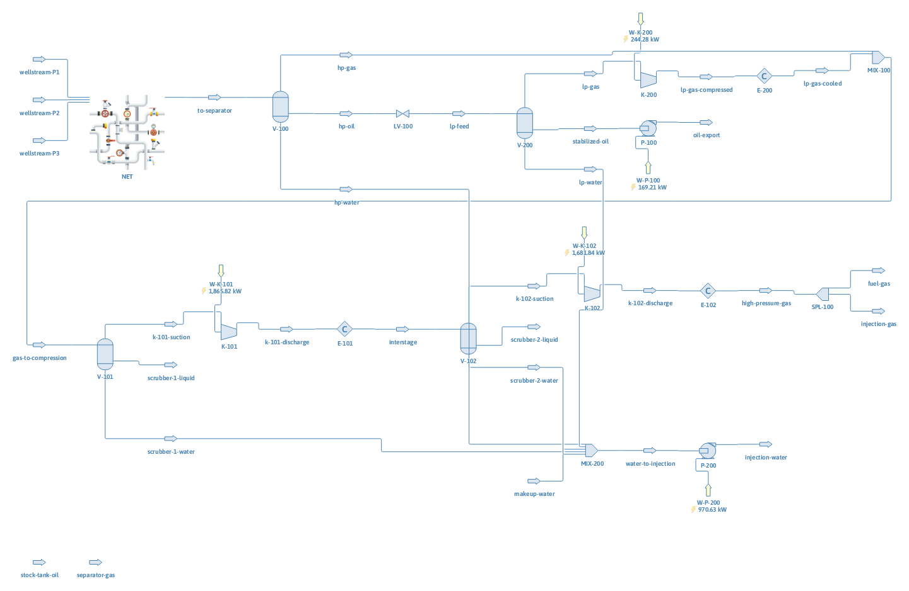
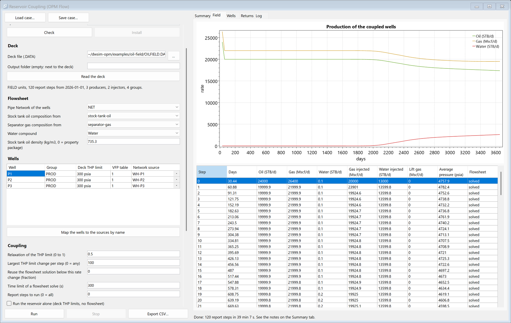
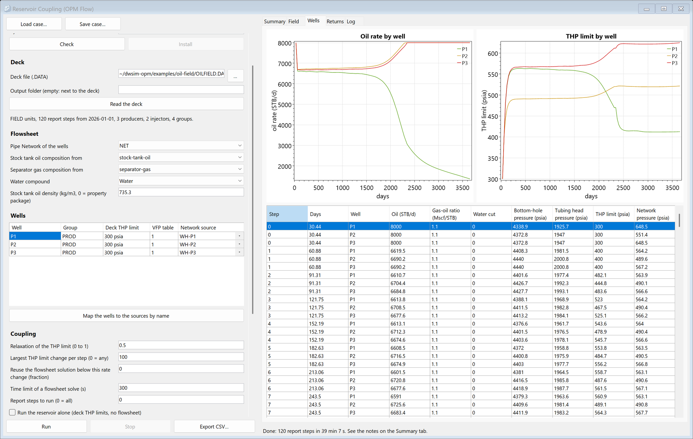
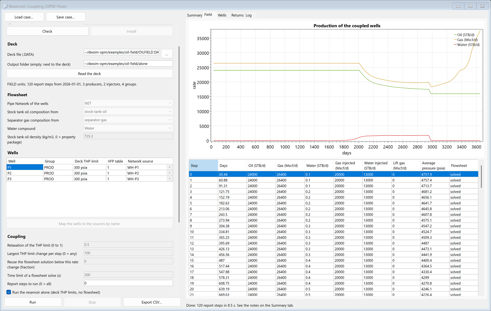

# Oil field from the reservoir to the plant (DWSIM coupled to OPM Flow)

**Category:** fluid-flow-and-piping
**Status:** community
**DWSIM version:** 10.3.0 or later
**DWSIM edition:** Patreon Edition (Reservoir Coupling, Pipe Network)
**Language:** English
**Contributor:** Daniel Wagner Oliveira de Medeiros (@DanWBR)

> **Requirement.** The Reservoir Coupling tool and the Pipe Network unit operation belong to DWSIM Patreon, and running a coupled case needs membership level 3. The reservoir simulator is OPM Flow, which runs in WSL on Windows; the tool's window checks the installation and can install it. The file opens anywhere, but the coupled run only starts where the extension is licensed.

## Summary

Ten years of an oil field with three producers, one gas injector and one water injector, solved together with its surface facilities. OPM Flow computes the reservoir. DWSIM computes the gathering network and a production plant with two-stage separation, gas recompression, injection compression, fuel gas and water injection. At every report step the network returns the wellhead pressure of each well to the reservoir, and the plant returns the gas and the water it has available for injection.

The reservoir run on its own, with the fixed 300 psia wellhead pressure of the reservoir model, holds 24000 STB/d for 5.5 years and recovers 77.1 million STB. With the surface model in the loop, the network returns wellhead pressure limits of 490 to 620 psia and the plant takes at most 20000 STB/d of liquid, and the same field recovers 70.3 million STB. The wells could flow against a much higher wellhead pressure (about 1800 to 1900 psia on the plateau), so the pressure limits never hold a well back. The difference of 6.8 million STB (9 %) comes from the plant: its liquid limit cuts the plateau from 24000 to 20000 STB/d, and the gas and water it reinjects keep the reservoir pressure higher, so P1 still produces at the end and the rate after ten years is higher than in the reservoir run alone.

## Process description

**Reservoir:** a box of 10 x 10 x 3 cells, 10000 ft on each side and 110 ft thick, with the top at 8300 ft, 27 % porosity and 350 / 60 / 220 mD in the three layers. The oil is undersaturated (4800 psia at 8400 ft, solution gas 1.1 Mscf/STB) over an aquifer contact at 8600 ft. Producers P1, P2 and P3 sit at three corners and are completed in the bottom layer. Gas injector GI1 sits at the fourth corner in the top layer, and water injector WI1 two cells away from P1. Each producer is set to 8000 STB/d of oil. A producer is shut when its oil rate falls below 1000 STB/d or its water cut passes 0.8. The numbers were chosen for the example. It is not a model of any real field.

**Gathering network (NET):** a Pipe Network block with one source per well (WH-P1, WH-P2, WH-P3), flowlines to a manifold and a trunk line to the plant, whose inlet separator holds the back pressure.

**Plant:**

| Section | Equipment | Duty |
|---|---|---|
| Separation | V-100 (three-phase, network pressure), LV-100, V-200 (3 bar) | oil, gas and water |
| Oil export | P-100 | stabilized oil to 30 bar |
| LP gas | K-200, E-200 | flash gas back to 20 bar, 40 °C |
| Injection compression | V-101, K-101 (70 bar), E-101, V-102, K-102 (250 bar), E-102 | two stages with a scrubber before each |
| Fuel gas | SPL-100 | 5 % of the compressed gas; the other 95 % is `injection-gas` |
| Water injection | MIX-200, P-200 (250 bar) | produced water plus 25 kg/s of make-up, as `injection-water` |

## Feed and operating conditions

| Item | Value | Unit | Notes |
|---|---|---|---|
| Stock tank oil | n-octane 0.25, n-decane 0.30, n-dodecane 0.25, n-tetradecane 0.20 | mole fraction | 735.3 kg/m³, 153.5 g/mol |
| Separator gas | methane 0.80, ethane 0.10, propane 0.07, n-butane 0.03 | mole fraction | 20.67 g/mol |
| Well target | 8000 | STB/d of oil per producer | bottom-hole limit 1000 psia |
| Plant liquid limit | 20000 | STB/d | return rule on group PROD |
| Tubing | 2560 m vertical, 5 in | | lift table of the wells |
| Bottom-hole temperature | 93 | °C | |
| Report steps | 120 of 30.44 days | | 10 years |

## Thermodynamics

- **Property package:** Peng-Robinson.
- **Why this package:** light hydrocarbons and water from 3 to 250 bar, which is the usual range of a cubic equation of state.
- **One fluid on both sides:** the black-oil PVT of the reservoir model (`pvt_dwsim.inc`) and the lift table of the wells (`vfp_dwsim.inc`) were generated by the tool from this flowsheet's fluid and property package. The reservoir and the plant therefore agree on densities, solution gas and formation volume factors, and the stock tank barrels of one side are the same mass on the other.

## How the coupling works

The case file `oil-field-reservoir-to-plant.dwrsc` holds the settings of the Reservoir Coupling window:

- **Wells to network:** P1, P2 and P3 are mapped to the sources WH-P1, WH-P2 and WH-P3. After each report step the rates of the wells go to the sources, the flowsheet is solved, and the pressure the network finds at each wellhead becomes the tubing head pressure limit of that well for the next step, with a relaxation of 0.5 and a largest change of 100 psi per step.
- **Gas injection:** the flow of `injection-gas` becomes the injection target of group GINJ.
- **Water injection:** the flow of `injection-water` becomes the injection target of group WINJ.
- **Plant capacity:** a constant limit of 20000 STB/d of liquid on group PROD.

The returns act one step later, since the reservoir step that produced the rates has already been computed when the plant is solved.

## Running the case

1. In WSL, write the reservoir model file: `python3 make_reservoir_model.py ~/dwsim-opm/examples/oil-field`. The script copies the two include files next to `OILFIELD.DATA`.
2. Open `oil-field-reservoir-to-plant.dwxmz` in DWSIM and open **Tools > Reservoir Coupling (OPM Flow)**.
3. Press **Check** to test the OPM Flow installation (**Install** sets it up when it is missing).
4. Press **Load case...** and pick `oil-field-reservoir-to-plant.dwrsc`, then **Read the reservoir model**.
5. Press **Run**. To see the reservoir on its own, tick **Run the reservoir alone** and run again.

## Tuning and convergence notes

- **Time:** the coupled run took 39 minutes on a desktop computer, almost all of it in the 120 flowsheet solves. The reservoir alone takes 9 seconds.
- **One step did not solve:** at step 75, while water was arriving at the wells, the flowsheet solve reached its time limit of 300 s. The tool kept the wellhead pressures and the returns of the step before and went on; the next step solved.
- **Scrubbers need a water outlet:** the first version of the plant had two-phase scrubbers. As soon as the wells produced water, the gas carried enough of it to condense after the coolers, and the scrubbers stopped the flowsheet in 30 steps. V-101 and V-102 now send their water to the injection header.
- **Well limits above the group targets:** the return rules write group targets. The injection wells of the reservoir model must have rate limits above those targets (40000 Mscf/d and 30000 STB/d here), or the well limit wins and the plant's figure never reaches the reservoir.
- **Lift table range:** the table covers 500 to 12000 STB/d, 200 to 1500 psia, water cuts up to 0.9 and gas-oil ratios from 0.8 to 3 Mscf/STB. The coupled case stays inside it (the gas-oil ratio remains at 1.1). Points with water and gas-oil ratios of 6 and above took minutes each to compute, so a wider table is a long job: the 288 points of this one took four hours.
- **Minimum rate:** the Pipe Network has trouble at very low well rates. The economic limit of 1000 STB/d in the reservoir model keeps the wells away from that region.

## Results

| Quantity | Reservoir alone | Coupled to the plant |
|---|---|---|
| Wellhead pressure limit (THP) of the producers | 300 psia (fixed) | 490 to 565 psia at the start, 415 to 620 psia after water arrives |
| Oil plateau | 24000 STB/d for 2000 days | 20000 STB/d for 2000 days |
| Oil rate after 10 years | 16000 STB/d | 17370 STB/d |
| Cumulative oil | 77.13 million STB | 70.29 million STB |
| Cumulative oil, P1 / P2 / P3 | 18.69 / 29.22 / 29.22 million STB | 16.93 / 26.77 / 26.59 million STB |
| Well P1 | shut at day 2950 (water cut above 0.8) | still producing at day 3653, about 1400 STB/d |
| Gas injected | 20000 Mscf/d (reservoir model) | 19925 Mscf/d (95 % of the produced gas) |
| Water injected | 13000 STB/d (reservoir model) | 13600 STB/d of make-up, plus the produced water once it arrives |
| Average reservoir pressure after 10 years | 3167 psia | 4025 psia |
| Flowsheet solves | | 119 of 120 |

Field rates of the coupled run:

Oil rate and tubing head pressure limit by well. P1, next to the water injector, loses rate when water arrives and the network lowers its wellhead pressure in response, while P2 and P3 take over the plant's capacity:

The reservoir alone, for comparison:

The compressors and pumps of the plant at the first step (24000 STB/d): K-101 1866 kW, K-102 1682 kW, K-200 244 kW, P-200 971 kW, P-100 169 kW.

The case does not have a reference from a plant or from another simulator. The comparison is between the two ways of running the same model.

## Files

- `oil-field-reservoir-to-plant.dwxmz` - the DWSIM flowsheet: gathering network and plant.
- `oil-field-reservoir-to-plant.dwrsc` - the case file of the Reservoir Coupling window.
- `make_reservoir_model.py` - writes the reservoir model file `OILFIELD.DATA`.
- `pvt_dwsim.inc`, `vfp_dwsim.inc` - black-oil PVT and lift table, generated by the tool from the flowsheet.
- `oil-field-reservoir-to-plant.png`, `results-*.png` - the figures above.

## Confidentiality

The reservoir, the fluid and the plant were made up for this example. They do not come from any field, project or third-party data set.

## References

- OPM Flow, the reservoir simulator of the Open Porous Media initiative: https://opm-project.org
- DWSIM User Guide, Reservoir Coupling.
