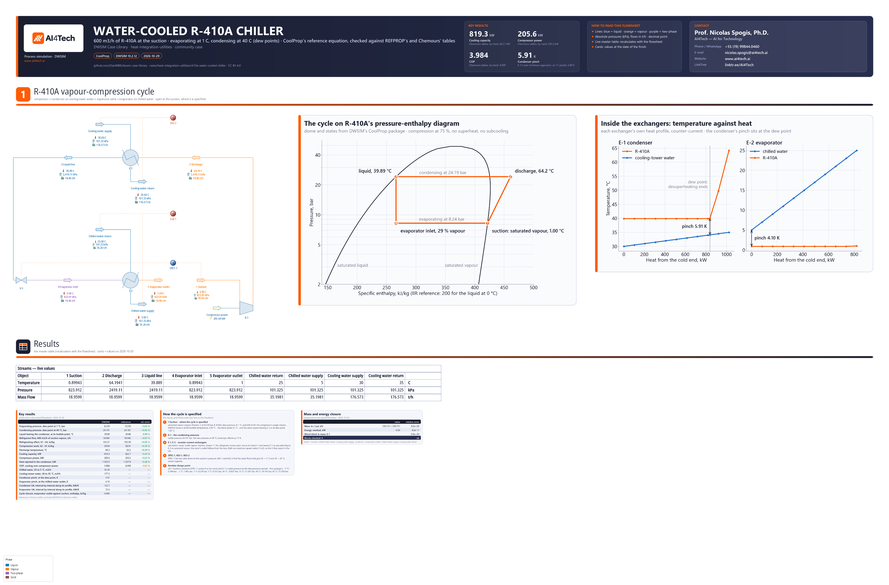

# Water-cooled R-410A chiller: a vapour-compression cycle on CoolProp's reference equation of state, with counter-current exchangers and a check against published R-410A tables

**Category:** heat-integration-utilities
**Status:** community
**DWSIM version:** 10.2.12
**Language:** English
**Contributor:** Prof. Nicolas Spogis, Ph.D. (@Spogis), AI4Tech · nicolas.spogis@ai4tech.ai · www.ai4tech.ai

## Summary

A water-cooled chiller of about 233 tons of refrigeration. It cools process water from 25 to 5 °C and rejects the heat to cooling-tower water, warmed from 30 to 35 °C. The compressor displaces 600 m3/h of R-410A at the suction with an isentropic efficiency of 75 %. The refrigerant evaporates at 1 °C and condenses at 40 °C, with neither superheat nor subcooling.

The case shows four things a DWSIM user modelling refrigeration needs:

- R-410A on CoolProp's reference equation of state, the one NIST's REFPROP uses for the blend;
- condenser and evaporator as counter-current heat exchangers with their temperature-heat profiles. The condenser's pinch is inside it, at the refrigerant's dew point;
- a cycle specified where the machine fixes it, at the compressor suction, with Adjust blocks finding the water flows;
- every number checked against published R-410A tables: REFPROP's saturation table, and the whole cycle by hand on Chemours' tables, a second, independent equation of state.

| | This case | Reference |
|---|---|---|
| Evaporating / condensing pressure | 8.239 / 24.191 bar | 8.238 / 24.187 bar (REFPROP) |
| Refrigerating effect | 155.57 kJ/kg | 155.49 kJ/kg (REFPROP) |
| Cooling capacity / compressor power | 819.3 / 205.6 kW | 822.7 / 205.2 kW (Chemours, by hand) |
| COP | 3.984 | 4.009 (Chemours, by hand) |

The exchangers are where the cycle meets its utilities. The condenser's water comes within 5.9 K of the refrigerant at the point where desuperheating ends, nowhere near either end. Sized on its end temperatures, the condenser would get 57.5 kW/K of UA. Its own heat profile, interval by interval, asks for 122.7: more than twice as much.

## Process description

R-410A, a 50/50 blend of R-32 and R-125 by mass, runs a vapour-compression cycle between two water circuits:

1. **Compressor K-1.** Saturated vapour at 8.24 bar is compressed to 24.19 bar and leaves at 64.2 °C.
2. **Condenser E-1.** The vapour is desuperheated and condensed against cooling-tower water, and leaves as saturated liquid at 39.9 °C. The water is warmed from 30 to 35 °C.
3. **Expansion valve V-1.** The liquid is throttled back to 8.24 bar, and 29 % of it flashes.
4. **Evaporator E-2.** The rest evaporates against the chilled water, which is cooled from 25 to 5 °C. The refrigerant leaves as saturated vapour at 1.0 °C, back at the suction.

How it is modelled in DWSIM:

- **The cycle is open at the suction, where it is specified.** Stream 1 is saturated vapour (vapour fraction 1) at the evaporating pressure, at the compressor's swept volume, 600 m3/h. The evaporator outlet, stream 5, comes back to the same state: the case measures the closure, and the enthalpies agree to 1e-13 kJ/kg. A closed loop through a recycle block would hold whatever refrigerant mass its tear started with. A displacement compressor fixes the volume at the suction, so the open cycle specifies what the machine fixes, and a change of evaporating pressure changes the mass flow, as it does in the machine.
- **Both exchangers are DWSIM heat exchangers, counter-current,** in the mode "outlet vapour fraction, stream 1". The refrigerant crosses each one as its stream 1 and is held at saturation there: liquid out of E-1, vapour out of E-2. The water takes the duty. Each block calculates its temperature-heat profile, eleven points, and its minimum approach. The two figures on the drawing are made from those profiles and from the package's own saturation dome. The exchangers are rated per square metre (1 m2), so the U they report is the UA their end temperatures imply.
- **SPEC-1** sets the valve's outlet pressure to the suction's, so one number sets the evaporator.
- **ADJ-1 and ADJ-2** find the chilled-water and cooling-water flows that give 5 °C and 35 °C at the outlets. They are solved together by DWSIM's simultaneous adjust solver.

## Feed and operating conditions

| Item | Value | Unit | Notes |
|---|---|---|---|
| Refrigerant | R-410A | | R-32/R-125, 50/50 by mass; CoolProp's pseudo-pure R410A.PPF |
| Compressor suction | 600 | m3/h | saturated vapour; the swept volume |
| Isentropic efficiency | 75 | % | adiabatic compression |
| Evaporating temperature | 1 (8.239 bar) | °C | dew point; no superheat |
| Condensing temperature | 40 (24.191 bar) | °C | dew point; no subcooling, the liquid leaves at its bubble point, 39.89 °C |
| Chilled water | 25 to 5 | °C | 1 atm; flow found by ADJ-1 |
| Cooling-tower water | 30 to 35 | °C | 1 atm; flow found by ADJ-2 |
| Pressure drops | none | | the textbook cycle, as compared with the tables |

## Thermodynamics

- **Property package:** CoolProp, with the pseudo-pure R410A.PPF for the refrigerant and IAPWS-95 for the water.
- **Why this package:** a refrigeration cycle's results are differences of enthalpy along the saturation dome and along an isentrope. R410A.PPF is Lemmon's (2003) Helmholtz equation for R-410A, fitted to his mixture model for R-32 and R-125. It reproduces REFPROP's saturation table to 0.02 % in pressure and 0.05 % in refrigerating effect (Results). Enthalpies are on the IIR reference, 200 kJ/kg for the saturated liquid at 0 °C, the same as both tables. So even absolute values compare directly.
- **What else DWSIM offers for R-410A, measured on 10.2.12, and why it is not used:**
  - Peng-Robinson on R-32 and R-125 from the CoolProp databank, blended 50/50, gives the 40 °C bubble pressure within 0.2 %. But it gives the liquid a negative density, because those compounds carry no liquid-density data for the cubic packages.
  - CoolProp's own mixture of the same two compounds puts the 40 °C bubble pressure 3.7 % low (2336 against 2426 kPa).
- **The temperatures are dew points.** R-410A is a near-azeotropic blend. At 8.24 bar it boils at 0.90 °C and its last drop evaporates at 1.00 °C, a glide of 0.1 K. The evaporating and condensing temperatures are stated, as for a compressor rating, at the dew point.

## Tuning and convergence notes

- **The suction is specified by pressure and vapour fraction, and its temperature reads 0.10 K low.** In DWSIM 10.2.12 the CoolProp package gives a stream specified by a vapour fraction the bubble line of a pseudo-pure blend, whatever the fraction:
  - a stream at 1 °C and vapour fraction 1 gets 8.265 bar, the bubble pressure, instead of the dew pressure 8.239;
  - a stream at 8.239 bar and vapour fraction 1 has the right enthalpy and entropy, but shows the bubble temperature, 0.90 °C.

  The vapour that a unit operation brings to vapour fraction 1 does show the dew point, as stream 5 does. So the two design pressures come from that flash: `dew_point()` in `build.py` finds the pressure at which saturated vapour shows 1 °C, and 40 °C. The suction then takes the pressure and vapour fraction 1. Its state is right and its displayed temperature is the bubble point. The suction's density is taken at that temperature too, so the refrigerant flow is 0.07 % above what REFPROP's vapour density gives.
- **The refrigerant must be stream 1 of each exchanger.**
  - The mode "outlet vapour fraction, stream 2" flashes stream 2 at the cold side's inlet pressure. With the condensing refrigerant as stream 2, E-1 returned liquid at the water's inlet temperature, 30 °C, with 9 % more duty, and no message.
  - "Stream 1" works on either side: it is hot in E-1 and cold in E-2.
  - The modes refer to stream 1 and 2, the ports, not to the hot and cold sides.
- **The Adjusts are in the simultaneous solver.** An Adjust left out of it was skipped by a solve run from a script: the water flows stayed at their first guesses, and no message was given. Solved together from the first guesses, the two take about 45 s, about 20 solves of the cycle. The saved file opens with them converged and solves in about 4 s.
- **The condenser's minimum approach is taken at the dew point.** E-1's profile has eleven points spaced by duty, and the dew point falls between two of them. On those points the block reports 5.89 K. The case puts the dew point into the profile, from the discharge's enthalpy and the saturated vapour's at that pressure, and reads 5.91 K there. The block also draws the condensing refrigerant at its bubble temperature, which is why the profile is flat at 39.89 °C.
- **Settings changed from the defaults:**
  - flash tolerances of 1e-10;
  - both exchangers counter-current, with their heat profile on and an area of 1 m2;
  - the Adjusts' tolerance of 1e-4 K and simultaneous solving.

## Results

There are two references.

**REFPROP 9.0** (Lemmon, Huber & McLinden, NIST), as Arkema tabulates R-410A's saturation for its Forane 410A. This is the full mixture model of R-32 and R-125, not the pseudo-pure equation. The values used:

| Quantity | 1 °C | 39 °C | 40 °C |
|---|---|---|---|
| Dew pressure | 823.8 kPa | | 2418.7 kPa |
| Bubble pressure | | 2367.4 kPa | 2425.6 kPa |
| Vapour density | 31.577 kg/m3 | | |
| Vapour enthalpy | 421.60 kJ/kg | | |
| Liquid enthalpy | | 264.48 kJ/kg | 266.33 kJ/kg |

The bubble point at the condensing pressure is interpolated linearly between 39 and 40 °C: 39.88 °C, 266.11 kJ/kg. That gives a refrigerating effect of 155.49 kJ/kg, and 600 m3/h of vapour weighs 18.946 t/h.

**Chemours' tables for Freon 410A (SI units).** These rest on the Martin-Hou equation of state fitted to the blend's own measurements, independently of Lemmon's equation. The cycle is worked by hand on them:

1. **Suction.** Saturated vapour at 1 °C: 31.649 kg/m3, 422.8 kJ/kg, 1.8128 kJ/kg-K.
2. **Condensing.** At the 40 °C dew pressure, 2411.1 kPa, the bubble point is 39.86 °C, interpolated between 39 °C (2361.2 kPa, 265.2 kJ/kg) and 40 °C (2419.3 kPa, 267.1 kJ/kg). The liquid's enthalpy there is 266.83 kJ/kg.
3. **Compression.** The isentrope s = 1.8128 is read on the superheated tables:
   - at 2400 kPa, between 55 °C (450.8 kJ/kg, 1.8096) and 60 °C (457.7, 1.8305);
   - at 2600 kPa, between 60 °C (453.7, 1.8117) and 65 °C (460.7, 1.8325);
   - in pressure between the two, which gives 451.98 kJ/kg at 2411.1 kPa.

   At 75 % the work is 38.91 kJ/kg. The discharge, read back on the same tables, is at 63.2 °C.
4. **The cycle.** 5.2748 kg/s, a refrigerating effect of 155.97 kJ/kg, 822.7 kW of cooling for 205.2 kW, and a COP of 4.009.

The two equations of state place R-410A's vapour about 1 kJ/kg apart: at the dew point at 1 °C, 422.8 against 421.7 kJ/kg. That is why the discharge temperature is a kelvin apart while the enthalpy differences, and the COP, agree within 0.6 %. The reference column below compares DWSIM with whichever table gives the quantity directly. The pinches, the UA and the water flows have no published reference: they are the case's design results, from the exchangers' own profiles.

| Quantity | DWSIM | Reference | Reference source | Rel. error |
|---|---|---|---|---|
| Evaporating pressure, dew point at 1 °C, bar | 8.239 | 8.238 | REFPROP 9.0 (Arkema's table) | +0.01 % |
| Condensing pressure, dew point at 40 °C, bar | 24.191 | 24.187 | REFPROP 9.0 (Arkema's table) | +0.02 % |
| Liquid leaving the condenser, at its bubble point, °C | 39.89 | 39.88 | REFPROP 9.0 (Arkema's table) | 0.00 % |
| Refrigerant flow, 600 m3/h of suction vapour, t/h | 18.960 | 18.946 | REFPROP 9.0 (Arkema's table) | +0.07 % |
| Refrigerating effect, h1 - h4, kJ/kg | 155.57 | 155.49 | REFPROP 9.0 (Arkema's table) | +0.05 % |
| Compression work, h2 - h1, kJ/kg | 39.04 | 38.91 | Chemours tables, by hand | +0.35 % |
| Discharge temperature, °C | 64.2 | 63.2 | Chemours tables, by hand | +0.30 % |
| Cooling capacity, kW | 819.3 | 822.7 | Chemours tables, by hand | −0.41 % |
| Compressor power, kW | 205.6 | 205.2 | Chemours tables, by hand | +0.21 % |
| Heat rejected in the condenser, kW | 1 025.0 | 1 027.9 | Chemours tables, by hand | −0.28 % |
| COP, cooling over compressor power | 3.984 | 4.009 | Chemours tables, by hand | −0.61 % |
| Chilled water, 25 to 5 °C, m3/h | 35.30 | — | set by ADJ-1 | — |
| Cooling-tower water, 30 to 35 °C, m3/h | 177.3 | — | set by ADJ-2 | — |
| Condenser pinch, at the dew point, K | 5.91 | — | E-1's own minimum approach, on 11 points: 5.89 K | — |
| Evaporator pinch, at the chilled-water outlet, K | 4.10 | — | — | — |
| Condenser UA, interval by interval along its profile, kW/K | 122.7 | — | on its end temperatures alone (LMTD 17.83 K): 57.5 kW/K | — |
| Evaporator UA, interval by interval along its profile, kW/K | 72.6 | — | on its end temperatures: 72.6 kW/K | — |
| Cycle closure: evaporator outlet against suction, enthalpy, kJ/kg | 0.000 | — | — | — |

The relative error of a temperature is taken on the kelvin scale: the discharge temperatures are 1.0 K apart.

The condenser's two UA values differ because its end temperatures hide its shape. The vapour enters at 64 °C against water leaving at 35 °C, and the liquid leaves at 39.9 °C against water entering at 30 °C: 29 K and 10 K at the ends. Inside, the refrigerant stops desuperheating at its dew point, 40.0 °C, where the water has reached 34.1 °C. Four-fifths of the duty crosses that 5.9 to 9.9 K gap. The evaporator has no such corner, and its two UA values agree.

## Files

- `r410a-water-cooled-chiller.dwxmz` - the DWSIM flowsheet, with:
  - AI4Tech's title block (logo, key results, contact);
  - the cycle on R-410A's pressure-enthalpy diagram and the exchangers' temperature-heat profiles;
  - a live master table of the nine streams.
- `r410a-water-cooled-chiller.png` - the flowsheet as DWSIM draws it.

## Confidentiality

No plant data of the contributor or of any client is used. The design point is a generic water-cooled chiller duty chosen for the case. The reference values are quoted from property tables their publishers distribute freely, and only the handful the comparison needs. No company, site or person is named but the contributor, whose contact details appear in the flowsheet's title block with the maintainer's agreement, and the publishers of the reference tables. The contributor ran no simulator but DWSIM, and has the right to publish all of it.

## References

- E. W. Lemmon, "Pseudo-pure fluid equations of state for the refrigerant blends R-410A, R-404A, R-507A, and R-407C", *International Journal of Thermophysics* 24 (2003) 991-1006. https://doi.org/10.1023/A:1025048800563
- I. H. Bell, J. Wronski, S. Quoilin, V. Lemort, "Pure and pseudo-pure fluid thermophysical property evaluation and the open-source thermophysical property library CoolProp", *Industrial & Engineering Chemistry Research* 53 (2014) 2498-2508. https://doi.org/10.1021/ie4033999
- W. Wagner, A. Pruß, "The IAPWS formulation 1995 for the thermodynamic properties of ordinary water substance for general and scientific use", *Journal of Physical and Chemical Reference Data* 31 (2002) 387-535.
- E. W. Lemmon, M. L. Huber, M. O. McLinden, *NIST Standard Reference Database 23: Reference Fluid Thermodynamic and Transport Properties - REFPROP*, Version 9.0, NIST (2010), as tabulated in Arkema, "Forane 410A: Thermodynamic Properties (Saturation) - SI". https://www.arkema.com/files/live/sites/shared_arkema/files/downloads/fluorochemicals/forane-410a-thermodynamic-properties-si.pdf
- Chemours, "Freon 410A Refrigerant (R-410A): Thermodynamic Properties (SI Units)". https://www.freon.com/en/-/media/files/freon/freon-410a-si-thermodynamic-properties.pdf
- J. J. Martin, Y.-C. Hou, "Development of an equation of state for gases", *AIChE Journal* 1 (1955) 142-151.
