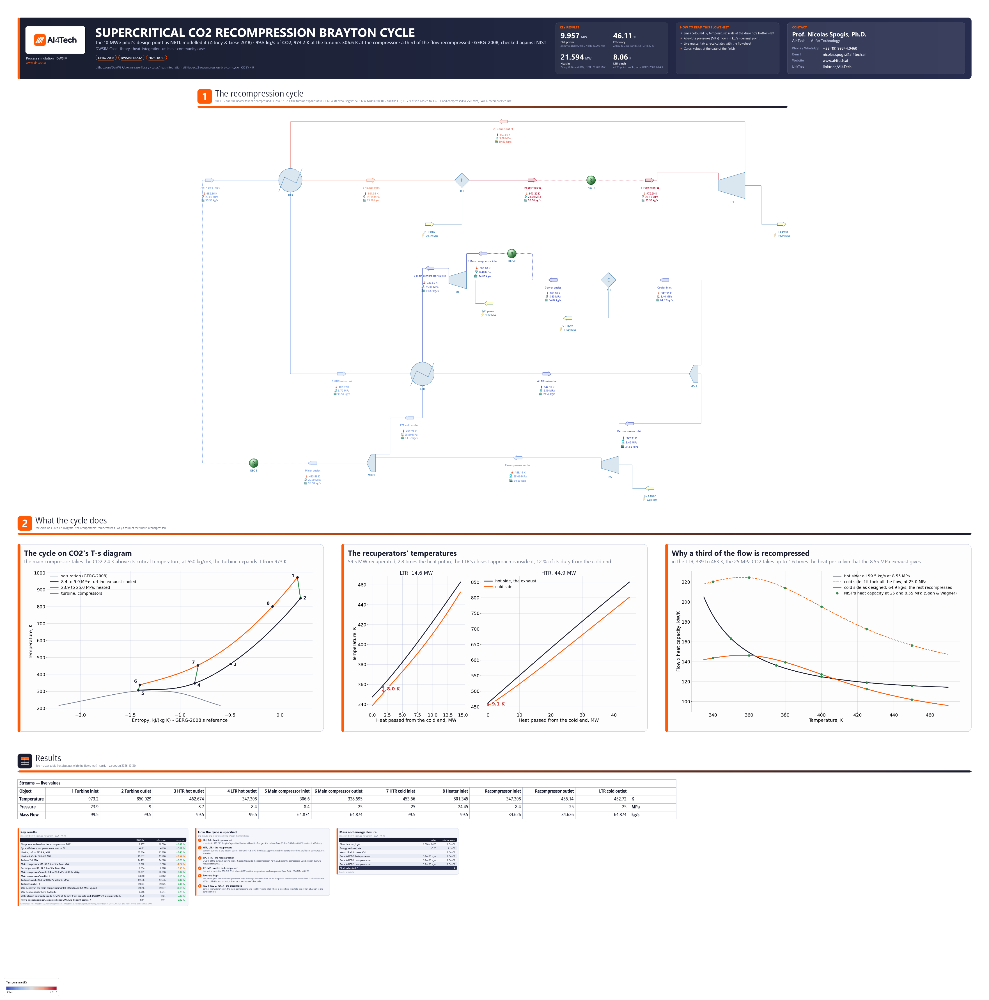

# Supercritical CO2 recompression Brayton cycle: the design point of a 10 MWe pilot, its recuperators pinched near CO2's critical point

**Category:** heat-integration-utilities
**Status:** community
**DWSIM version:** 10.2.12
**Language:** English
**Contributor:** Prof. Nicolas Spogis, Ph.D. (@Spogis), AI4Tech · nicolas.spogis@ai4tech.ai · www.ai4tech.ai

## Summary

A closed Brayton cycle on carbon dioxide, kept above its critical point (304.13 K, 7.38 MPa) all the way round. Its main compressor takes the CO2 2.5 K above the critical temperature, where it is as dense as a liquid, 650 kg/m³. Compressing it from 8.4 to 25.0 MPa there takes 28 kJ/kg, a fifth of the 145 kJ/kg the turbine gives back at 973 K. Most of the heat is recuperated: the turbine's exhaust gives 59.5 MW back to the compressed CO2 in two recuperators, 2.8 times the heat put in. And a third of the flow is never cooled. It is recompressed hot and joins the rest between the two recuperators, because near the critical point the 25 MPa CO2 needs more heat per kelvin than the exhaust can give it.

The case is the design point of the 10 MWe pilot plant of the U.S. Department of Energy's STEP programme, as the National Energy Technology Laboratory (NETL) modelled it. Zitney and Liese (2018) give its CO2 flow, its temperatures and pressures, the machines' efficiencies and the recuperators' duties, and from them its powers and its efficiency. On DWSIM's own blocks with GERG-2008, the case reproduces every one of those numbers within the three figures they are published to: an efficiency of 46.11 % against 46.1 %, and 9.96 MW net against 10.0 MW.

The thermodynamics is checked against NIST. The main compressor's and the turbine's work, worked by hand on NIST's tables of Span and Wagner's equation, are within 0.02 %.

## Process description

The streams are numbered as Zitney and Liese number them, 1 at the turbine's inlet to 8 at the heater's.

- **Heat in, power out.** The heater H-1 takes the compressed CO2 from 801 K to 973.2 K: 21.59 MW. In the pilot this is a natural-gas-fired heater; here it is a heater block, its flue gas left out. The turbine T-1 expands the CO2 from 23.9 to 9.0 MPa at 85 % isentropic efficiency: 14.46 MW, the exhaust leaving at 850 K.
- **The recuperators.** The exhaust returns above the cycle to the two counter-current recuperators.
  - The high-temperature recuperator HTR gives 44.9 MW to the whole compressed flow, heating it from 454 K to 801 K, and cools the exhaust to 463 K.
  - The low-temperature recuperator LTR gives 14.6 MW to the main compressor's CO2 alone, heating it from 339 K to 453 K, and cools the exhaust to 347 K.
- **Cooling and compression.** The splitter SPL-1 divides the exhaust leaving the LTR.
  - 65.2 % is cooled by C-1 to 306.6 K, 11.64 MW, and compressed by the main compressor MC from 8.4 to 25.0 MPa at 82 %: 1.82 MW, 28 kJ/kg.
  - 34.8 % goes straight to the recompressor RC, still at 347 K: 180 kg/m³, a little over a quarter of the main compressor's 650. RC compresses it to 25.0 MPa at 78 %: 2.68 MW, 77 kJ/kg. It leaves at 455 K, about the LTR's cold outlet temperature, and the mixer MIX-1 joins the two flows ahead of the HTR.
- **The closed loop.** Three Recycle blocks tear it where a block fixes the state:
  - REC-1, the turbine's inlet, set by the heater's outlet temperature;
  - REC-2, the main compressor's inlet, set by the cooler's;
  - REC-3, the HTR's cold inlet, set by the mixer.

The cycle's 99.5 kg/s is the turbine inlet's.

The streams are coloured by temperature, on the scale at the drawing's bottom-left: blue at 306.6 K, red at 973.2 K.

Below the cycle, three figures are drawn from the solved flowsheet:
- **The cycle on CO2's temperature-entropy diagram.** Every state and path is from the flowsheet's own GERG-2008. The main compressor works at the top of the saturation dome.
- **The recuperators' temperatures against the heat passed**, each from a 200-point profile on the flowsheet's package, with the closest approach marked.
- **Why a third of the flow is recompressed.** For each side of the LTR, the flow times the heat capacity against temperature, as designed and if the cold side took all the flow, with NIST's heat capacities on both curves.

## Feed and operating conditions

| Item | Value | Unit | Notes |
|---|---|---|---|
| CO2 flow | 99.5 | kg/s | the turbine's; pure CO2, the cycle closed |
| Turbine inlet | 973.2 K, 23.9 | MPa | 700 °C; the material limit of the design |
| Turbine outlet | 9.0 | MPa | 85 % isentropic efficiency |
| Main compressor inlet | 306.6 K, 8.4 | MPa | 33.45 °C, 2.5 K above CO2's critical temperature |
| Compressors' outlet | 25.0 | MPa | the main compressor's, published, and the recompressor's (the notes); 82 % and 78 % isentropic efficiency |
| Recompressed | 34.8 | % | of the exhaust leaving the LTR |
| HTR, LTR | 44.9, 14.6 | MW | counter-current, at these duties |
| Pressure drops | 0.55, 0.55, 0.3, 0.3 | MPa | the HTR's cold side, the heater, the HTR's and the LTR's hot sides; none elsewhere |

All pressures are absolute. Everything in the table but the pressure drops is Zitney and Liese's (2018) design point. They give the pressures at the machines only, and the drops between them are this case's choice (Tuning and convergence notes).

## Thermodynamics

- **Property package:** GERG-2008 (Kunz and Wagner 2012), on pure CO2.
- **Why GERG-2008:** its CO2 reproduces NIST's, Span and Wagner's reference equation, where this cycle works:
  - the density at the main compressor's inlet within 0.014 %, and the heat capacity there within 0.4 %, 2.5 K from the critical point;
  - the main compressor's work within 0.02 % and the turbine's within 0.004 % (Results).
  GERG-2008's stated range ends at 700 K. At the turbine's 973 K and 23.9 MPa its CO2 is within 0.01 % of NIST's density.
- **Why not CoolProp:** CoolProp carries Span and Wagner's equation itself, and gives the same enthalpy and density as NIST. But on DWSIM 10.2.12 its pressure-entropy flash does not find a state where the CO2 is liquid-like. The main compressor's isentrope at 25 MPa came back at 216.6 K, the triple point. The Compressor block then solved without a message to an outlet at 216.6 K and a negative power: a compressor that cools the CO2 and makes power. The package also gives such CO2 a heat capacity of zero.
- **Why not Peng-Robinson:** it puts the density at the main compressor's inlet 14 % low, its enthalpy 13.5 kJ/kg off, and found no density at all at 340 K and 25 MPa (1e20 kg/m³).
- **Zitney and Liese** computed CO2 with Span and Wagner's equation, through NIST's REFPROP.

## Tuning and convergence notes

**The pressure drops**

- **Zitney and Liese give four pressures:**
  - 25.0 MPa at the main compressor's outlet and 23.9 MPa at the turbine's inlet;
  - 9.0 MPa at the turbine's outlet and 8.4 MPa at the main compressor's inlet.
- **The case puts the drops between them on the passes that carry the whole flow:**
  - 0.55 MPa on the HTR's cold side and 0.55 MPa on the heater;
  - 0.3 MPa on each recuperator's hot side;
  - none on the LTR's cold side, the cooler or the mixer.
- **Both compressors then work between the same two pressures,** 8.4 and 25.0 MPa, and every power and duty is within the rounding of the published figures.
- **Shared equally among all six passes instead,** the recompressor takes its suction at 8.6 MPa and discharges at 24.6. It then takes 2.58 MW, 4.5 % less than the published 2.7 MW, and the efficiency comes out at 46.37 %.
- **Which arrangement the pilot has is not published.** The recompressor's power is the number that tells them apart.

**The recuperators**

- **Both are DWSIM's HeatExchanger,** counter-current, in its `CalcBothTemp` mode: the duty is given and both outlets are calculated. `CalculateHeatExchangeProfile` is on, so DWSIM works out each one's temperature-heat profile and its closest approach, `CalculatedMITA`.
- **DWSIM's profile has 11 points.** On the LTR it puts the closest approach at 8.06 K; a 200-point profile on the same package finds 8.04 K, 12 % of the duty in from the cold end.
- **That approach is inside the exchanger, not at either end:** 8.71 K at the cold end, 9.95 K at the hot end, and 12.2 K at its widest, 70 % in. The gap narrows wherever the exhaust carries more heat per kelvin than the CO2 it heats, and widens where it carries less. The closest approach is where the two are equal (the third figure).
- **The HTR's closest approach is at its cold end,** 9.11 K. At its hot end the exhaust comes in 49 K hotter than the CO2 leaves.
- **To try another design,** switch either recuperator to the `PinchPoint` mode with a minimum approach. On this LTR, measured while building the case:
  - 5 K gave 15.05 MW, 8 K gave 14.61 MW and 10 K gave 14.31 MW;
  - the published 14.6 MW is therefore an LTR designed to an 8 K approach;
  - each solve took 5 s, against 0.5 s at a given duty;
  - the 200-point profile confirmed every approach within 0.01 K.

**The loops**

- **The three Recycles each tear the loop where a block fixes the state,** so one pass closes them. The build closes them from outside DWSIM's solver anyway, to round-off: one pass, to 6e-16.
- **The Recycles' tolerances are set to 1e-9 kg/s, 1e-6 K and 1e-3 Pa.** DWSIM's defaults, 0.01 kg/s, 0.1 K and 0.1 Pa, would accept the tear guesses.
- **The first guess of each tear is calculated before its Recycle is connected.** Below a Recycle, DWSIM calculates a stream from pressure and enthalpy, and a temperature given alone would not be read.

**Settings changed from the defaults:**
- flash tolerances of 1e-10;
- the recuperators' profile switched on;
- the Recycles' tolerances.

## Results

The references are outside DWSIM. Each is worked out in the case's `build.py`, which embeds the data it uses:

- **The cycle's powers, duties and efficiency** are Zitney and Liese's (2018), given to three figures:
  - net power 10 MWe;
  - heat in 21.7 MWt and the cooler's 11.7 MWt;
  - the turbine's 14.5 MWe, the main compressor's 1.8 MWe and the recompressor's 2.7 MWe;
  - an efficiency of 46.1 %.
- **The machines' work** is worked by hand on the NIST Chemistry WebBook's tables of Span and Wagner's equation. The inlet's entropy is interpolated on the outlet's isobar, 1 K apart, for the isentropic outlet. The efficiency is applied to the enthalpy change, and the outlet temperature interpolated from the enthalpy.
- **The density and heat capacity at the main compressor's inlet** are NIST's at 306.6 K and 8.4 MPa.
- **The recuperators' closest approaches** are DWSIM's 11-point profile against a 200-point profile on the same package. That is a check of the profile's resolution, not of the thermodynamics.

Things to keep in mind when reading the table:

- **Zitney and Liese's figures are rounded.** 1.8 MWe stands for anything from 1.75 to 1.85, ±2.8 %. The main compressor's +1.24 % is inside that.
- **Their own numbers are rounded the same way.** They quote the turbine's pressure ratio as 2.67, and give 23.9 and 9.0 MPa, which make 2.656.
- **The recompressor's power depends on the pressure drops,** which the paper does not give (Tuning and convergence notes).
- **The cycle reaches 67 % of Carnot's efficiency** between 306.6 K and 973.2 K, which is 68.5 %.

Relative errors are on the reference.

| Quantity | DWSIM | Reference | Reference source | Rel. error |
|---|---|---|---|---|
| Net power, turbine less both compressors, MW | 9.957 | 10.000 | Zitney & Liese (2018), NETL | −0.43 % |
| Cycle efficiency, net power over heat in, % | 46.11 | 46.10 | Zitney & Liese (2018), NETL | +0.02 % |
| Heat in, H-1 to 973.2 K, MW | 21.594 | 21.700 | Zitney & Liese (2018), NETL | −0.49 % |
| Heat out, C-1 to 306.6 K, MW | 11.637 | 11.700 | Zitney & Liese (2018), NETL | −0.54 % |
| Turbine T-1, MW | 14.463 | 14.500 | Zitney & Liese (2018), NETL | −0.25 % |
| Main compressor MC, 65.2 % of the flow, MW | 1.822 | 1.800 | Zitney & Liese (2018), NETL | +1.24 % |
| Recompressor RC, 34.8 % of the flow, MW | 2.684 | 2.700 | Zitney & Liese (2018), NETL | −0.58 % |
| Main compressor's work, 8.4 to 25.0 MPa at 82 %, kJ/kg | 28.091 | 28.098 | NIST WebBook (Span & Wagner), by hand | −0.02 % |
| Main compressor's outlet, K | 338.60 | 338.62 | NIST WebBook (Span & Wagner), by hand | −0.01 % |
| Turbine's work, 23.9 to 9.0 MPa at 85 %, kJ/kg | 145.36 | 145.36 | NIST WebBook (Span & Wagner), by hand | 0.00 % |
| Turbine's outlet, K | 850.03 | 850.25 | NIST WebBook (Span & Wagner), by hand | −0.03 % |
| CO2 density at the main compressor's inlet, 306.6 K and 8.4 MPa, kg/m3 | 650.46 | 650.37 | NIST WebBook (Span & Wagner) | +0.01 % |
| CO2 heat capacity there, kJ/(kg K) | 6.916 | 6.944 | NIST WebBook (Span & Wagner) | −0.41 % |
| LTR's closest approach, inside it, 12 % of its duty from the cold end: DWSIM's 11-point profile, K | 8.06 | 8.04 | a 200-point profile, same GERG-2008 | +0.27 % |
| HTR's closest approach, at its cold end: DWSIM's 11-point profile, K | 9.11 | 9.11 | a 200-point profile, same GERG-2008 | 0.00 % |

## Files

- `sco2-recompression-brayton-cycle.dwxmz` - the DWSIM flowsheet, with:
  - AI4Tech's title block (logo, key results, contact);
  - the three figures, drawn from the solved flowsheet;
  - a live master table of the cycle's states;
  - result cards.
- `sco2-recompression-brayton-cycle.png` - the flowsheet as DWSIM draws it.

## Confidentiality

No plant data of the contributor or of any client is used:
- The design point is the one Zitney and Liese (2018) presented at the 6th International Supercritical CO2 Power Cycles Symposium. They work at NETL, a U.S. Department of Energy laboratory. The case cites their numbers, not their figures: every figure here is drawn from this flowsheet.
- The pressure drops between the published pressures are the contributor's own choice.
- The references are the published literature and the NIST Chemistry WebBook.

No company, site or person is named but the contributor and the authors cited. The contributor's contact details appear in the flowsheet's title block with the maintainer's agreement. The contributor ran no simulator but DWSIM, and has the right to publish all of it.

## References

- S. E. Zitney, E. A. Liese, "Dynamic Modeling and Simulation of a 10 MWe Supercritical CO2 Recompression Closed Brayton Power Cycle for Off-Design, Part-Load, and Control Analysis", 6th International Supercritical CO2 Power Cycles Symposium, Pittsburgh, Pennsylvania, March 27-29, 2018. https://www.sco2symposium.com/papers2018/modeling-control/016_Pres.pdf
- O. Kunz, W. Wagner, "The GERG-2008 Wide-Range Equation of State for Natural Gases and Other Mixtures: An Expansion of GERG-2004", *Journal of Chemical & Engineering Data* 57 (2012) 3032-3091. https://doi.org/10.1021/je300655b
- R. Span, W. Wagner, "A New Equation of State for Carbon Dioxide Covering the Fluid Region from the Triple-Point Temperature to 1100 K at Pressures up to 800 MPa", *Journal of Physical and Chemical Reference Data* 25 (1996) 1509-1596. https://doi.org/10.1063/1.555991
- I. H. Bell, J. Wronski, S. Quoilin, V. Lemort, "Pure and pseudo-pure fluid thermophysical property evaluation and the open-source thermophysical property library CoolProp", *Industrial & Engineering Chemistry Research* 53 (2014) 2498-2508. https://doi.org/10.1021/ie4033999
- D.-Y. Peng, D. B. Robinson, "A New Two-Constant Equation of State", *Industrial & Engineering Chemistry Fundamentals* 15 (1976) 59-64. https://doi.org/10.1021/i160057a011
- P. J. Linstrom, W. G. Mallard (eds.), *NIST Chemistry WebBook*, NIST Standard Reference Database 69, National Institute of Standards and Technology: E. W. Lemmon, M. O. McLinden, D. G. Friend, "Thermophysical Properties of Fluid Systems". https://doi.org/10.18434/T4D303
