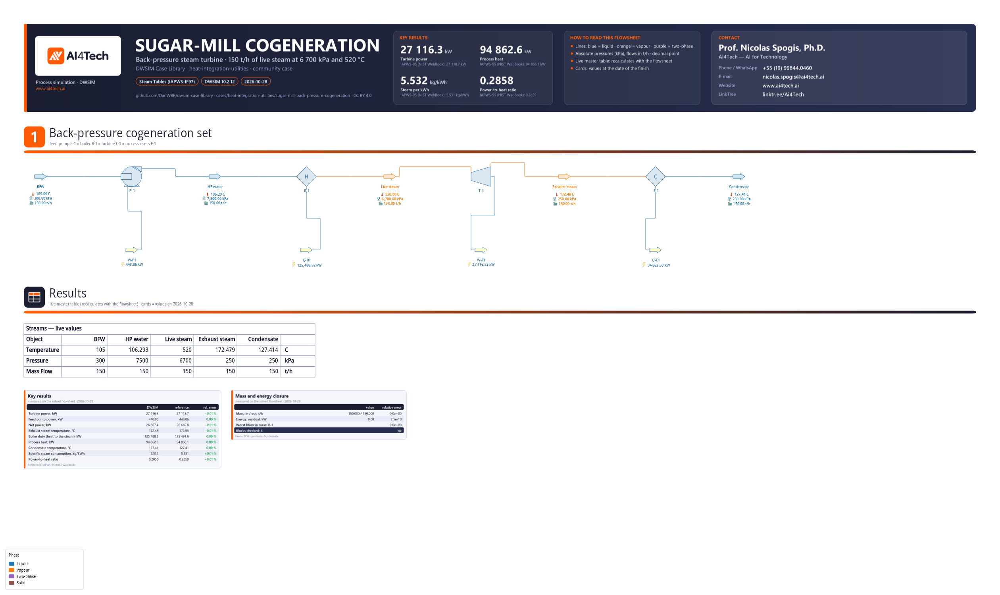

# Back-pressure steam cogeneration of a sugar-cane mill

**Category:** heat-integration-utilities
**Status:** community
**DWSIM version:** 10.2.12
**Language:** English
**Contributor:** Prof. Nicolas Spogis, Ph.D. (@Spogis), AI4Tech · nicolas.spogis@ai4tech.ai · www.ai4tech.ai

## Summary

The steam path at the centre of a sugar-cane mill's energy system, from the deaerator to the process: boiler feedwater pumped to 7 500 kPa, raised to live steam at 6 700 kPa and 520 °C, expanded in a back-pressure turbine to the 250 kPa process-steam header and condensed by the process users. With 150 t/h of steam the turbine delivers 27.1 MW while 94.9 MW of heat reach the process, at 5.53 kg of steam per kWh. Every result is computed again by hand from IAPWS-95, the scientific formulation of water and steam, at the same states: DWSIM's Steam Tables (IAPWS-IF97) agree with it to about one part in ten thousand.

## Process description

A back-pressure turbine is the classic cogeneration machine of a sugar-cane mill: it takes the live steam the bagasse boiler raises and lets all of it out at the pressure the process needs, so every kilogram of process steam makes power on its way to the evaporators, juice heaters and distillery. This case models that path:

- **P-1**, the boiler feed pump, raises the feedwater from 300 to 7 500 kPa; its power is the energy stream W-P1.
- **B-1**, the boiler, heats it to 520 °C with an 800 kPa pressure drop. Only the heat given to the steam is modelled (Q-B1): fuel, combustion and boiler efficiency are outside the case.
- **T-1**, the back-pressure turbine, expands the live steam to 250 kPa with an adiabatic efficiency of 80 %; its shaft power is W-T1.
- **E-1** stands for the process users: they condense the exhaust completely, and the condensate leaves saturated at 250 kPa. Their heat is Q-E1.

The boundary is the boiler feedwater from the deaerator and the condensate the process returns; the deaerator, the make-up water and the condensate return system are outside it.

## Feed and operating conditions

| Item | Value | Unit | Notes |
|---|---|---|---|
| Boiler feedwater | 150 | t/h | 105 °C and 300 kPa: subcooled, from the deaerator |
| Feed pump P-1 discharge | 7 500 | kPa | efficiency 70 %, hydraulic (see the notes) |
| Live steam | 6 700 / 520 | kPa / °C | boiler pressure drop 800 kPa |
| Turbine T-1 exhaust | 250 | kPa | back pressure; adiabatic efficiency 80 % |
| Process users E-1 | saturated liquid | outlet | vapour fraction 0 at the outlet, no pressure drop |

All pressures are absolute. The conditions are a design basis chosen for this case, not a plant's data.

## Thermodynamics

- **Property package:** Steam Tables (IAPWS-IF97).
- **Why this package:** the only compound is water - a subcooled liquid, a superheated vapour and the saturation dome in between. IAPWS-IF97 is the industrial formulation for water and steam, the one boiler and steam-turbine calculations are made with; it was fitted to the scientific formulation, IAPWS-95, and reproduces it here to a few hundredths of a kJ/kg (Results).
- **Interaction parameters / assays:** none - a single compound.

## Tuning and convergence notes

- No recycle and no column: the four blocks solve in one pass from DWSIM's defaults, and no initial estimate matters.
- **The pump's efficiency is hydraulic.** DWSIM computes the pump power as W·ΔP/(ρ·η), with the density at the inlet (`Pump.vb`), not from an isentropic enthalpy rise. With the same 70 % the two definitions differ by 0.15 % here (448.86 kW against 448.17 kW from IAPWS-95's isentropic rise); a pump curve's efficiency is a hydraulic one as well, so it is given to DWSIM as read.
- **The turbine's efficiency is the adiabatic (isentropic) one:** h_out = h_in − η (h_in − h_s). The isentropic end point lies inside the dome (quality 0.969), while the actual exhaust leaves 45 K superheated.
- **E-1 is specified by its outlet vapour fraction, 0,** and the condensate comes out at saturation, 127.41 °C at 250 kPa: on this Cooler the specification does what it says. A mill desuperheats the exhaust before its users; that is not modelled here, and the process heat includes the 45 K of superheat.
- **Settings changed from the defaults:** the flash tolerances of the property package were tightened to 1e-10, so that the file, reopened and solved again, reproduces every digit of the Results table - which was checked on the file submitted.

## Results

The reference is the same quantity computed by hand from IAPWS-95, with the property values the NIST Chemistry WebBook gives at the case's states (read on 2026-10-28): live steam at 6 700 kPa and 520 °C, h = 3 462.978 kJ/kg and s = 6.885005 kJ/(kg·K); saturation at 250 kPa, 127.4114 °C, with h' = 535.3450 and h'' = 2 716.490 kJ/kg, s' = 1.607230 and s'' = 7.052449 kJ/(kg·K); the feedwater at 105 °C and 300 kPa, h = 440.4063 kJ/kg and v = 0.001047351 m³/kg; and the 250 kPa isobar at 170 and 175 °C, h = 2 806.915 and 2 817.224 kJ/kg, to place the exhaust temperature. The definitions are DWSIM's: the pump's hydraulic efficiency, the turbine's adiabatic one - isentropic exhaust quality x = (s − s')/(s'' − s') = 0.96925, h_s = 2 649.418 kJ/kg, actual exhaust h = 3 462.978 − 0.80 × (3 462.978 − 2 649.418) = 2 812.130 kJ/kg. Relative errors are on the reference, a temperature's on the absolute scale.

Mass closes exactly across the boundary and energy to 7.5e-10 relative, as the flowsheet's closure card shows.

| Quantity | DWSIM | Reference | Reference source | Rel. error |
|---|---|---|---|---|
| Turbine power, kW | 27 116.3 | 27 118.7 | IAPWS-95 (NIST WebBook) | −0.01 % |
| Feed pump power, kW | 448.86 | 448.86 | IAPWS-95 (NIST WebBook) | 0.00 % |
| Net power, kW | 26 667.4 | 26 669.8 | IAPWS-95 (NIST WebBook) | −0.01 % |
| Exhaust steam temperature, °C | 172.48 | 172.53 | IAPWS-95 (NIST WebBook) | −0.01 % |
| Boiler duty (heat to the steam), kW | 125 488.5 | 125 491.6 | IAPWS-95 (NIST WebBook) | 0.00 % |
| Process heat, kW | 94 862.6 | 94 866.1 | IAPWS-95 (NIST WebBook) | 0.00 % |
| Condensate temperature, °C | 127.41 | 127.41 | IAPWS-95 (NIST WebBook) | 0.00 % |
| Specific steam consumption, kg/kWh | 5.532 | 5.531 | IAPWS-95 (NIST WebBook) | +0.01 % |
| Power-to-heat ratio | 0.2858 | 0.2859 | IAPWS-95 (NIST WebBook) | −0.01 % |

## Files

- `sugar-mill-back-pressure-cogeneration.dwxmz` - the DWSIM flowsheet, with AI4Tech's title block (logo, key results, contact) and a live master table of the five streams.
- `sugar-mill-back-pressure-cogeneration.png` - the flowsheet as DWSIM draws it.

## Confidentiality

No plant data is used: the conditions are a design basis chosen for this case, and the reference values are public (NIST Chemistry WebBook). No company, site or person is named but the contributor, whose contact details appear in the flowsheet's title block with the maintainer's agreement. The contributor has the right to publish all of it.

## References

- W. Wagner et al., "The IAPWS Industrial Formulation 1997 for the Thermodynamic Properties of Water and Steam", *J. Eng. Gas Turbines Power* 122 (2000) 150-182.
- W. Wagner, A. Pruß, "The IAPWS Formulation 1995 for the Thermodynamic Properties of Ordinary Water Substance for General and Scientific Use", *J. Phys. Chem. Ref. Data* 31 (2002) 387-535.
- *Thermophysical Properties of Fluid Systems*, NIST Chemistry WebBook, NIST Standard Reference Database 69, https://webbook.nist.gov/chemistry/fluid/ (accessed 2026-10-28).
