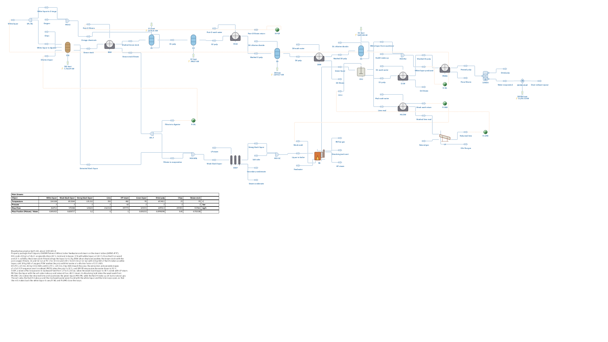

# Bleached eucalyptus kraft mill: digester, oxygen and chlorine dioxide bleaching, evaporators, recovery boiler, causticizing and lime kiln

**Category:** other
**Status:** community
**DWSIM version:** 10.3.0 or later
**DWSIM edition:** Patreon Edition (Kraft Liquors property package, Pulp and Paper unit operations, Premium level)
**Language:** English
**Contributor:** Daniel Wagner Oliveira de Medeiros (@DanWBR)

> **Requirement.** The Kraft Liquors property package and the pulp and paper unit operations (Kraft Digester, Pulp Washer, Bleaching Stage, Evaporator Train, Recovery Boiler, Causticizer and Lime Kiln) belong to DWSIM Patreon, Premium level. The file opens anywhere, but it only solves where they are licensed.

## Summary

A bleached eucalyptus kraft pulp mill of about 1460 ADt/d, from the chips to the dried pulp and around the chemical recovery loop. The digester cooks the chips to kappa 17.8; the brown stock is washed, delignified in a two-reactor oxygen stage and bleached in two chlorine dioxide stages, then pressed and dried to 90 %. The weak black liquor goes through a seven-effect evaporator to 80 % solids and burns in the recovery boiler; the smelt dissolves in the weak wash, and the green liquor is causticized with the reburned lime into the white liquor that goes back to the digester and the oxygen stage. The lime mud is washed and burned in the lime kiln, and the lime goes back to the causticizer. The whole flowsheet, with its five recycles, solves in about 5 s from the saved file.

## Process description

**Cooking:** DIG, a continuous Kraft Digester, cooks 32 kg/s of dry E. urograndis chips (45 % moisture) with white liquor at 18.5 % effective alkali as Na2O on wood and 25 % sulfidity. Its target kappa mode finds the cooking time for kappa 17.8. Part of the brown stock filtrate (SPL-F, R-DIL) brings the cooking liquor to about 4 L/kg; the rest goes with the extracted black liquor to the evaporators.

**Brown stock washing and oxygen delignification:** BSW, a three-stage drum displacer, washes the brown stock with the post-oxygen filtrate (R-POF). The oxygen stage has two Bleaching Stage blocks in O mode: O1 at 95 °C for 10 min and O2 at 100 °C for 60 min, both at 5.5 bar, with 15 kg/ADt of NaOH, taken as white liquor (SPL-WL), and 18 kg/ADt of oxygen. POW, a two-stage drum displacer, washes the pulp with hot water at a dilution factor of 2.5 t/ADt.

**Bleaching:** D0 (70 °C, 60 min, 8.5 kg ClO2/ADt, kappa factor 0.2) and D1 (75 °C, 120 min, 5 kg ClO2/ADt) are Bleaching Stage blocks in D mode, each with a washer on hot water (D0W, D1W). The chlorine dioxide comes with the water that takes the pulp to 10 % consistency. The extraction and peroxide stages of a full ECF sequence aren't in the case.

**Pressing and drying:** PRESS takes the pulp to 50 %, and DRYER evaporates the water down to 90 % (a component separator for the water, and the heater DRYER-EVAP for the heat).

**Evaporation:** EVAP, an Evaporator Train with seven effects in backward feed from 1.9 to 0.135 bar, takes the weak black liquor to 80 % solids. It finds the LP steam (4.5 bar) that this takes and writes it into the steam stream.

**Recovery boiler:** RB fires the strong liquor with the salt cake make-up (MIX-SC), with air preheated to 150 °C, and raises steam at 62 bar and 482 °C from feedwater at 120 °C on the steam tables. Its dissolving tank takes the weak wash from the lime mud washer (R-WW) and gives the green liquor at 95 °C.

**Causticizing and lime reburning:** CAU slakes the lime and causticizes the green liquor; MIX-MU adds the NaOH make-up to the white liquor. MUDW washes the lime mud with hot water to 75 % solids, and LK, the Lime Kiln, burns natural gas to calcine it. R-WL takes the white liquor back to the fibreline, and R-LIME takes the lime back to the causticizer.

## Feed and operating conditions

| Item | Value | Unit | Notes |
|---|---|---|---|
| Chips | 58.2 | kg/s | 32 kg/s of dry wood, 45 % moisture, 25 °C; lignin 30.5 %, extractives 4.1 % (Gomide 2005, clone A) |
| White liquor | 18.5 / 25 | % EA as Na2O on wood / % sulfidity on AA | TTA about 118 g/L as Na2O |
| Kappa after the digester | 17.8 | | target kappa mode |
| Oxygen stage | 95 °C, 10 min / 100 °C, 60 min | | 5.5 bar, NaOH 15 and O2 18 kg/ADt (Segura 2016) |
| Washing | 2.5 | t/ADt | dilution factor of the post-oxygen washer (TAPPI 2023) |
| D0 / D1 | 70 °C, 60 min, 8.5 kg/ADt / 75 °C, 120 min, 5 kg/ADt | | ClO2 |
| Press / dryer | 50 / 90 | % | dryness |
| Evaporator | 7 effects, 1.9 to 0.135 bar | | backward feed, steam at 4.5 bar, strong liquor at 80 % |
| Recovery boiler | 62 bar, 482 °C | | reduction 92 %, air at 150 °C, 2 % O2 in the flue gas |
| Causticizer | approach 4.5 points | | Lindberg and Ulmgren equilibrium |
| Lime kiln | 2 % residual CaCO3 | | natural gas, 3 % O2 in the flue gas |
| Salt cake / NaOH make-up | 2.4 / 1.1 | kg/ADt | found with the loops open (see below) |

## Thermodynamics

- **Property package:** Kraft Liquors, DWSIM Patreon, for the wood, the pulp, the liquors, the lime and the gases; Steam Tables (IAPWS-IF97) for the boiler feedwater and the steam.
- **Why this package:** the black liquor is a concentrated solution whose boiling point rise, heat capacity and heat of dilution set the evaporator and the boiler. The package takes them from published correlations for kraft liquors, keeps the dissolved salts and organics in the liquid, and keeps the wood, the fibres and the lime solid.
- **Compounds:** the wood and black liquor compounds (cellulose, xylan, hardwood lignin, extractives, acetyl groups, sodium lignate, sodium lactate, tall oil soap, sodium sulfide, calcium oxide, chlorine dioxide and the dissolved lignin of the bleach plant) come with DWSIM under the Pulp tag; the salts and the gases come from the databases.

## Tuning and convergence notes

- **Make-ups found with the loops open.** The case was first solved with the white liquor and the lime as feed streams. The salt cake, the NaOH make-up and the mud wash water were then corrected, pass after pass, until the white liquor that the causticizer makes matched the one the mill uses, with the dead load (carbonate, sulfate, chloride) carried over. With those values the two loops were closed with R-WL and R-LIME. The make-ups are fixed values: if the fibreline changes, the loops settle at another inventory of sodium and sulfur, and the make-ups should be found again.
- **One block for the evaporator.** A train of falling film evaporators in backward feed needs one recycle per effect, and those recycles didn't settle. The Evaporator Train solves the heat balances of all the effects inside the block.
- **Recycle tolerance:** 0.005 kg/s, above the numerical noise of the washers and the digester (about 0.003 kg/s).
- **Lime loop:** the lime loop doesn't have a make-up or a purge, so its calcium stays in it.
- **Solve time:** about 5 s from the saved file.

## Results

| Quantity | DWSIM | Published | Source |
|---|---|---|---|
| Production | 1462 ADt/d | | |
| Wood | 1.89 t/ADt | | |
| Kappa: digester / O / D0 / D1 | 17.8 / 9.7 / 3.3 / 1.9 | 17.7 to 11.5 in the oxygen stage | Segura 2016 |
| Screened yield of the digester | 48.4 % | 50.2 % (lab cook) | Gomide 2005 |
| Black liquor solids | 1.59 t DS/ADt | 1.35; 1.59 | Persson; Vakkilainen 2018 |
| Weak / strong black liquor | 17.0 / 80.0 % | 14 / 80 % | Persson |
| Evaporator | 25.5 kg/s of steam, economy 4.9 | | |
| Recovery boiler steam | 4.1 kg per kg of solids | 3.5 (2.5 to 3.8) | Tran and Vakkilainen |
| White liquor | TTA 118 g/L, sulfidity 25 %, causticity 81 % | | |
| Causticizing efficiency | 84.9 % | | |
| Lime kiln heat rate | 6.6 GJ/t CaO (LHV) | 8.7 | Adams, KROS 2008 |
| Process heat | 9.1 GJ/ADt | 8.1; 10.8 | Energiforsk 2025; Persson |
| Dryer / evaporation | 1.9 / 3.2 GJ/ADt | 2.1 / 2.7 | Energiforsk 2025 |
| Sodium / sulfur loss | 1.4 kg Na/ADt / 0.54 kg S/ADt | 2.7 / 0.7 | Energiforsk 2025 |
| ClO2 | 13.9 kg/ADt | 15.9 | Antes 2015 |
| Fresh water | 29.7 m3/ADt | 25 (effluent) | Energiforsk 2025 |
| Element balances | Na and S close within 0.005 % of the load that circulates in the white liquor | | |

**Digester heat:** heating the chips and the liquors to the cooking temperature takes 2.4 GJ/ADt, against 1.38 GJ/ADt of steam in the Energiforsk reference mill, where the flash steam of the black liquor presteams the chips. Here the chips enter at 25 °C, and the flash steam isn't recovered.

**Steam per kg of solids:** the black liquor of the model has a higher heating value of 15.7 MJ/kg, against about 13.9 for mill liquors, which carry chloride and potassium as dead load; the boiler doesn't take the sootblowing steam off.

## Files

- `bleached-eucalyptus-kraft-mill.dwxmz`: the DWSIM flowsheet.
- `bleached-eucalyptus-kraft-mill.png`: the flowsheet.
- The flowsheet is built by `PulpMillTest.cs` in the DWSIM FluentAPI tests, which also finds the make-ups, checks the element balances and reloads the saved file.

## Confidentiality

The wood, the charges and the operating conditions come from published laboratory studies and published model mills. No plant data were used.

## References

- Gomide et al., Revista Arvore 29 (2005) 129.
- Segura et al., BioResources 11 (2016) 9842.
- Antes and Joutsimo, BioResources 10 (2015) 210.
- Energiforsk, Reference mill for bleached kraft market pulp, report 2025:1095.
- Persson, Energy efficient pulp mill (celso-foelkel.com.br).
- Vakkilainen, Toward future, ABTCP 2018 (eucalyptus.com.br).
- H. Tran, E. Vakkilainen, The kraft chemical recovery process, TAPPI.
- Adams, Lime kiln, TAPPI Kraft Recovery Operations Short Course, 2008.
