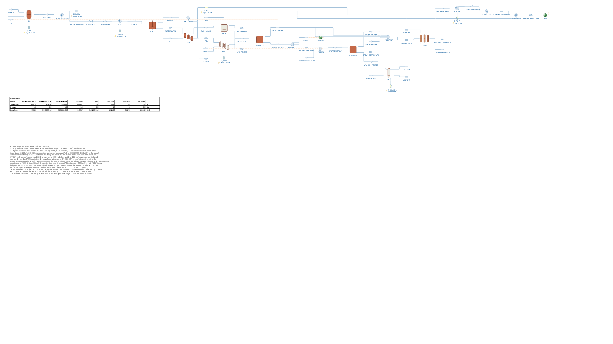

# Gibbsitic bauxite alumina refinery: low-temperature digestion, red mud washing, precipitation, calcination and the liquor loop

**Category:** other
**Status:** community
**DWSIM version:** 10.3.0 or later
**DWSIM edition:** Patreon Edition (Bayer Liquors property package and the alumina unit operations, which build on the pulp and paper unit operations; Premium level)
**Language:** English
**Contributor:** Daniel Wagner Oliveira de Medeiros (@DanWBR)

> **Requirement.** The Bayer Liquors property package and the alumina unit operations (Bauxite Digester, Mud Settler, Mud Washer Train, Bayer Causticizer, Precipitator Train, Hydrate Calciner and Liquor Evaporator) belong to DWSIM Patreon, Premium level. The file opens anywhere, but it only solves where they are licensed.

## Summary

This case is a Bayer refinery of about 0.95 Mt/y of smelter-grade alumina that runs on a gibbsitic bauxite from western Pará, with low-temperature digestion. It covers the refinery from the bauxite to the calcined alumina and around the liquor loop:
- The strong liquor digests the bauxite at 145 °C, and the digested slurry gives its heat to the strong liquor.
- The red mud settles and is washed in six counter-current washers, and the wash liquor is causticized with lime.
- The pregnant liquor gives its heat to the strong liquor and precipitates gibbsite on recycled seed in fourteen tanks.
- The product hydrate is washed and calcined on natural gas.
- A six-effect evaporator takes the spent liquor back to the strong liquor.

The NaOH make-up and the carbonate that the bauxite organics form were found with the loops open, so that the refinery makes back the strong liquor it uses. The whole flowsheet, with its two recycles, solves in about 2 s from the saved file.

## Process description

**Digestion:** DIG, a Bauxite Digester, digests 79 kg/s of the CETEM reference bauxite BXPA-5 (64.7 % gibbsite, 9.2 % kaolinite, 10 % moisture) at 145 °C for 60 min in strong liquor at C 260 g/L (as Na2CO3) and C/S 0.90. The bauxite charge is set so that the pregnant liquor leaves at A/C 0.70. The kaolinite reacts to the desilication product, which takes soda and alumina with it.

**Flash train and heat interchange:** SLURRY-COOLER cools the digested slurry from 145 to 120 °C, and SL-HEATER-2 gives that heat to the strong liquor through their shared energy stream. The pair stands for the flash tanks and slurry heaters of a refinery. BLOW-VALVE and FLASH take the slurry to 105 °C at 1.5 bar. PGL-COOLER cools the pregnant liquor to 78 °C, and SL-HEATER-1 gives that heat to the strong liquor, which reaches digestion at 114 °C.

**Clarification and washing:** SETTLER takes the red mud to 40 % solids. Its overflow has police filtration (0 g/L of solids). CCD, a Mud Washer Train of six washers at 40 % underflow solids, washes the mud with 2.8 t of hot water per t of dry mud. The washed mud leaves as RESIDUE.

**Causticization:** CAUS, a Bayer Causticizer, treats the wash liquor with lime up to C/S 0.95. Its lime efficiency is 50 %, and the rest of the lime forms tricalcium aluminate, which takes alumina with it.

**Precipitation and hydrate:**
- PREC, a Precipitator Train of fourteen tanks of 4500 m³ from 78 to 60 °C, deposits gibbsite on the seed. It uses the White-Bateman growth rate on a seed surface of 0.035 m²/g.
- HYD-FILTER takes the hydrate to 85 % solids, and SEED-SPLIT sends 80 % of it back to precipitation as seed (R-SEED).
- HYD-WASH washes the product hydrate with 0.8 t of hot water per t to 92 % solids.
- CALC, a Hydrate Calciner, calcines it on natural gas to alumina with 0.8 % LOI and 5 % alpha alumina.

**Evaporation:** the spent liquor, the hydrate filtrate and the causticized liquor mix with the NaOH make-up and with the carbonate that the bauxite organics form (as Na2CO3). EVAP, a Liquor Evaporator with six effects in forward feed from 2.5 to 0.15 bar, takes the mix back to C 260 g/L with LP steam. SL-PUMP returns the strong liquor to 8 bar, and R-SL closes the loop.

## Feed and operating conditions

| Item | Value | Unit | Notes |
|---|---|---|---|
| Bauxite | 79 | kg/s | BXPA-5 (western Pará), 10 % moisture, 25 °C |
| Strong liquor | 260 / 0.90 | C g/L / C/S | about 1360 m³/h |
| Digestion | 145 / 60 | °C / min | eight stirred tanks |
| Pregnant liquor | 0.70 | A/C | set by the bauxite charge |
| Mud washing | 6 / 40 / 2.8 | washers / % / t/t | underflow solids, wash water per dry mud |
| Causticization | 0.95 / 50 | C/S / % | target C/S, lime efficiency |
| Precipitation | 14 × 4500 / 78 to 60 | m³ / °C | constant seed surface 0.035 m²/g |
| Seed recycle | 80 | % of the hydrate | |
| Calcination | 150 / 130 / 75 | °C | exit gas, alumina from the cyclones, product |
| Evaporator | 6 effects, 2.5 to 0.15 bar | | forward feed, steam at 4 bar |
| NaOH make-up / organic carbonate | 2.0 / 1.3 | kg/s | found with the loops open (see below) |

## Thermodynamics

- **Property package:** Bayer Liquors, DWSIM Patreon, for the liquors, the minerals, the hydrate, the alumina and the gases.
- **Why this package:** the Bayer liquor is a concentrated solution of NaOH, sodium aluminate and sodium carbonate. Its density, heat capacity, heats of dilution, boiling point elevation and the equilibrium alumina (gibbsite solubility) set the digester, the precipitators and the evaporators. The package takes them from published correlations (Rosenberg-Healy for the solubility, Dewey for the boiling point elevation, Langa for the heat capacity) and keeps the minerals solid.
- **Compounds:** the bauxite minerals, sodium aluminate, the desilication product, gamma alumina, corundum and tricalcium aluminate come with DWSIM under the Bayer tag; the salts and the gases come from the databases.

## Tuning and convergence notes

- **Make-ups found with the loops open.** The case was first solved with the strong liquor and the seed as feed streams. Then, pass after pass:
  - the bauxite was set for the pregnant A/C;
  - the NaOH make-up was set for the sodium of the strong liquor;
  - the organic carbonate was set for its C/S;
  - the seed was taken from the seed that came back.

  When the refinery made back the strong liquor and the seed it used, R-SL and R-SEED closed the loops, and they converged at once. The make-ups are fixed values: if the bauxite or the conditions change, the loop settles at another inventory, and the make-ups should be found again.
- **Heat interchange through energy streams.** Two heat exchangers between the slurry, the pregnant liquor and the strong liquor need two more recycles, and four recycles together didn't converge. Each exchanger is a cooler and a heater that share an energy stream, which keeps the loop at two recycles.
- **Carbonate.** The desilication product takes carbonate out of the liquor, and the digester doesn't model the organics of the bauxite. So the carbonate that the organics form enters as a stream of Na2CO3, sized to hold C/S 0.90.
- **Solve time:** about 2 s from the saved file.

## Results

| Quantity | DWSIM | Published | Source |
|---|---|---|---|
| Production | 108.4 t/h (0.95 Mt/y) | | |
| Bauxite factor | 2.36 t/t dry, 2.63 t/t wet | 2.07 to 2.28 dry; 2.51 with moisture (South America) | EU BREF 2017; IAI 2019 |
| Residue | 0.95 t/t | 0.55 to 2.21, average 1.23 | IAI 2022 |
| Caustic soda | 99.5 kg NaOH/t | 99.1 (South America), 81.0 (world) | IAI 2019 |
| Lime | 13.1 kg CaO/t | 14.2 (South America), 52.3 (world) | IAI 2019 |
| Liquor productivity | 70.0 g/L | 70 to 90 | Guo 2009 |
| Calcination | 2.67 GJ/t (LHV) | 2.66 to 3.03 (gas suspension calciners) | Raahauge 2017 |
| Digestion steam | 3.0 GJ/t | 1.7 (first quartile) | ICSOBA 2024 AA01 |
| Evaporation steam | 2.7 GJ/t | 1.1 (first quartile) | ICSOBA 2024 AA01 |
| Thermal energy | 8.4 GJ/t | 8.4 (South America); 7.6 to 11.7 | IAI 2019; EU BREF 2017 |
| Carbonate causticized | 12.4 kg Na2CO3/t | 20 to 30 | Rosenberg 2017 |
| Fresh water | 4.0 m³/t | 4.8 (world input) | IAI 2019 |
| Soda in the residue | 7.7 % Na2O | 9.8 % (a Pará residue, another bauxite) | Menezes and LaMacchia 2018 |
| Element balances | Si, Fe, Ti and Ca within 1e-15, Al within 3e-5; Na and C within 0.1 % of the make-ups | | |

**Energy:** the total thermal energy agrees with the South American average, but its split doesn't match a first-quartile refinery:
- Digestion takes 3.0 GJ/t, against 1.7 in a first-quartile refinery. In the case, the digested slurry heats the strong liquor only from 145 to 120 °C, and the flash vapour from 120 to 105 °C (1.0 GJ/t) isn't recovered.
- Evaporation takes 2.7 GJ/t, against 1.1. The evaporator has six effects in forward feed without condensate or vapour preheaters, and it reaches an economy of 2.2.

**Bauxite and residue:** BXPA-5 carries 9.2 % kaolinite, more reactive silica than an average bauxite. The desilication product therefore takes more soda and alumina, and the bauxite factor is above the European range.

## Files

- `gibbsitic-bauxite-alumina-refinery.dwxmz`: the DWSIM flowsheet.
- `gibbsitic-bauxite-alumina-refinery.png`: the flowsheet.
- The flowsheet is built by `build_refinery.py` in the alumina validation of DWSIM, which also finds the make-ups, checks the element balances and the benchmarks, and reloads the saved file.

## Confidentiality

The bauxite, the liquors and the operating conditions come from published studies and published benchmarks. No plant data were used.

## References

- CETEM, certified reference bauxite BXPA-5 (western Pará), with the conventional digestion conditions of Bánvölgyi.
- Rosenberg S.P., Healy S.J. (1996), A thermodynamic model for gibbsite solubility in Bayer liquors, 4th AQW.
- White E.T., Bateman S.H. (1988), Light Metals, through the SysCAD Precipitator3 documentation.
- Raahauge B. (2017), Thermal energy consumption in gas suspension calciners, ICSOBA Travaux 46, 333-346.
- Rosenberg S. (2017), Impurity removal in the Bayer process, ICSOBA Travaux 46, 177-190.
- Barnes M., Neil J., Bosamia K. (2024), Decarbonisation of the Bayer process, ICSOBA Travaux 53, 279-300.
- International Aluminium Institute (2019), Life cycle inventory data; (2022) Sustainable bauxite residue management guidance.
- European Commission JRC (2017), Best Available Techniques reference document for the non-ferrous metals industries.
- Guo J. (2009), Mass balance of the precipitation process of the Bayer process, CEED Seminar Proceedings, UWA.
- Chen Y., Li Z., Jiang Y. (2023), Study of Guinean bauxite processing under low and high digestion temperatures, ICSOBA Travaux 52, 539-547.
- Menezes R., LaMacchia R. (2018), bauxite residue of a Pará refinery, ICSOBA.
