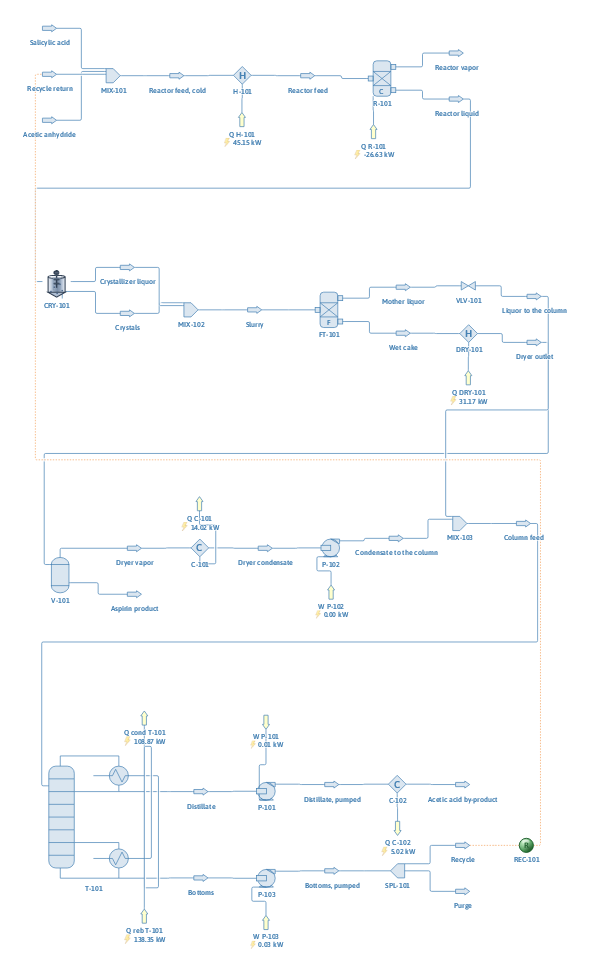
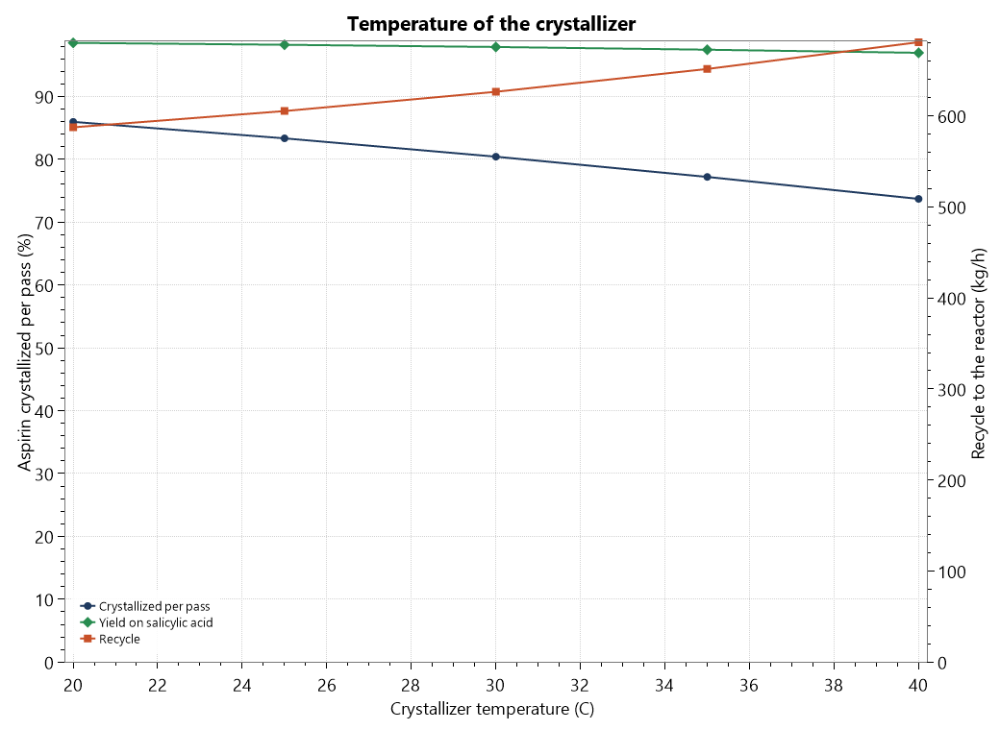
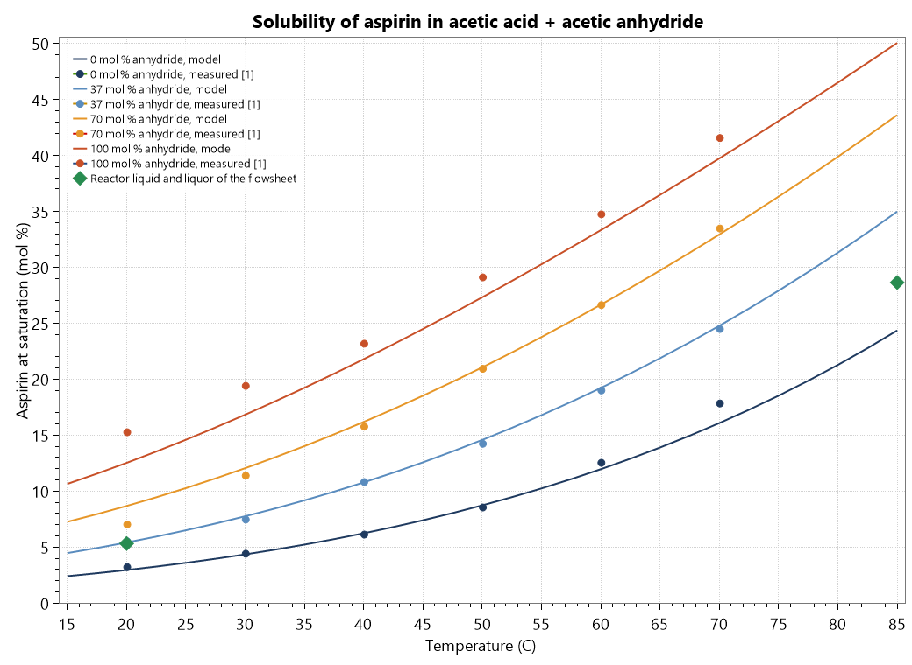

# Aspirin by acetylation of salicylic acid, with cooling crystallization and recovery of the acetic acid

**Category:** reaction-systems
**Status:** community
**DWSIM version:** 10.3.0 or later
**DWSIM edition:** open source
**Language:** English
**Contributor:** Daniel Wagner Oliveira de Medeiros (@DanWBR)

> **Requirement:** The case needs DWSIM 10.3.0 or later, for the Crystallizer with the solubility from the property package and for a distillation column that works with a property package that handles solids. Aspirin isn't in the standard databases; it is stored inside the file.

## Summary

Aspirin (acetylsalicylic acid) is made by the acetylation of salicylic acid with acetic anhydride, and it is crystallized from the liquor of the reaction itself, a mixture of acetic acid and anhydride. This case takes 500 kg/h of salicylic acid through the reaction, a cooling crystallizer, a filter and a vacuum dryer. The mother liquor goes to a vacuum column that takes out the acetic acid made by the reaction, and the bottoms return to the reactor. The solubility of aspirin in the liquor comes from an NRTL model fitted to 48 published measurements in acetic acid, in acetic anhydride and in their mixtures. The plant makes 643 kg/h of aspirin with 99.94 wt % purity, a yield of 98.5 % on salicylic acid.

## Process description

**Reaction:** MIX-101 joins the salicylic acid, the acetic anhydride (10 % molar excess) and the recycled liquor. H-101 heats the mixture to 85 °C and R-101 converts the salicylic acid to aspirin and acetic acid. At 85 °C all the aspirin is in solution.

**Crystallization:** CRY-101 cools the reactor liquid to 20 °C. The aspirin above saturation leaves as crystals, and MIX-102 joins the crystals and the liquor into the slurry.

**Filtration and drying:** FT-101, a rotary vacuum filter, leaves a cake with 15 wt % of liquor. DRY-101 heats the cake to 70 °C at 0.03 bar and V-101 separates the vapor from the product. C-101 condenses the vapor and P-102 sends the condensate to the column.

**Acetic acid column:** VLV-101 lets the mother liquor down to 0.2 bar and MIX-103 joins it with the dryer condensate. T-101 takes the acetic acid overhead; P-101 and C-102 deliver it as a by-product. The bottoms hold the anhydride, the rest of the acid and the dissolved aspirin.

**Recycle:** P-103 pumps the bottoms to 1.5 bar, SPL-101 purges 10 % of them, and the recycle block REC-101 closes the loop at the reactor.

## Feed and operating conditions

| Item | Value | Unit | Notes |
|---|---|---|---|
| Salicylic acid | 500 (3.620) | kg/h (kmol/h) | 25 °C, 1.5 bar, solid |
| Acetic anhydride | 406.5 | kg/h | 10 % molar excess |
| R-101 | 85 °C, 1.5 bar | | isothermal; 99.5 % of the salicylic acid converted (assumed) |
| Crystallizer CRY-101 | 20 | °C | cooling mode, solubility from the property package |
| Filter FT-101 | 0.5 bar of pressure drop, 15 wt % of liquor in the cake | | design mode |
| Dryer DRY-101 / V-101 | 70 °C, 0.03 bar | | |
| Condenser C-101 | 20 | °C | 0.03 bar |
| T-101 | 25 stages, feed on 12, 0.2 bar | | distillate rate 3.30 kmol/h, boil-up ratio 2.2, default bubble point solver |
| Purge SPL-101 | 10 | % of the bottoms | |

## Thermodynamics

- **Property package:** NRTL with solids handled by the default flash (`HandleSolidsInDefaultEqCalcMode`), for the whole flowsheet, the column included.
- **Solubility data:** Xiong et al. [1] measured the solubility of aspirin in acetic acid, in acetic anhydride and in six mixtures of the two, from 293.2 to 343.2 K, by a gravimetric method (their Table 1, 48 points).
- **Aspirin / acetic acid and aspirin / acetic anhydride pairs:** fitted together to those 48 points for this case, with two constant energies per pair and alpha = 0.3 (aspirin is compound 1). Aspirin / acetic acid: A12 = 1743.3, A21 = -879.8 cal/mol. Aspirin / acetic anhydride: A12 = 190.2, A21 = -1300.4 cal/mol. The fit follows the data within 6 % on average.
- **A fit with energies linear in temperature wasn't worth it:** eight parameters brought the average deviation from 6.1 % to 5.8 %.
- **Other pairs:** acetic acid / acetic anhydride and the three pairs of salicylic acid don't have parameters in the database and are set as ideal pairs.
- **Aspirin:** melting point 408.95 K and enthalpy of fusion 32.6 kJ/mol, measured by DSC [2]. Its boiling point, critical constants and ideal gas properties are Joback estimates. It decomposes before it boils, so its vapor pressure is only a placeholder for the models.
- **Crystal densities:** aspirin 1400 kg/m3, salicylic acid 1443 kg/m3.
- **Acetic acid vapor:** ideal. The association of acetic acid in the vapor isn't modelled, which affects the column more than the crystallizer.

## Tuning and convergence notes

- **The reactor works above the range of the data:** the measurements stop at 70 °C and R-101 is at 85 °C. There the reactor liquid has 28.7 mol % of aspirin and the model gives 34.7 mol % at saturation, so the aspirin stays in solution, on an extrapolation of 15 °C.
- **The conversion is an assumption:** R-101 is a conversion reactor with 99.5 % of the salicylic acid converted. Its duty (-27 kW) comes from estimated enthalpies of formation and isn't a measure of the heat of the reaction.
- **The distillate rate sets the acetic acid that leaves the loop:** the reaction makes 3.62 kmol/h of acetic acid. T-101 takes out 3.30 kmol/h and the purge takes the rest (0.32 kmol/h). A distillate rate above what the reaction makes would empty the loop of acid.
- **Column specifications:** distillate rate and boil-up ratio. With these two the bubble point solver searches for the reflux ratio; the column solves in each pass of the recycle.
- **Why the column is under vacuum:** at 0.2 bar the bottoms are at 82 °C. At atmospheric pressure they would boil between the boiling points of the acid and of the anhydride, 118 and 140 °C, with aspirin dissolved in them, and aspirin decomposes when heated.
- **The anhydride in the loop:** the excess of anhydride fed (0.36 kmol/h) leaves only in the purge, so the bottoms hold ten times that. The liquor of the crystallizer ends with 36 mol % of anhydride in its solvent, where aspirin is 1.8 times as soluble as in acetic acid alone.
- **Where the unconverted salicylic acid goes:** it stays dissolved in the liquor. What the cake carries (15 wt % of liquor) dries onto the product, which ends with 0.03 wt % of salicylic acid. A plant washes the cake, which the Filter block doesn't do.
- **Acetic acid freezes at 16.6 °C:** the crystallizer and the condenser C-101 stay at 20 °C for that reason.
- **The recycle block uses Wegstein acceleration on every pass** (`AccelerationMethod`, `WegsteinParameters.AccelFreq = 1`, `MaximumIterations = 300`), set from the script that built the case, and the tear stream has a first estimate.
- **Automatic estimation of NRTL pairs is switched off** (`AutoEstimateMissingNRTLUNIQUACParameters`), and the pairs without data are declared with zero energies.
- **The filter area is illustrative:** it comes from the default cake and medium resistances of the block.
- **Mass balance:** feeds 906.5 kg/h, products 906.5 kg/h.

## Results

| Quantity | DWSIM | Unit |
|---|---|---|
| Product | 643.1 | kg/h |
| Aspirin in the product | 99.94 | wt % |
| Salicylic acid in the product | 0.03 | wt % |
| Yield on salicylic acid | 98.5 | % |
| Acetic acid by-product | 198 | kg/h, 99.98 wt % of acid |
| Purge | 65.3 | kg/h, with 9.0 kg/h of aspirin |
| Aspirin crystallized in CRY-101 per pass | 86.0 | % |
| Crystals in the slurry | 42.1 | wt % |
| Aspirin at saturation in the liquor at 20 °C | 5.3 | mol % |
| Recycle to the reactor | 588 | kg/h |
| Filter area FT-101 | 2.55 | m2 |
| Reboiler / condenser of T-101 | 138 / 109 | kW |
| Crystallizer cooling CRY-101 | 87 | kW |
| Reactor feed heater H-101 / reactor R-101 | 45 / -27 | kW |
| Dryer DRY-101 / condenser C-101 | 31 / 14 | kW |

Where the salicylic acid goes, per 100 mol fed: 98.5 as aspirin in the product, 1.4 as aspirin in the purge, and 0.1 unconverted, in the purge and in the product.

The temperature of the crystallizer, with everything else as in the base case:

| Crystallizer, °C | Crystallized per pass, % | Yield on salicylic acid, % | Crystals in the slurry, wt % | Recycle, kg/h | Reboiler, kW |
|---|---|---|---|---|---|
| 20 | 86.0 | 98.5 | 42.1 | 588 | 138 |
| 25 | 83.4 | 98.2 | 41.3 | 605 | 140 |
| 30 | 80.4 | 97.9 | 40.5 | 627 | 143 |
| 35 | 77.2 | 97.5 | 39.5 | 652 | 145 |
| 40 | 73.7 | 97.0 | 38.3 | 681 | 149 |

A warmer crystallizer leaves more aspirin in the liquor: the recycle grows, the purge takes more of it, and the column boils more. The base case stays at 20 °C, a little above the freezing point of acetic acid.

The solubility of aspirin from the model against the measurements of [1]:

Aspirin at saturation in mol %, measured / DWSIM, by the anhydride in the solvent:

| Anhydride in the solvent, mol % | 20 °C | 30 °C | 40 °C | 50 °C | 60 °C | 70 °C |
|---|---|---|---|---|---|---|
| 0.0 | 3.22 / 2.97 | 4.42 / 4.37 | 6.13 / 6.26 | 8.55 / 8.75 | 12.54 / 11.99 | 17.84 / 16.11 |
| 12.8 | 3.73 / 3.69 | 5.51 / 5.39 | 7.56 / 7.64 | 10.37 / 10.58 | 14.21 / 14.31 | 19.06 / 18.98 |
| 21.1 | 4.00 / 4.23 | 6.32 / 6.13 | 8.54 / 8.64 | 11.69 / 11.87 | 15.73 / 15.93 | 21.02 / 20.92 |
| 37.0 | 5.52 / 5.43 | 7.47 / 7.78 | 10.82 / 10.81 | 14.24 / 14.61 | 19.00 / 19.25 | 24.49 / 24.81 |
| 54.0 | 6.76 / 6.98 | 9.30 / 9.84 | 13.49 / 13.44 | 17.35 / 17.83 | 22.92 / 23.03 | 29.36 / 29.04 |
| 70.2 | 7.03 / 8.70 | 11.39 / 12.08 | 15.77 / 16.21 | 20.94 / 21.09 | 26.63 / 26.70 | 33.48 / 32.98 |
| 82.5 | 9.04 / 10.19 | 13.92 / 13.96 | 18.62 / 18.47 | 24.45 / 23.66 | 29.97 / 29.49 | 36.21 / 35.88 |
| 100.0 | 15.27 / 12.56 | 19.41 / 16.86 | 23.18 / 21.83 | 29.11 / 27.36 | 34.75 / 33.37 | 41.57 / 39.78 |

The largest deviations are at 20 °C in the solvents rich in anhydride: 24 % at 70 mol % of anhydride, where the measured point sits below its neighbours, and 18 % in the anhydride alone.

The case doesn't have a reference from a plant or from another simulator. The comparison of the solubility is the only one against data.

## Files

- `aspirin-acetylation-cooling-crystallization-acetic-acid-recovery.dwxmz` - the DWSIM flowsheet, with the notes, the stream table and the two charts on it.
- `aspirin-acetylation-cooling-crystallization-acetic-acid-recovery.png` - the flowsheet picture.
- `solubility-aspirin-acetic-acid-anhydride.png`, `crystallizer-temperature.png` - the charts above.

## Confidentiality

The flowsheet was put together for this example from the public description of the route. The flows, the conversion and the operating conditions are illustrative and don't come from any plant or third-party data set.

## References

1. L. Xiong, L. Zhou, X. Zhang, M. Zhang, B. Hou, Y. Bao, W. Du, W. Su, S. Zhang, Q. Yin, Determination of metastable zone widths and nucleation behavior of aspirin in acetic acid and acetic anhydride binary solvent mixture, J. Mol. Liq. 269 (2018) 805-815.
2. I. Hahnenkamp, G. Graubner, J. Gmehling, Measurement and prediction of solubilities of active pharmaceutical ingredients, Int. J. Pharm. 388 (2010) 73-81.
