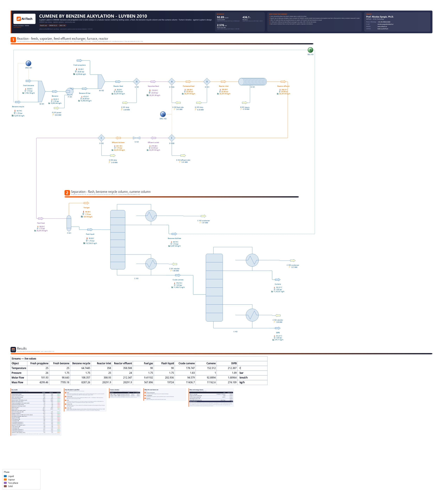

# Cumene by benzene alkylation with propylene: Luyben's 2010 plant - cooled tubular reactor, benzene recycle and two columns

**Category:** reaction-systems
**Status:** community
**DWSIM version:** 10.2.13
**DWSIM edition:** open source
**Language:** English
**Contributor:** Prof. Nicolas Spogis, Ph.D. (@Spogis), AI4Tech · nicolas.spogis@ai4tech.ai · www.ai4tech.ai

## Summary

W. L. Luyben's cumene plant (2010) is a standard example of a process with a recycle: benzene and propylene react in the vapour over a solid catalyst, in tubes cooled by boiling water, and a second reaction turns some of the cumene into p-diisopropylbenzene (DIPB). A flash takes the propane off, a first column recovers the excess benzene for the reactor, and a second takes the cumene overhead. The case rebuilds his steady-state design in DWSIM with the recycle closed, and it follows his numbers within a few per cent: 92.89 kmol/h of 99.95 % cumene against his 92.86 kmol/h of 99.9 %, a reactor hot spot of 436 °C against 430, a benzene recycle of 108.4 kmol/h at 94.9 % against 108.2 at 95.2. It also shows three things this kind of plant needs in DWSIM: a makeup held by a Spec block, columns held to a trace impurity through their bottoms flows, and Raoult's law where DWSIM's activity models mishandle propane and propylene near their critical point.

## Process description

**Reaction (section 1).**
- Fresh benzene and the benzene recycled from C-101 are mixed (M-101) and pumped to 26 bar (P-101). SPEC-101 sets the fresh benzene so that the two add up to Luyben's 207 kmol/h, as his control does; the fresh benzene is a result.
- The fresh C3 stream - 95 % propylene, 5 % propane - joins it (M-102). E-101 vaporizes the feed at 25 bar to 210 °C, E-102A heats it to 330 °C with the reactor's effluent, and the furnace H-101 takes it to 358 °C.
- R-101 holds 1,500 tubes of catalyst. Propylene reacts with benzene to cumene and with cumene to DIPB, on Turton's kinetics. The heat goes through the tube walls to boiling water at one temperature.
- The effluent gives its heat to the feed in E-102B, the exchanger's hot side: SPEC-102 hands it E-102A's duty. V-101 lets it down to 1.75 bar, and E-103 cools it to 90 °C.

**Separation (section 2).**
- F-101 flashes the light gases off as fuel gas: all the propane the plant is fed, the propylene left, and some benzene.
- C-101, Luyben's recycle column, takes the benzene overhead with the propane and propylene the flash left in its liquid. Its distillate goes back to M-101 (REC-101 closes the loop); its bottoms hold 0.05 mol % benzene.
- C-102, the product column, takes the cumene overhead; the DIPB leaves in its bottoms with 0.1 mol % cumene.

## Feed and operating conditions

| Item | Value | Unit | Notes |
|---|---|---|---|
| Fresh C3 | 101.93 | kmol/h | 95 mol % propylene, 5 % propane; 25 °C, 26 bar (Luyben) |
| Fresh benzene | 98.64 | kmol/h | the result: SPEC-101 holds fresh and recycled benzene at Luyben's 207 kmol/h; 25 °C |
| Vaporizer E-101 | 210 °C, 25 bar | | 1 bar of pressure drop |
| Feed-effluent exchanger E-102 | cold side to 330 °C | | drawn as its two sides, E-102A and E-102B; 1 bar of drop on the hot side |
| Furnace H-101 | 358 °C | | |
| Reactor R-101 | 1,500 tubes of 76.3 mm and 6 m, 41.2 m3; bed void 0.5; U 0.065 kW/(m2 K) | | boiling water at 358.19 °C, the one number the case adjusts; 25 -> 24 bar |
| Kinetics | cumene: 2.8E7 exp(-104,174 / RT) C(propylene) C(benzene); DIPB: 2.32E9 exp(-146,742 / RT) C(propylene) C(cumene) | kmol/(m3 s); E in kJ/kmol; C in kmol/m3 | Turton et al., as Luyben uses them; per m3 of the bed's void |
| Flash F-101 | 90 °C, 1.75 bar | | after the letdown valve V-101 and the cooler E-103 |
| C-101 (Luyben's C1) | 15 stages, feed on 6; 1.75 bar at the top, 1.83 at the bottom; molar reflux 0.44; 0.05 mol % benzene in the bottoms | | the stages count the condenser and the reboiler, as Luyben's do |
| C-102 (Luyben's C2) | 20 stages, feed on 12; 1.00 / 1.09 bar; molar reflux 0.63; 0.1 mol % cumene in the bottoms | | |

## Thermodynamics

- **Property package:** Raoult's law - an ideal liquid and an ideal gas - on "Ideal" enthalpies, with `UseHenryConstants` off.
- **Why this package:** the five compounds are hydrocarbons, and Luyben's numbers behave as an ideal solution. His recycle - benzene with 4.8 % of propane and propylene - boils at 64 °C, and DWSIM's ideal solution puts it at 64.7 °C. The reproduction's flash gives propane a K of 19.0 at 85 °C, and Raoult's law 19.5. The reactor's rates are written on concentrations of an ideal gas. On Peng-Robinson, whose compressibility at 25 bar packs the gas tighter, the hot spot ran about 17 K hotter.
- **Why not NRTL**, which the reproduction used: DWSIM's activity models (NRTL, UNIQUAC, the UNIFACs) take a compound's liquid fugacity from its vapour pressure only below 0.98 of its critical temperature. From 0.98 to 1.02 they interpolate it to the compound's Henry constant, and DWSIM's Henry constants are a gas's in water. This happens whatever `UseHenryConstants` says (DWSIM's source, `ActivityCoefficientBase.vb`). Luyben's flash at 90 °C is at 0.982 of propane's critical temperature and 0.995 of propylene's. NRTL gave them K-values of 6,848 and 16,058, where Raoult's law gives 21.3 and 25.2.
  - Built on NRTL, the flash sent every mole of the C3s to the fuel gas, where Luyben's recycle carries 5.2 kmol/h of them back.
  - The recycle came out at 99.5 % benzene and 89 °C. The fuel gas took 5.06 kmol/h of benzene against his 3.96, and the fresh benzene rose to 99.91 kmol/h.
  - No interaction parameter reaches it: the numbers are the same with the NRTL pairs zeroed, or the Poynting correction off. DWSIM's databank holds only the benzene / cumene pair, and estimates the other nine from UNIFAC (skill F118).
- **Henry constants off:** with them on, Raoult's law takes a compound above its critical temperature in a liquid from its Henry constant in water. Propane and propylene are above it in the vaporizer and down the columns. Off, it takes the extrapolated vapour pressure. The setting is saved with the file.
- **"Ideal" enthalpies:** "ExpData" builds an enthalpy from the liquid's heat capacity. Propane and propylene, supercritical in the reactor, have no liquid there, and on "ExpData" the hot spot rose about 10 K (skill F57).

## Tuning and convergence notes

- **The total benzene is held, not the fresh benzene.** Benzene in excess leaves only by reacting, in the fuel gas and in the product. With the fresh feed fixed, the recycle has to grow or shrink until the fuel gas sheds the difference, and a model whose reactor or flash differ a little from Luyben's moves it a lot. Luyben's control holds the total at 207 kmol/h, and so does SPEC-101: `207 - X` on the fresh benzene, X the recycle. A Spec on a feed stream runs again on every pass of the recycle (the skill's `examples/38`). The fresh benzene then shows what changed: 98.64 kmol/h here, 99.91 on NRTL.
- **The rate per m3 of the bed's void.** DWSIM's rate is per m3 of reactor, so each pre-exponential factor is multiplied by the void fraction, 0.5. On the tubes' whole volume, measured on Peng-Robinson, the hot spot reached 498 °C against 453 on the void.
- **The coolant temperature, the one number adjusted.** Luyben gives the tubes, U and the outlet temperature, not the steam's. The build finds by a secant on R-101 alone the boiling water that leaves Luyben's reactor feed at his 358.5 °C: 358.19 °C. The hot spot, the DIPB and the heat removed follow from it.
- **The reactor's heat is read from the streams.** DWSIM's PFR in heat-exchange mode writes into its energy stream U dA (Tc - T) summed over every pass of each slice's temperature loop. On Luyben's feed, the gas gives the water 2,579 kW by its streams with the heats of formation, and 2,571 kW by U π D (T - Tc) dz over the profile; the energy stream says 3,122 kW (skill F87). The case reports the streams', and case.json names R-101 a known imbalance.
- **The feed-effluent exchanger as its two sides.** E-102A heats the feed to 330 °C, and SPEC-102 hands its duty to E-102B. As one exchanger block it would close a second loop through the reactor.
- **Every compound's order in a kinetic reaction.** `DefineKineticReaction` raises "The given key was not present in the dictionary" unless both order dictionaries name every compound of the reaction, the products at zero (skill F117).
- **The columns are held to Luyben's impurities through their bottoms flows.** DWSIM's Wang-Henke takes a bottoms impurity only as the bottoms' flow. Naphtali-Sandholm takes the impurity itself, but it took 42 s a solve on C-101 alone, and 17 to 45 s warm, on every pass of the recycle.
  - At reflux 0.44 C-101's top pinches. Its distillate keeps about 0.4 % cumene whatever the bottoms flow, and each kmol/h less bottoms takes a kmol/h of benzene out of them.
  - So the build moves each bottoms flow by `B (1 - x) / (1 - x_spec)`, a Newton step, and solves the plant again. Both columns met their impurities in five solves, C-102 by a secant after its first step.
  - The flows start on the light side, with more benzene or cumene in the bottoms than the target. As a trace runs out, Wang-Henke's iterations climb: C-102 took up to 2,422 near its 0.1 %. The columns get 5,000 iterations, because at the limit DWSIM hands a column to Naphtali-Sandholm without a word.
  - The impurities are met to 2 % of themselves: tighter, the moves fall inside the recycle's own tolerance (skill F116).
- **One recycle.** REC-101 tears C-101's distillate, its first guess Luyben's. Each column restarts from its last solution (`keep_warm`). The whole build, the coolant secant and five solves of the plant, solves in about a minute.

## Results

The case follows Luyben's design within 1 % on the product, the fresh benzene, the recycle, the reactor's outlet and heat, the feed-effluent exchanger and the cumene column, and within 7 % on the recycle column and the flash. It parts from his numbers in two places:

- **DIPB, 9 % more.** R-101 makes 55 mol of cumene per mol of DIPB where the reproduction's reactor makes 60. Its hot spot runs 6 K hotter, and the DIPB reaction, with 41 % more activation energy, gains more from it. This was not traced further: a one-dimensional plug flow, the heats of reaction from DWSIM's heats of formation.
- **The vaporizer, 16 % less heat.** DWSIM vaporizes 96.8 % of the feed at 210 °C, where the reproduction leaves 6.4 % liquid, and does it with less heat. The difference is in the liquid feed's enthalpy, not in the equilibrium. It was not traced.

| Quantity | DWSIM | Reference | Reference source | Rel. error |
|---|---|---|---|---|
| Cumene product, kmol/h | 92.89 | 92.86 | Luyben (2010), Korprasert (2013) Fig. 4.2 | +0.03 % |
| Cumene in the product, mol % | 99.95 | 99.90 | Luyben (2010), Korprasert (2013) Fig. 4.2 | +0.05 % |
| DIPB, C-102 bottoms, kmol/h | 1.690 | 1.550 | Luyben (2010), Korprasert (2013) Fig. 4.2 | +9.01 % |
| Fresh benzene, kmol/h | 98.64 | 98.78 | Luyben (2010), Korprasert (2013) Fig. 4.2 | −0.14 % |
| Benzene recycle, C-101 distillate, kmol/h | 108.36 | 108.20 | Luyben (2010), Korprasert (2013) Fig. 4.2 | +0.15 % |
| Benzene in the recycle, mol % | 94.88 | 95.20 | Luyben (2010), Korprasert (2013) Fig. 4.2 | −0.34 % |
| Propane and propylene in the recycle, kmol/h | 5.38 | 5.19 | Luyben (2010), Korprasert (2013) Fig. 4.2 | +3.66 % |
| Fuel gas from the flash, kmol/h | 9.41 | 9.98 | Luyben (2010), Korprasert (2013) Fig. 4.2 | −5.70 % |
| Benzene lost in the fuel gas, kmol/h | 3.70 | 3.96 | Luyben (2010), Korprasert (2013) Fig. 4.2 | −6.51 % |
| Reactor hot spot, C | 436.1 | 430.0 | Luyben (2010), Gera et al. (2011) Table 1 | +0.87 % |
| Reactor outlet, C | 358.51 | 358.50 | Luyben (2010), Korprasert (2013) Table A.1 | 0.00 % |
| Boiling water in the reactor's shell, C | 358.19 | — | the one number adjusted: Luyben's feed leaves at 358.5 C | — |
| Heat to the boiling water, MW | 2.576 | 2.567 | Luyben (2010), Korprasert (2013) Table A.1 | +0.34 % |
| Propylene converted, % | 99.52 | 99.10 | Korprasert (2013) Table A.2, NRTL | +0.43 % |
| Selectivity, cumene over DIPB made in R-101, mol/mol | 55.2 | 60.4 | Korprasert (2013) Table A.2, NRTL | −8.70 % |
| Feed-effluent exchanger, effluent out, C | 279.1 | 279.0 | Luyben (2010), Korprasert (2013) Fig. 4.2 | +0.02 % |
| Vaporizer E-101, MW | 3.644 | 4.333 | Luyben (2010), Korprasert (2013) Table A.1 | −15.91 % |
| C-101 condenser, MW | 1.469 | 1.572 | Luyben (2010), Korprasert (2013) Table A.1 | −6.58 % |
| C-101 reboiler, MW | 1.983 | 2.072 | Luyben (2010), Korprasert (2013) Table A.1 | −4.30 % |
| C-101 distillate temperature, C | 64.7 | 64.0 | Luyben (2010), Korprasert (2013) Fig. 4.2 | +0.22 % |
| C-101 bottoms temperature, C | 178.7 | 178.0 | Luyben (2010), Korprasert (2013) Fig. 4.2 | +0.17 % |
| Benzene in C-101's bottoms, mol % | 0.05 | 0.05 | Luyben (2010), Korprasert (2013) Table A.1 | −1.40 % |
| C-102 condenser, MW | 1.568 | 1.586 | Luyben (2010), Korprasert (2013) Table A.1 | −1.15 % |
| C-102 reboiler, MW | 1.376 | 1.397 | Luyben (2010), Korprasert (2013) Table A.1 | −1.49 % |
| C-102 distillate temperature, C | 152.5 | 152.0 | Luyben (2010), Korprasert (2013) Fig. 4.2 | +0.12 % |
| C-102 bottoms temperature, C | 212.3 | 214.0 | Luyben (2010), Korprasert (2013) Fig. 4.2 | −0.35 % |
| Cumene in C-102's bottoms, mol % | 0.10 | 0.10 | Luyben (2010), Korprasert (2013) Table A.1 | +0.63 % |

## Files

- `cumene-by-benzene-alkylation.dwxmz` - the DWSIM flowsheet, with AI4Tech's title block.
- `cumene-by-benzene-alkylation.png` - the flowsheet as DWSIM draws it.

## Confidentiality

Everything in the case is public: Luyben's published design, as two public works reproduce it, and Turton's kinetics. No client and no plant data are in it. The contributor's contact is in the flowsheet's title block with the maintainer's agreement.

## References

- Luyben, W. L. (2010). Design and control of the cumene process. *Industrial & Engineering Chemistry Research* 49(2), 719-734. https://doi.org/10.1021/ie9011535
- Korprasert, S. (2013). *Plantwide control structure design for cumene process.* M.Eng. thesis, Department of Chemical Engineering, Chulalongkorn University. Chulalongkorn University Intellectual Repository (CUIR), handle 123456789/43905 - Luyben's flowsheet and streams (Fig. 4.2), the kinetics (Table 4.1), the reactor and the columns (Table A.1), an NRTL re-simulation's stream table (Table A.2).
- Gera, V., Kaistha, N., Panahi, M., Skogestad, S. (2011). Plantwide control of a cumene manufacture process. *21st European Symposium on Computer Aided Process Engineering (ESCAPE 21)*, Computer Aided Chemical Engineering 29, Elsevier - Luyben's design (Table 1). Author's copy: https://skoge.folk.ntnu.no/publications/2011/gera_escape21/escape21_vivekgera.pdf
- Turton, R., Bailie, R. C., Whiting, W. B., Shaeiwitz, J. A. (2009). *Analysis, Synthesis, and Design of Chemical Processes*, 3rd ed. Prentice Hall - the kinetics.
