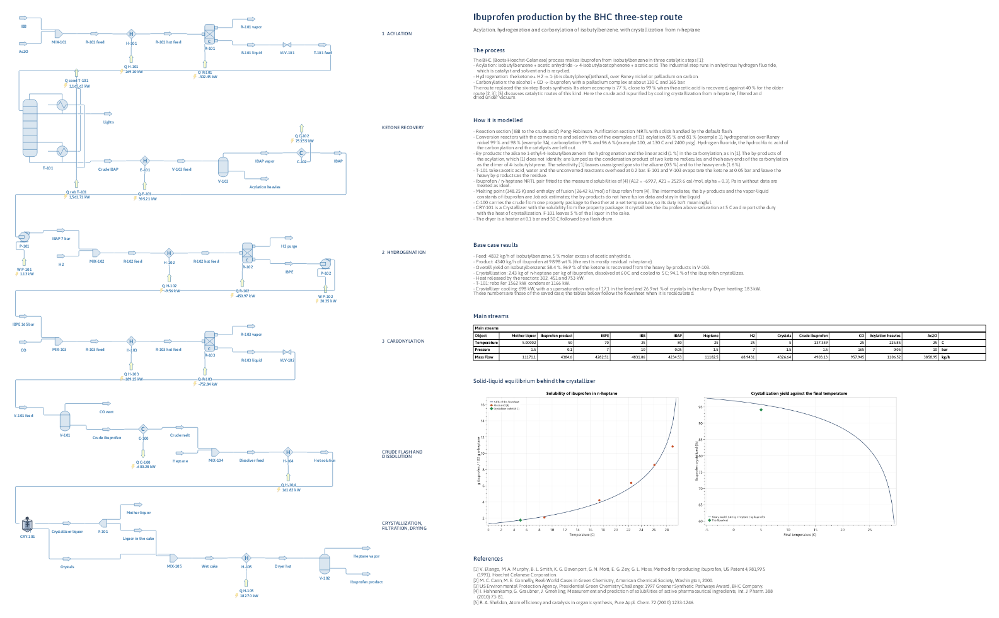
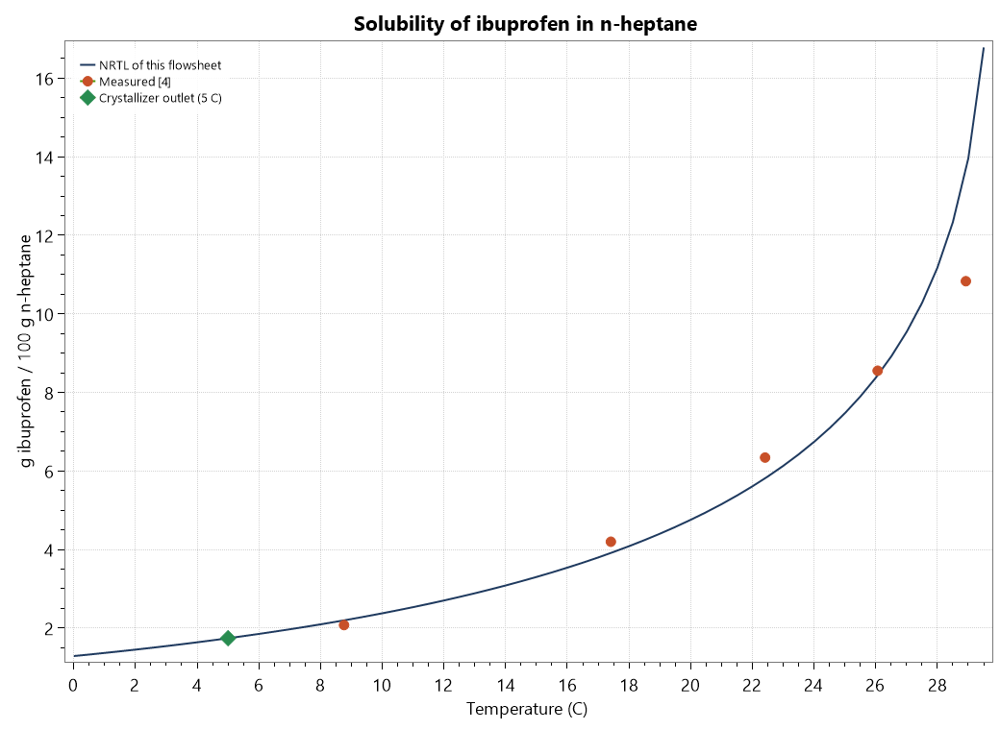
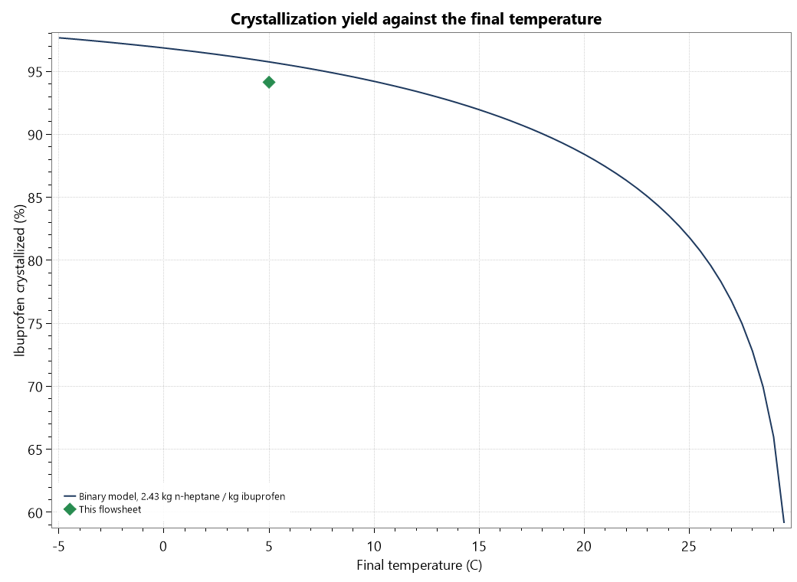

# Ibuprofen by the BHC three-step route, with crystallization from n-heptane

**Category:** reaction-systems
**Status:** community
**DWSIM version:** 10.2.17 or later
**DWSIM edition:** open source
**Language:** English
**Contributor:** Daniel Wagner Oliveira de Medeiros (@DanWBR)

> **Requirement:** The case needs DWSIM 10.2.17 or later. Earlier versions calculate the enthalpy of streams with solids differently and give a wrong temperature for the wet cake of this flowsheet, and the Crystallizer doesn't have the option to take the solubility from the property package. The nine compounds that aren't in the standard databases (ibuprofen, its two intermediates and the by-products among them) are stored inside the file.

## Summary

The BHC (Boots-Hoechst-Celanese) process makes ibuprofen from isobutylbenzene in three catalytic steps: acylation, hydrogenation and carbonylation [1]. This case follows 4.8 t/h of isobutylbenzene through the three reactors, with the conversions and selectivities of the examples of the patent, and through a purification section where the crude acid is crystallized from n-heptane, filtered and dried under vacuum. The purification section is the point of the case: the solid-liquid equilibrium comes from an NRTL pair fitted to measured solubilities [4], and the filter, the dryer and the energy balance all run with a solid phase in the streams. The flowsheet gives 4.34 t/h of ibuprofen at 99.0 wt %, with an overall yield of 58.4 % on isobutylbenzene in one pass, without recycling the unconverted reactants.

## Process description

**Step 1, acylation:** Isobutylbenzene (IBB) and acetic anhydride are mixed, heated to 80 °C and react in R-101 to 4-isobutylacetophenone (IBAP) and acetic acid. The industrial step runs in anhydrous hydrogen fluoride, which is catalyst and solvent and is recycled; the model leaves it out. The reactor liquid is let down to 0.2 bar and T-101 takes the acetic acid, the water and the unconverted reactants overhead. E-101 and V-103 then evaporate the ketone at 0.05 bar and leave the heavy by-products as the residue; C-102 condenses the ketone.

**Step 2, hydrogenation:** The ketone is pumped to 7 bar, mixed with hydrogen and brought to 70 °C. R-102 converts it to 1-(4-isobutylphenyl)ethanol (IBPE), over Raney nickel in the patent's example. A little of the ketone goes on to the alkane, 1-ethyl-4-isobutylbenzene. The excess hydrogen leaves as the reactor's vapor.

**Step 3, carbonylation:** The alcohol is pumped to 165 bar, mixed with carbon monoxide and heated to 130 °C. R-103 converts it to ibuprofen, in industry with a palladium complex in aqueous hydrochloric acid. The by-products are the linear isomer of ibuprofen, 3-(4-isobutylphenyl)propanoic acid, and heavy ends. The liquid is let down to 1.5 bar and V-101 vents the carbon monoxide left.

**Purification:** The crude acid (C-100) is dissolved in n-heptane (MIX-104, H-104 at 60 °C), cooled to 5 °C in the Crystallizer CRY-101, which takes the solubility of ibuprofen from the property package, and filtered in F-101, which sends 95 % of the liquor to the mother liquor and leaves the rest in the cake. The wet cake is dried at 0.1 bar and 50 °C (H-105 and the flash drum V-102). The by-products that reach this section leave in the mother liquor.

## Feed and operating conditions

| Item | Value | Unit | Notes |
|---|---|---|---|
| Isobutylbenzene | 10.0 (4832) | mol/s (kg/h) | 25 °C, 10 bar |
| Acetic anhydride | 10.5 | mol/s | 5 % molar excess |
| Hydrogen | 9.5 | mol/s | 25 °C, 7 bar |
| Carbon monoxide | 9.5 | mol/s | 25 °C, 165 bar |
| n-Heptane | 31.0 | mol/s | 2.43 kg per kg of ibuprofen |
| R-101, acylation | 80 °C, 10 bar | | isothermal; 85 % conversion of IBB, 81 % selectivity to IBAP ([1], example 1) |
| T-101 | 12 stages, feed on 6, 0.2 bar | | reflux ratio 1; bottoms rate equal to the ketone and the heavies fed |
| E-101 / V-103, ketone evaporator | 227 °C, 0.05 bar | | 96.9 % of the ketone goes overhead |
| R-102, hydrogenation | 70 °C, 7 bar | | isothermal; 99 % conversion of IBAP, 98 % selectivity to IBPE ([1], example 3A) |
| R-103, carbonylation | 130 °C, 165 bar | | isothermal; 99 % conversion of IBPE, 96.6 % selectivity to ibuprofen and 1.0 % to the linear acid ([1], example 100: 130 °C, 2400 psig) |
| Dissolution | 60 °C, 1.5 bar | | |
| Crystallizer CRY-101 | 5 °C | | cooling mode, solubility from the property package |
| Filter F-101 | 95 % of the liquor separated, the rest stays in the cake | | a splitter and the mixer MIX-105 |
| Dryer | 50 °C, 0.1 bar | | |

## Thermodynamics

- **Property packages:** Peng-Robinson from the feeds to the crude acid; NRTL with solids handled by the default flash (`HandleSolidsInDefaultEqCalcMode`) in the purification section.
- **Why two packages:** the reaction section has hydrogen and carbon monoxide at up to 165 bar, which calls for an equation of state. The purification section is a solution of a polar acid in an alkane at low pressure, where the solubility depends on the activity coefficient of ibuprofen.
- **Ibuprofen / n-heptane pair:** fitted for this case to the five solubility points of Hahnenkamp et al. [4] between 8.8 and 28.9 °C: A12 = -699.7 cal/mol, A21 = 2529.6 cal/mol, alpha = 0.3 (ibuprofen is compound 1). The other 90 pairs don't have data and are set as ideal pairs.
- **Fusion data of ibuprofen:** melting point 348.25 K and enthalpy of fusion 26.42 kJ/mol, from [4].
- **Estimated properties:** the two intermediates, the four by-products, and the boiling point, critical constants and ideal gas heat capacity of ibuprofen, are Joback estimates. Ibuprofen decomposes before it boils, so its vapor-liquid constants are only placeholders for the models. The by-products don't have fusion data, so they stay in the liquid.

## Tuning and convergence notes

- **Where the conversions come from:** The three conversion reactors use the conversions and selectivities of three examples of the patent [1]. They are batch laboratory runs: example 1 with a 2 to 1 ratio of acetic anhydride to isobutylbenzene, where this flowsheet uses 1.05 to 1, and example 100 with aqueous hydrochloric acid, which the model leaves out. The flowsheet shows what those numbers give when they are chained; it isn't a model of the reactors.
- **The by-products:** The patent names the alkane of the hydrogenation and the linear acid of the carbonylation. It doesn't identify the by-products of the acylation (19 % of the isobutylbenzene converted), which are lumped here as the condensation product of two ketone molecules, 1,3-bis(4-isobutylphenyl)but-2-en-1-one. The heavy ends of the carbonylation, which the patent takes for polymers of 4-isobutylstyrene, are lumped as its dimer. The selectivity the patent leaves unassigned goes to the alkane (0.5 %) and to the heavy ends (1.6 %).
- **The ketone is separated from the heavies in an evaporator, not in a column:** A distillation column at 0.05 bar between the ketone and a compound estimated to boil near 600 °C didn't close its mass balance (0.24 % of error on the ketone). One equilibrium stage is enough for this split.
- **Automatic estimation of NRTL pairs is switched off in the purification package** (`AutoEstimateMissingNRTLUNIQUACParameters`). Left on, the package fills the pairs without data with values regressed from UNIFAC, and with 1 mol % of the intermediates in the liquor that moved the activity coefficient of ibuprofen by a factor of 2.7. The package also refuses to calculate with a pair it doesn't have, so the pairs without data are declared with zero energies.
- **The enthalpy doesn't carry from one property package to the other:** The crude acid enters the purification section through C-100, an exchanger with a set outlet temperature (90 °C). Its duty (-600 kW in the flowsheet) isn't meaningful.
- **Peng-Robinson for the reaction section, not UNIFAC:** hydrogen and carbon monoxide don't have UNIFAC groups, and the package stops on them.
- **The Crystallizer does the solid-liquid equilibrium:** With its Solubility Source set to Property Package it gives the same crystals as a cooler followed by the flash with solids (5.826 against 5.827 mol/s here) and the same duty, and it reports the supersaturation ratio of the feed (17.1) and the temperature at which the liquor is saturated (29.7 °C). Its Crystals outlet is forced to the solid phase, which the log reports as a warning at each solve.
- **The dryer is a heater with a pressure drop of 1.4 bar,** followed by a flash drum.
- **Limit of the fitted pair:** the model follows the measurements to within about 8 % in mole fraction up to 26 °C. At the last point (28.9 °C, x = 0.05) it gives 0.062, 24 % above the measurement, and above about 30 °C the fitted NRTL curve rises faster than the data. The crystallizer works at 5 °C, inside the fitted range; the dissolution at 60 °C is above it, so the amount of n-heptane the model needs to dissolve the crude isn't validated.
- **The unconverted reactants aren't recycled:** The 15 % of the isobutylbenzene that doesn't react leaves with the acetic acid in the distillate of T-101, and the ibuprofen in the mother liquor isn't recovered. A plant recycles both, so its yield is higher than the one of this flowsheet.

## Results

| Quantity | DWSIM | Unit |
|---|---|---|
| Ibuprofen in the product | 4341 | kg/h |
| Product purity | 98.98 | wt % (0.68 wt % n-heptane) |
| Overall yield on isobutylbenzene | 58.4 | % |
| Ketone recovered in V-103 | 96.9 | % |
| Ibuprofen crystallized in CRY-101 | 94.1 | % of the ibuprofen fed |
| Crystals in the slurry of CRY-101 | 26.9 | wt % |
| Solids in the wet cake | 78.5 | mol % |
| Heat released by R-101 / R-102 / R-103 | 302 / 451 / 753 | kW |
| T-101 reboiler / condenser | 1562 / 1166 | kW |
| Ketone evaporator E-101 | 395 | kW |
| Crystallizer cooling CRY-101 | 698 | kW |
| Dryer heating H-105 | 183 | kW |

Where the isobutylbenzene goes, per 100 mol fed: 15.0 unconverted, 16.2 to the heavy by-products of the acylation, 2.2 as ketone left in the evaporator residue, 1.3 to the alkane and 0.7 as unconverted ketone in the hydrogenation, 0.6 to the linear acid, 1.5 to the heavy ends and 0.7 as unconverted alcohol in the carbonylation, 3.4 as ibuprofen in the mother liquor, and 58.4 as ibuprofen in the product.

The solubility of ibuprofen in n-heptane from the model against the measurements of [4], and the crystallization yield the binary model gives for the solvent ratio of the flowsheet:

| Temperature, K | x ibuprofen, measured [4] | x ibuprofen, DWSIM | Rel. error |
|---|---|---|---|
| 281.91 | 0.0100 | 0.0106 | +5.8 % |
| 290.56 | 0.0200 | 0.0187 | -6.7 % |
| 295.56 | 0.0299 | 0.0275 | -8.1 % |
| 299.21 | 0.0399 | 0.0394 | -1.3 % |
| 302.07 | 0.0500 | 0.0622 | +24.4 % |

The case doesn't have a reference from a plant or from another simulator. The comparison above is the only one against data.

## Files

- `ibuprofen-bhc-three-step-synthesis.dwxmz` - the DWSIM flowsheet, with the notes, the stream table and the two charts on it.
- `ibuprofen-bhc-three-step-synthesis.png` - the flowsheet picture.
- `solubility-ibuprofen-n-heptane.png`, `crystallization-yield.png` - the charts above.

## Confidentiality

The flowsheet was put together for this example from the public description of the route and the examples of the patent. The flows and operating conditions are illustrative and don't come from any plant or third-party data set.

## References

1. V. Elango, M. A. Murphy, B. L. Smith, K. G. Davenport, G. N. Mott, E. G. Zey, G. L. Moss, Method for producing ibuprofen, US Patent 4,981,995 (1991), Hoechst Celanese Corporation.
2. M. C. Cann, M. E. Connelly, Real-World Cases in Green Chemistry, American Chemical Society, Washington, 2000. Source of the atom economy figures quoted on the flowsheet: 77 % for this route, 99 % with the acetic acid recovered, 40 % for the six-step Boots route.
3. US Environmental Protection Agency, Presidential Green Chemistry Challenge: 1997 Greener Synthetic Pathways Award, BHC Company.
4. I. Hahnenkamp, G. Graubner, J. Gmehling, Measurement and prediction of solubilities of active pharmaceutical ingredients, Int. J. Pharm. 388 (2010) 73-81.
5. R. A. Sheldon, Atom efficiency and catalysis in organic synthesis, Pure Appl. Chem. 72 (2000) 1233-1246. https://doi.org/10.1351/pac200072071233
