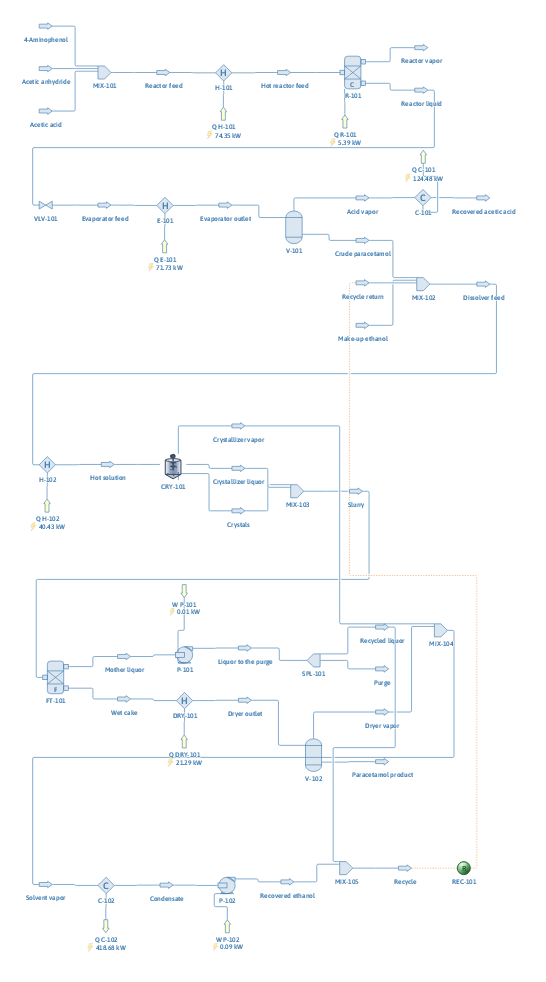
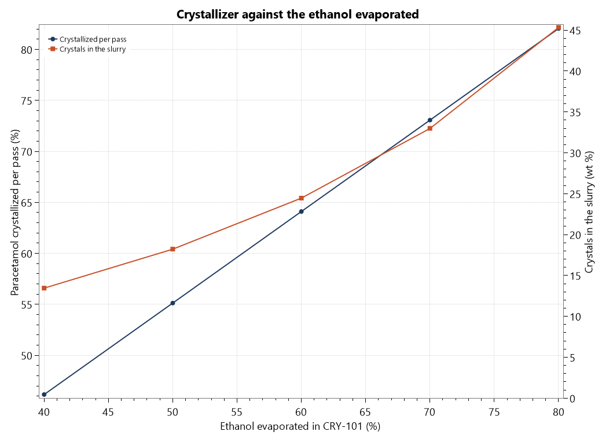
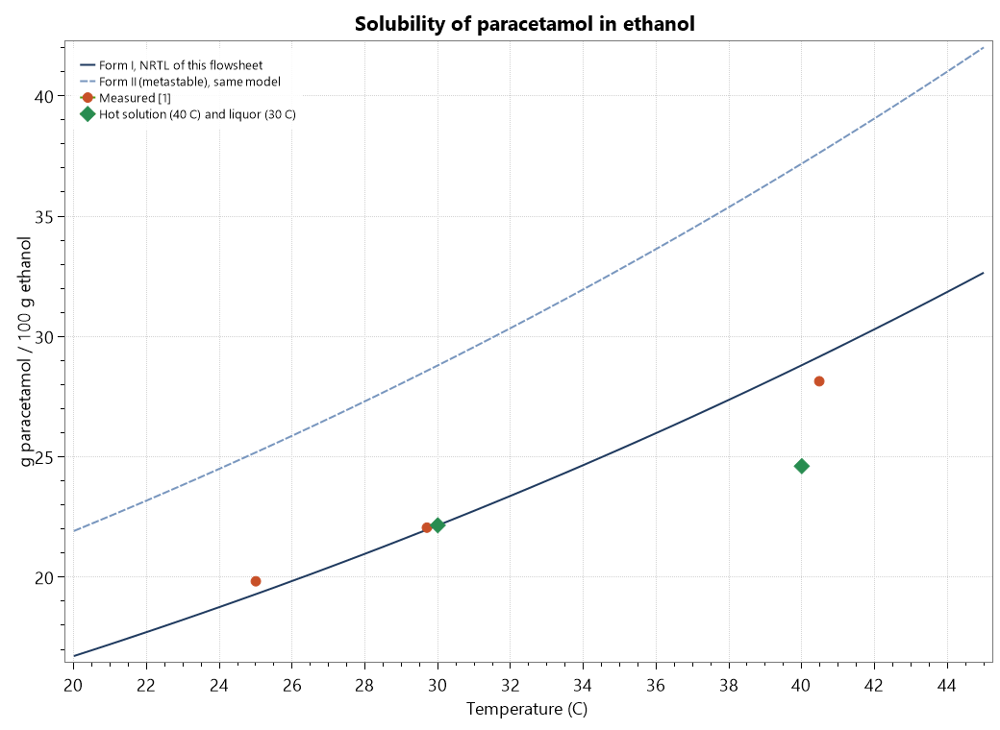

# Paracetamol by acetylation of 4-aminophenol, with evaporative crystallization from ethanol

**Category:** reaction-systems
**Status:** community
**DWSIM version:** 10.2.17 or later
**DWSIM edition:** open source
**Language:** English
**Contributor:** Daniel Wagner Oliveira de Medeiros (@DanWBR)

> **Requirement:** The case needs DWSIM 10.2.17 or later, for the Crystallizer with the solubility from the property package, the solid forms of a compound and the flashes with solids under vacuum. Paracetamol and 4-aminophenol aren't in the standard databases; both are stored inside the file.

## Summary

Paracetamol is made by the acetylation of 4-aminophenol with acetic anhydride. This case takes 300 kg/h of 4-aminophenol through the reaction in acetic acid, the removal of the acid under vacuum, and a recrystallization from ethanol in an evaporative crystallizer, with filtration, vacuum drying and recycle of the mother liquor and of the solvent. The purification is the point of the case: the solubility of paracetamol in ethanol changes little with temperature, so the crystals come from evaporating the solvent at 30 °C; the solid-liquid equilibrium comes from an NRTL pair fitted to measured solubilities [1]; and paracetamol carries its two crystalline forms [2], with the stable form I as the one that crystallizes. The flowsheet gives 399 kg/h of paracetamol, a yield of 96.0 % on 4-aminophenol.

## Process description

**Reaction:** MIX-101 joins the 4-aminophenol, the acetic anhydride (5 % molar excess) and acetic acid as the solvent. H-101 heats the mixture to 100 °C and R-101 converts the 4-aminophenol to paracetamol and acetic acid.

**Acid removal:** VLV-101 lets the reactor liquid down to 0.1 bar and E-101 heats it to 110 °C. In V-101 the acetic acid and the excess anhydride leave as vapor and the crude paracetamol stays as a solid. C-101 condenses the vapor as the recovered acetic acid.

**Dissolution:** MIX-102 joins the crude, the make-up ethanol and the recycle, and H-102 heats the mixture to 40 °C, where all the paracetamol is in solution.

**Crystallization:** CRY-101 evaporates 70 % of the ethanol at 30 °C. Its vapor leaves at the vapor pressure of ethanol at that temperature, 0.105 bar, and the paracetamol above saturation leaves as crystals of form I. MIX-103 joins the crystals and the liquor into the slurry.

**Filtration and drying:** FT-101, a rotary vacuum filter, leaves a cake with 15 wt % of liquor. DRY-101 heats the cake to 60 °C at 0.1 bar and V-102 separates the solvent vapor from the product.

**Solvent loop:** MIX-104 joins the vapors of the crystallizer and of the dryer, C-102 condenses them at 10 °C and P-102 pumps the condensate to 1.5 bar. P-101 brings the mother liquor to the same pressure, SPL-101 purges 10 % of it, and MIX-105 joins the rest with the recovered ethanol. The recycle block REC-101 closes the loop at the dissolver.

## Feed and operating conditions

| Item | Value | Unit | Notes |
|---|---|---|---|
| 4-Aminophenol | 300 (2.749) | kg/h (kmol/h) | 25 °C, 1.5 bar, solid |
| Acetic anhydride | 294.7 | kg/h | 5 % molar excess |
| Acetic acid | 600 | kg/h | solvent of the reaction |
| Make-up ethanol | 59 | kg/h | |
| R-101 | 100 °C, 1.5 bar | | isothermal; 99.5 % of the 4-aminophenol converted (assumed) |
| E-101 / V-101, acid removal | 110 °C, 0.1 bar | | |
| Dissolver H-102 | 40 | °C | 1.5 bar |
| Hot solution | 4.05 | kg ethanol / kg paracetamol | 7.0 mol % of paracetamol |
| Crystallizer CRY-101 | 30 °C, 70 % of the ethanol evaporated | | evaporative mode, solubility from the property package, crystal form "Form I" |
| Filter FT-101 | 0.5 bar of pressure drop, 15 wt % of liquor in the cake | | design mode |
| Dryer DRY-101 / V-102 | 60 °C, 0.1 bar | | |
| Condenser C-102 | 10 | °C | 0.1 bar |
| Purge SPL-101 | 10 | % of the mother liquor | |

## Thermodynamics

- **Property package:** NRTL with solids handled by the default flash (`HandleSolidsInDefaultEqCalcMode`), for the whole flowsheet.
- **Paracetamol / ethanol pair:** A12 = 4183.3 cal/mol, A21 = -1035.1 cal/mol, alpha = 0.3 (paracetamol is compound 1), fitted for this case to the three solubility points of Hahnenkamp et al. [1] between 25 and 40.5 °C.
- **Solid forms of paracetamol:** form I, 168.6 °C and 28.1 kJ/mol; form II, 156.4 °C and 27.6 kJ/mol, from Sacchetti [2]. Both are stored in the compound, form I is the one in use, and the fit above was made with its fusion data. The pair is monotropic: form I is the stable one at every temperature below its melting point.
- **Other pairs:** of the other nine pairs, the database has parameters for one, which is kept. The eight without data, among them all the pairs of paracetamol and of 4-aminophenol except the fitted one, are set as ideal pairs.
- **4-Aminophenol:** added to DWSIM for this case. Its boiling point, critical constants and ideal gas properties are Joback estimates; the melting point is 187.5 °C and the enthalpy of fusion (26 kJ/mol) is an estimate from the rule of Walden.
- **Paracetamol:** vapor-liquid constants and formation properties are Joback estimates. It decomposes before it boils, so its vapor pressure is only a placeholder for the models.
- **Crystal density of paracetamol:** 1293 kg/m3, the density of form I.

## Tuning and convergence notes

- **Why an evaporative crystallizer:** between 25 and 40 °C the measured solubility in ethanol only goes from 5.7 to 7.9 mol %, so cooling a saturated solution over that range would crystallize less than a third of the paracetamol. Evaporating 70 % of the ethanol at 30 °C crystallizes 73 % in each pass.
- **The solvent rate is set on the composition of the hot solution:** the make-up of ethanol of each case was found by trial so that the hot solution has 4.05 kg of ethanol per kg of paracetamol, 7.0 mol %, under the saturation the model gives at 40 °C (8.1 mol %). The dissolver and the crystallizer stay inside the range of the measurements.
- **The conversion is an assumption:** R-101 is a conversion reactor with 99.5 % of the 4-aminophenol converted. Its duty (5 kW) comes from estimated enthalpies of formation and isn't a measure of the heat of the reaction.
- **The amount of acetic acid isn't validated:** with ideal pairs the reactor liquid holds all the paracetamol in solution at 100 °C. A measured solubility of paracetamol in acetic acid would be needed to set the solvent rate.
- **Where the unconverted 4-aminophenol goes:** in V-101 nearly all of it (1.5 kg/h) leaves with the acid vapor, and the product ends with 3 ppm. That split rests on an estimated vapor pressure. A plant doesn't count on it: it washes the cake, which the Filter block doesn't do.
- **Paracetamol in the acid vapor:** 1.5 kg/h, for the same reason. It is a loss of 0.4 % of the product in the model.
- **The crude changes pressure in a mixer:** it leaves V-101 at 0.1 bar and the dissolver works at 1.5 bar, as through a solids lock. MIX-102 is set to take the highest pressure of its feeds.
- **Vapor of the crystallizer:** the Crystallizer sends the evaporated solvent, pure, to its Vapor outlet, saturated at the operating temperature. Its duty (345 kW) includes that evaporation.
- **Saturation temperature reported by CRY-101:** in evaporative mode the block reports the temperature at which the liquor left after the evaporation would dissolve all the paracetamol (86 °C here). It is outside the fitted range and only shows how far the liquor is from saturation.
- **The recycle block uses Wegstein acceleration on every pass** (`AccelerationMethod`, `WegsteinParameters.AccelFreq = 1`, `MaximumIterations = 300`), set from the script that built the case, and the tear stream has a first estimate at the loop pressure.
- **Automatic estimation of NRTL pairs is switched off** (`AutoEstimateMissingNRTLUNIQUACParameters`), and the pairs without data are declared with zero energies.
- **The filter area is illustrative:** it comes from the default cake and medium resistances of the block.
- **Mass balance:** feeds 1253.7 kg/h, products 1253.5 kg/h.

## Results

| Quantity | DWSIM | Unit |
|---|---|---|
| Product | 398.9 | kg/h |
| Paracetamol in the product | 99.998 | wt % |
| Yield on 4-aminophenol | 96.0 | % |
| Paracetamol in the purge | 13.1 | kg/h |
| Recovered acetic acid | 783 | kg/h, 97.6 wt % of acid |
| Paracetamol crystallized in CRY-101 per pass | 73.0 | % |
| Crystals in the slurry | 32.9 | wt % |
| Ethanol evaporated in CRY-101 | 1506 | kg/h |
| Recycle to the dissolver | 2209 | kg/h |
| Filter area FT-101 | 1.81 | m2 |
| Crystallizer heating CRY-101 | 345 | kW |
| Ethanol condenser C-102 | 419 | kW |
| Reactor feed heater H-101 | 74 | kW |
| Acid evaporator E-101 / condenser C-101 | 72 / 124 | kW |
| Dissolver H-102 / dryer DRY-101 | 40 / 21 | kW |

Where the 4-aminophenol goes, per 100 mol fed: 0.5 unconverted, 0.4 as paracetamol in the acid vapor, 3.1 as paracetamol in the purge and 96.0 as paracetamol in the product.

The fraction of the ethanol evaporated in the crystallizer. Each row has its own make-up, for the same solvent ratio in the hot solution and 10 % of purge:

| Ethanol evaporated, % | Make-up, kg/h | Yield on 4-aminophenol, % | Crystallized per pass, % | Crystals in the slurry, wt % | Recycle, kg/h |
|---|---|---|---|---|---|
| 40 | 184 | 89.3 | 46.2 | 13.5 | 3338 |
| 50 | 131 | 92.1 | 55.1 | 18.2 | 2856 |
| 60 | 90 | 94.3 | 64.1 | 24.5 | 2488 |
| 70 | 59 | 96.0 | 73.1 | 33.0 | 2201 |
| 80 | 33 | 97.4 | 82.1 | 45.3 | 1967 |

The base case stops at 70 %: at 80 % the slurry would have 45 wt % of crystals, more than a crystallizer and a filter feed usually handle.

The solubility of paracetamol in ethanol from the model against the measurements of [1], with the curve the same model gives for form II:

| Temperature, K | x paracetamol, measured [1] | x paracetamol, DWSIM | Rel. error |
|---|---|---|---|
| 298.15 | 0.057 | 0.0555 | -2.5 % |
| 302.85 | 0.063 | 0.0628 | -0.4 % |
| 313.63 | 0.079 | 0.0816 | +3.3 % |

At 30 °C the model gives form II 1.28 times the solubility of form I in ethanol. A liquor saturated with form I is therefore undersaturated in form II, which is why the stable form is the one that crystallizes here. The curve of form II isn't compared with measurements.

The case doesn't have a reference from a plant or from another simulator. The comparison of the solubility is the only one against data.

## Files

- `paracetamol-acetylation-evaporative-crystallization.dwxmz` - the DWSIM flowsheet, with the notes, the stream table and the two charts on it.
- `paracetamol-acetylation-evaporative-crystallization.png` - the flowsheet picture.
- `solubility-paracetamol-ethanol.png`, `crystallizer-against-ethanol-evaporated.png` - the charts above.

## Confidentiality

The flowsheet was put together for this example from the public description of the route. The flows, the conversion and the operating conditions are illustrative and don't come from any plant or third-party data set.

## References

1. I. Hahnenkamp, G. Graubner, J. Gmehling, Measurement and prediction of solubilities of active pharmaceutical ingredients, Int. J. Pharm. 388 (2010) 73-81.
2. M. Sacchetti, Thermodynamic analysis of DSC data for acetaminophen polymorphs, J. Therm. Anal. Calorim. 63 (2001) 345-350.
