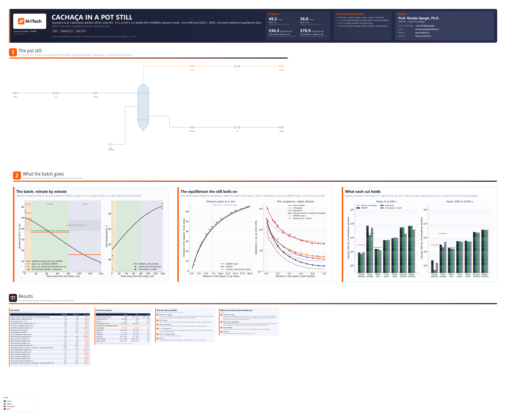

# Cachaça in a pot still: a batch distillation in DWSIM's dynamic mode, cut into head, heart and tails against a laboratory alembic

**Category:** separation-processes
**Status:** community
**DWSIM version:** 10.2.12
**Language:** English
**Contributor:** Prof. Nicolas Spogis, Ph.D. (@Spogis), AI4Tech · nicolas.spogis@ai4tech.ai · www.ai4tech.ai

## Summary

Cachaça is Brazil's cane spirit. A fermented cane juice, the wine, at 8 to 10 % v/v of ethanol, is boiled off in a pot still, without reflux, and the distillate is cut by time. The head comes first and is set aside: it carries most of what boils lighter than ethanol: acetaldehyde, ethyl acetate and methanol. The heart is the cachaça. The tails take the ethanol left as the pot runs out of it.

The case runs that batch in DWSIM's dynamic mode. The pot is a Vessel boiled by an energy stream, the vapour leaves through a valve, and each cut is what the pot lost between two cut times. It follows the run of Scanavini, Ceriani and Meirelles (2012) on a laboratory alembic: 7.2 L of their model wine W2, 8.80 % v/v of ethanol and six congeners, heated by an electric resistance, cut at 690 s and 4,876 s, at the atmosphere of Campinas.

On DWSIM's own Vessel, valves and NRTL:
- the heart comes out at 36.8 % v/v against the 38.1 measured;
- its higher alcohols, which a cachaça's legislation caps at 360 mg per 100 mL of anhydrous alcohol, come out at 371 against 341;
- in the head, n-propanol, isoamyl alcohol and methanol are within 2.3 % of the measured, isobutanol within 8 %;
- the still's temperature at the end of the run is within 0.3 K.

The thermodynamics is fitted to equilibrium data, never to the still. Nine NRTL pairs are refitted: water / ethanol to Cornell and Montonna's (1933) data, and four congeners with water and with ethanol to the volatilities Puentes et al. (2018) reviewed. Where the model and the alembic part, the case shows why: no single equilibrium stage reaches the alcohol strength the alembic's first sample had, and the measured cuts hold only part of the charge's ethyl acetate and acetaldehyde.

## Process description

- **The charge.** Wine W2, 7.2 L at 20 °C: 8.80 % v/v of ethanol, 7.100 kg by the density of OIML R 22's alcoholometric tables, and six congeners at Scanavini et al.'s Table 1. It enters through the valve V-0 at its bubble point, a vapour fraction of 4e-4. DWSIM initializes a Vessel's content from its inlet stream, as that stream's density times the Vessel's volume, so a pot of 12.505 L holds the charge, its vapour space included.
- **The still.** POT is that Vessel, 0.3 m high. Its Minimum Pressure is the atmosphere of Campinas, 93.36 kPa, where the alembic stood. The resistance under it is the energy stream Heat, 448.5 W.
- **The vapour line.** V-1 takes the vapour to the condenser, at a Kv of 1 m³/h. The distillate is the vapour that leaves the still: a total condenser changes no composition.
- **Firing the still.** The pot is set to the pressure that pushes its boil-up through V-1: the atmosphere plus 95.6 Pa. At t = 0 the event set *Fire the still* closes V-0, the charge valve, and V-2, the drain.
- **The cuts.** The head runs to 690 s and the heart to 4,876 s, the alembic's cut times. The tails run to 8,400 s, the run's last sample. `build.py` steps the batch and reads the pot's content at each cut time. Each cut is the content at its start less the content at its end, compound by compound: what each receiver collects. DWSIM's dynamic mode cannot run the receivers themselves as vessels (Tuning and convergence notes). The drawing's results panel holds them as a card, *The three receivers*: each cut's volume, mass, strength and congeners against the alembic's.

The batch starts when the charge starts to boil. At t = 0 the pot holds the wine at its bubble point, 91.3 °C, and the first drop of distillate leaves. The heat-up before it is not modelled, and from then on nothing enters or leaves the pot but the vapour. V-0 and V-2 are the alembic's charge and drain lines, shut while it boils.

DWSIM fills a Vessel only from what flows into it, and the file must also solve as a steady state. So in the file's steady state the wine passes through the pot at 1 kg/h: that is how the pot is loaded, not a stage of the batch, and the drawing shows no stream values. To watch the batch in DWSIM:
1. open the Dynamics Manager and switch the dynamic mode on - DWSIM saves the schedule with the file, not the mode;
2. run the schedule *Batch*.

Its integrator steps 60 s to 8,400 s and plots the distillate's mass flow and the still's temperature. DWSIM runs one step past the duration, so it stops at 8,460 s. That run also steps 60 s from t = 0, so its first step runs on the steady state's flows, the wine still entering (Tuning and convergence notes). The Results are `build.py`'s run.

Below the still, three figures are drawn from the batch:
- **The batch, minute by minute:**
  - the distillate's alcohol against time, the cuts shaded, with each cut's average and the alembic's;
  - the still's temperature, with the alembic's first and last readings and the authors' model's.
- **The equilibrium the still boils on:**
  - ethanol in the vapour over a dilute ethanol-water liquid, on DWSIM's pair and on the refit, against Cornell and Montonna (1933);
  - each fitted congener's volatility, on DWSIM's pairs and on the refit, against Puentes et al. (2018).
- **What each cut holds:** each congener in the head and in the heart, for DWSIM, the alembic and the authors' model, against the limits for a cachaça.

## Feed and operating conditions

| Item | Value | Unit | Notes |
|---|---|---|---|
| Wine W2 | 7.2 | L at 20 °C | 7.100 kg; fed at its bubble point, a vapour fraction of 4e-4 |
| Ethanol | 8.80 | % v/v at 20 °C | |
| Acetaldehyde | 2.69 | mg/100 mL AA | AA: anhydrous alcohol |
| Ethyl acetate | 123.25 | mg/100 mL AA | |
| Methanol | 21.57 | mg/100 mL AA | |
| n-Propanol | 50.35 | mg/100 mL AA | |
| Isobutanol | 53.89 | mg/100 mL AA | |
| Isoamyl alcohol | 232.67 | mg/100 mL AA | 2-methyl-1-butanol in the model (Thermodynamics) |
| Volatile acidity | 1,209.99 | mg/100 mL AA, as acetic acid | left out (Thermodynamics) |
| Heat | 448.5 | W | UA (Tu − Tb): 4.38 W/K × (197 − 94.6) °C, at the batch's mean still temperature |
| Pressure | 93.36 | kPa | the atmosphere at Campinas, 685 m (ISO 2533) |
| Cut times | 690, 4,876, 8,400 | s | the head, the heart, the tails |
| Pot | 12.505, 0.3 | L, m | a Vessel; V-0, V-1 and V-2 at a Kv of 1 m³/h |

The wine, the heat transfer, the cut times and the measured cuts are Scanavini et al.'s (2012):
- the wine's composition is their Table 1;
- the 7.2 L is the volume of which their 72 mL head would be 1 %;
- UA and Tu are the values their simulations used (Eq. 1, Table 2);
- the cut times are their Table 5's.

They state no pressure. Their own simulated still temperatures, 90.5 °C at the start and 97.3 °C at the end (Table 4), are those of a pot at about 93 kPa, not at 101.325. The residue, nearly water, ends the batch at 97.0 °C here, and would at 99.1 °C at sea level.

The heat follows their Eq. (1) at the batch's mean still temperature, so it is constant. Over the batch the still warms from 91.3 to 97.0 °C, and the equation would move the heat ±3 % about that mean.

## Thermodynamics

- **Property package:** NRTL (Renon and Prausnitz 1968), with the vapour ideal at 0.93 bar. Its enthalpy is built from the compounds' liquid heat capacities and heats of vaporization (DWSIM's `ExpData`, its default for NRTL).
- **Why NRTL:** water, ethanol and polar congeners at the atmosphere call for an activity model, and NRTL is the one Scanavini et al. used. They added a Hayden-O'Connell vapour, which at 0.93 bar changes little.
- **Where the pairs come from.** Eight compounds make 28 pairs. DWSIM's database holds 11; DWSIM estimates the other 17 with UNIFAC at the first flash and saves them with the file. Nine pairs are refitted here, on the logarithm of the volatility, against equilibrium data, never against the still:
  - **Water / ethanol**, to Cornell and Montonna's (1933) 43 points at 1 atm, alpha kept. DWSIM's pair puts the ethanol in the vapour 8 to 13 % below their data between 2 and 9 % of ethanol by mass in the liquid, where this still boils. The refit moves A12 by −11 cal/mol and A21 by +50. The wine's first vapour, at 1 atm, goes from 42.0 % ethanol by mass to 43.1 %.
  - **n-Propanol, isobutanol and isoamyl alcohol, each with water and with ethanol**, to the volatilities Puentes et al. (2018) accept in their Supporting Information's Table S1, highly diluted in ethanol-water at 101.3 kPa.
  - **Ethyl acetate with water and with ethanol**, to the same review's Figure S3a, read off it. DWSIM's own ethyl acetate pairs, from its database, make the ester's volatility 31 at an ethanol mole fraction of 0.02, where the data put 105.
- **Isoamyl alcohol** (3-methyl-1-butanol) is not in DWSIM's databases. 2-Methyl-1-butanol, its isomer with the same UNIFAC groups, stands in for it, with its pairs fitted to isoamyl alcohol's data.
- **Acetaldehyde's pairs** with water and ethanol are DWSIM's UNIFAC estimate. Its volatility, 30.5 at an ethanol mole fraction of 0.03, is near the 35 or so read off Puentes et al.'s Figure S2a. **Methanol's** pairs are DWSIM's database's.
- **Acetic acid is left out.** The wine's volatile acidity, 1,210 mg/100 mL AA counted as acetic acid, is more than acetic acid. The authors' model, with acetic acid alone, put 2.6 mg/100 mL AA in the heart against the 101.6 measured.

The refitted pairs, in DWSIM's order (A12, A21 in cal/mol), as the file holds them:

| Pair (1 / 2) | DWSIM's A12, A21, alpha | Refitted A12, A21, alpha | Fitted to |
|---|---|---|---|
| Ethanol / Water | −57.96, 1241.74, 0.294 | −68.84, 1291.74, 0.294 | Cornell & Montonna (1933), 43 points |
| Water / 1-propanol | 1419.79, −229.08, 0.2 (UNIFAC) | 2064.02, −64.10, 0.3 | Puentes et al., Table S1, 11 points |
| Ethanol / 1-propanol | −322.29, 352.64, 0.2 (UNIFAC) | 843.66, −602.50, 0.3 | the same |
| 2-methyl-1-propanol / Water | 639.82, 2491.02, 0.439 | 118.35, 2442.07, 0.3 | Puentes et al., Table S1, 9 points |
| Ethanol / 2-methyl-1-propanol | −559.82, 802.54, 0.272 | 264.16, −94.46, 0.3 | the same |
| Water / 2-methyl-1-butanol | 2963.43, −412.49, 0.2 (UNIFAC) | 3207.71, 467.49, 0.3 | Puentes et al., Table S1, isoamyl alcohol, 11 points |
| Ethanol / 2-methyl-1-butanol | −432.53, 565.02, 0.2 (UNIFAC) | −208.62, 603.99, 0.3 | the same |
| Ethyl acetate / Water | 1285.99, 1606.08, 0.439 | 503.50, 2766.80, 0.3 | Puentes et al., Figure S3a, 17 points |
| Ethyl acetate / Ethanol | 305.60, 330.51, 0.299 | 1022.30, −182.13, 0.3 | the same |

The fits leave a root-mean-square error on ln K (ln y for ethanol):
- 0.055 for water / ethanol;
- 0.005 for isobutanol and 0.016 for isoamyl alcohol;
- 0.094 for ethyl acetate;
- 0.116 for n-propanol. Its accepted volatilities fall from 3.62 to 1.47 between ethanol mole fractions of 0.2 and 0.3, a step NRTL cannot follow.

## Tuning and convergence notes

**The still in dynamic mode.** What DWSIM 10.2.12 needs for a batch in a Vessel, measured while building the case:

- **The charge is the inlet's density times the volume.** Fed at its bubble point, a vapour fraction of 4e-4, the wine is two-phase, and the pot's volume includes the vapour space. The volume is set after the still is fired, from the charge's density at that pressure. The pot then holds the charge's composition exactly and its mass within 0.2 % (Results).
- **Every line is a valve in a Kv mode.** V-0 and V-2 are in `Kv_Liquid`, V-1 in `Kv_Gas`; a liquid-mode valve fed a vapour gives an outlet pressure of minus infinity. At a Kv of 1 m³/h the boil-up is steady; at a large Kv it comes in bursts.
- **The boundary streams are set to the atmosphere after the steady state,** which leaves them where its valves put them. Before the still was fired at its boiling pressure, the distillate's came out below the pot's Minimum Pressure, and its valve drew without limit.
- **The pot is fired at its boiling pressure.** Fired at the atmosphere, nothing pushes the vapour out. On this wine at 101.325 kPa:
  - the first 60 s steps swung between no flow and a burst;
  - the first three minutes collected 21 g of their 44;
  - the head came out an eighth short.
- **The integrator's first step runs on the steady state's flows.** The events that close V-0 and V-2 at t = 0 act from the second step. `build.py` takes a 1 s step first, then reads the charge and starts the clock.
- **One step at a time.** On the integrator object, a duration of 0 runs exactly one step, because DWSIM runs a step past the duration it is given. That lands the run on each cut time, and costs no more than a continuous run. A batch takes about 10 minutes on these eight compounds, a tenth of that on water and ethanol alone.
- **A 60 s step.** On water and ethanol, halving it to 30 s moves:
  - the head's mass 0.01 % and its ethanol 0.14 %;
  - the heart and the tails 0.14 %.
  Against 5 s steps, steps of 120 s and 300 s make the boil-up come in bursts and move the pot's final mass 0.8 % and 4.6 %.
- **The Vessel's energy balance closes.** The heat in equals the holdup's enthalpy change plus what the vapour carries out, within 0.6 % a step.
- **No receivers.** Every way of cutting into receivers in dynamic mode failed:
  - a splitter feeding a valve per receiver gave flows 18 % too high;
  - two valves in a row passed nothing;
  - an open receiver cooled by the room went unstable at a 60 s step, to 3,197 °C.
  The cuts are the pot's holdup differences instead. They agree to round-off with the vapour line's flow summed step by step, and `build.py` checks that they do.
- **No condenser.** DWSIM's dynamic cooler refuses an outlet temperature. With an ambient UA it cannot condense the vapour: "Volume flash: the root is not bracketed".

**Settings changed from the defaults:**
- flash tolerances of 1e-10;
- the nine NRTL pairs;
- the valves' Kv and the pot's Minimum Pressure, the dynamic set-up above.

## Results

The references are Scanavini et al.'s (2012) run on wine W2:
- the cuts' strength and composition, measured, from their Table 5;
- the head's volume, "the initial 200 mL of distillate", from their text;
- the first and last samples' strength from their Table 3;
- the still's measured temperatures from their Table 4.

The charge is 7.2 L at OIML R 22's density at 20 °C. A cut's strength is from its ethanol mass fraction, by OIML R 22. Its congeners are in mg per 100 mL of the anhydrous alcohol it holds, as the legislation counts them.

Things to keep in mind when reading the table:

- **The alcohol strength.** The model's head is 49.2 % v/v against 54.4, and its first 100 mL 49.9 against 56.4.
  - No distillate of one equilibrium stage is richer than the wine's first vapour: 51.1 % v/v on the refitted pair at the still's pressure, 49.9 on DWSIM's own.
  - The first sample's 56.4 would need the ethanol 17 % more volatile than the equilibrium data say.
  - So the alembic separated more than one stage: part of its vapour must have condensed on the way to the condenser and run back to the pot. The model has no reflux.
  - The ethanol the model's head does not take comes out later: the last 100 mL at 9.7 % v/v against 7.8.
  - The authors' own model, with its own NRTL parameters, gave 54.9 % v/v for the first sample and 54.2 for the head.
- **The head's volume,** 186 mL against 200. Two things make it smaller:
  - the heat is constant, at the batch's mean still temperature: at the head's 91 °C, Eq. (1) gives 3 % more;
  - a weaker distillate takes more heat per millilitre: about 6 % more at 49 % v/v than at 54 %.
- **The still's temperature.** At the end it is 97.0 °C against the 96.7 measured and the authors' model's 97.3, at the pressure of Campinas. At the start it is 91.3 °C against 88.8 measured and the authors' 90.5. The authors, too, found their largest deviations in the initial boiling temperatures, 2.0 to 2.7 %.
- **The higher alcohols.**
  - In the head, n-propanol, isobutanol and isoamyl alcohol are within 0.5, 7.9 and 2.3 %; the authors' model put 191 mg/100 mL AA of isoamyl alcohol where 549 were measured.
  - In the heart they are 2.1, 15.6 and 8.6 % high, and their sum, 371, is above the 360 the legislation allows. The alembic's heart, at 341, is within it.
- **Methanol,** on DWSIM's own pairs, is 2.1 % high in the head and 9.2 % in the heart.
- **Ethyl acetate and acetaldehyde are what the measured cuts lost.**
  - The model's head holds 4.8 times the measured ethyl acetate, its heart 1.5 times; for acetaldehyde, 1.2 and 4.8 times.
  - The measured cuts cannot hold what the charge had. Counting every millilitre of alcohol after the head as heart, they hold at most 35 % of the charge's ethyl acetate and 61 % of its acetaldehyde.
  - The rest was lost before it was analysed. The authors suggest evaporation at the condenser, cooled by running water, with acetaldehyde boiling at 21 °C.
  - An equilibrium model keeps every milligram, so matching those cuts would take losing mass, not a parameter. The authors' model, too, put 518.5 mg/100 mL AA of ethyl acetate in the head.

Relative errors are on the reference.

| Quantity | DWSIM | Reference | Reference source | Rel. error |
|---|---|---|---|---|
| Charge, as the pot holds it when fired: 7.2 L of wine W2 at 20 C, kg | 7.101 | 7.100 | 7.2 L, OIML R 22 density | 0.00 % |
| Head, 0 to 690 s: volume at 20 C, mL | 186 | 200 | Scanavini et al. (2012) | −6.99 % |
| Head: alcohol at 20 C, % v/v | 49.2 | 54.4 | Scanavini et al. (2012) | −9.53 % |
| Heart, 690 to 4,876 s: alcohol at 20 C, % v/v | 36.8 | 38.1 | Scanavini et al. (2012) | −3.43 % |
| First 100 mL of distillate: alcohol, % v/v | 49.9 | 56.4 | Scanavini et al. (2012) | −11.56 % |
| Last 100 mL, to 8,400 s: alcohol, % v/v | 9.7 | 7.8 | Scanavini et al. (2012) | +23.79 % |
| Still temperature when fired, C | 91.3 | 88.8 | Scanavini et al. (2012) | +0.68 % |
| Still temperature at 8,400 s, C | 97.0 | 96.7 | Scanavini et al. (2012) | +0.08 % |
| Head: acetaldehyde, mg/100 mL AA | 8.6 | 7.1 | Scanavini et al. (2012) | +20.73 % |
| Head: ethyl acetate, mg/100 mL AA | 720.8 | 150.9 | Scanavini et al. (2012) | +377.66 % |
| Head: methanol, mg/100 mL AA | 15.5 | 15.2 | Scanavini et al. (2012) | +2.14 % |
| Head: n-propanol, mg/100 mL AA | 66.5 | 66.8 | Scanavini et al. (2012) | −0.51 % |
| Head: isobutanol, mg/100 mL AA | 93.0 | 101.0 | Scanavini et al. (2012) | −7.93 % |
| Head: isoamyl alcohol, mg/100 mL AA | 536.3 | 548.9 | Scanavini et al. (2012) | −2.29 % |
| Head: higher alcohols, n-propanol + isobutanol + isoamyl, mg/100 mL AA | 695.8 | 716.7 | Scanavini et al. (2012) | −2.92 % |
| Heart: acetaldehyde, mg/100 mL AA | 2.4 | 0.5 | Scanavini et al. (2012) | +383.11 % |
| Heart: ethyl acetate, mg/100 mL AA | 32.2 | 21.2 | Scanavini et al. (2012) | +51.73 % |
| Heart: methanol, mg/100 mL AA | 18.2 | 16.7 | Scanavini et al. (2012) | +9.18 % |
| Heart: n-propanol, mg/100 mL AA | 55.4 | 54.3 | Scanavini et al. (2012) | +2.10 % |
| Heart: isobutanol, mg/100 mL AA | 61.3 | 53.0 | Scanavini et al. (2012) | +15.64 % |
| Heart: isoamyl alcohol, mg/100 mL AA | 254.1 | 234.1 | Scanavini et al. (2012) | +8.55 % |
| Heart: higher alcohols, n-propanol + isobutanol + isoamyl, mg/100 mL AA | 370.9 | 341.4 | Scanavini et al. (2012) | +8.63 % |

## Files

- `cachaca-pot-still-batch-distillation.dwxmz` - the DWSIM flowsheet, with:
  - the pot still at the moment it is fired, and the dynamic setup to run it: the integrator Batch, the event set Fire the still and the schedule Batch;
  - the nine refitted NRTL pairs;
  - AI4Tech's title block (logo, key results, contact);
  - the three figures, drawn from the batch;
  - result cards, the three receivers' contents among them.
- `cachaca-pot-still-batch-distillation.png` - the flowsheet as DWSIM draws it.

## Confidentiality

No plant data of the contributor or of any client is used:
- The still, the wine and the measured cuts are those Scanavini, Ceriani and Meirelles (2012) published, open access, in the Brazilian Journal of Chemical Engineering. The case cites their numbers, not their figures: every figure here is drawn from this flowsheet.
- The equilibrium data are the published literature: Cornell and Montonna (1933), and Puentes et al. (2018), whose Supporting Information gives the volatilities used.
- The pressure, the heat input at the batch's mean temperature and the dynamic set-up are the contributor's own choices, each stated above.

No company, site or person is named but the contributor and the authors cited. The contributor's contact details appear in the flowsheet's title block with the maintainer's agreement. The contributor ran no simulator but DWSIM, and has the right to publish all of it.

## References

- H. F. A. Scanavini, R. Ceriani, A. J. A. Meirelles, "Cachaça distillation investigated on the basis of model systems", *Brazilian Journal of Chemical Engineering* 29 (2012) 429-440. https://doi.org/10.1590/S0104-66322012000200022
- C. Puentes, X. Joulia, V. Athès, M. Esteban-Decloux, "Review and Thermodynamic Modeling with NRTL Model of Vapor-Liquid Equilibria (VLE) of Aroma Compounds Highly Diluted in Ethanol-Water Mixtures at 101.3 kPa", *Industrial & Engineering Chemistry Research* 57 (2018) 3443-3470, and its Supporting Information. https://doi.org/10.1021/acs.iecr.7b03857
- L. W. Cornell, R. E. Montonna, "Studies in Distillation. II. Liquid-Vapor Equilibria in the Systems Ethanol-Water, Methanol-Water, and Acetic Acid-Water", *Industrial & Engineering Chemistry* 25 (1933) 1331-1336, as transcribed at https://scipython.com/chem/documents/5/ethanol-water-vle-mass.txt. https://doi.org/10.1021/ie50288a010
- H. Renon, J. M. Prausnitz, "Local compositions in thermodynamic excess functions for liquid mixtures", *AIChE Journal* 14 (1968) 135-144. https://doi.org/10.1002/aic.690140124
- OIML R 22, *International alcoholometric tables*, International Organization of Legal Metrology, 1975. https://www.oiml.org/en/files/pdf_r/r022-e75.pdf
- Brasil, Instrução Normativa nº 13, de 29 de junho de 2005, the identity and quality standards of cachaça, as Scanavini et al.'s Table 1 gives its limits.
- ISO 2533:1975, *Standard Atmosphere*.
