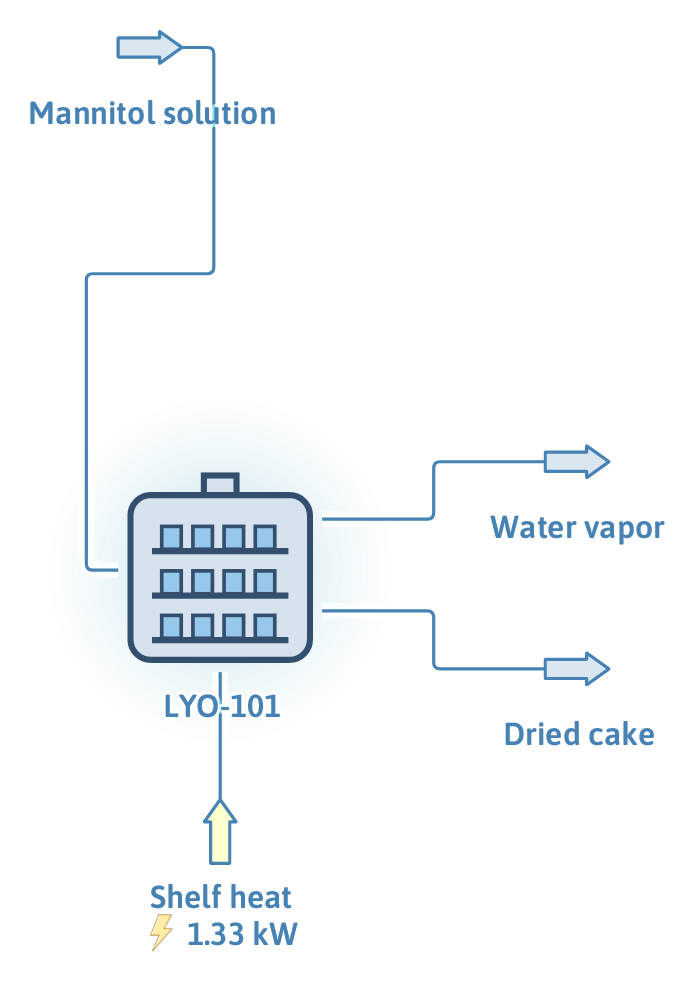
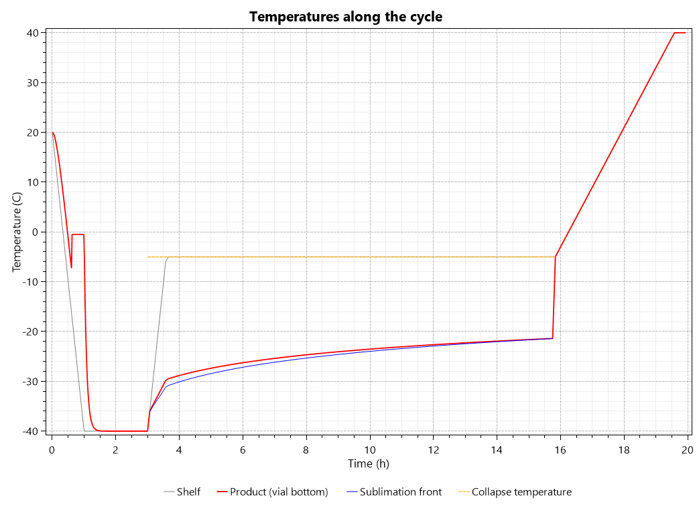
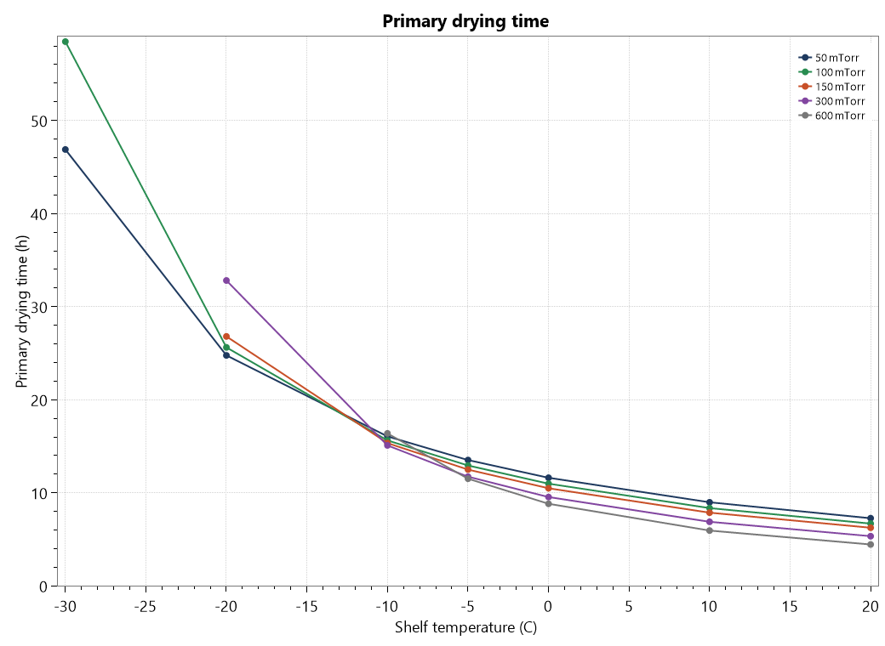
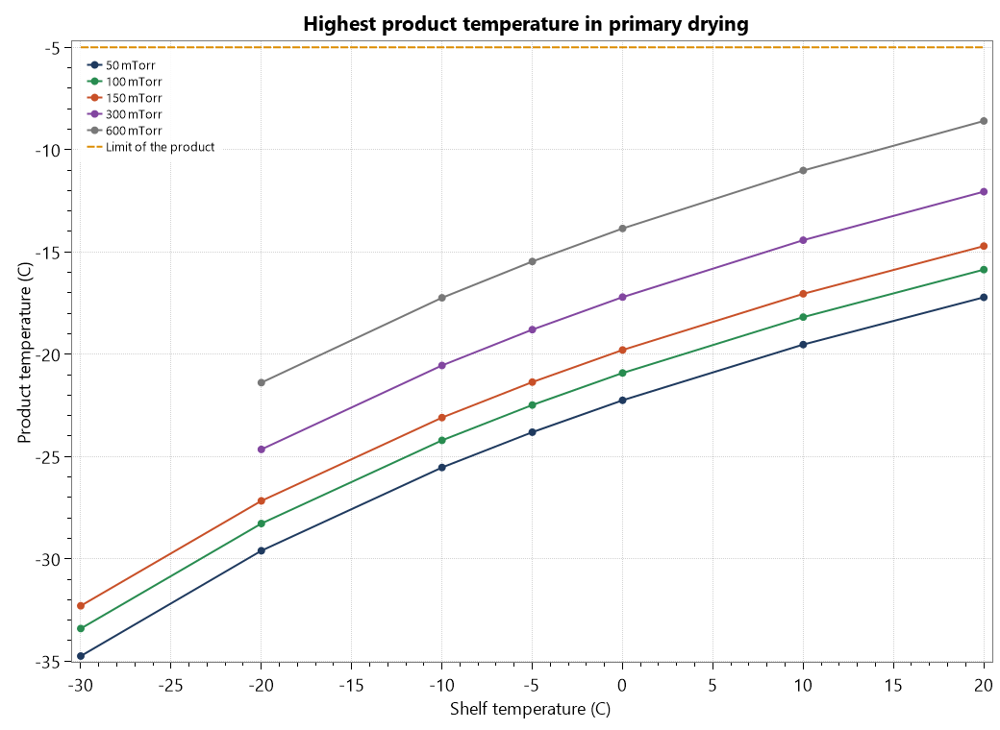

# Freeze drying of a 5 % mannitol solution in vials

**Category:** separation-processes
**Status:** community
**DWSIM version:** 10.2.17 or later
**DWSIM edition:** Patreon Edition (Lyophilizer)
**Language:** English
**Contributor:** Daniel Wagner Oliveira de Medeiros (@DanWBR)

> **Requirement.** The Lyophilizer block belongs to DWSIM Patreon (Premium+). The file opens anywhere, but it only solves where the block is licensed.

## Summary

A freeze dryer takes the water out of a product that can't be heated: the solution is frozen in its vials, the ice sublimes under vacuum and the water left bound to the solid desorbs at a higher temperature. This case dries a solution with 5 wt % of mannitol in 20000 vials of the 6R size, with the vial and cake parameters of a published study [1]. The Lyophilizer block gives a primary drying of 12.8 h at 150 mTorr with the shelves at -5 °C, a cycle of 21.9 h and a product that stays 16 K under its temperature limit. The primary drying times at four chamber pressures are within 5 % of the measured ones.

## Process description

**Charge:** 20000 vials, each with 2 mL of solution, are loaded on the shelves at 20 °C. One batch holds 41.1 kg of solution.

**Freezing:** the shelves go to -40 °C at 1 K/min and hold for 2 h. The solution supercools, freezes and cools to the shelf temperature.

**Primary drying:** the chamber goes to 150 mTorr (20 Pa) and the shelves to -5 °C at 1 K/min. The ice sublimes from the top of the cake down, with the heat that comes from the shelf through the bottom of the vial, and the vapor goes to the condenser.

**Secondary drying:** the shelves rise to 40 °C at 0.2 K/min, at the same pressure, until the cake has 0.5 % of water on the dry solid.

**Flowsheet:** the freeze dryer is a batch unit and LYO-101 is one block. The streams carry the average of the cycle: the solution enters, the dried cake and the water vapor leave, and the energy stream is the heat the shelves supply in the two drying steps.

## Feed and operating conditions

| Item | Value | Unit | Notes |
|---|---|---|---|
| Mannitol solution | 1.77 | kg/h | 20 °C; 5 wt % of mannitol; 95 % of the capacity of one freeze dryer |
| Vials | 6R: 22 mm outside, 20 mm inside | | 2 mL of fill, 20000 per batch |
| Freezing | shelves at -40 °C, 1 K/min, 2 h of hold | | nucleation at -8 °C, freezing at -0.5 °C |
| Primary drying | shelves at -5 °C, 150 mTorr | | ramp of 1 K/min |
| Secondary drying | shelves at 40 °C, 150 mTorr | | ramp of 0.2 K/min, down to 0.5 % of water on the dry solid |
| Loading and unloading | 2 | h | |
| Temperature limit of the product | -5 | °C | as taken for mannitol in [1] |

## Thermodynamics and model

- **Drying model:** the block follows one vial. In primary drying the heat that comes from the shelf through the vial bottom and the frozen layer equals, at each moment, the heat of sublimation of the vapor that leaves through the dried layer [1]. The vial heat transfer coefficient depends on the chamber pressure, Kv = KC + KP.P / (1 + KD.P), and the resistance of the dried layer grows with its thickness, Rp = R0 + A1.L / (1 + A2.L).
- **Vial parameters [1]:** KC = 11.51 W/(m2.K), KP = 0.28 W/(m2.K.Pa), KD = 0.00345 1/Pa, for the 6R vial in the freeze dryer of that study.
- **Cake parameters [1]:** R0 = 6.72e4 m/s, A1 = 7.68e7 1/s, A2 = 0, for 5 % mannitol.
- **Ice:** vapor pressure and heat of sublimation from the correlations of Murphy and Koop [2]; thermal conductivity 2.47 W/(m.K).
- **Freezing:** one lump that exchanges heat with the shelf, with 40 W/(m2.K).
- **Secondary drying:** the product follows the shelf and the bound water leaves at a rate proportional to what is left, with a rate constant of 0.36 1/h at 25 °C and an activation energy of 40 kJ/mol.
- **Property package:** NRTL with an ideal water / mannitol pair. The package gives the density and the heat capacity of the feed and the enthalpies of the streams. Mannitol ("d-Mannitol") comes from the food properties database of DWSIM.

## Tuning and convergence notes

- **The freezing and secondary drying parameters are assumptions:** the heat transfer coefficient of freezing, the nucleation temperature, the bound water after primary drying (2 % of the dry solid) and the desorption rate were chosen for this example. They don't come from measurements, so the times of those two steps are illustrative. The primary drying parameters are the published ones.
- **Frozen layer:** the block takes the volume of the ice and of the solute in the vial, with the density of the solution from the property package (1027 kg/m3), which gives a layer of 6.99 mm.
- **Batch and flowsheet:** the feed of the flowsheet was set to 95 % of what one freeze dryer handles with this cycle. A larger feed makes the block ask for more units and warn about it.
- **Streams:** the vapor leaves at the mean temperature of the sublimation front and at the chamber pressure. The cake leaves at the shelf temperature of secondary drying and at the feed pressure, as a solid phase.
- **Duties:** the energy stream carries the shelf heat of the two drying steps, as an average of the cycle. The refrigeration of the freezing step and the duty of the condenser are results of the block and aren't on a stream.
- **Only vials:** the block doesn't model trays of bulk product, and it takes water as the solvent that freezes.
- **Mass balance:** feed 1.7700 kg/h, cake 0.0889 kg/h, vapor 1.6811 kg/h.

## Results

| Quantity | DWSIM | Unit |
|---|---|---|
| Freezing time (ramp and hold) | 3.00 | h |
| Product completely frozen after | 1.00 | h |
| Primary drying time | 12.84 | h |
| Secondary drying time | 4.10 | h |
| Cycle time, with loading and unloading | 21.9 | h |
| Highest product temperature in primary drying | -21.4 | °C |
| Margin to the limit of the product | 16.4 | K |
| Mean temperature of the sublimation front | -25.2 | °C |
| Frozen layer | 6.99 | mm |
| Peak sublimation rate | 0.199 g/h per vial, 3.97 kg/h for the batch | |
| Batch | 41.1 kg of solution, 2.06 kg of cake | |
| Water in the cake | 0.50 | wt % |
| Capacity of one freeze dryer | 1.87 | kg/h of solution |
| Shelf heat, average of the cycle | 1.327 | kW |
| Freezing duty, average of the cycle | 0.236 | kW |
| Condenser duty, average of the cycle / peak | 1.325 / 3.13 | kW |

Primary drying time against the measured values of [1], with the shelves at -5 °C:

| Chamber pressure, mTorr | Measured [1], h | DWSIM, h | Difference, % | Highest product temperature, °C |
|---|---|---|---|---|
| 100 | 12.82 | 13.25 | +3.4 | -22.48 |
| 150 | 12.62 | 12.84 | +1.7 | -21.36 |
| 300 | 11.62 | 12.12 | +4.3 | -18.79 |
| 1500 | 15.84 | 16.51 | +4.2 | -10.07 |

The measured times are those of Table II and of the validation run of [1]. The pressure has two effects that pull in opposite directions: more gas in the chamber carries more heat to the vial, and it also takes away part of the pressure difference that moves the vapor. The time has a minimum between 300 and 1500 mTorr for this shelf temperature. DWSIM is 2 to 4 % above the measurements; its primary drying includes the ramp of the shelves from -40 °C, and its frozen layer follows the density of the property package.

The cycle of one vial:

Primary drying over shelf temperatures and chamber pressures, with the shelf temperature and the pressure held from the start. Each cell gives the drying time and the highest product temperature:

| Shelf, °C | 50 mTorr | 100 mTorr | 150 mTorr | 300 mTorr | 600 mTorr |
|---|---|---|---|---|---|
| -30 | 46.89 h, -34.7 °C | 58.48 h, -33.4 °C | 78.81 h, -32.3 °C | no drying | no drying |
| -20 | 24.77 h, -29.6 °C | 25.64 h, -28.3 °C | 26.81 h, -27.2 °C | 32.82 h, -24.6 °C | 82.34 h, -21.4 °C |
| -10 | 16.07 h, -25.5 °C | 15.64 h, -24.2 °C | 15.35 h, -23.1 °C | 15.10 h, -20.5 °C | 16.39 h, -17.2 °C |
| -5 | 13.53 h, -23.8 °C | 12.95 h, -22.5 °C | 12.51 h, -21.4 °C | 11.74 h, -18.8 °C | 11.53 h, -15.5 °C |
| 0 | 11.63 h, -22.2 °C | 10.99 h, -20.9 °C | 10.50 h, -19.8 °C | 9.56 h, -17.2 °C | 8.83 h, -13.9 °C |
| 10 | 9.00 h, -19.5 °C | 8.37 h, -18.2 °C | 7.88 h, -17.0 °C | 6.90 h, -14.4 °C | 5.96 h, -11.0 °C |
| 20 | 7.28 h, -17.2 °C | 6.71 h, -15.9 °C | 6.26 h, -14.7 °C | 5.35 h, -12.1 °C | 4.46 h, -8.6 °C |

A warmer shelf shortens the drying and warms the product. With mannitol, which crystallizes and takes -5 °C as its limit, the whole map is on the safe side: the shelves could go to 20 °C and cut primary drying to about half. A product that stays amorphous, such as sucrose, has a limit near -32 °C, and most of this map would be out of reach for it.

## Files

- `freeze-drying-mannitol-solution-vials.dwxmz` - the DWSIM flowsheet, with the notes, the stream table and the three charts on it.
- `freeze-drying-mannitol-solution-vials.png` - the flowsheet picture.
- `cycle-temperatures.png`, `primary-drying-time.png`, `product-temperature.png` - the charts above.

## Confidentiality

The case was put together for this example from the published study [1]. The batch size and the freezing and secondary drying settings are illustrative and don't come from any plant or third-party data set.

## References

1. G. Shivkumar, P. S. Kazarin, A. D. Strongrich, A. A. Alexeenko, "LyoPRONTO: an Open-Source Lyophilization Process Optimization Tool", AAPS PharmSciTech 20 (2019) 328. https://doi.org/10.1208/s12249-019-1532-7
2. D. M. Murphy, T. Koop, "Review of the vapour pressures of ice and supercooled water for atmospheric applications", Q. J. R. Meteorol. Soc. 131 (2005) 1539-1565.
