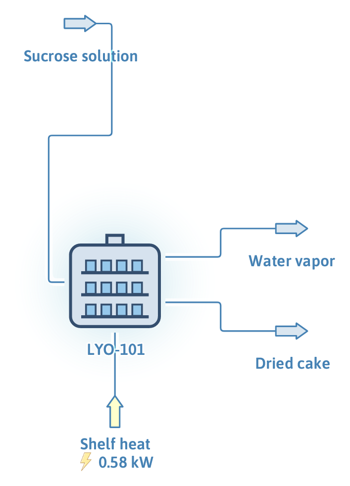
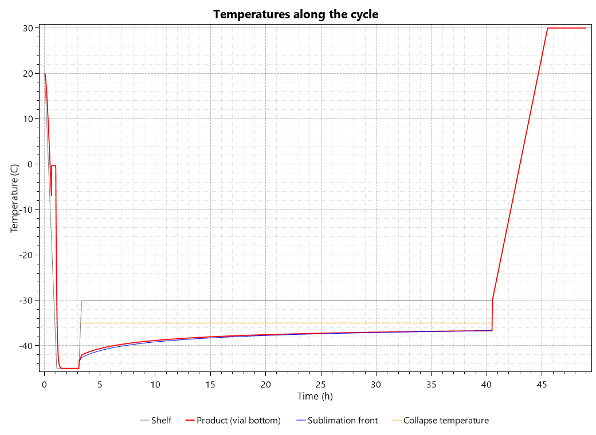
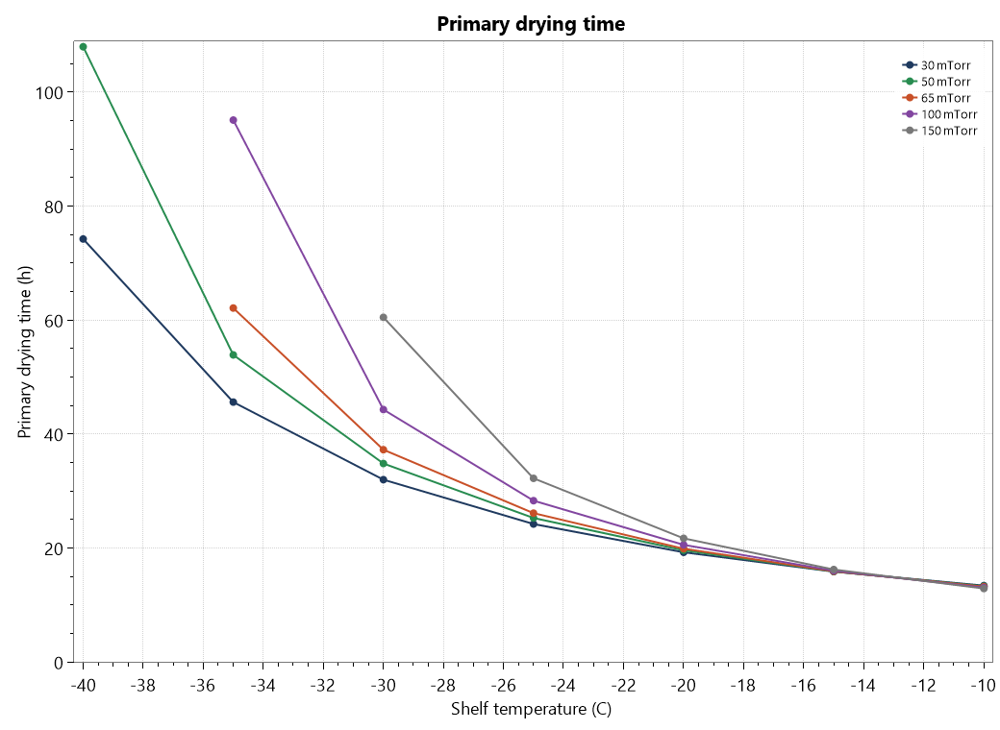
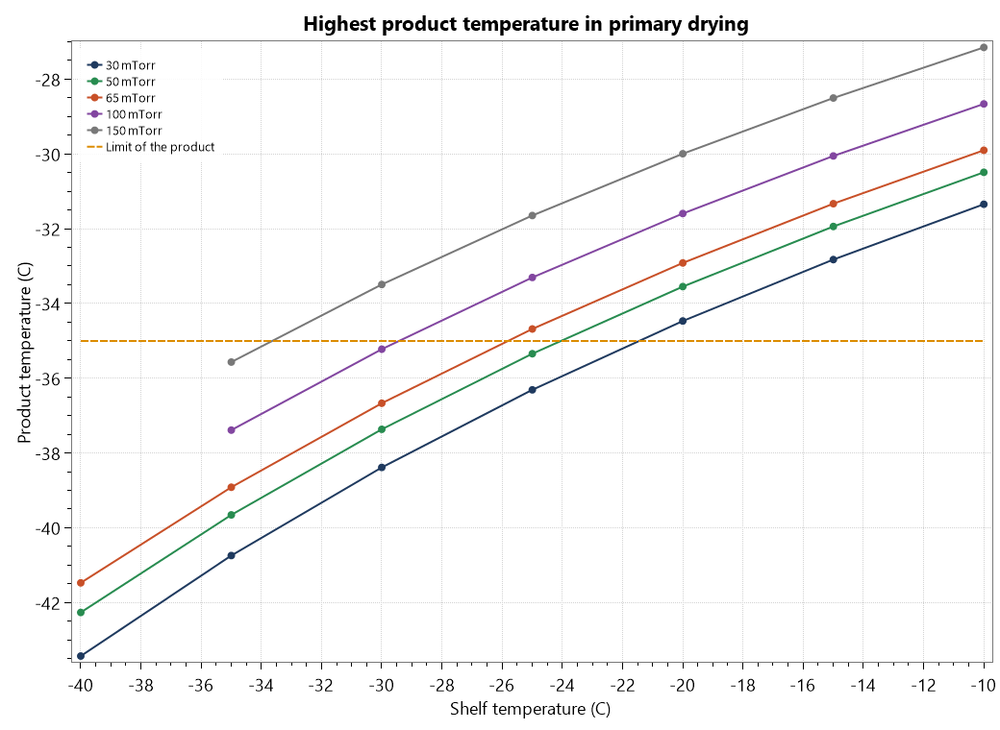

# Freeze drying of a 5 % sucrose solution in vials

**Category:** separation-processes
**Status:** community
**DWSIM version:** 10.2.17 or later
**DWSIM edition:** Patreon Edition (Lyophilizer)
**Language:** English
**Contributor:** Daniel Wagner Oliveira de Medeiros (@DanWBR)

> **Requirement.** The Lyophilizer block belongs to DWSIM Patreon (Premium+). The file opens anywhere, but it only solves where the block is licensed.

## Summary

Sucrose doesn't crystallize when its solution freezes. It stays as an amorphous phase between the ice crystals, and the dried cake collapses if that phase gets warmer than about -32 °C while there is still ice in the vial. This case dries a solution with 5 wt % of sucrose in 20000 vials of the 6R size, with the vial and cake parameters of a published study [1], and looks for the shelf temperature and the chamber pressure that keep the product under -35 °C. With the shelves at -30 °C and 65 mTorr the Lyophilizer block gives a primary drying of 37.4 h and a cycle of 51 h, with the product 1.7 K under the limit. The operating map shows that 30 mTorr with the shelves at -25 °C dries in 24.2 h and still respects the limit.

## Process description

**Charge:** 20000 vials, each with 2 mL of solution, are loaded on the shelves at 20 °C. One batch holds 41.4 kg of solution.

**Freezing:** the shelves go to -45 °C at 1 K/min and hold for 2 h.

**Primary drying:** the chamber goes to 65 mTorr (8.7 Pa) and the shelves to -30 °C at 1 K/min. The ice sublimes from the top of the cake down, and the vapor goes to the condenser.

**Secondary drying:** the shelves rise to 30 °C at 0.2 K/min, at the same pressure, until the cake has 1 % of water on the dry solid.

**Flowsheet:** the freeze dryer is a batch unit and LYO-101 is one block. The streams carry the average of the cycle: the solution enters, the dried cake and the water vapor leave, and the energy stream is the heat the shelves supply in the two drying steps.

## Feed and operating conditions

| Item | Value | Unit | Notes |
|---|---|---|---|
| Sucrose solution | 0.77 | kg/h | 20 °C; 5 wt % of sucrose; 95 % of the capacity of one freeze dryer |
| Vials | 6R: 22 mm outside, 20 mm inside | | 2 mL of fill, 20000 per batch |
| Freezing | shelves at -45 °C, 1 K/min, 2 h of hold | | nucleation at -8 °C, freezing at -0.3 °C |
| Primary drying | shelves at -30 °C, 65 mTorr | | ramp of 1 K/min |
| Secondary drying | shelves at 30 °C, 65 mTorr | | ramp of 0.2 K/min, down to 1 % of water on the dry solid |
| Loading and unloading | 2 | h | |
| Temperature limit of the product | -35 | °C | 3 K below the collapse of sucrose, as in [1] |

## Thermodynamics and model

- **Drying model:** the block follows one vial. In primary drying the heat that comes from the shelf through the vial bottom and the frozen layer equals, at each moment, the heat of sublimation of the vapor that leaves through the dried layer [1]. The vial heat transfer coefficient depends on the chamber pressure, Kv = KC + KP.P / (1 + KD.P), and the resistance of the dried layer grows with its thickness, Rp = R0 + A1.L / (1 + A2.L).
- **Vial parameters [1]:** KC = 11.51 W/(m2.K), KP = 0.28 W/(m2.K.Pa), KD = 0.00345 1/Pa, for the 6R vial in the freeze dryer of that study.
- **Cake parameters [1]:** R0 = 1.00e4 m/s, A1 = 7.34e7 1/s, A2 = 160 1/m, for 5 % sucrose.
- **Ice:** vapor pressure and heat of sublimation from the correlations of Murphy and Koop [2]; thermal conductivity 2.47 W/(m.K).
- **Freezing:** one lump that exchanges heat with the shelf, with 40 W/(m2.K).
- **Secondary drying:** the product follows the shelf and the bound water leaves at a rate proportional to what is left, with a rate constant of 0.36 1/h at 25 °C and an activation energy of 40 kJ/mol.
- **Property package:** NRTL with an ideal water / sucrose pair. The package gives the density and the heat capacity of the feed and the enthalpies of the streams.

## Tuning and convergence notes

- **The freezing and secondary drying parameters are assumptions:** the heat transfer coefficient of freezing, the nucleation temperature, the bound water after primary drying (10 % of the dry solid) and the desorption rate were chosen for this example. They don't come from measurements, so the times of those two steps are illustrative. The primary drying parameters are the published ones.
- **The limit is on the bottom of the vial:** the block compares the temperature at the bottom of the frozen layer, the warmest point of the product, with the limit, and warns when it is exceeded.
- **Frozen layer:** the block takes the volume of the ice and of the solute in the vial, with the density of the solution from the property package (1036 kg/m3), which gives a layer of 7.03 mm.
- **Batch and flowsheet:** the feed of the flowsheet was set to 95 % of what one freeze dryer handles with this cycle.
- **Streams:** the vapor leaves at the mean temperature of the sublimation front and at the chamber pressure. The cake leaves at the shelf temperature of secondary drying and at the feed pressure, as a solid phase.
- **Duties:** the energy stream carries the shelf heat of the two drying steps, as an average of the cycle. The refrigeration of the freezing step and the duty of the condenser are results of the block and aren't on a stream.
- **Only vials:** the block doesn't model trays of bulk product, and it takes water as the solvent that freezes.
- **Mass balance:** feed 0.7700 kg/h, cake 0.0389 kg/h, vapor 0.7311 kg/h.

## Results

| Quantity | DWSIM | Unit |
|---|---|---|
| Freezing time (ramp and hold) | 3.08 | h |
| Product completely frozen after | 1.00 | h |
| Primary drying time | 37.42 | h |
| Secondary drying time | 8.50 | h |
| Cycle time, with loading and unloading | 51.0 | h |
| Highest product temperature in primary drying | -36.7 | °C |
| Margin to the limit of the product | 1.7 | K |
| Mean temperature of the sublimation front | -38.2 | °C |
| Frozen layer | 7.03 | mm |
| Peak sublimation rate | 0.080 g/h per vial, 1.61 kg/h for the batch | |
| Batch | 41.4 kg of solution, 2.09 kg of cake | |
| Water in the cake | 0.99 | wt % |
| Capacity of one freeze dryer | 0.81 | kg/h of solution |
| Shelf heat, average of the cycle | 0.577 | kW |
| Freezing duty, average of the cycle | 0.105 | kW |
| Condenser duty, average of the cycle / peak | 0.576 / 1.27 | kW |

Primary drying time against the values calculated in [1] for the same vials and fill:

| Chamber pressure, mTorr | Shelf, °C | Reference [1], h | DWSIM, h | Difference, % | Highest product temperature, °C |
|---|---|---|---|---|---|
| 65 | -30 | 36.64 | 37.42 | +2.1 | -36.67 |
| 50 | -25 | 24.88 | 25.47 | +2.4 | -35.34 |

The reference values are calculated ones, from the tool of that study, and not measurements. DWSIM is 2 % above them; its primary drying includes the ramp of the shelves from -45 °C, and its frozen layer follows the density of the property package.

The cycle of one vial:

Primary drying over shelf temperatures and chamber pressures, with the shelf temperature and the pressure held from the start. Each cell gives the drying time and the highest product temperature, and "(above)" marks the points where the product passes -35 °C:

| Shelf, °C | 30 mTorr | 50 mTorr | 65 mTorr | 100 mTorr | 150 mTorr |
|---|---|---|---|---|---|
| -40 | 74.2 h, -43.4 °C | 108.0 h, -42.3 °C | 161.2 h, -41.5 °C | no drying | no drying |
| -35 | 45.6 h, -40.7 °C | 53.9 h, -39.7 °C | 62.1 h, -38.9 °C | 95.1 h, -37.4 °C | 367.3 h, -35.6 °C |
| -30 | 32.0 h, -38.4 °C | 34.9 h, -37.4 °C | 37.3 h, -36.7 °C | 44.3 h, -35.2 °C | 60.5 h, -33.5 °C (above) |
| -25 | 24.2 h, -36.3 °C | 25.3 h, -35.3 °C | 26.1 h, -34.7 °C (above) | 28.3 h, -33.3 °C (above) | 32.3 h, -31.6 °C (above) |
| -20 | 19.3 h, -34.5 °C (above) | 19.6 h, -33.5 °C (above) | 19.9 h, -32.9 °C (above) | 20.6 h, -31.6 °C (above) | 21.7 h, -30.0 °C (above) |
| -15 | 15.9 h, -32.8 °C (above) | 15.9 h, -31.9 °C (above) | 16.0 h, -31.3 °C (above) | 16.1 h, -30.1 °C (above) | 16.3 h, -28.5 °C (above) |
| -10 | 13.4 h, -31.3 °C (above) | 13.3 h, -30.5 °C (above) | 13.2 h, -29.9 °C (above) | 13.1 h, -28.7 °C (above) | 12.9 h, -27.1 °C (above) |

The map has a narrow usable region. A lower pressure cools the product, because the ice sublimes at a lower temperature, and that lets the shelves run warmer: 30 mTorr with the shelves at -25 °C dries in 24.2 h against 37.3 h for 65 mTorr and -30 °C, 35 % less, with the product still under the limit. At 150 mTorr the product only stays under the limit with shelves so cold that drying takes days. This is the same direction the optimization of [1] takes.

## Files

- `freeze-drying-sucrose-solution-vials.dwxmz` - the DWSIM flowsheet, with the notes, the stream table and the three charts on it.
- `freeze-drying-sucrose-solution-vials.png` - the flowsheet picture.
- `cycle-temperatures.png`, `primary-drying-time.png`, `product-temperature.png` - the charts above.

## Confidentiality

The case was put together for this example from the published study [1]. The batch size and the freezing and secondary drying settings are illustrative and don't come from any plant or third-party data set.

## References

1. G. Shivkumar, P. S. Kazarin, A. D. Strongrich, A. A. Alexeenko, "LyoPRONTO: an Open-Source Lyophilization Process Optimization Tool", AAPS PharmSciTech 20 (2019) 328. https://doi.org/10.1208/s12249-019-1532-7
2. D. M. Murphy, T. Koop, "Review of the vapour pressures of ice and supercooled water for atmospheric applications", Q. J. R. Meteorol. Soc. 131 (2005) 1539-1565.
