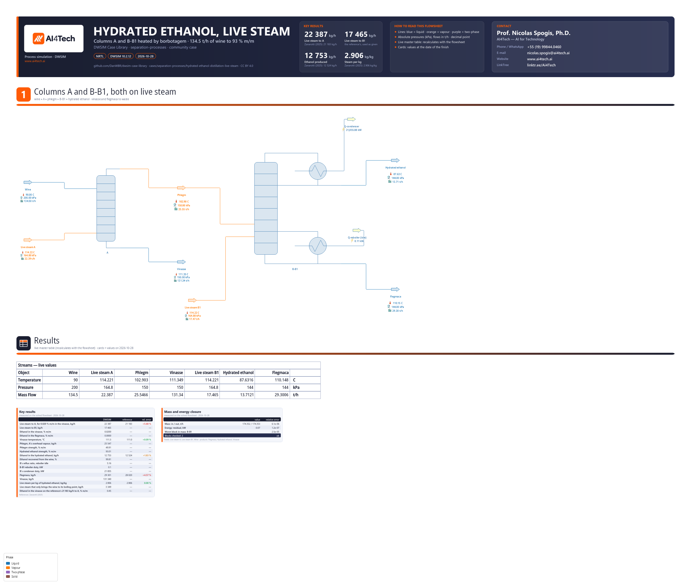

# Hydrated ethanol distillation with live steam (borbotagem): columns A and B-B1 of a Brazilian distillery

**Category:** separation-processes
**Status:** community
**DWSIM version:** 10.2.12
**Language:** English
**Contributor:** Prof. Nicolas Spogis, Ph.D. (@Spogis), AI4Tech · nicolas.spogis@ai4tech.ai · www.ai4tech.ai

## Summary

The distillation set that turns fermented wine into hydrated fuel ethanol in Brazil's sugar-cane and corn mills, with both columns heated the Brazilian way: by live steam injected under the bottom tray (borbotagem), with no reboilers. Column A strips 134.5 t/h of wine at 9.5 % m/m ethanol into a phlegm of about 50 % m/m, and column B, stacked on B1, rectifies the phlegm into hydrated ethanol at 93.0 % m/m. The case reproduces the published simulation of a real apparatus. Column A needs 22.4 t/h of live steam to leave 0.020 % m/m of ethanol in the vinasse, 5.7 % more than the reference. B1 runs on the reference's 17.5 t/h. With B-B1's 55 trays taken as 28 equilibrium stages, the reflux ratio that this steam sustains is 5.2, inside the 5 to 7 the plant runs at.

## Process description

- **Column A** has 16 stages at 150 kPa, no condenser and no reboiler. The wine enters on the top stage at 90 °C and the live steam under the bottom stage. The vapour leaving the top is the phlegm. The vinasse leaves the bottom at 111 °C, diluted by the steam that condensed in it.
- **Column B over B1** runs at 144 kPa. The phlegm vapour enters at B's base. B rectifies it under its total condenser, whose product is the hydrated ethanol. B1, below, strips the liquid that flows down, with live steam under its last tray, and its bottoms are the flegmaca (phlegm water).
- **The boundary** runs from the wine, after its two preheaters, to the vinasse, the flegmaca and the hydrated ethanol. The preheaters are condenser E (against B's overhead) and exchanger K (against the vinasse), and they are not modelled.

How it is modelled in DWSIM:

- **Column A** is an absorption column (no condenser, no reboiler) solved with Naphtali-Sandholm.
- **B and B1 are one distillation column.** It has its own total condenser and the live steam fed to its last tray. B's 42 trays count as 21 equilibrium stages and B1's 13 as 7, a tray efficiency of about one half.
- **The reboiler is held idle.** The reflux ratio is searched until its duty is zero, so all the heat in B-B1 comes from the live steam, as in the plant.
- **Design specifications.** A's live steam is searched for 0.020 % m/m of ethanol in the vinasse, the reference's design specification. B1's live steam is the reference's own value. The hydrated ethanol is taken off at 93.0 % m/m.

## Feed and operating conditions

| Item | Value | Unit | Notes |
|---|---|---|---|
| Wine | 134 500 | kg/h | 9.5 % m/m ethanol (12 % v/v), 90 °C, after its preheaters |
| Column A | 16 stages, 150 | kPa | wine on stage 1, live steam under stage 16 |
| Column B over B1 | 42 + 13 trays, 144 | kPa | 21 + 7 equilibrium stages; phlegm at B's base |
| Live steam | 164.8 | kPa | saturated, 9.2 psig: 114.2 °C |
| Live steam to B1 | 17 465 | kg/h | the reference's value |
| Ethanol in the vinasse | 0.020 | % m/m | the design specification of A's steam |
| Hydrated ethanol | 93.0 | % m/m | inside the 92.5 to 94.6 % m/m of ANP Resolution 907/2022 |

All pressures are absolute. The basis is the one Zanarotti (2025) took from a real apparatus of a sugar-cane mill in São Paulo state; the plant is not named there.

## Thermodynamics

- **Property package:** NRTL, with enthalpy from the liquids' own heat capacities (ExpData).
- **Why this package:** ethanol and water are strongly non-ideal at both ends of this set. A's and B1's bottoms sit at infinite dilution, where ethanol's K in nearly pure water decides the stripping. B's top approaches the azeotrope, where the separation pinches. NRTL with the pair's measured parameters covers both. At 150 kPa the vapour is ideal.
- **Interaction parameters / assays:** DWSIM's NRTL parameters for ethanol and water, unchanged. The wine's other compounds - 0.51 % m/m acetic acid and traces of aldehydes, esters and higher alcohols - are counted as water. Columns A1 and D, which take the light compounds out in the real apparatus, and the fusel-oil draws are left out with them.

## Tuning and convergence notes

**Column A**

- It converges in under a second as an absorption column on Naphtali-Sandholm. The absorber's default method, Burningham-Otto (Sum Rates), stops at its iteration limit.
- **The live steam has a wall.** At the reference's 21 183 kg/h, this column leaves 0.45 % m/m of ethanol in the vinasse; 22 387 kg/h leaves 0.020 %.
- **Part of that steam does no stripping.** 3 349 kg/h of it only brings the wine from 90 °C to its boiling point on the top stage. Every degree of wine preheat in exchanger K saves steam directly.
- **The drawing needs a fix.** DWSIM's builder draws each feed into the next free inlet, so the live steam appears to enter just under the wine. The stage is kept by the column itself, so the line was moved to the lowest inlet; the numbers do not change.

**Column B-B1: what did not converge.** All tried on DWSIM 10.2.12:

- An absorption column fed with reflux from an external condenser, both as B-B1's 55 stages and as B's 42 alone. Neither Naphtali-Sandholm nor Sum Rates converged.
- The distillation column in its refluxed-absorber mode (`RefluxedAbsorber = True`: a condenser, no reboiler). Wang-Henke closed the mass balance only to 2-4 %, and Naphtali-Sandholm did not converge.
- The distillation column with all 55 trays as equilibrium stages. It converged only at refluxes far from the product.

**Column B-B1: what converged.**

- A distillation column with **21 + 7 equilibrium stages**, on Wang-Henke (bubble point).
- The specification pair is the reflux ratio plus the bottoms flow, which is the pair that method is built for. The bottoms flow is whatever is left after taking the hydrated ethanol off at 93.0 % m/m.
- The reflux ratio is searched in steps from 5.0, which converges, until the reboiler idles. Wang-Henke starts each solve from the column's last profile, and a jump in reflux can land outside what it converges from. On a failure the search goes back to the last good point and halves the step.

**Why fewer stages.** The reference counts B's 42 trays as equilibrium stages and needs a reflux of 3.9, while the plant runs at 5 to 7. With half the trays as equilibrium stages, the reflux the live steam sustains is 5.2, in the plant's range.

**Loop tolerances.** The column checks its own balance against 10 × the smaller of its two loop tolerances. At the default 1e-5, the converged profile fails that check by a hair (1.4e-4 against 1e-4). At 1e-4 it passes, and the flowsheet's boundary still closes to 6e-6 in mass.

**Product strength, and why B1's steam is not designed here.**

- With 21 equilibrium stages, B cannot reach the reference's 94.18 % m/m at these refluxes. Asking for it pushes the ethanol it cannot carry into the flegmaca: 0.27 % m/m instead of 0.018 %. 93.0 % m/m is inside the ANP range.
- With the reboiler idle, B1's steam sets the reflux. Lowering it to put 0.018 % in the flegmaca, as the reference's design specification does, drives the reflux down to where B no longer makes 93 %. Past that point the flegmaca's ethanol measures the rectifier's limit, not B1's stripping, and the column stops converging there. So B1 runs on the reference's steam, and its loss is a result.

**Settings changed from the defaults:** flash tolerances of 1e-10; A on Naphtali-Sandholm; B-B1's loop tolerances at 1e-4.

## Results

The reference is the published simulation of the same apparatus (Zanarotti, 2025). That model has NRTL-HOC and ten compounds, columns A1 and D above A, B and B1 as separate columns with external condensers, and trays counted as equilibrium stages. Its numbers come from that work:

- live steam of 21 183 kg/h to A and 17 465 kg/h to B1, as its design specifications for 0.020 % and 0.018 % m/m;
- vinasse at 111 °C and flegmaca at 28 020 kg/h;
- hydrated ethanol at 13 298 kg/h and 94.18 % m/m. The "ethanol in the hydrated ethanol" reference is the product of those two, and the "steam per kg" reference is (21 183 + 17 465) / 13 298.

Things to keep in mind when reading the table:

- **The steam per kg matches to three decimals partly by coincidence.** Column A takes 5.7 % more steam here, and the product is weaker (93.0 against 94.18 % m/m), so there are more kilograms of it.
- **The reference's product holds 1.8 % less ethanol.** That model also carries the wine's other compounds through columns A1 and D. This binary model loses ethanol only to the vinasse (0.21 % of it) and to the flegmaca (below 0.0001 % m/m).
- **The phlegm is stronger than the reference's 44 % m/m,** because here all of A's overhead is the phlegm. In the reference part of it heats the wine in A1.

Mass closes across the boundary to 6e-6 and energy to 1e-7, as the flowsheet's closure card shows. Relative errors are on the reference, and a temperature's on the absolute scale.

| Quantity | DWSIM | Reference | Reference source | Rel. error |
|---|---|---|---|---|
| Live steam to A, for 0.020 % m/m in the vinasse, kg/h | 22 387 | 21 183 | Zanarotti (2025) | +5.68 % |
| Live steam to B1, kg/h | 17 465 | — | the reference's, used as given | — |
| Ethanol in the vinasse, % m/m | 0.0200 | — | design specification | — |
| Ethanol in the flegmaca, % m/m | 0.0000 | — | 0.018 in the reference | — |
| Vinasse temperature, °C | 111.3 | 111.0 | Zanarotti (2025) | +0.09 % |
| Phlegm, A's overhead vapour, kg/h | 25 547 | — | all of A's overhead: no A1 here | — |
| Phlegm strength, % m/m | 49.91 | — | about 50 °GL (44 % m/m) is the usual target | — |
| Hydrated ethanol strength, % m/m | 93.01 | — | ANP: 92.5 to 94.6; the reference made 94.18 | — |
| Ethanol in the hydrated ethanol, kg/h | 12 753 | 12 524 | Zanarotti (2025) | +1.83 % |
| Ethanol recovered from the wine, % | 99.81 | — | — | — |
| B's reflux ratio, reboiler idle | 5.16 | — | 3.9 in the reference; 5 to 7 in the plant | — |
| B-B1 reboiler duty, kW | 0.1 | — | live steam only | — |
| B's condenser duty, kW | 21 855 | — | — | — |
| Flegmaca, kg/h | 29 301 | 28 020 | Zanarotti (2025) | +4.57 % |
| Vinasse, kg/h | 131 340 | — | — | — |
| Live steam per kg of hydrated ethanol, kg/kg | 2.906 | 2.906 | Zanarotti (2025) | 0.00 % |
| Live steam that only brings the wine to its boiling point, kg/h | 3 349 | — | the wine's preheat, paid in steam | — |
| Ethanol in the vinasse on the reference's 21 183 kg/h to A, % m/m | 0.45 | — | 0.020 in the reference: the wall | — |

## Files

- `hydrated-ethanol-distillation-live-steam.dwxmz` - the DWSIM flowsheet, with AI4Tech's title block (logo, key results, contact) and a live master table of the seven streams.
- `hydrated-ethanol-distillation-live-steam.png` - the flowsheet as DWSIM draws it.

## Confidentiality

No plant data of the contributor or of any client is used. The basis is a published academic simulation (Zanarotti, 2025) of an apparatus that work does not name, and the product specification is public (ANP). No company, site or person is named but the contributor, whose contact details appear in the flowsheet's title block with the maintainer's agreement. The comparison is with numbers that work published; the contributor ran no simulator but DWSIM. The contributor has the right to publish all of it.

## References

- F. Zanarotti, *Simulação de colunas de destilação para produção de etanol hidratado: avaliação do impacto de parâmetros de processo nas perdas de etanol nas correntes de resíduos*, undergraduate thesis in chemical engineering, Universidade Federal de São Carlos, 2025. https://repositorio.ufscar.br/items/676fa4fc-767c-4094-953a-be2c52fe114c
- Agência Nacional do Petróleo, Gás Natural e Biocombustíveis, Resolução ANP nº 907, de 18 de novembro de 2022 (specifications of anhydrous and hydrated fuel ethanol), Diário Oficial da União, 23 November 2022.
- H. Renon, J. M. Prausnitz, "Local compositions in thermodynamic excess functions for liquid mixtures", *AIChE Journal* 14 (1968) 135-144.
