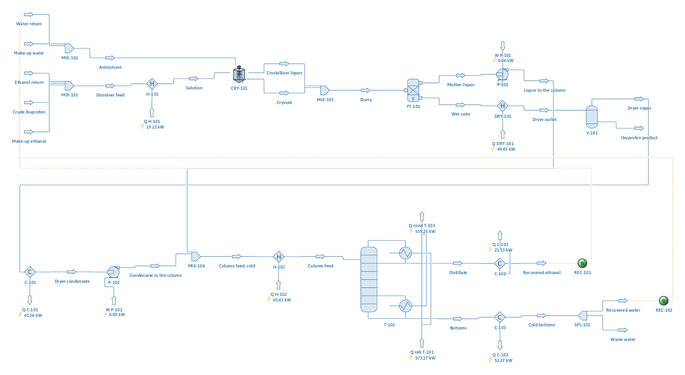
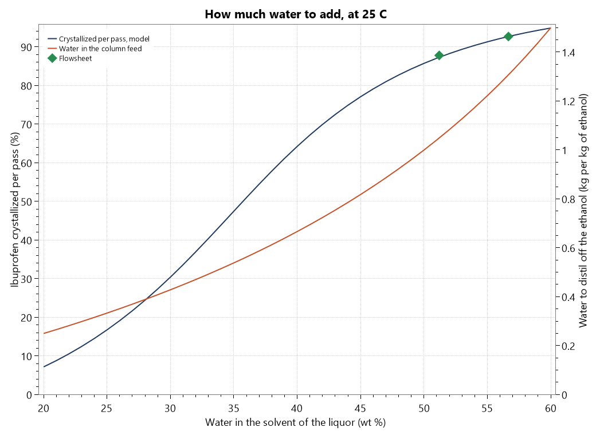
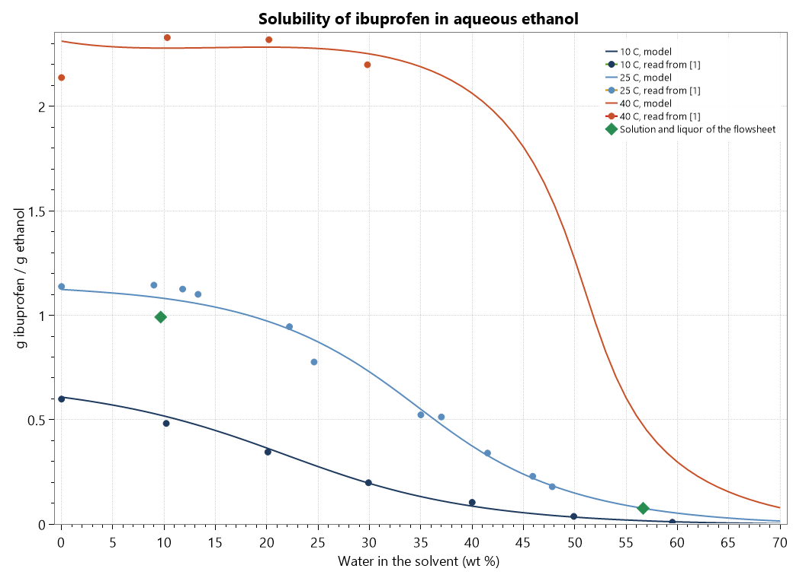

# Antisolvent crystallization of ibuprofen from ethanol with water, and recovery of the ethanol

**Category:** separation-processes
**Status:** community
**DWSIM version:** 10.3.0 or later
**DWSIM edition:** open source
**Language:** English
**Contributor:** Daniel Wagner Oliveira de Medeiros (@DanWBR)

> **Requirement:** The case needs DWSIM 10.3.0 or later, where the Crystallizer can take the solubility from the property package. Ibuprofen isn't in the standard databases; it is stored inside the file.

## Summary

Ibuprofen is very soluble in ethanol and nearly insoluble in water, so adding water to an ethanol solution crystallizes it without cooling. This case dissolves 500 kg/h of ibuprofen in recovered ethanol, crystallizes it at 25 °C with water as the antisolvent, filters and dries the crystals, distils the mother liquor to recover the ethanol, and returns both the ethanol and most of the water. The solubility comes from an NRTL model of ibuprofen, ethanol and water fitted to published measurements [1], which also reproduces the split into two liquid layers that the same authors found at 40 °C. The flowsheet recovers 98.6 % of the ibuprofen at 99.997 wt % and uses 0.04 g of fresh ethanol per kg of product; the price is a reboiler of 573 kW.

## Process description

**Dissolution:** MIX-101 joins the crude ibuprofen and the recovered ethanol, which carries about 10 wt % of water. H-101 brings the solution to 30 °C.

**Crystallization:** MIX-102 joins the recovered water and the make-up water into the antisolvent. CRY-101 mixes it with the solution at 25 °C; the liquor ends with 57 wt % of water in its solvent, and the ibuprofen above saturation leaves as crystals. MIX-103 joins the crystals and the liquor into the slurry.

**Filtration and drying:** FT-101, a rotary vacuum filter, leaves a cake with 15 wt % of liquor. DRY-101 heats the cake to 50 °C at 0.1 bar and V-101 separates the vapor from the product. C-101 condenses the vapor and P-102 pumps it to the column.

**Ethanol recovery:** P-101 pumps the mother liquor, MIX-104 joins it with the dryer condensate, and H-102 heats the column feed to 80 °C. T-101, with 20 stages at atmospheric pressure, takes the ethanol overhead at 90 wt % and leaves the water and the dissolved ibuprofen in the bottoms.

**Recycles:** C-102 cools the distillate, which returns to the dissolver through REC-101. C-103 cools the bottoms, SPL-101 sends 20 % of them to waste water, and the rest returns as antisolvent through REC-102, with the ibuprofen it carries.

## Feed and operating conditions

| Item | Value | Unit | Notes |
|---|---|---|---|
| Crude ibuprofen | 500 | kg/h | 25 °C, 1.013 bar, solid |
| Make-up ethanol | 0.02 | kg/h | equal to the losses |
| Make-up water | 121 | kg/h | |
| Dissolver H-101 | 30 | °C | |
| Solution | 0.99 | g ibuprofen / g ethanol | 10 wt % of water in the solvent |
| Crystallizer CRY-101 | 25 | °C | antisolvent mode, solubility from the property package |
| Liquor of CRY-101 | 57 | wt % of water in the solvent | 0.076 g ibuprofen / g ethanol |
| Filter FT-101 | 0.5 bar of pressure drop, 15 wt % of liquor in the cake | | design mode |
| Dryer DRY-101 / V-101 | 50 °C, 0.1 bar | | |
| Column feed heater H-102 | 80 | °C | 1.3 bar |
| T-101 | 20 stages, feed on 12, 1.013 bar | | distillate rate 3.87 mol/s, boil-up ratio 1.5, Naphtali-Sandholm solver |
| Waste water SPL-101 | 20 | % of the bottoms | |

## Thermodynamics

- **Property packages:** NRTL with solids handled by the default flash (`HandleSolidsInDefaultEqCalcMode`) for the crystallization section; a second NRTL package for the heater H-102 and the column T-101.
- **Solubility data:** Rashid et al. [1] measured the solubility of ibuprofen in absolute ethanol and in aqueous ethanol at 10, 25 and 40 °C. For absolute ethanol the article gives a correlation: 0.497 + 0.001026 T² g of ibuprofen per g of ethanol, with T in °C. For aqueous ethanol it gives a chart, and the points used here were read from it, with an error of about 0.01 g/g. The same data are tabulated in a later article of the authors that wasn't available for this case.
- **Ibuprofen / ethanol and ibuprofen / water pairs:** fitted together to 5 values of the correlation and to 20 points of the chart, with energies linear in temperature, (A + B T) in cal/mol with T in K. Ibuprofen / ethanol: A12 = -3549.744, A21 = 6877.817, B12 = 9.67178, B21 = -19.13966, alpha = 0.3. Ibuprofen / water: A12 = -1960.298, A21 = -10088.042, B12 = 30.45368, B21 = 66.70384, alpha = 0.2. Ibuprofen is compound 1 of both pairs.
- **Ethanol / water pair:** the one of the DWSIM database.
- **Range:** the fitted pairs are a correlation for 10 to 40 °C. In the package of the recovery section the two pairs of ibuprofen are ideal, so that the column sees ibuprofen as a heavy compound.
- **Fusion data of ibuprofen:** melting point 348.25 K and enthalpy of fusion 26.42 kJ/mol, from [2]. Crystal density 1110 kg/m3.

## Tuning and convergence notes

- **A fit with constant energies wasn't good enough:** with two constant energies per pair, the pair with water fitted to the aqueous points, the model missed the data by a factor of 1.9 on average and didn't give two liquids at any temperature. The eight-parameter fit follows the data within 8 % on average.
- **Two liquid layers:** [1] reports that at 40 °C the saturated solutions with 35 to 65 wt % of water in the solvent split into two liquids. The fitted model, which wasn't given that information, splits the saturated solutions from 38 to 54 wt % of water at 40 °C and from 38 to 46 wt % at 35 °C, and gives one liquid at 30 and 25 °C. The crystallizer works at 25 °C for that reason.
- **Oiling out during the mixing:** the same model says that a liquid with all the ibuprofen still dissolved (0.99 g per g of ethanol) splits into two liquids at 25 °C once the water reaches 36 wt % of the solvent, well before the final 57 wt %. The flowsheet is at equilibrium and doesn't see this. A real crystallizer has to keep the crystallization ahead of the water addition, with seeds and a slow addition, or the ibuprofen separates as an oil first.
- **The make-up of ethanol has to equal the losses:** T-101 has a fixed distillate rate. With a make-up of 1 kg/h, more than what leaves with the product, the ethanol built up in the loop until the distillate reached the azeotrope and the column stopped converging. With 0.02 kg/h the two recycles close.
- **The water held in the loop is the make-up divided by the purge fraction:** 121 kg/h and 20 % give 605 kg/h of water in the bottoms, and 57 wt % of water in the liquor.
- **Column solver:** T-101 uses the Naphtali-Sandholm solver.
- **The fitted pairs made the column fail:** above their range they give ibuprofen a very large activity coefficient in water. The recovery section has a package of its own for that reason; the cost is that the dissolved ibuprofen is a simple heavy compound there, and that the feed of the column is taken as one liquid.
- **The amount of water has a lower limit:** the cases from 75 to 150 kg/h of make-up water converge and are in the table below. With 60 kg/h the column doesn't converge.
- **Both recycle blocks use Wegstein acceleration on every pass** (`AccelerationMethod`, `WegsteinParameters.AccelFreq = 1`, `MaximumIterations = 300`), set from the script that built the case, and both tear streams have a first estimate.
- **The ibuprofen of the bottoms returns as a solid:** at 30 °C nearly all the ibuprofen of the cooled bottoms is out of solution, and it goes back to the crystallizer suspended in the recovered water. The waste water takes its share, which is the whole loss of the process.
- **The filter area is illustrative:** it comes from the default cake and medium resistances of the block.
- **The loop isn't heat integrated:** the bottoms at 100 °C could preheat the column feed.
- **Mass balance:** feeds 621.02 kg/h, product and waste water 621.01 kg/h.

## Results

| Quantity | DWSIM | Unit |
|---|---|---|
| Product | 492.9 | kg/h |
| Ibuprofen in the product | 99.997 | wt % |
| Yield of ibuprofen | 98.6 | % |
| Ibuprofen in the waste water | 7.2 | kg/h |
| Ibuprofen crystallized in CRY-101 per pass | 92.7 | % |
| Crystals in the slurry | 29.0 | wt % |
| Distillate | 558 | kg/h, 90.3 wt % of ethanol |
| Bottoms | 641 | kg/h, with 35.8 kg/h of ibuprofen |
| Reboiler / condenser of T-101 | 573 / 559 | kW |
| Reboiler duty per kg/h of product | 1.16 | kW |
| Column feed heater H-102 | 65 | kW |
| Dryer DRY-101 / condenser C-101 | 49 / 44 | kW |
| Crystallizer cooling CRY-101 | 22.8 | kW |
| Dissolver H-101 | 19 | kW |
| Filter area FT-101 | 2.43 | m2 |
| Fresh ethanol per kg of product | 0.04 | g |
| Fresh water per kg of product | 0.25 | kg |

The amount of water in the loop:

| Make-up water, kg/h | Water in the solvent of the liquor, wt % | Liquor, g ibuprofen / g ethanol | Crystallized per pass, % | Yield, % | Reboiler, kW |
|---|---|---|---|---|---|
| 75 | 46 | 0.219 | 81.0 | 95.9 | 362 |
| 85 | 49 | 0.169 | 84.9 | 96.9 | 407 |
| 95 | 51 | 0.133 | 87.8 | 97.5 | 453 |
| 108 | 54 | 0.100 | 90.7 | 98.1 | 513 |
| 121 | 57 | 0.076 | 92.7 | 98.6 | 573 |
| 135 | 59 | 0.059 | 94.3 | 98.9 | 638 |
| 150 | 61 | 0.045 | 95.6 | 99.1 | 709 |

More water crystallizes more ibuprofen in each pass and costs more in the column, because all of it has to be boiled up as the ethanol is stripped.

The solubility from the model against the correlation and the points read from the chart of [1]:

| Temperature, °C | Water in the solvent, wt % | g ibuprofen / g ethanol, from [1] | DWSIM | Rel. error |
|---|---|---|---|---|
| 10 | 0 | 0.600 | 0.609 | +2 % |
| 10 | 10.2 | 0.483 | 0.516 | +7 % |
| 10 | 20.1 | 0.346 | 0.363 | +5 % |
| 10 | 29.9 | 0.199 | 0.197 | -1 % |
| 10 | 40.0 | 0.105 | 0.087 | -17 % |
| 10 | 49.9 | 0.038 | 0.035 | -8 % |
| 10 | 59.5 | 0.010 | 0.012 | +25 % |
| 25 | 0 | 1.138 | 1.124 | -1 % |
| 25 | 9.0 | 1.145 | 1.088 | -5 % |
| 25 | 11.8 | 1.126 | 1.069 | -5 % |
| 25 | 13.3 | 1.101 | 1.056 | -4 % |
| 25 | 22.2 | 0.946 | 0.934 | -1 % |
| 25 | 24.6 | 0.777 | 0.882 | +14 % |
| 25 | 35.0 | 0.524 | 0.551 | +5 % |
| 25 | 37.0 | 0.514 | 0.477 | -7 % |
| 25 | 41.5 | 0.341 | 0.329 | -3 % |
| 25 | 45.9 | 0.230 | 0.221 | -4 % |
| 25 | 47.8 | 0.180 | 0.184 | +2 % |
| 25 | 56.7 | 0.073 | 0.076 | +4 % |
| 40 | 0 | 2.139 | 2.313 | +8 % |
| 40 | 10.3 | 2.33 | 2.280 | -2 % |
| 40 | 20.2 | 2.32 | 2.284 | -2 % |
| 40 | 29.8 | 2.20 | 2.253 | +2 % |

The values at 0 wt % of water are those of the correlation; the others were read from the chart. At 25 °C and 45.9 wt % the chart has three points between 0.18 and 0.27, and 0.230 is their mean.

The case doesn't have a reference from a plant or from another simulator. The comparison of the solubility is the only one against data.

## Files

- `ibuprofen-antisolvent-crystallization-ethanol-recovery.dwxmz` - the DWSIM flowsheet, with the notes, the stream table and the two charts on it.
- `ibuprofen-antisolvent-crystallization-ethanol-recovery.png` - the flowsheet picture.
- `solubility-ibuprofen-aqueous-ethanol.png`, `water-against-yield.png` - the charts above.

## Confidentiality

The flowsheet was put together for this example. The flows and operating conditions are illustrative and don't come from any plant or third-party data set.

## References

1. A. Rashid, E. T. White, T. Howes, J. D. Litster, I. Marziano, Crystallization kinetics of ibuprofen from ethanol and aqueous ethanol, 10th International Conference on Chemical and Process Engineering (ICheaP-10), 2011. The solubility data are also in: A. Rashid, E. T. White, T. Howes, J. D. Litster, I. Marziano, Effect of solvent composition and temperature on the solubility of ibuprofen in aqueous ethanol, J. Chem. Eng. Data 59 (2014) 2699-2703.
2. I. Hahnenkamp, G. Graubner, J. Gmehling, Measurement and prediction of solubilities of active pharmaceutical ingredients, Int. J. Pharm. 388 (2010) 73-81.
