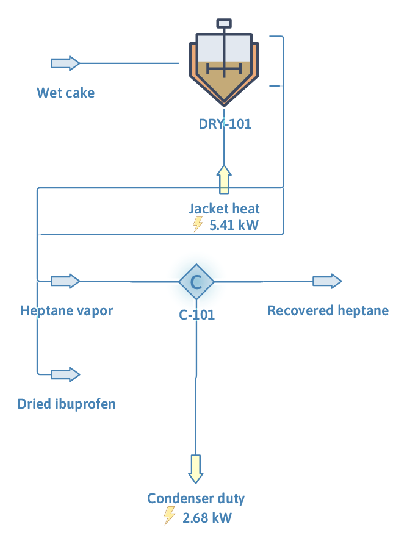
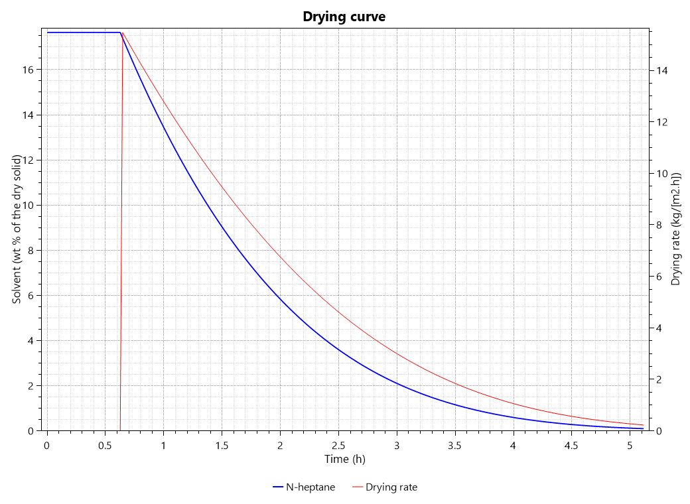
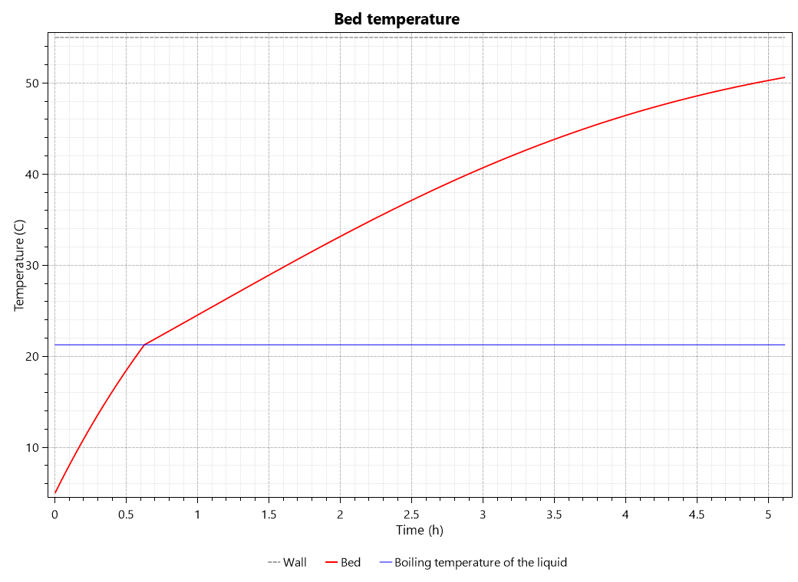
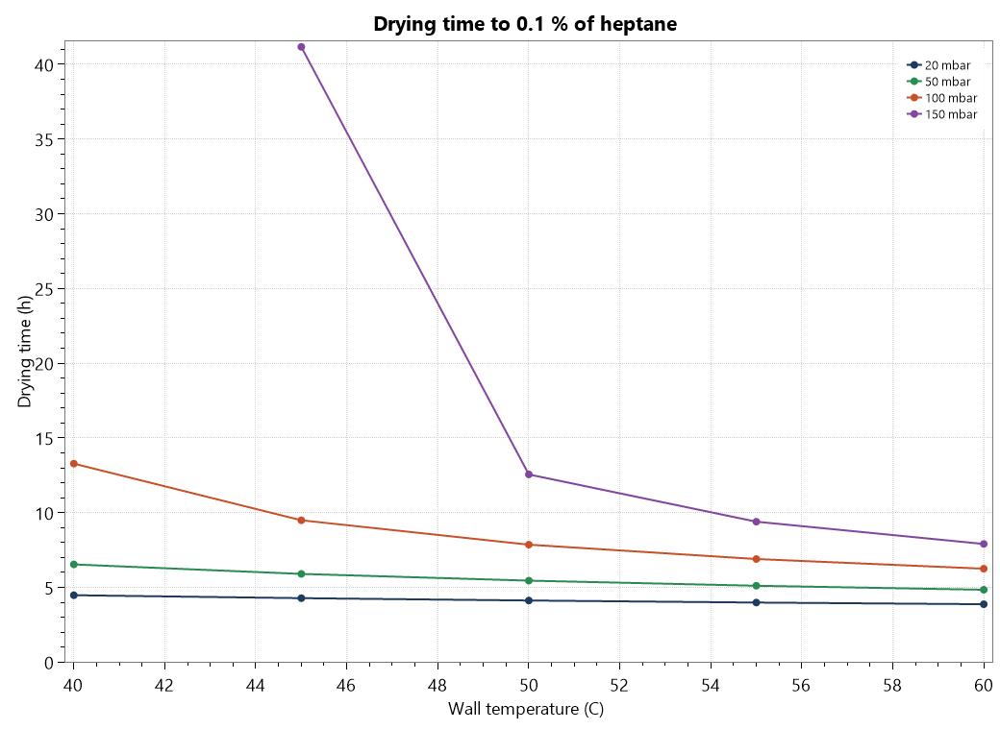

# Vacuum contact drying of an ibuprofen cake wet with n-heptane

**Category:** separation-processes
**Status:** community
**DWSIM version:** 10.3.0 or later
**DWSIM edition:** Patreon Edition (Contact Dryer)
**Language:** English
**Contributor:** Daniel Wagner Oliveira de Medeiros (@DanWBR)

> **Requirement.** The Contact Dryer block belongs to DWSIM Patreon (Premium+). The file opens anywhere, but it only solves where the block is licensed.

## Summary

After its crystallization from n-heptane, ibuprofen leaves the filter as a cake with 15 wt % of liquor. This case dries that cake under vacuum in an agitated filter-dryer, 1000 kg of dry solid per batch, with the jacket at 55 °C and the chamber at 50 mbar. The Contact Dryer block gives a drying time of 5.1 h to reach 0.1 % of heptane, a cycle of 7.1 h and a bed that ends at 51 °C, under the 60 °C taken as the limit of the product. The heptane left, 999 ppm, is under the ICH Q3C limit of 5000 ppm for this class 3 solvent. A condenser recovers the solvent.

## Process description

**Charge:** each batch takes 1000 kg of dry ibuprofen with 17.6 % of n-heptane on the dry solid, at 5 °C.

**Drying:** DRY-101 is a jacketed vessel with an agitator. The jacket is at 55 °C and the chamber at 50 mbar, where heptane boils at 21.3 °C. The agitator turns at 8 rpm.

**Solvent recovery:** C-101 condenses the heptane vapor at 5 °C, at the chamber pressure.

**Flowsheet:** the dryer is a batch unit. The streams carry the average of the cycle: the wet cake enters, the dried product and the heptane vapor leave, and the energy stream is the heat of the jacket.

## Feed and operating conditions

| Item | Value | Unit | Notes |
|---|---|---|---|
| Wet cake | 160.0 | kg/h | 5 °C; 15 wt % of n-heptane; 97 % of the capacity of one dryer |
| Batch | 1000 | kg of dry solid | 8 m2 of heated area in contact with the bed |
| Jacket | 55 | °C | |
| Chamber | 50 | mbar | |
| Agitator | 8 rpm, mixing number 10 | | |
| Target | 0.1 | wt % of heptane on the dry solid | |
| Temperature limit of the product | 60 | °C | ibuprofen melts at 76 °C |
| Loading and unloading | 2 | h | |
| Condenser C-101 | 5 | °C | |

## Thermodynamics and model

- **Drying model:** an agitated bed follows the penetration model [1]. The heat goes from the wall to the first layer of particles and then into the bed; after a number of turns of the agitator, the mixing number, the bed is mixed and a new contact period starts. While the bed is wet it stays near the boiling temperature of the liquid; as it dries, it warms toward the wall temperature and the drying rate falls.
- **Contact between the wall and the particles:** the coefficient is calculated from the particle diameter and the chamber pressure [2], with 80 % of the surface covered by particles.
- **Bed:** bulk density 450 kg/m3, thermal conductivity 0.12 W/(m.K), heat capacity of the solid 1500 J/(kg.K), particles of 50 micron.
- **Liquid:** the boiling temperature and the heat of vaporization of n-heptane come from the property package.
- **Property package:** NRTL, with the ibuprofen / n-heptane pair fitted to measured solubilities [3] (A12 = -1145.2, A21 = 3186.1 cal/mol, alpha = 0.2, ibuprofen as compound 1). Ibuprofen doesn't have a vapor pressure correlation and stays in the solid.
- **Residual solvent:** the block compares the heptane in the product with the limit of ICH Q3C(R9) [4].

## Tuning and convergence notes

- **The bed properties and the mixing number are assumptions:** they were chosen for this example. The mixing number depends on the dryer and its agitator and is fitted to a drying curve of the equipment; with another value the drying time changes.
- **Solvents named:** the block is told that n-heptane is the solvent. Without that it picks the compounds whose vapor pressure at the wall temperature is above 1 % of the chamber pressure, which gives the same choice here.
- **Heated area:** the 8 m2 are the wall and bottom in contact with the bed. The bed is 278 mm deep.
- **Batch and flowsheet:** the feed was set to 97 % of what one dryer handles with this cycle. A larger feed makes the block ask for more units and warn about it.
- **Streams:** the vapor leaves saturated at the chamber pressure, and the product at the final bed temperature and at the feed pressure, as a solid phase.
- **Duties:** the energy stream of the block carries the jacket heat as an average of the cycle. The peak is a result of the block.
- **Without bound solvent:** the model takes all the heptane as free liquid. A product that holds solvent inside its crystals dries more slowly at the end than the model says.
- **Mass balance:** wet cake 160.00 kg/h, dried product 136.136 kg/h, vapor 23.864 kg/h.

## Results

| Quantity | DWSIM | Unit |
|---|---|---|
| Heating to the boiling temperature | 38 | min |
| Drying time, heating included | 5.12 | h |
| Cycle time, with loading and unloading | 7.12 | h |
| n-Heptane in the product | 999 ppm | ICH Q3C limit 5000 ppm |
| Boiling temperature of heptane at 50 mbar | 21.3 | °C |
| Highest bed temperature | 50.6 | °C |
| Contact coefficient, wall to particles | 2824 | W/(m2.K) |
| Mean overall heat transfer coefficient | 50 | W/(m2.K) |
| Peak drying rate | 15.5 kg/(m2.h), 124 kg/h for the batch | |
| Batch | 1176 kg of wet cake, 175 kg of heptane removed | |
| Capacity of one dryer | 165 | kg/h of wet cake |
| Jacket heat, average of the cycle / peak | 5.41 / 17.2 | kW |
| Condenser C-101, average of the cycle | 2.67 | kW |

The drying of one batch. The rate is highest while the bed is at the boiling temperature and falls as the bed dries and warms:

How long the batch stays in the dryer for each level of heptane in the product:

| n-Heptane in the product, ppm | Drying time, h | Cycle, h | Final bed temperature, °C | Capacity, kg/h of wet cake | Under the ICH Q3C limit |
|---|---|---|---|---|---|
| 4975 | 4.12 | 6.12 | 47.0 | 192.1 | yes |
| 1996 | 4.72 | 6.72 | 49.4 | 175.2 | yes |
| 999 | 5.12 | 7.12 | 50.6 | 165.3 | yes |
| 500 | 5.48 | 7.48 | 51.5 | 157.2 | yes |
| 200 | 5.92 | 7.92 | 52.4 | 148.5 | yes |

The limit of 5000 ppm is reached in 4.12 h. Going from there to 200 ppm takes the drying to 5.92 h: the last tenths of a percent are the slow part, because the heat that reaches the bed then mostly warms the solid.

The drying time to 0.1 % over jacket temperatures and chamber pressures. Each cell gives the drying time and the highest bed temperature:

| Jacket, °C | 20 mbar | 50 mbar | 100 mbar | 150 mbar |
|---|---|---|---|---|
| 40 | 4.48 h, 35.4 °C | 6.54 h, 37.8 °C | 13.29 h, 39.6 °C | no drying |
| 45 | 4.29 h, 39.6 °C | 5.91 h, 42.1 °C | 9.50 h, 44.0 °C | 41.17 h, 45.0 °C |
| 50 | 4.13 h, 43.8 °C | 5.46 h, 46.4 °C | 7.86 h, 48.4 °C | 12.56 h, 49.5 °C |
| 55 | 3.99 h, 47.9 °C | 5.12 h, 50.6 °C | 6.90 h, 52.7 °C | 9.40 h, 53.9 °C |
| 60 | 3.88 h, 52.1 °C | 4.85 h, 54.8 °C | 6.26 h, 57.0 °C | 7.91 h, 58.3 °C |

A lower pressure lowers the boiling temperature of heptane and widens the difference to the jacket, so the vacuum matters more than the jacket temperature in this range. At 150 mbar heptane boils between 40 and 45 °C, and a jacket at 40 °C doesn't dry the cake.

The case doesn't have a reference from a plant or from a measured drying curve. The model of the block was checked against a published simulation of an industrial indirect dryer.

## Files

- `ibuprofen-cake-vacuum-contact-drying.dwxmz` - the DWSIM flowsheet, with the notes, the stream table and the three charts on it.
- `ibuprofen-cake-vacuum-contact-drying.png` - the flowsheet picture.
- `drying-curve.png`, `bed-temperature.png`, `drying-time-map.png` - the charts above.

## Confidentiality

The case was put together for this example. The batch size, the dryer and the bed properties are illustrative and don't come from any plant or third-party data set.

## References

1. E.-U. Schlünder, N. Mollekopf, "Vacuum contact drying of free flowing mechanically agitated particulate material", Chem. Eng. Process. 18 (1984) 93-111.
2. E.-U. Schlünder, "Heat transfer to packed and stirred beds from the surface of immersed bodies", Chem. Eng. Process. 18 (1984) 31-53.
3. I. Hahnenkamp, G. Graubner, J. Gmehling, "Measurement and prediction of solubilities of active pharmaceutical ingredients", Int. J. Pharm. 388 (2010) 73-81.
4. ICH Q3C(R9), Impurities: guideline for residual solvents, 2024.
