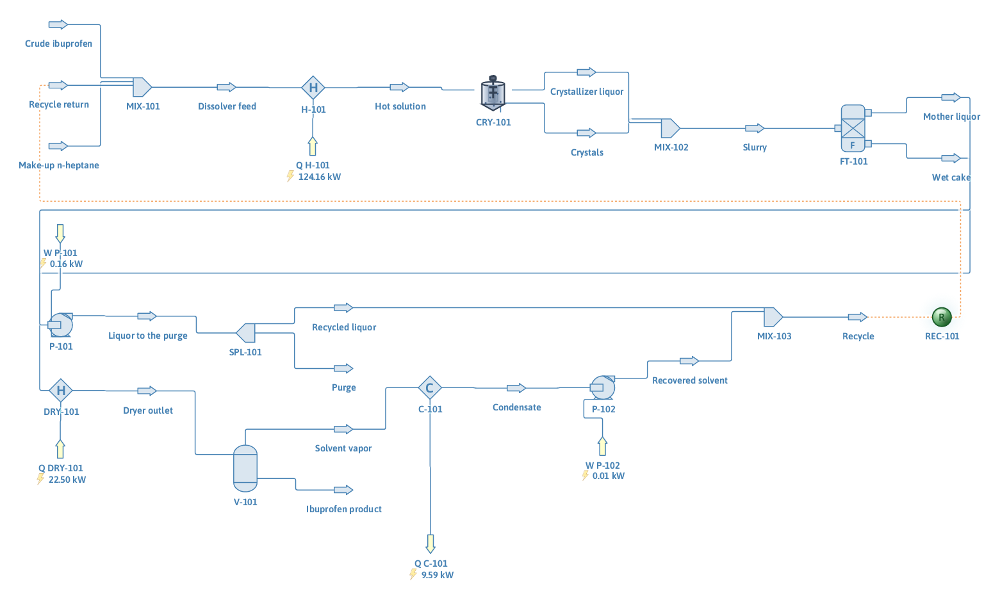
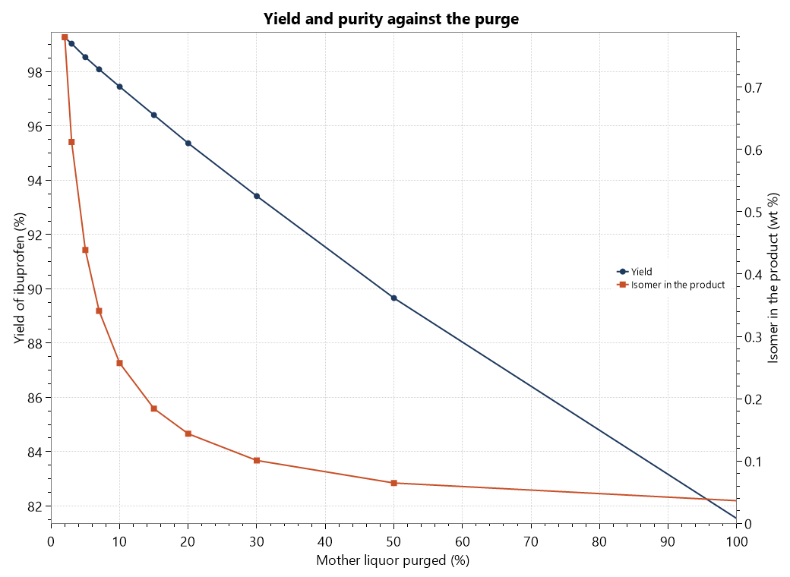
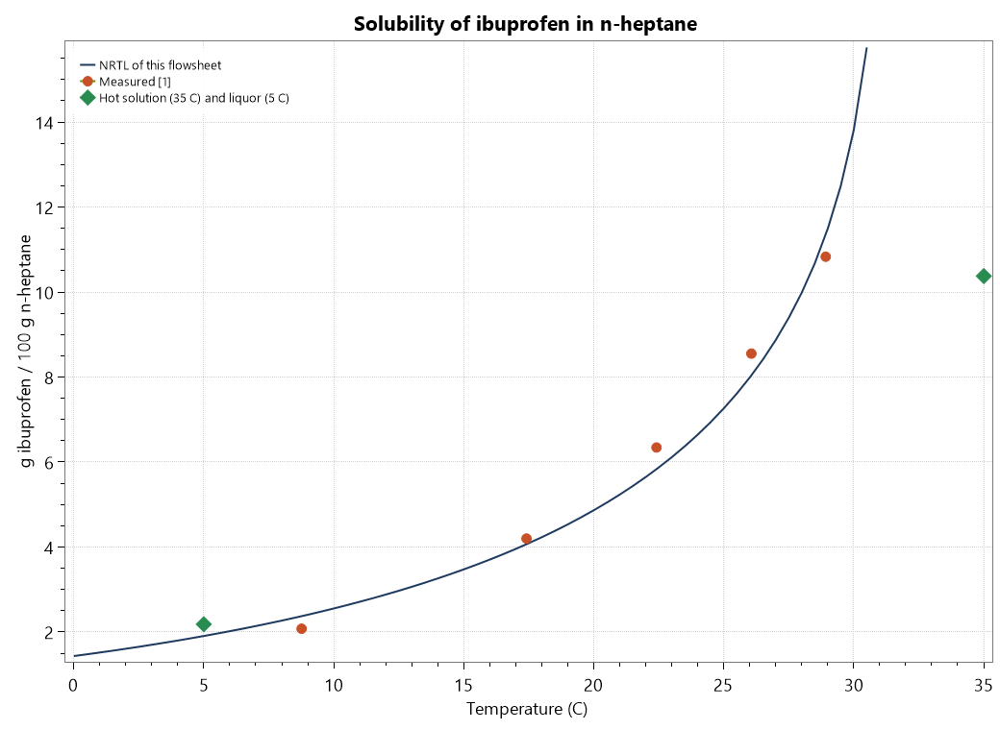

# Cooling crystallization of ibuprofen from n-heptane, with mother liquor recycle

**Category:** separation-processes
**Status:** community
**DWSIM version:** 10.2.17 or later
**DWSIM edition:** open source
**Language:** English
**Contributor:** Daniel Wagner Oliveira de Medeiros (@DanWBR)

> **Requirement:** The case needs DWSIM 10.2.17 or later, where the Crystallizer can take the solubility from the property package and the flashes with solids keep the energy balance of the filter cake and of the dryer. Ibuprofen and its linear isomer aren't in the standard databases; both are stored inside the file.

## Summary

Crude ibuprofen with 2 wt % of its linear isomer is purified by cooling crystallization from n-heptane: dissolution at 35 °C, crystallization at 5 °C, filtration, vacuum drying, and recycle of the mother liquor and of the dryer solvent with a purge. The solid-liquid equilibrium comes from an NRTL pair fitted to measured solubilities [1], and the solvent rate keeps the solution inside the range of those measurements. With 10 % of the mother liquor purged, the flowsheet recovers 97.5 % of the ibuprofen at 99.2 wt %, against 81.5 % in one pass without the recycle, and uses a tenth of the fresh solvent. The purge is what the case is about: it is the outlet of the isomer, and the smaller it gets, the higher the yield and the lower the purity.

## Process description

**Dissolution:** MIX-101 joins the crude, the make-up n-heptane and the recycle. H-101 heats the mixture to 35 °C, where all the ibuprofen is in solution.

**Crystallization:** CRY-101 cools the solution to 5 °C. It takes the solubility of ibuprofen from the property package, and the ibuprofen above saturation leaves as crystals. MIX-102 joins the crystals and the liquor into the slurry.

**Filtration:** FT-101, a rotary vacuum filter, separates the mother liquor and leaves a cake with 15 wt % of liquor.

**Drying and solvent recovery:** DRY-101 heats the cake to 50 °C at 0.1 bar and V-101 separates the solvent vapor from the product. C-101 condenses the vapor at 10 °C and P-102 pumps the condensate back to 1.5 bar.

**Purge and recycle:** P-101 brings the mother liquor back to 1.5 bar. SPL-101 purges 10 % of it, and MIX-103 joins the rest with the recovered solvent. The recycle block REC-101 closes the loop at the dissolver.

## Feed and operating conditions

| Item | Value | Unit | Notes |
|---|---|---|---|
| Crude ibuprofen | 500 | kg/h | 98 wt % ibuprofen, 2 wt % 3-(4-isobutylphenyl)propanoic acid; 25 °C, 1.5 bar, solid |
| Make-up n-heptane | 575 | kg/h | 25 °C, 1.5 bar |
| Dissolver H-101 | 35 | °C | 1.5 bar |
| Hot solution | 9.63 | kg n-heptane / kg ibuprofen | 4.8 mol % of ibuprofen in n-heptane |
| Crystallizer CRY-101 | 5 | °C | cooling mode, solubility from the property package |
| Filter FT-101 | 0.5 bar of pressure drop, 15 wt % of liquor in the cake | | design mode: it calculates the area |
| Dryer DRY-101 / V-101 | 50 °C, 0.1 bar | | a heater with the pressure drop and a flash drum |
| Condenser C-101 | 10 | °C | 0.1 bar |
| Purge SPL-101 | 10 | % of the mother liquor | |

## Thermodynamics

- **Property package:** NRTL with solids handled by the default flash (`HandleSolidsInDefaultEqCalcMode`).
- **Ibuprofen / n-heptane pair:** A12 = -1145.2 cal/mol, A21 = 3186.1 cal/mol, alpha = 0.2 (ibuprofen is compound 1), fitted to the five solubility points of Hahnenkamp et al. [1] between 8.8 and 28.9 °C with the Solubility and Solvent Screening tool. The parameters are stored in the file, so the case doesn't need the tool.
- **Fusion data of ibuprofen:** melting point 348.25 K and enthalpy of fusion 26.42 kJ/mol, from [1].
- **The isomer:** its two pairs don't have data and are set as ideal pairs. It doesn't have fusion data either, so it stays in the liquid at any concentration.
- **Estimated properties:** the boiling point, critical constants and ideal gas heat capacity of the two acids are Joback estimates. Ibuprofen decomposes before it boils, so its vapor-liquid constants are only placeholders for the models.
- **Crystal density of ibuprofen:** 1110 kg/m3 [2]. The filter needs it for the volume of the slurry.

## Tuning and convergence notes

- **The solvent rate is set on the composition of the hot solution:** Above about 30 °C the fitted NRTL curve rises much faster than the measurements, and a solution saturated at 30 °C can be anything from 5 to 17 mol % of ibuprofen in the model. A make-up tuned for a saturation temperature landed on the concentrated end, outside the range of the data. The make-up of each case was found by trial so that the hot solution has 9.63 kg of n-heptane per kg of ibuprofen, which is 4.8 mol % in the binary, saturated at 28 °C.
- **The pairs of the isomer are ideal:** A first version gave the isomer the NRTL energies of ibuprofen against n-heptane, since the two are position isomers. The isomer that builds up in the loop then more than doubled the solubility of ibuprofen at 5 °C. There isn't a measurement to support either choice; the ideal pairs are the neutral one, and the result of the case depends on it.
- **Automatic estimation of NRTL pairs is switched off** (`AutoEstimateMissingNRTLUNIQUACParameters`), and the two pairs without data are declared with zero energies, because the package refuses to calculate with a pair it doesn't have.
- **The recycle block uses Wegstein acceleration on every pass:** With plain substitution the tear stream converges slowly when the purge is small, and below 10 % of purge the block reached its iteration limit. `AccelerationMethod`, `WegsteinParameters.AccelFreq = 1` and `MaximumIterations = 300` were set from the script that built the case.
- **The tear stream needs a first estimate at the loop pressure:** left empty, it starts at 1.013 bar, the mixer takes the lowest pressure of its feeds, and the dryer ends below zero pressure.
- **The Crystallizer has two outlets and the Filter takes one slurry,** so MIX-102 sits between them. The Crystals outlet is forced to the solid phase, which the log reports as a warning at each solve.
- **The filter area is illustrative:** it comes from the default specific cake resistance and medium resistance of the block, for a cycle of 300 s with 30 % of the drum submerged.
- **Heat recovery is limited by the saturation temperature:** the recycle returns at 5 °C and H-101 heats it again to 35 °C (124 kW), while CRY-101 removes 137 kW. An exchanger between the hot solution and the cold recycle can only cool the solution to about 28 °C, because below 26.7 °C the ibuprofen crystallizes on the exchanger surface. That is about a quarter of the heating duty, and the flowsheet leaves it out.
- **Mass balance:** feeds 1075.00 kg/h, product and purge 1075.05 kg/h.

## Results

| Quantity | DWSIM | Unit |
|---|---|---|
| Product | 481.2 | kg/h |
| Ibuprofen in the product | 99.23 | wt % |
| Isomer in the product | 0.26 | wt % |
| n-Heptane in the product | 0.52 | wt % |
| Yield of ibuprofen | 97.5 | % of the ibuprofen in the crude |
| Yield without the recycle | 81.5 | % |
| Ibuprofen crystallized in CRY-101 per pass | 78.9 | % |
| Supersaturation ratio of the crystallizer feed | 4.75 | |
| Saturation temperature of the hot solution | 26.7 | °C |
| Crystals in the slurry | 7.3 | wt % |
| Mother liquor | 5938 | kg/h, with 1.47 wt % of isomer and 2.11 wt % of ibuprofen |
| Purge | 594 | kg/h, with 8.8 kg/h of isomer and 12.5 kg/h of ibuprofen |
| Filter area FT-101 | 4.03 | m2 |
| Crystallizer cooling CRY-101 | 136.7 | kW |
| Dissolver heating H-101 | 124.2 | kW |
| Dryer heating DRY-101 | 22.5 | kW |
| Condenser C-101 | 9.6 | kW |

Of the 10 kg/h of isomer in the crude, 8.8 kg/h leave in the purge and 1.2 kg/h in the product, carried by the liquor that dries on the crystals.

The purge fraction against the yield and the purity. Each row has its own make-up, found for the same solvent ratio in the hot solution:

| Mother liquor purged, % | Make-up, kg/h | Make-up, kg per kg of product | Yield, % | Isomer in the product, wt % | Isomer in the mother liquor, wt % |
|---|---|---|---|---|---|
| 100 (one pass) | 4652 | 11.63 | 81.5 | 0.04 | 0.21 |
| 50 | 2567 | 5.83 | 89.7 | 0.06 | 0.37 |
| 30 | 1613 | 3.51 | 93.4 | 0.10 | 0.58 |
| 20 | 1105 | 2.35 | 95.4 | 0.14 | 0.82 |
| 15 | 843 | 1.77 | 96.4 | 0.18 | 1.05 |
| 10 | 575 | 1.20 | 97.5 | 0.26 | 1.47 |
| 7 | 412 | 0.85 | 98.1 | 0.34 | 1.96 |
| 5 | 302 | 0.62 | 98.5 | 0.44 | 2.53 |
| 3 | 191 | 0.39 | 99.0 | 0.61 | 3.55 |
| 2 | 135 | 0.27 | 99.3 | 0.78 | 4.55 |

The solubility of ibuprofen in n-heptane from the model against the measurements of [1], with the hot solution and the crystallizer liquor of the flowsheet:

| Temperature, K | x ibuprofen, measured [1] | x ibuprofen, DWSIM | Rel. error |
|---|---|---|---|
| 281.91 | 0.0100 | 0.0114 | +14.0 % |
| 290.56 | 0.0200 | 0.0194 | -3.1 % |
| 295.56 | 0.0299 | 0.0276 | -7.8 % |
| 299.21 | 0.0399 | 0.0376 | -5.8 % |
| 302.07 | 0.0500 | 0.0523 | +4.5 % |

The case doesn't have a reference from a plant or from another simulator. The comparison above is the only one against data.

## Files

- `ibuprofen-cooling-crystallization-with-recycle.dwxmz` - the DWSIM flowsheet, with the notes, the stream table and the two charts on it.
- `ibuprofen-cooling-crystallization-with-recycle.png` - the flowsheet picture.
- `solubility-ibuprofen-n-heptane.png`, `yield-and-purity-against-purge.png` - the charts above.

## Confidentiality

The flowsheet was put together for this example. The flows, the impurity level and the operating conditions are illustrative and don't come from any plant or third-party data set.

## References

1. I. Hahnenkamp, G. Graubner, J. Gmehling, Measurement and prediction of solubilities of active pharmaceutical ingredients, Int. J. Pharm. 388 (2010) 73-81.
2. J. F. McConnell, Cryst. Struct. Commun. 3 (1974) 73-75. The unit cell of racemic ibuprofen (a = 14.667 Å, b = 7.886 Å, c = 10.730 Å, beta = 99.362°, four molecules) gives 1.12 g/cm3; helium pycnometry on the crystals gives 1.11 g/cm3, the value used here.
