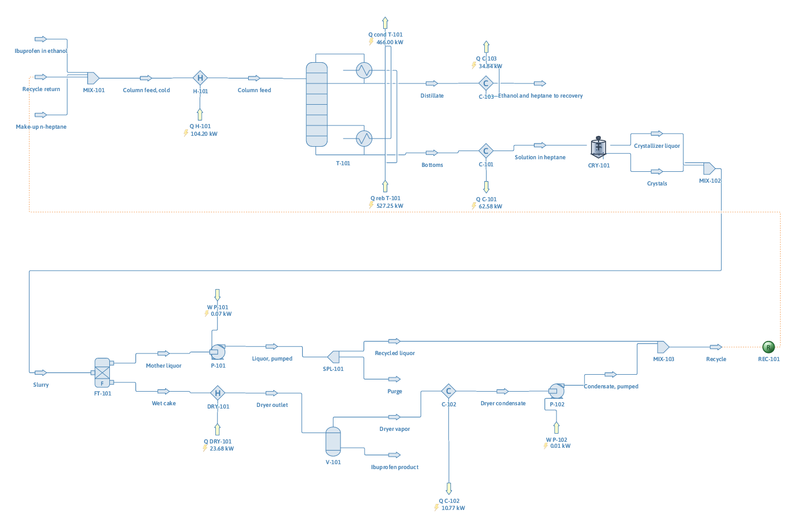
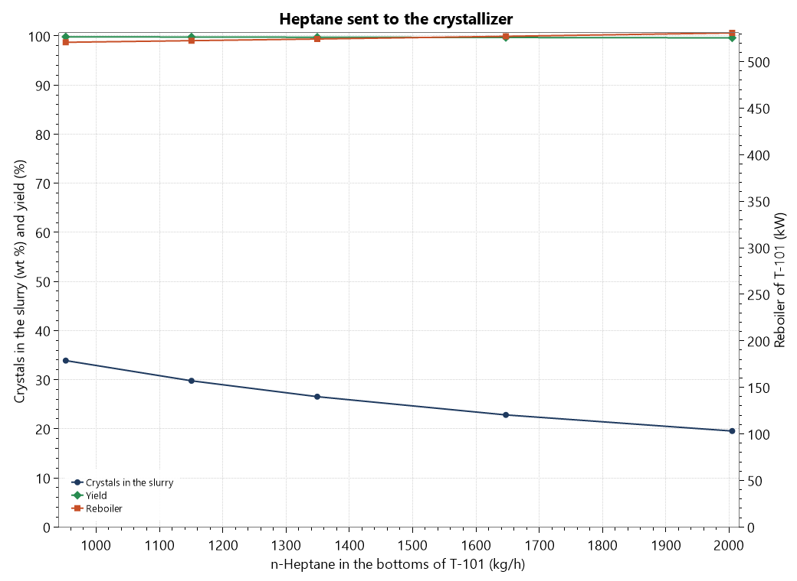
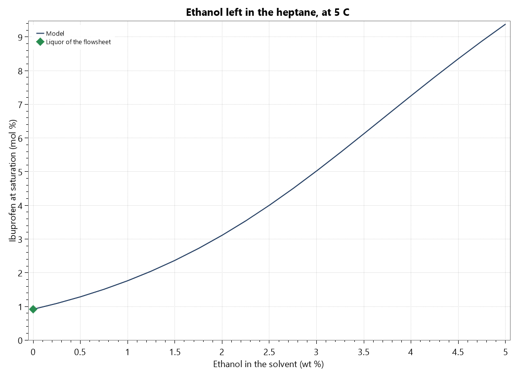

# Solvent swap of ibuprofen from ethanol to n-heptane, with cooling crystallization

**Category:** separation-processes
**Status:** community
**DWSIM version:** 10.2.17 or later
**DWSIM edition:** open source
**Language:** English
**Contributor:** Daniel Wagner Oliveira de Medeiros (@DanWBR)

> **Requirement:** The case needs DWSIM 10.2.17 or later, for the Crystallizer with the solubility from the property package. Ibuprofen isn't in the standard databases; it is stored inside the file.

## Summary

A solvent swap takes a product out of the solvent it was made in and into the solvent it will be crystallized from. Here 500 kg/h of ibuprofen arrive dissolved in ethanol, where ibuprofen is too soluble to crystallize with a good yield, and leave as crystals from n-heptane. A distillation column takes the ethanol overhead with part of the heptane, since the two form an azeotrope, and leaves the ibuprofen in heptane in the bottoms. A cooling crystallizer, a filter and a vacuum dryer follow, and the mother liquor returns to the column. The plant delivers 498.5 kg/h of ibuprofen, a yield of 99.7 %, and uses 1.60 kg of heptane per kg of product.

## Process description

**Feed:** MIX-101 joins the solution of ibuprofen in ethanol, the make-up of n-heptane and the recycled mother liquor. H-101 heats the mixture to 65 °C.

**Swap column:** T-101 has 8 stages at atmospheric pressure. The distillate, at 71 °C, holds all the ethanol and the heptane that leaves with it. The bottoms, at 103 °C, are the ibuprofen in heptane. C-103 cools the distillate, which goes to solvent recovery outside the flowsheet.

**Crystallization:** C-101 cools the bottoms to 60 °C and CRY-101 to 5 °C. MIX-102 joins the crystals and the liquor into the slurry.

**Filtration and drying:** FT-101, a rotary vacuum filter, leaves a cake with 15 wt % of liquor. DRY-101 heats the cake to 50 °C at 0.1 bar and V-101 separates the heptane vapor from the product. C-102 condenses the vapor at 5 °C and P-102 pumps the condensate to 1.5 bar.

**Recycle:** P-101 pumps the mother liquor, SPL-101 purges 5 % of it, and MIX-103 joins the rest with the dryer condensate. The recycle block REC-101 closes the loop at MIX-101.

## Feed and operating conditions

| Item | Value | Unit | Notes |
|---|---|---|---|
| Ibuprofen in ethanol | 500 + 500 | kg/h | 30 °C, 1.5 bar |
| Make-up n-heptane | 800 | kg/h | 25 °C |
| H-101 | 65 | °C | 1.013 bar |
| T-101 | 8 stages, feed on 3, 1.013 bar | | reflux ratio 1.5, bottoms rate 19.0 kmol/h, default bubble point solver |
| C-101 | 60 | °C | |
| Crystallizer CRY-101 | 5 | °C | cooling mode, solubility from the property package |
| Filter FT-101 | 0.4 bar of pressure drop, 15 wt % of liquor in the cake | | design mode |
| Dryer DRY-101 / V-101 | 50 °C, 0.1 bar | | |
| Condenser C-102 | 5 | °C | 0.1 bar |
| Purge SPL-101 | 5 | % of the mother liquor | |

## Thermodynamics

- **Crystallization section:** NRTL with solids handled by the default flash (`HandleSolidsInDefaultEqCalcMode`).
- **Ibuprofen / n-heptane pair:** A12 = -1145.2, A21 = 3186.1 cal/mol, alpha = 0.2 (ibuprofen is compound 1), fitted to the five solubilities of Hahnenkamp et al. [1] between 9 and 29 °C. It is the pair of the case "Cooling crystallization of ibuprofen with mother liquor recycle".
- **Ibuprofen / ethanol pair:** A12 = -3549.744, A21 = 6877.817 cal/mol, B12 = 9.67178, B21 = -19.13966 cal/(mol K), alpha = 0.3, with energies (A + B T). It is the pair of the case "Antisolvent crystallization of ibuprofen with ethanol recovery", fitted to the data of Rashid et al. [2] from 10 to 40 °C.
- **Ethanol / n-heptane pair:** the one of the database, A12 = 1137.265, A21 = 1453.595 cal/mol, alpha = 0.479. It gives the azeotrope that drives the swap.
- **Swap column, H-101 and C-103:** a second NRTL package, where ibuprofen is an ideal heavy compound. The two fitted pairs are correlations for 9 to 40 °C and the column works from 71 to 103 °C, so they are kept out of it.
- **Solubility in a mixture of the two solvents isn't validated:** the model has data for each solvent alone. What it gives for heptane with a little ethanol is an interpolation.
- **Crystal density of ibuprofen:** 1110 kg/m3.

## Tuning and convergence notes

- **The azeotrope sets the heptane the swap uses:** ethanol can't leave the column alone. In the base case the 500 kg/h of ethanol take 722 kg/h of heptane with them, and the purge takes 78 kg/h more. With a make-up of 700 kg/h the flowsheet didn't converge: the ethanol has nowhere to go.
- **Column specifications:** reflux ratio and bottoms rate. The bottoms rate is the ibuprofen plus the heptane that goes with it to the crystallizer; everything else that enters the column leaves overhead. Both are specifications the bubble point solver takes directly.
- **Eight stages, and not more:** with 12 or 20 stages the bubble point solver didn't converge this column and the Naphtali-Sandholm solver took over, at 15 to 45 s per solve, which is too slow inside a recycle. With 8 stages the default solver converges it in about 2 s and the bottoms still leave without ethanol.
- **How much heptane to send to the crystallizer:** bottoms rates from 12 to 22.6 kmol/h are in the table below. At 26 kmol/h the flowsheet didn't converge.
- **Why the ethanol has to go:** at 5 °C the model gives 0.92 mol % of ibuprofen at saturation in heptane, 1.8 mol % with 1 wt % of ethanol in the solvent and 5.0 mol % with 3 wt %. The chart below has the curve.
- **The distillate isn't separated:** it leaves as a mixture with 41 wt % of ethanol. A plant recovers the heptane from it, for example by washing the ethanol out with water, which would bring the heptane used per kg of product down from 1.60 kg to what the purge takes, 0.16 kg.
- **The bottoms leave at 103 °C:** above the melting point of ibuprofen (76 °C), which stays dissolved. A column under vacuum would lower that temperature.
- **The recycle block uses Wegstein acceleration on every pass** (`AccelerationMethod`, `WegsteinParameters.AccelFreq = 1`, `MaximumIterations = 300`), set from the script that built the case, and the tear stream has a first estimate.
- **Automatic estimation of NRTL pairs is switched off** (`AutoEstimateMissingNRTLUNIQUACParameters`).
- **The filter area is illustrative:** it comes from the default cake and medium resistances of the block.
- **Mass balance:** feeds 1800.0 kg/h, products 1800.0 kg/h.

## Results

| Quantity | DWSIM | Unit |
|---|---|---|
| Product | 498.5 | kg/h |
| Yield | 99.7 | % |
| Ibuprofen in the purge | 1.5 | kg/h |
| Distillate of T-101 | 1222 | kg/h, 40.9 wt % of ethanol, 71 °C |
| Bottoms of T-101 | 2176 | kg/h, 103 °C, without ethanol |
| Ibuprofen crystallized in CRY-101 per pass | 94.1 | % |
| Crystals in the slurry | 22.8 | wt % |
| Ibuprofen at saturation in the liquor at 5 °C | 0.92 | mol % |
| Recycle to the column | 1597 | kg/h |
| Heptane used per kg of product | 1.60 | kg, of which 1.45 kg leave with the ethanol |
| Filter area FT-101 | 2.54 | m2 |
| Reboiler / condenser of T-101 | 527 / 466 | kW |
| Feed heater H-101 | 104 | kW |
| Coolers C-101 / C-103 | 63 / 35 | kW |
| Crystallizer cooling CRY-101 | 92 | kW |
| Dryer DRY-101 / condenser C-102 | 24 / 11 | kW |

The heptane sent to the crystallizer, set by the bottoms rate of T-101, with the same make-up:

| Bottoms rate, kmol/h | Heptane in the bottoms, kg/h | Crystals in the slurry, wt % | Crystallized per pass, % | Yield, % | Reboiler, kW | Recycle, kg/h | Heptane in the distillate, kg/h |
|---|---|---|---|---|---|---|---|
| 12.0 | 952 | 33.9 | 96.5 | 99.8 | 521 | 924 | 757 |
| 14.0 | 1151 | 29.8 | 95.8 | 99.8 | 523 | 1117 | 747 |
| 16.0 | 1349 | 26.6 | 95.1 | 99.8 | 524 | 1309 | 737 |
| 19.0 | 1647 | 22.8 | 94.1 | 99.7 | 527 | 1597 | 722 |
| 22.6 | 2005 | 19.6 | 92.8 | 99.6 | 531 | 1944 | 704 |

Less heptane gives a denser slurry and a slightly higher yield, because less liquor reaches the purge; the reboiler hardly changes, since the ethanol and the heptane that leaves with it are what it boils. The base case stays at 19 kmol/h, with 23 wt % of crystals in the slurry.

What ethanol left in the heptane does to the solubility at 5 °C, from the model:

| Ethanol in the solvent, wt % | 0 | 0.25 | 0.5 | 1 | 2 | 3 | 5 |
|---|---|---|---|---|---|---|---|
| Ibuprofen at saturation, mol % | 0.92 | 1.09 | 1.29 | 1.77 | 3.12 | 5.03 | 9.39 |

The solubility of ibuprofen in n-heptane from the model against the measurements of [1]:

| Temperature, K | x ibuprofen, measured [1] | x ibuprofen, DWSIM | Rel. error |
|---|---|---|---|
| 281.91 | 0.0100 | 0.0114 | +14.0 % |
| 290.56 | 0.0200 | 0.0194 | -3.1 % |
| 295.56 | 0.0299 | 0.0276 | -7.8 % |
| 299.21 | 0.0399 | 0.0376 | -5.8 % |
| 302.07 | 0.0500 | 0.0523 | +4.5 % |

The case doesn't have a reference from a plant or from another simulator. The comparison of the solubility in heptane is the only one against data.

## Files

- `ibuprofen-solvent-swap-ethanol-to-heptane.dwxmz` - the DWSIM flowsheet, with the notes, the stream table and the two charts on it.
- `ibuprofen-solvent-swap-ethanol-to-heptane.png` - the flowsheet picture.
- `ethanol-left-in-the-heptane.png`, `heptane-to-the-crystallizer.png` - the charts above.

## Confidentiality

The flowsheet was put together for this example. The flows and the operating conditions are illustrative and don't come from any plant or third-party data set.

## References

1. I. Hahnenkamp, G. Graubner, J. Gmehling, Measurement and prediction of solubilities of active pharmaceutical ingredients, Int. J. Pharm. 388 (2010) 73-81.
2. A. Rashid, E. T. White, T. Howes, J. D. Litster, I. Marziano, Crystallization kinetics of ibuprofen from ethanol and aqueous ethanol, 10th International Conference on Chemical and Process Engineering (ICheaP-10), 2011.
