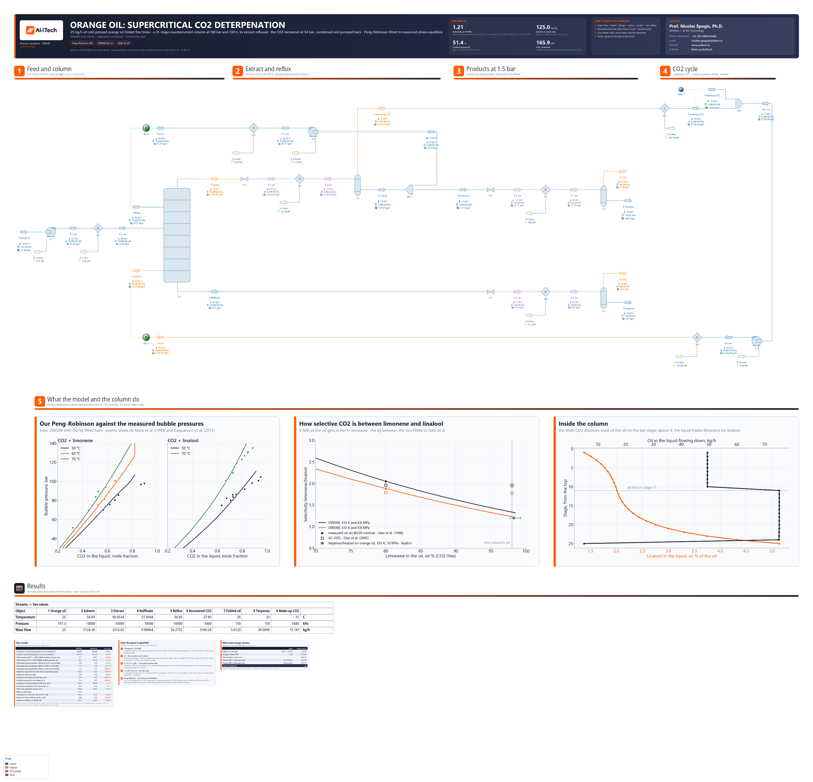

# Deterpenation of cold-pressed orange oil with supercritical CO2: a countercurrent column and its CO2 cycle

**Category:** separation-processes
**Status:** community
**DWSIM version:** 10.2.12
**Language:** English
**Contributor:** Prof. Nicolas Spogis, Ph.D. (@Spogis), AI4Tech · nicolas.spogis@ai4tech.ai · www.ai4tech.ai

## Summary

Cold-pressed orange oil is almost all terpenes, mostly limonene. Its flavour is in the 1 to 2 % of oxygenated compounds, and linalool is the one closest to limonene. Supercritical CO2 dissolves limonene more readily than linalool. A countercurrent column with extract reflux therefore strips the terpenes and leaves a "folded" oil richer in the flavour compounds.

This case is the pump-cycle plant that Díaz, Espinosa and Brignole (2005, Table 4) designed for a 98/2 wt % limonene/linalool model oil:

- 25 kg/h of oil;
- a column of 25 theoretical stages at 100 bar and 330 K, with an extract reflux of 2.45;
- a separator at 54.4 bar and 301 K, where the terpenes drop out of the CO2;
- the CO2 condensed, pumped back to 100 bar and reheated.

As in their design, the solvent flow is set so that the folded oil is a fifth of the feed: a five-fold concentrate.

The model is Peng-Robinson, with limonene's and linalool's constants and every binary parameter fitted to published measurements. On it, CO2's selectivity between limonene and linalool for this oil is 1.21, where Budich measured 1.2 on orange oil. The group-contribution equation of state (GC-EOS) the plant was designed with gives 1.77. With the measured selectivity, the same plant makes its five-fold concentrate with less solvent, and keeps half the linalool:

| | This case | Díaz et al. (2005), GC-EOS |
|---|---|---|
| Selectivity limonene/linalool, 98/2 oil, 333 K, 10 MPa | 1.21 | 1.77 (Budich measured 1.2) |
| Solvent-to-feed ratio | 125.0 kg/kg | 153.5 kg/kg |
| Linalool recovered in the folded oil | 51.4 % | 95.9 % |
| Limonene in the top product, CO2-free | 98.78 wt % | 99.90 wt % |

The CO2 cycle is checked against NIST's CO2: the condenser, the pump and the heater are within 3.8, 2.3 and 6.3 %.

## Process description

- **Feed and column.** The pump P-1 takes the oil to 100 bar and the heater E-1 to 330 K. The column C-1 is an absorption column of 25 equilibrium stages, counted from the top, with no condenser and no reboiler:
  - the reflux enters on stage 1;
  - the oil on stage 11;
  - the CO2, 3,124 kg/h, on stage 25.

  The extract leaves the top: 3,217 kg/h, 97.7 wt % CO2. The raffinate leaves the bottom: 9.0 kg/h, of which 4.0 kg/h is dissolved CO2.
- **Extract and reflux.** The valve V-1 lets the extract down to 54.4 bar, which cools it to 21.6 °C. The heater E-2 (21.2 kW) brings it to 301 K, where the CO2 holds much less oil, and the separator S-1 splits it:
  - 3,109 kg/h of gas, 99.83 wt % CO2, to the CO2 cycle;
  - 107 kg/h of liquid: 63.5 wt % limonene, 0.78 % linalool, 35.8 % dissolved CO2.

  The splitter SPL-1 sends 2.45 parts of the liquid back for each part taken off. The pump P-3 and the heater E-5 return it to the top stage at 100 bar and 330 K.
- **Products at 1.5 bar.** Both products are let down to 1.5 bar, heated to 25 °C and degassed:
  - The top product (31.1 kg/h) flashes to −31 °C in V-3. E-7 warms it, and S-3 vents 11.1 kg/h of CO2 and leaves 20.1 kg/h of terpenes.
  - The raffinate flashes to −8 °C in V-2. E-6 warms it, and S-2 vents 4.0 kg/h of CO2 and leaves the folded oil, 5.0 kg/h.
- **CO2 cycle.** The cooler E-3 condenses the recovered CO2 at 54.4 bar and takes it to 15 °C: 165.9 kW, below its saturation temperature of 17.8 °C, so the duty is refrigeration.
  - The mixer M-1 adds the make-up, 15.1 kg/h. The Spec block SPEC-1 sets it to the solvent flow less the condensed CO2: the CO2 the products carry away.
  - The pump P-2 (6.4 kW) and the heater E-4 (137.1 kW) return the CO2 to the column's bottom stage at 100 bar and 330 K.

Below the plant, three figures are drawn from the solved flowsheet:
- the model's bubble pressures against the measurements its binary parameters were fitted to;
- CO2's selectivity between limonene and linalool, as the oil gets richer in limonene;
- the column stage by stage: the linalool in the liquid, and the oil it carries down.

## Feed and operating conditions

| Item | Value | Unit | Notes |
|---|---|---|---|
| Orange oil | 25.0 | kg/h | 98 wt % limonene, 2 wt % linalool: Díaz et al.'s pseudo-binary model of cold-pressed orange oil; 25 °C, 1.013 bar |
| Column C-1 | 25 | theoretical stages | reflux on stage 1, oil on stage 11, CO2 on stage 25; 100 bar, no pressure drop |
| Feeds to the column | 100 bar, 330 | K | oil, reflux and CO2 alike |
| Extract reflux | 2.45 | kg/kg | reflux / top product, by SPL-1 |
| Separator S-1 | 54.4 bar, 301 | K | after the let-down valve V-1 and the heater E-2 |
| CO2 condenser E-3 | 54.4 bar, 15 | °C | 2.8 K below the CO2's saturation temperature |
| Pumps | 75 | % | P-1, P-2 and P-3 |
| Products | 1.5 bar, 25 | °C | degassed in S-2 and S-3 |
| Specification | 5.0 | kg/h | folded oil, CO2-free: a fifth of the feed, met by the solvent flow |

All pressures are absolute. The plant is Díaz et al.'s pump cycle (2005, Table 4). The degassing of the products, the condenser's temperature and the pumps' efficiency are this case's choices.

## Thermodynamics

- **Property package:** Peng-Robinson (1976), with DWSIM's CO2 and limonene and linalool from its FoodProp databank. The two terpenes' constants are set on the flowsheet's own copies of the compounds, which are saved with the file; the databank is not changed.
- **Why Peng-Robinson:** GERG-2008 has no limonene or linalool. Peng-Robinson is the equation both sets of measurements used here were correlated with (Vieira de Melo et al. 1999; Capparucci et al. 2013), and it carries the CO2 close to its critical point: the cycle's condenser and pump are within 3.8 % and 2.3 % of NIST.
- **The compounds.** DWSIM's linalool carries a critical temperature of 697.84 K and an acentric factor of 0.77. With them, Peng-Robinson puts its normal boiling point at 518.7 K, where NIST gives 471.75 K. Both terpenes therefore get measured constants:
  - Tc and Pc from Capparucci et al. (2013, Table 4): linalool 646.03 K and 31.55 bar, limonene 27.88 bar;
  - limonene's Tc as Smith et al. (1990) measured it, 653 K;
  - the acentric factor that puts each normal boiling point on NIST's: 0.3646 for limonene (450.0 K) and 0.7503 for linalool (471.75 K).
- **Interaction parameters:** DWSIM has none for these pairs. All three are fitted here, by a golden-section search in the build script:
  - CO2-limonene, 0.1059: the bubble pressures of Vieira de Melo et al. (1999), 14 of their 16 points at 50 to 70 °C, mean deviation 2.8 %. The other two lie past the mixture's critical point.
  - CO2-linalool, 0.0138: 16 of the 19 points of Vieira de Melo et al. (1999) and Capparucci et al. (2013), mean deviation 5.2 %.
  - Limonene-linalool, 0.0632: the five selectivities Sato et al. (1996) measured on an 80/20 oil, as Díaz et al. (2005, Table 1) give them, mean deviation 7.7 %.
- **The selectivity depends on the oil.** Fitted on the 80/20 oil, the model gives 1.21 for the 98/2 oil at 333 K and 10 MPa. Budich measured terpenes against linalool on orange oil at 60 °C and 10 MPa, "in the range of 1.2" (Danielski 2007, p. 93). The selectivity falls as the oil gets richer in limonene (the second figure), so a value measured on one oil does not size a column for another.

## Tuning and convergence notes

**The column**

- **Naphtali-Sandholm, up to 1,000 iterations.** On the column alone, with the reflux as a fixed feed, the absorption column's default method (Sum Rates) stopped at its iteration limit; Naphtali-Sandholm converged in a second.
- **The column starts from its own last solution.** A DWSIM column starts every solve from its initial estimates, not from the profile it last converged to. Started from those estimates on the converged reflux, this column stopped with "DCErrorStillHigh". So:
  - `AutoUpdateInitialEstimates` is on from the start: each converged profile is recorded as the column's estimates;
  - once the column has converged, the four "Use ... Estimates" options are switched on, so it starts from that profile.

  The profile is saved with the file, which therefore opens and solves.
- **The reflux's first guess** is 2.45 times the expected top product, as limonene with a fifth of CO2. A guess close to the converged reflux, with 36 % CO2, sent the first solve to "DCErrorStillHigh".
- **The feeds are drawn at their stages' heights.** DWSIM draws a column's feeds on its inlets in the order they were connected, whatever their stages. The build moves each line to the inlet at its stage's height. The stage each feed enters is the column's own setting, and the numbers are the same either way.

**The loops**

- **Two Recycle blocks close the loops:** REC-1 on the CO2, REC-2 on the reflux. Each tear is calculated as a feed before its Recycle is connected. Otherwise the stream starts the loop from an enthalpy nobody set: CO2 given 50 °C at 85 bar started at 97 °C. The Recycles' tolerances are 1e-8 kg/s, 1e-5 K and 1 Pa, with up to 200 iterations.
- **The solvent flow is found by a secant**, so that the folded oil is 5.0 kg/h. The make-up's Spec, SPEC-1, is rewritten with each guess, as the guess less the condensed CO2.
- **SPEC-1 computes in the flowsheet's own units**, and its constant, the solvent flow, is in kg/h. So the flowsheet shows mass flow in kg/h. In t/h, the same expression would ask for 3,124 t/h less the condensed CO2, and the file would not solve.

**Settings changed from the defaults:**
- flash tolerances of 1e-10;
- the column on Naphtali-Sandholm, up to 1,000 iterations, starting from its recorded profile;
- the Recycles' tolerances;
- limonene's and linalool's critical constants and acentric factors, and the three binary parameters.

Mass closes across the boundary to about 1e-5 and energy to about 3e-6; the flowsheet's closure card shows the last solve's. The mass residual, about 0.5 g/h, is under two parts in ten million of the 3,200 kg/h the column and the CO2 cycle carry, set against the 40 kg/h that cross the boundary.

## Results

The references are outside DWSIM, and each is worked out in the case's `build.py`, which embeds the data it uses:

- **The boiling points** are NIST's: d-limonene 450 ± 2 K, the average of the values the WebBook lists, and linalool 471.75 K.
- **The bubble pressures and selectivities** are the measurements the binary parameters were fitted to, and Budich's selectivity on orange oil, which was not used in the fit.
- **The plant's performance** is Díaz et al.'s simulation of the same plant on the GC-EOS: there is no published measurement of this column.
- **The CO2 cycle** is NIST's CO2 (Span and Wagner 1996), at the flows DWSIM carries: the condenser between NIST's states at 54.4 bar, the pump along NIST's isentrope at 75 %, the heater from NIST's pump outlet to 330 K at 100 bar.

Things to keep in mind when reading the table:

- **The plant's performance follows the selectivity.** Díaz et al. note that a change of 0.1 matters in a 25-stage column when the selectivity is below 2. Here it is 1.21 against their 1.77.
  - The five-fold concentrate keeps 51.4 % of the linalool, where the GC-EOS keeps 95.9 %.
  - The top product is 98.78 % limonene, where the GC-EOS gives 99.90 %.
  - The plant and its specification are the same; the selectivity is not. The GC-EOS gives 1.77 for this oil, where 1.2 was measured on orange oil.
- **The CO2 cycle is within 6.3 % of NIST.** The heater E-4 is the furthest. It takes the CO2 across its pseudo-critical temperature at 100 bar, about 45 °C, where the heat capacity peaks and a cubic equation of state is least accurate.
- **The make-up CO2 has no reference.** It is the CO2 the degassed products vent, 15.1 kg/h, or 0.5 % of the solvent.

Relative errors are on the reference, and a temperature's on the absolute scale.

| Quantity | DWSIM | Reference | Reference source | Rel. error |
|---|---|---|---|---|
| Limonene: normal boiling point on our constants, K | 450.00 | 450.00 | NIST WebBook | 0.00 % |
| Linalool: normal boiling point on our constants, K | 471.75 | 471.75 | NIST WebBook | 0.00 % |
| CO2-limonene, 60 °C, x_CO2 0.6626: bubble pressure, bar | 97.7 | 100.7 | Vieira de Melo et al. (1999) | −3.02 % |
| CO2-linalool, 70 °C, x_CO2 0.6668: bubble pressure, bar | 99.1 | 101.0 | Capparucci et al. (2013) | −1.87 % |
| Selectivity limonene/linalool, 80/20 oil, 333 K and 8.8 MPa | 2.05 | 2.05 | Sato et al. (1996) | +0.13 % |
| Selectivity limonene/linalool, 98/2 oil, 333 K and 10 MPa | 1.21 | 1.20 | Budich, via Danielski (2007) | +0.47 % |
| Selectivity limonene/linalool, 98/2 oil, 333 K and 9.8 MPa | 1.23 | 1.77 | Diaz et al. (2005), GC-EOS | −30.35 % |
| Solvent-to-feed ratio for a five-fold concentrate, kg/kg | 125.0 | 153.5 | Diaz et al. (2005), GC-EOS | −18.57 % |
| Folded oil, CO2-free, kg/h | 5.00 | 5.00 | the specification: a fifth of the feed | 0.00 % |
| Linalool in the folded oil, CO2-free, wt % | 5.14 | 9.57 | Diaz et al. (2005), GC-EOS | −46.32 % |
| Linalool recovered in the folded oil, % | 51.4 | 95.9 | Diaz et al. (2005), GC-EOS | −46.42 % |
| Limonene in the top product, CO2-free, wt % | 98.78 | 99.90 | Diaz et al. (2005), GC-EOS | −1.12 % |
| Limonene recovered in the top product, % | 80.6 | 81.6 | Diaz et al. (2005), GC-EOS | −1.12 % |
| CO2 in the separator vapour, wt % | 99.83 | 99.95 | Diaz et al. (2005), GC-EOS | −0.12 % |
| Make-up CO2, kg/h | 15.14 | — | the CO2 that leaves dissolved in the products, vented when they are degassed | — |
| Condenser E-3: 54.4 bar, 27.9 to 15 °C, kW | 165.9 | 172.5 | NIST WebBook (Span & Wagner) | −3.81 % |
| Pump P-2: 54.4 to 100 bar at 75 %, kW | 6.40 | 6.26 | NIST WebBook (Span & Wagner) | +2.27 % |
| Heater E-4: 100 bar, to 330 K, kW | 137.1 | 146.2 | NIST WebBook (Span & Wagner) | −6.26 % |

## Files

- `orange-oil-deterpenation-supercritical-co2.dwxmz` - the DWSIM flowsheet, with:
  - limonene and linalool on the constants above, saved with the file;
  - AI4Tech's title block (logo, key results, contact);
  - the three figures, drawn from the solved flowsheet;
  - a live master table of the main streams;
  - result cards.
- `orange-oil-deterpenation-supercritical-co2.png` - the flowsheet as DWSIM draws it.

## Confidentiality

No plant data of the contributor or of any client is used:
- The plant is the one Díaz, Espinosa and Brignole (2005) published.
- The degassing of the products, the CO2 condenser's temperature and the pumps' efficiency are the contributor's own choices, from engineering practice.
- The references are the published literature and the NIST Chemistry WebBook.

No company, site or person is named but the contributor, whose contact details appear in the flowsheet's title block with the maintainer's agreement. The contributor ran no simulator but DWSIM, and has the right to publish all of it.

## References

- S. Diaz, S. Espinosa, E. A. Brignole, "Citrus peel oil deterpenation with supercritical fluids: Optimal process and solvent cycle design", *The Journal of Supercritical Fluids* 35 (2005) 49-61. https://doi.org/10.1016/j.supflu.2004.12.002
- C. Capparucci, S. Frattari, F. Gironi, "Supercritical Equilibrium Data of the Systems Carbon Dioxide—Linalool and Carbon Dioxide—Orange Essential Oil", *American Journal of Analytical Chemistry* 4 (2013) 763-770. https://doi.org/10.4236/ajac.2013.412093 (open access, CC BY)
- S. A. B. Vieira de Melo, P. Pallado, G. B. Guarise, A. Bertucco, "High-pressure vapor-liquid equilibrium data for binary and ternary systems formed by supercritical CO2, limonene and linalool", *Brazilian Journal of Chemical Engineering* 16 (1999) 7-17. https://doi.org/10.1590/S0104-66321999000100002 (open access)
- R. L. Smith Jr., E. Negishi, K. Arai, S. Saito, "Measurement of Critical Temperatures of Terpenes", *Journal of Chemical Engineering of Japan* 23 (1990) 99-102. https://doi.org/10.1252/jcej.23.99
- M. Sato, M. Goto, T. Hirose, "Supercritical fluid extraction on semi-batch mode for the removal of terpene in citrus oil", *Industrial & Engineering Chemistry Research* 35 (1996) 1906; its selectivities as tabulated by Díaz et al. (2005, Table 1).
- L. Danielski, *Extraction and Fractionation of Natural Organic Compounds from Plant Materials with Supercritical Carbon Dioxide*, Dr.-Ing. thesis, Technische Universität Hamburg-Harburg, 2007; p. 93 for the selectivity M. Budich measured (*Countercurrent extraction of citrus aroma from aqueous and nonaqueous solutions using supercritical carbon dioxide*, PhD thesis, 1999).
- D.-Y. Peng, D. B. Robinson, "A New Two-Constant Equation of State", *Industrial & Engineering Chemistry Fundamentals* 15 (1976) 59-64. https://doi.org/10.1021/i160057a011
- R. Span, W. Wagner, "A New Equation of State for Carbon Dioxide Covering the Fluid Region from the Triple-Point Temperature to 1100 K at Pressures up to 800 MPa", *Journal of Physical and Chemical Reference Data* 25 (1996) 1509-1596. https://doi.org/10.1063/1.555991
- P. J. Linstrom, W. G. Mallard (eds.), *NIST Chemistry WebBook*, NIST Standard Reference Database 69, National Institute of Standards and Technology: the normal boiling points, and E. W. Lemmon, M. O. McLinden, D. G. Friend, "Thermophysical Properties of Fluid Systems" for CO2. https://doi.org/10.18434/T4D303
