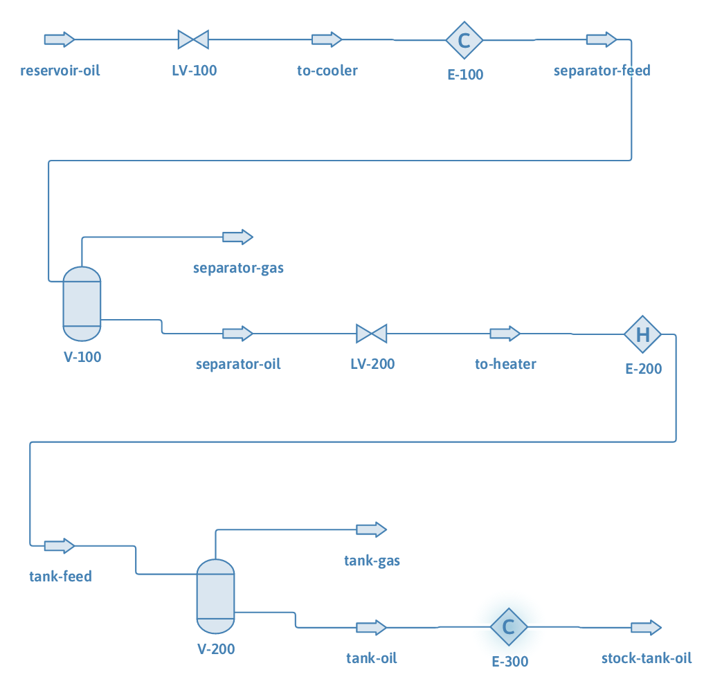
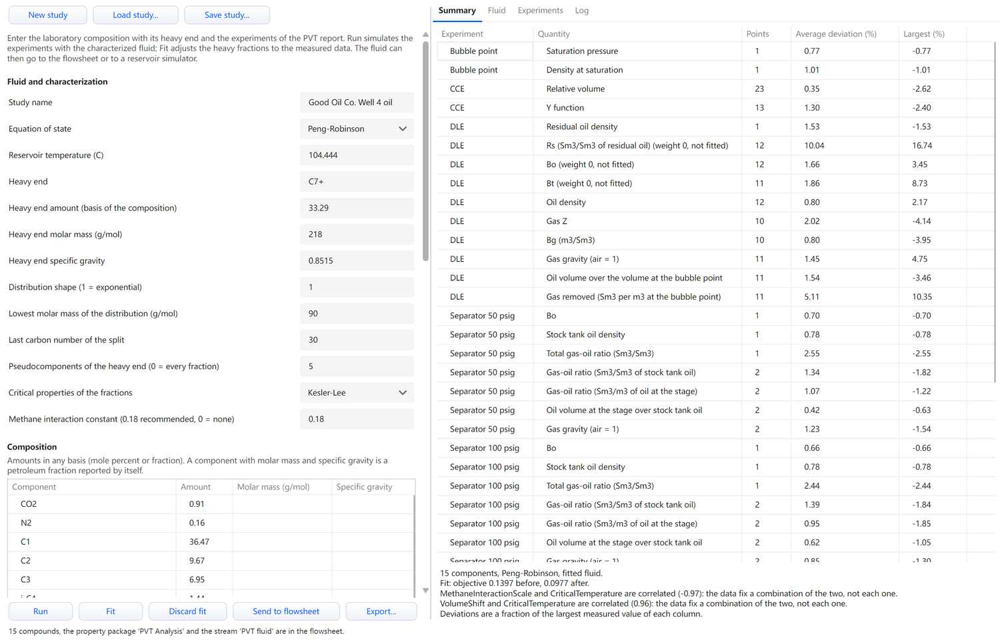
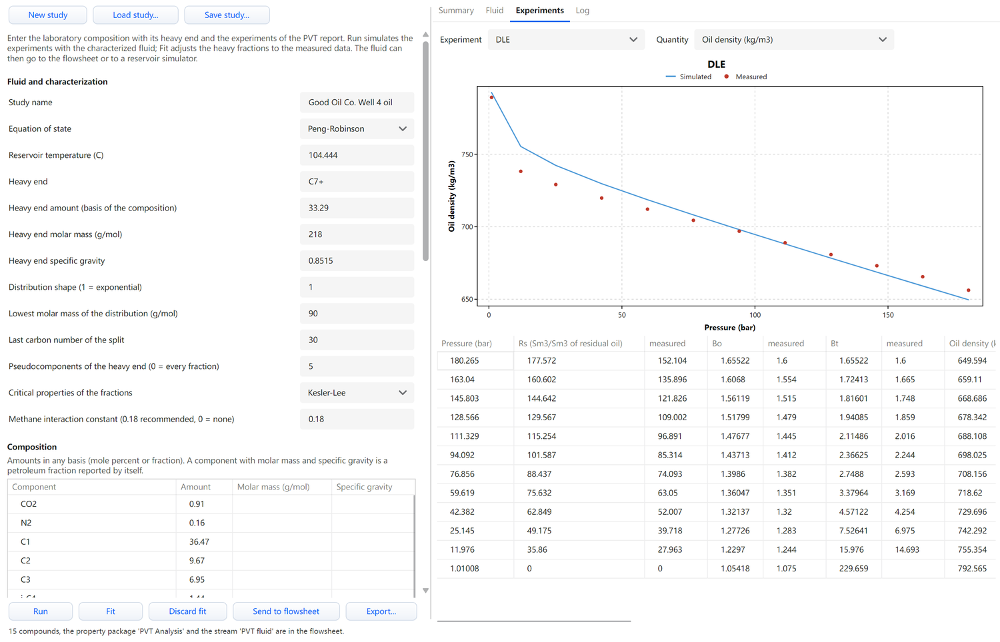

# Reservoir oil from a PVT report to a two-stage separation (PVT Analysis)

**Category:** separation-processes
**Status:** community
**DWSIM version:** 10.2.17 or later
**DWSIM edition:** the flowsheet opens in any edition; the PVT Analysis tool that produced its fluid belongs to the Patreon Edition
**Language:** English
**Contributor:** Daniel Wagner Oliveira de Medeiros (@DanWBR)

> **Requirement.** The flowsheet uses only the Peng-Robinson property package and petroleum pseudocomponents, so it opens and solves in the open-source DWSIM. The study file `reservoir-oil-pvt-two-stage-separation.dwpvt` is read by **Tools > PVT Analysis**, a tool of DWSIM Patreon. Its window opens for anyone; running, fitting and exporting need membership level 2.

## Summary

A black oil is taken from its laboratory PVT report to a process flowsheet. The PVT Analysis tool splits the C7+ fraction of the reported composition, simulates the experiments of the report (bubble point, constant composition expansion, differential liberation and four separator tests), fits three parameters of the heavy fractions to the measured data and sends the fluid to the flowsheet as compounds, a property package and a stream.

The flowsheet then repeats one of the separator tests with ordinary unit operations: the reservoir oil is let down and cooled to a separator at 100 psig and 75 °F, and the separator oil goes to a stock tank at atmospheric pressure. The gas-oil ratios read from the solved streams are the ones the tool computes for the same test (133.5 Sm³/Sm³ in total) and stay within 2.4 % of the laboratory value (136.8 Sm³/Sm³).

## Process description

| Tag | Equipment | Duty |
|---|---|---|
| reservoir-oil | feed | the fitted fluid at 104.4 °C and 185.3 bar, 5 bar above its bubble point |
| LV-100, E-100 | valve and cooler | to the separator conditions: 7.91 bar (100 psig) and 23.9 °C (75 °F) |
| V-100 | separator | first stage: `separator-gas` and `separator-oil` |
| LV-200, E-200 | valve and heater | to the stock tank conditions: 1.013 bar and 23.9 °C |
| V-200 | separator | stock tank: `tank-gas` and `tank-oil` |
| E-300 | cooler | stock tank oil at 15.56 °C (60 °F), where its volume is reported |

The heater E-200 is there because the laboratory holds the tank at 75 °F: the oil cools when it flashes to atmospheric pressure.

## Feed and operating conditions

Composition of the reservoir oil as reported (mole percent):

| CO₂ | N₂ | C1 | C2 | C3 | i-C4 | n-C4 | i-C5 | n-C5 | C6 | C7+ |
|---|---|---|---|---|---|---|---|---|---|---|
| 0.91 | 0.16 | 36.47 | 9.67 | 6.95 | 1.44 | 3.93 | 1.44 | 1.41 | 4.33 | 33.29 |

| Item | Value | Unit |
|---|---|---|
| C7+ molar mass | 218 | g/mol |
| C7+ specific gravity | 0.8515 | |
| Reservoir temperature | 104.4 (220 °F) | °C |
| Measured bubble point | 181.7 (2620 psig) | bar |
| Feed flow in the flowsheet | 100 | mol/s |

## Thermodynamics

- **Property package:** Peng-Robinson with volume translation, tagged `PVT Analysis`.
- **Why this package:** a cubic equation of state with a characterized heavy end is the usual model for reservoir fluids, and it is the model reservoir simulators take. The volume translation corrects the liquid density, which a cubic equation alone misses by several percent.
- **Heavy end:** the C7+ fraction follows a gamma distribution of molar mass (shape 1, lowest molar mass 90 g/mol) split in fractions of one carbon number up to C30+, with Søreide specific gravities and boiling points and Kesler-Lee critical properties. The fractions are lumped in five pseudocomponents: C7-11, C12-15, C16-21, C22-29 and C30+.
- **Interaction parameters:** methane with the heavy fractions by the modified Chueh-Prausnitz rule, N₂ and CO₂ with the hydrocarbons from the usual table. The tool writes every pair in the property package of the flowsheet.

## The fit

Three multipliers of the five pseudocomponents were fitted to 148 measured values, with weight 5 on the bubble point, 3 on the densities and zero on the solution gas-oil ratio, Bo and Bt of the differential liberation (they repeat the oil volume and the gas removed, on the basis of a residual oil the last stage does not measure well).

| Variable | Fitted value |
|---|---|
| Methane interaction parameters (multiplier) | 1.136 |
| Volume translation of the heavy fractions (multiplier) | 1.009 |
| Tc of the heavy fractions (multiplier) | 1.007 |

| Measured quantity | Before the fit | After the fit |
|---|---|---|
| Bubble point | 3.9 % low | 0.8 % low |
| Density at the bubble point | 1.0 % | 1.0 % |
| Expansion: relative volume | 0.5 % | 0.4 % |
| Liberation: oil volume | 1.6 % | 1.5 % |
| Liberation: gas removed | 4.8 % | 5.1 % |
| Liberation: oil density | 1.0 % | 0.8 % |
| Liberation: gas Z | 2.0 % | 2.0 % |

The figures are average absolute deviations as a fraction of the largest measured value of each column. The fit moves the bubble point and leaves the rest about where it was, with multipliers close to 1: the characterization was already near the data. The tool reports that the methane interaction multiplier and Tc are correlated (-0.97), so the data fix a combination of the two.

Oil density of the differential liberation, simulated and measured:

## Running the case

1. Open `reservoir-oil-pvt-two-stage-separation.dwxmz`. The flowsheet is solved as saved.
2. In DWSIM Patreon, open **Tools > PVT Analysis**. The study next to the flowsheet (same name, extension `.dwpvt`) is loaded with the composition, the experiments and the fitted fluid.
3. **Run** simulates the experiments with the fitted fluid. **Discard fit** followed by **Run** shows the characterization before the fit, and **Fit** repeats the regression.
4. **Send to flowsheet** writes the compounds, the property package `PVT Analysis` and a stream `PVT fluid` with the fluid at reservoir conditions. Sending again updates the same compounds and package, so `reservoir-oil` follows a new fit.
5. **Export...** writes the fluid for a reservoir simulator: compositional keywords, black-oil tables (PVTO, PVTG, PVTW), and a report of the study.

## Results

Separator test at 100 psig and 75 °F, stock tank at 75 °F:

| Quantity | Laboratory | PVT Analysis | Flowsheet |
|---|---|---|---|
| Separator gas-oil ratio (Sm³/Sm³ of stock tank oil) | 120.4 | 119.3 | 119.3 |
| Tank gas-oil ratio (Sm³/Sm³ of stock tank oil) | 16.4 | 14.2 | 14.2 |
| Total gas-oil ratio (Sm³/Sm³) | 136.8 | 133.5 | 133.5 |
| Stock tank oil density at 60 °F (kg/m³) | 820.9 | 814.5 | 814.6 |
| Bo at the bubble point | 1.474 | 1.464 | |
| Volume of the feed over stock tank oil volume | | | 1.462 |

The tool computes the test with its own flash and the flowsheet with the flash and the unit operations of DWSIM; the two give the same answer, which is the check that the fluid arrived in the flowsheet as it was fitted. The feed of the flowsheet is 5 bar above the bubble point, so its volume ratio (1.462) is a little below Bo at the bubble point (1.464).

In the flowsheet 49.5 % of the feed moles leave V-100 as gas and 11.6 % of the separator oil leaves V-200 as gas.

## Tuning and convergence notes

- **Fit three variables:** with the critical pressure of the fractions also free, the volume translation ran to its upper limit and the tool reported the two as correlated (-0.96). Density data alone do not separate them, so the critical pressure stayed out.
- **Weights:** with every measured value at weight 1, the single bubble point counts as one value in 148 and the fit hardly moves it. The weights above are the ones a new experiment starts with in the tool.
- **Tank gas:** the tank gas-oil ratio is the least accurate figure (14.2 against 16.4 Sm³/Sm³). It is a small volume of rich gas and depends on the intermediate components, which the fit does not touch.

## Files

- `reservoir-oil-pvt-two-stage-separation.dwxmz` - the DWSIM flowsheet.
- `reservoir-oil-pvt-two-stage-separation.dwpvt` - the study of the PVT Analysis tool: composition, experiments with the measured tables, weights and the fitted fluid.
- `reservoir-oil-pvt-two-stage-separation.png`, `pvt-analysis-*.png` - the figures above.

## Confidentiality

The fluid is the oil of the example PVT report in a published textbook (see the reference). It is not data from a client, a project or an operating field.

## References

- C. H. Whitson and M. R. Brulé, *Phase Behavior*, SPE Monograph 20, Society of Petroleum Engineers, 2000. Chapter 6, the example report of the oil of well 4 (composition, constant composition expansion, differential liberation and separator tests), and chapters 4 and 5 for the equation of state and the characterization of the heavy end.
- DWSIM User Guide, PVT Analysis.
