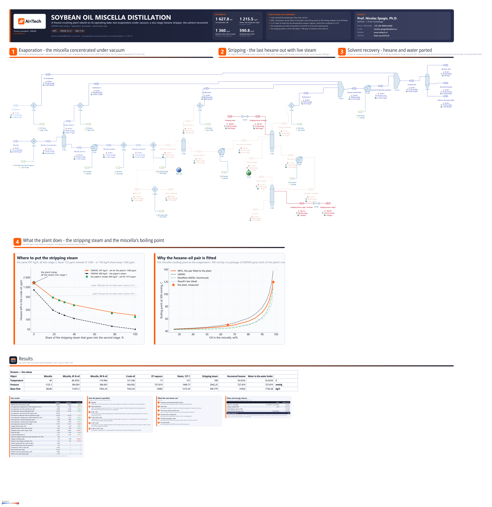

# Soybean oil miscella distillation - the evaporators and the hexane stripper of a crushing plant

**Category:** separation-processes
**Status:** community
**DWSIM version:** 10.2.13
**DWSIM edition:** open source
**Language:** English
**Contributor:** Prof. Nicolas Spogis, Ph.D. (@Spogis), AI4Tech · nicolas.spogis@ai4tech.ai · www.ai4tech.ai

## Summary

Hexane extracts the oil from flaked soybeans. What leaves the extractor, the miscella, is a solution of about a
quarter oil in hexane, and distilling it gives the crude oil and the solvent back:

- two evaporators under vacuum, the first heated by the vapours of the desolventizer-toaster, which costs nothing, the
  second by steam;
- a stripper in which live steam takes out the last of the hexane. What hexane is left in the oil sets its flash point.

This case rebuilds the miscella distillation of a soybean crushing plant in Paraná, Brazil, from the operating data
Paraíso, Andrade & Zemp published in two open papers (2003, 2005): every stream that enters, every outlet the plant
holds, and what the plant measured at each step. The model is then asked what the papers studied: where the stripping
steam should go. Into the second stage instead of the first, it gives the plant's oil with much less steam.

## Process description

The miscella from the extractor, at 26 wt% oil, enters the first evaporator (E-101, V-101) at 300 mmHg. The vapours
of the desolventizer-toaster - hexane with some water, from the meal - heat it, and most of its hexane boils off: the
miscella leaves at 65 % oil. It is pumped (P-101), preheated to 59 C (E-102) and boiled again in the second
evaporator (E-103, V-102), on steam at 127 C, to 98 % oil.

The stripper finishes the job. Its two stages (V-201, V-202) work counter-current at 470 and 560 mmHg: the oil flows
down, live steam at 180 C enters - in the plant, into the first stage only - and the vapour of the second stage rises
into the first (R-201). The crude oil leaves the second stage with 1360 ppm of hexane.

All the hexane vapours, and the desolventizer-toaster's once they have heated the first evaporator, are condensed at
35 C (E-104 to E-107). The vacuum condensates are mixed and pumped (M-102, P-103), join the desolventizer-toaster's
(M-101) and reach a decanter (V-301), which parts the hexane, back to the extractor, from the water, to the water
boiler.

## Feed and operating conditions

| Item | Value | Unit | Notes |
|---|---|---|---|
| Miscella | 28,240 | kg/h | 26 wt% oil, 49 C; Paraíso et al. (2003), Table 1 |
| Desolventizer-toaster vapours | 12,083 | kg/h | 71 C, saturated; 9.6 wt% water, from the paper's 124 kcal/kg latent heat |
| 1st evaporator | 300 mmHg | | the miscella leaves at 65 % oil; Table 1 |
| Preheater | 59 | C | Table 1 |
| 2nd evaporator | 300 mmHg | | steam at 127 C; the miscella leaves at 98 % oil and 119.8 C; Table 1 |
| Stripper | 470 and 560 | mmHg | two stages; Paraíso et al. (2005), Table 2 |
| Live steam | 180 C, 4 kgf/cm2 | | into the first stage, the plant's practice; Table 2 |
| Residual hexane in the crude oil | 1360 | ppm | Table 2; the stripping steam is set for it |
| Condensers | 35 | C | assumed; the papers stop at the stripper |

## Thermodynamics

- **Property package:** NRTL, with soybean oil as trilinolein, its main triglyceride.
- **Why a fitted pair:** the evaporators boil the miscella at 300 mmHg, and the plant measured the boiling point twice:
  50.0 C at 65 % oil, 119.8 C at 98 %. No package of DWSIM gives both. UNIFAC is right at 65 % and 18 K high at
  98 %; Modified UNIFAC (Dortmund) is 5 and 9 K low; Raoult's law is 22 K low at 98 %. A triglyceride is ten times
  hexane's size, and how much that lowers hexane's activity in the oil is what the predictive models do not agree on.
- **The hexane-oil pair:** fitted to those two boiling points by the build script (alpha 0.3): 48.4 C and 119.9 C.
  The figure *Why the hexane-oil pair is fitted* shows the curves. Every flash then uses the plant's own equilibrium.
- **The steam:** inert to the oil, as in the papers' model. DWSIM holds no oil-water pair and estimates none: the
  empty pair - ideal mixing - dissolved 1.6 % of water in the crude oil, so the case sets one that keeps it out.
- **Hexane and water:** DWSIM's estimate from UNIFAC. It finds the decanter's two liquids by itself. It puts 0.2 %
  of hexane in the water, more than hexane's real solubility, which is of the order of 10 ppm.

## Tuning and convergence notes

- **The evaporators are held by their boiling points.** A heater given its outlet vapour fraction missed it here: asked
  for 0.814, it returned 0.787 at 99 C, where the miscella has to reach 120 C to leave at 98 % oil. Given the boiling
  point of the miscella it has to leave as - computed by DWSIM at the plant's concentration - it leaves at exactly the
  plant's 65 and 98 %.
- **The desolventizer-toaster's vapours are condensed in one step.** Hexane and water condense together on a plateau:
  at constant temperature, as a heteroazeotrope. A cooler given its duty returned an outlet whose enthalpy did not
  match it, by 1.2 MW of 1.6, on every flash setting tried, VLLE and immiscible water among them. The vapours are
  drawn as heating the first evaporator through its energy stream and then condensing in E-107, held at 35 C, which is
  a well-defined state. How much they condense in the evaporator is measured apart, with vapour-fraction flashes.
- **The stripper's stages are adiabatic flashes.** A separator given a fixed pressure asked for an energy stream, and
  put 46 kW into it on a stage that has none. Here the stages take the lowest pressure of their inlets: the steam is
  let down to each stage's pressure (SV-201, SV-202), and the oil is pumped from the first stage's 470 mmHg to the
  second's 560 (P-201).
- **The stripping steam is set for the plant's 1360 ppm** by the build script, a secant on the steam. The second
  stage's steam is closed at 1 kg/h: a stream needs a flow.
- **The file solves in a few seconds** from its saved state.

## Results

Measured on the flowsheet as saved, reloaded and solved again. The plant's numbers are from Paraíso et al. (2003,
2005); where the plant did not measure, the papers' own model is the reference, and the note says so.

| Quantity | DWSIM | Reference | Reference source | Rel. error |
|---|---|---|---|---|
| Miscella from the extractor, kg/h | 28 240 | 28 240 | Paraíso et al. (2003) Table 1 | 0.00 % |
| 1st evaporator: boiling point at 300 mmHg, 65 % oil, C | 48.4 | 50.0 | Paraíso et al. (2003) Table 1 | −0.51 % |
| 1st evaporator: oil in the miscella out, wt% | 64.99 | 65.00 | Paraíso et al. (2003) Table 1 | −0.01 % |
| 1st evaporator: hexane evaporated, kg/h | 16 943 | 16 950 | Paraíso et al. (2003) Table 1 | −0.04 % |
| 1st evaporator: heat from the DT vapours, kW | 1 627.8 | — | — | — |
| DT vapours condensed in the 1st evaporator, kg/h | 10 290 | 10 429 | Paraíso et al. (2003) Table 2 | −1.33 % |
| 2nd evaporator: boiling point at 300 mmHg, 98 % oil, C | 119.9 | 119.8 | Paraíso et al. (2003) Table 1 | +0.03 % |
| 2nd evaporator: hexane evaporated, kg/h | 3 805 | 3 800 | Paraíso et al. (2003) Table 1 | +0.13 % |
| 2nd evaporator: miscella to the stripper, kg/h | 7 492 | 7 490 | Paraíso et al. (2005) Table 2 | +0.03 % |
| 2nd evaporator: steam at 127 C, kg/h | 1 215.5 | 1 357.3 | Paraíso et al. (2003) Table 2 | −10.44 % |
| Stripper feed: hexane, wt% | 2.00 | 2.00 | Paraíso et al. (2005) Table 2 | 0.00 % |
| Residual hexane in the crude oil, ppm | 1 360 | 1 360 | Paraíso et al. (2005) Table 2 | +0.01 % |
| Stripping steam, all into stage 1, kg/h | 590.8 | 960.0 | Paraíso et al. (2005) Table 3 | −38.46 % |
| Crude oil, kg/h | 7 353 | 7 345 | Paraíso et al. (2005) Table 2 | +0.10 % |
| Crude oil temperature, C | 121.5 | 114.0 | Paraíso et al. (2005) Table 2 | +1.95 % |
| Heat the stripper would lose to give the plant's 114 C, kW | 32.6 | — | the crude oil cooled from its temperature at its pressure | — |
| Stripper overhead, kg/h | 732 | 1 100 | Paraíso et al. (2005) Table 3 | −33.49 % |
| Hexane in the stripper overhead, wt% | 19.1 | 12.6 | Paraíso et al. (2005) Table 3 | +51.71 % |
| Hexane leaving with the crude oil, kg/h | 10.00 | — | — | — |
| Crude oil flash point, from its hexane, C | 107 | — | the 2005 paper's Table 1, interpolated | — |
| Condensers E-104 to E-107, kW | 4 841 | — | E-107 includes the heat the DT vapours give the 1st evaporator | — |
| Recovered hexane, kg/h | 31 832 | — | — | — |
| Hexane in the recovered hexane, wt% | 99.94 | — | — | — |
| Water to the water boiler, kg/h | 1 730 | — | — | — |

### Where to put the stripping steam

The 2005 paper's study (Section 3.3): the same steam, split between the two stages. The plant puts it all into the
first, because its operators fear water in the oil at the bottom. Into the second stage, it meets the oil when it has
least hexane left to lose, where the vapour that strips it is cleanest.

| Steam into stage 2 | DWSIM at 591 kg/h, ppm | DWSIM at 960 kg/h, ppm | the paper at 960 kg/h, ppm | Hexane lost at 591 kg/h, kg/h | Crude oil at 591 kg/h, C |
|---|---|---|---|---|---|
| 0 % | 1362 | 826 | 1413 | 10.02 | 121.5 |
| 19 % | 480 | 196 | 479 | 3.52 | 121.5 |
| 25 % | 396 | 157 | 393 | 2.91 | 121.5 |
| 30 % | 347 | 135 | 342 | 2.55 | 121.5 |
| 40 % | 283 | 108 | 276 | 2.08 | 121.5 |
| 77 % | 167 | 62 | 156 | 1.23 | 121.6 |
| 100 % | 135 | 50 | 120 | 0.99 | 121.7 |

All the steam into the second stage gives the plant's 1360 ppm with **156 kg/h**, against 591 kg/h into the first: 74 % less steam.

With its steam set for the plant's oil - all of it into the first stage, 1360 ppm - DWSIM's split study lands on the
paper's - within 4 % of its residual hexane up to 40 % of the steam in the second stage, 7 to 13 % above it beyond -
though DWSIM needs less steam for it than the paper's model, 591 against 960 kg/h. Steam into the second stage meets the oil where it has the least hexane
left, and the vapour that leaves the second stage still strips the feed in the first: the two stages work
counter-current, instead of one.

### Why DWSIM needs less steam than the paper's model

With all its steam in the first stage the stripper is one equilibrium stage - in the paper's model as in DWSIM - and
one stage's steam rests on a single number: hexane's partial pressure p over the oil that leaves it. The vapour carries
the hexane stripped, H, at p out of the stage's 470 mmHg, so S = H (P/p - 1). The build computes it both ways.

| One equilibrium stage at 470 mmHg | Oil, C | Hexane in the oil, ppm | Hexane over the oil, mmHg | Steam, kg/h | The model's own, kg/h |
|---|---|---|---|---|---|
| The paper's model, feed at 2.0 % hexane: γ 1.24 | 113.6 | 1413 | 13.86 | 960 | 960 (its Table 3) |
| The paper's model, feed at 1.2 % hexane: γ 1.24 | 115.7 | 1394 | 14.37 | 523 | 522 (its Table 4) |
| The paper's model with the plant's γ, 1.71 | 113.6 | 1413 | 19.06 | 690 | - |
| The same at DWSIM's stage temperature | 121.5 | 1360 | 22.04 | 594 | - |
| DWSIM at the plant's 114 C | 114.0 | 1360 | 19.01 | 694 | - |
| DWSIM at its own stage temperature | 121.5 | 1360 | 23.15 | 564 | 591 (the flowsheet) |

The paper's 960 kg/h is its own equilibrium, reproduced: K = γ P0/P, with γ held at 1.24 along the column (obtained
as in the 2003 paper, by UNIFAC), the papers' Antoine equation for P0, and the oil counted at 265.2 g/mol - the 2003
paper's value; the 2005 paper prints 795.6, three times it, but its tables follow from 265.2. Two of its inputs
differ from DWSIM's, and with both changed its own equations give DWSIM's answer: 594 kg/h, the flowsheet's 591.

- **How volatile the last hexane is.** The paper holds γ at 1.24 along the column. Read the same way, the plant's
  second evaporator - 2 % of hexane boiling at 119.8 C under 300 mmHg - needs 1.71, and DWSIM's hexane-oil pair is
  fitted to that evaporator: at the same temperature the paper's equations then need 690 kg/h, DWSIM 694.
- **The stage's temperature.** Both models are adiabatic. At the paper's own 960 kg/h DWSIM's oil leaves at
  123.8 C, 4 K warmer than it came in - steam superheated to 180 C gives up more heat than the hexane takes to boil
  off - and the paper's at 113.6 C, 6 K colder, which its own assumptions do not give; the plant's 114 C is a
  measurement, and includes whatever its stripper loses. At DWSIM's 121.5 C hexane is about a fifth more volatile.

The plant did not measure its steam, and its reading of the second evaporator is not fine enough to settle the
number: at 97.5 % oil instead of 98 % the plant's γ would be 1.38 and one stage at 121.5 C would need 742 kg/h; at
98.5 %, 2.25 and 443 kg/h.

### What does not match, and why

- **The crude oil's temperature.** The plant's oil leaves the stripper 6 K cooler than it enters; the model's leaves
  slightly warmer, because its stages are adiabatic and the live steam is superheated to 180 C. The heat the stripper
  would have to lose for the plant's 114 C is in the Results table: a few tens of kW, for a vessel at 120 C.
- **The stripping steam: 591 kg/h against the paper's 960.** Not a difference of structure - both are one
  equilibrium stage - but of hexane's volatility at a thousand ppm, the paper's constant UNIFAC activity coefficient
  against the plant's second evaporator, and of the stage's temperature: the section above. The flowsheet needs 5 %
  more steam than its one stage by hand, 591 against 564 kg/h; where the 5 % comes from was not traced.
- **The second evaporator's steam: 1216 kg/h against the paper's 1357.** Both evaporate the same hexane, within 2 %
  (DWSIM 3805 kg/h, the paper's model 3865). The paper's enthalpies are constant heat capacities and hexane's heat of
  vaporization at the evaporator's pressure (its equations 5 to 8), DWSIM's the compounds' own; how the 10 % divides
  between them was not measured.

## Files

- `soybean-oil-miscella-distillation.dwxmz` - the DWSIM flowsheet, with AI4Tech's title block.
- `soybean-oil-miscella-distillation.png` - the flowsheet as DWSIM draws it, with the study's figure and the boiling
  points against the plant.

## Confidentiality

Everything in the case is public: the plant's operating data are from two open papers, which name the cooperative
that provided them, and the model's other numbers are stated assumptions. No client is in it. The contributor's
contact is in the flowsheet's title block with the maintainer's agreement.

## References

- Paraíso, P. R.; Andrade, C. M. G.; Zemp, R. J. (2003). *Destilação da micela I: modelagem e simulação da
  evaporação do hexano.* Ciência e Tecnologia de Alimentos 23(3), 459-467. doi:10.1590/S0101-20612003000300028
- Paraíso, P. R.; Andrade, C. M. G.; Zemp, R. J. (2005). *Destilação da miscela II: modelagem e simulação do
  stripping do hexano.* Ciência e Tecnologia de Alimentos 25(1), 37-44.
